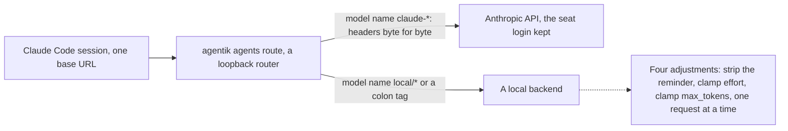

# agentik-agents

agentik-agents routes delegated work to one of three lanes: headless runs billed to an API key, the interactive subscription seat, and a local model behind a loopback router. It exists because delegated work billed in two currencies that nobody summed, delegated runs failed quietly while billing in full, and a Claude Code session reaches one API endpoint, so a local model could not serve subagents without a proxy.[^readme][^design01] Every measurement in the repo comes from one owner's laptop, one model family and small tasks, and the repo records no case of the local lane keeping the seat under a usage window.[^design01] Everything on this page is the repo's record at commit 78ce312 unless marked otherwise.

## The problem, as the repo records it

- Three currencies, no common ledger. API spend is real dollars from a usage log; seat work is priced at list rates as equivalent dollars; the local lane is zero dollars with tokens and wall time. The README states one undated pair: 3.13 dollars of API spend beside 155.78 of seat-absorbed work.[^readme]
- Delegation fails quietly and bills. Three of four delegates that tried a denied tool returned a schema-valid placeholder after full cost, one of them 2.15 dollars over 14 turns. In an eight-shard review fan-out two shards ran 8 to 10 turns, cost 1.02 dollars combined, returned a placeholder, and the envelope said success; 33 percent of that fan-out's spend bought nothing. A 0.01-dollar cap overshot to 0.0117 and returned nothing. Eight shards at the default 10-dollar ceiling expose 80 dollars.[^bin][^readme]
- Containment that did not contain. `--allowedTools` pre-approves a set and restricts nothing, and a red team ran a shell command inside a read-only profile; the fix is `--tools`. A deny-list over the caller's arguments was defeated four ways and replaced by an allow-list that builds the child's arguments and sends the prompt on stdin. `Read` is not confined to `--add-dir`: a probe read a private key.[^readme]
- One endpoint per session. The local lane puts a router on loopback that decides by the request's model name, because a session cannot name a provider per agent.[^design01]
- The local model's traps, measured on 2026-09-04 on an Apple Silicon laptop with 128 GB of memory and a 27B model: an unpinned reasoning effort took 4 minutes 56 seconds on a three-line file; a token reminder defeated the backend's prompt cache, 36.0 seconds of prefill against 0.38 without it; a 54-tool agent sent about 31,000 input tokens and took 172 seconds per turn; one Ollama version returned HTTP 500 on every non-bare request.[^design01][^evidence]
- The tools' own defects. A review round on 2026-09-05 found reproducible defects on all five surfaces: a two-entry header deny list let cookies reach the local backend, a chunked body lost its model name and went upstream on the seat's credential, both plugin skills granted nothing because of a wrong front-matter key, and four stated measurements failed a check against their own logs. A reviewer's `pkill` matched its own shell and killed the production router.[^review]

## The design

| Lane | What it is | Billed to | Entry point |
|---|---|---|---|
| API-billed | Headless `claude --bare` runs through a wrapper with read-only profiles and a default 10-dollar ceiling | A Console project, in dollars | `agentik agents api`, `agentik agents fanout` |
| Subscription | Plain interactive `claude`; the cost tool prices its usage as equivalent dollars | The seat | `claude` |
| Local model | A seat session whose subagents run on a local model behind a loopback router | Nothing; tokens and wall time are logged | `agentik agents local`, `agentik agents route`, `agentik agents rig` |

- **The router.** It decides one thing, the model string in the request body. A model is local if it starts with `local/`, is in a configured list, or carries an Ollama-style tag, unless the id names Claude. Upstream requests relay every header byte for byte, which keeps the session on the seat; local requests get an allow-list of headers and the seat's credential stripped. On local routes it drops the token reminder, pins effort to low, clamps `max_tokens` to 8,192, serialises requests, and sends keep-alive pings so Claude Code's stream watchdog does not fire. The fit rule is a four-rung ladder, local for mechanical and bounded work up to the frontier model for orchestration; escalation is by the acceptance check, not by the model's confidence. Privacy is not a routing criterion anywhere in the repo.[^bin][^design01]
- **The fan-out.** `--max-budget-usd` is per process, so the fan-out holds one pool: each shard reserves before launch and settles at its actual cost, so settled plus in-flight never exceeds the budget. The per-shard ceiling is deflated by 1.35 for a measured overshoot of 1.2. A result is checked for substance under eight statuses, and the exit code is non-zero unless every shard is `ok`.[^bin][^readme]
- **The cost log.** One line per run with cost, turns, duration, cache tokens and the names of denied tools, never a prompt or a result. A price table copied from the vendor's page is checked against every bill; past a 2 percent disagreement the tool withholds the cache figure and says so.[^readme]
- **The rig.** A backends file maps `local/<name>` to a server. On 2026-09-05 a new agent shape cost 28 to 37 seconds of prefill on every backend tried, so the design's conclusion is that prefill bandwidth, not caching, governs latency, and the levers are fewer agent shapes and smaller prompts.[^design02]

The diagram follows the design's own ASCII form.[^design01]

## Alternatives the repo rejected

| Alternative | What the repo says |
|---|---|
| A gateway app with its own control plane | Capable, but a fast-moving GUI whose core value, format translation, is unneeded[^design01] |
| An existing LAN gateway as the endpoint | Would lose the seat and Remote Control[^design01] |
| Aliasing the Haiku model name to the local model | Worked, but the alias also drives Claude Code's background calls[^design01] |
| One environment variable sending every unnamed subagent local | The variable does not reach the built-in agents, and an unnamed agent carries 54 tools[^design01] |
| Read-only by `--allowedTools` | Restricted nothing; replaced by `--tools`[^readme] |
| A deny-list over arguments | Defeated four ways; an allow-list fails closed[^readme] |
| A tight per-run cap as the safe choice | A run that trips the cap returns nothing and still bills[^readme] |
| A hand-rolled parallel fan-out | No shared pool, so no aggregate ceiling[^readme] |

The record names no one-lane alternative, no hosted router, and no use of the Agent SDK; headless work goes through the CLI.[^readme]

## What part 1 says

- Seat work and API spend are separate budgets, as documented: a credential replaces the login and plan limits stop. That the usage windows are the binding limit for long sessions is unmeasured; no window hit is recorded.
- Remote Control is off under a non-Anthropic base URL, as the repo says; voice dictation is tied to keys rather than the base URL, so that claim is half right.
- Subagents continue after a denial, as documented; a placeholder returned after full cost is not described, and its cause is conjecture.
- The local speeds the repo measured sit in the range two practitioners report. No source measures tool-call accuracy for a 27B-class model.
- Routing studies route on query difficulty, none on privacy, and several routers lose to the best single model; name-only routing is neither contradicted nor shown sufficient. The vendor's advice is to sweep effort first.
- The claim that the Agent SDK is API-billed is contradicted as a blanket statement: billing follows the credential. See [Budgets, pacing and cost lanes](../field/budgets-and-lanes.md).

## What is open

- One machine, one model family, small tasks; no quality comparison between local and hosted output.[^design01]
- The launcher can orphan a router on a signal, and two routers were left running in a 200-run reproduction.[^nth]
- The cache best case of 0.38 seconds was measured with flags the launcher does not use, and one production run re-prefilled in full.[^design01]
- The README and the wrapper disagree on a profile delegate's tools: Read, Grep and Glob in one, Read alone in the other.[^readme][^bin]
- The tests target macOS; on Linux five of six failures printed platform output and one, in the API-run suite, was not investigated.[^tests]

## Sources

[^readme]: agentik-dev/agentik-agents, "README.md", commit 78ce312, <https://github.com/agentik-dev/agentik-agents/blob/78ce312/README.md>.
[^design01]: agentik-dev/agentik-agents, "design/01-local-agent-lane.md", commit 78ce312, <https://github.com/agentik-dev/agentik-agents/blob/78ce312/design/01-local-agent-lane.md>.
[^bin]: agentik-dev/agentik-agents, "bin/", the API wrapper, the router and the fan-out, commit 78ce312, <https://github.com/agentik-dev/agentik-agents/tree/78ce312/bin>.
[^evidence]: agentik-dev/agentik-agents, "design/01-local-agent-lane/", the committed logs, commit 78ce312, <https://github.com/agentik-dev/agentik-agents/tree/78ce312/design/01-local-agent-lane>.
[^review]: agentik-dev/agentik-agents, "design/03-review-2026-09.md", commit 78ce312, <https://github.com/agentik-dev/agentik-agents/blob/78ce312/design/03-review-2026-09.md>.
[^design02]: agentik-dev/agentik-agents, "design/02-local-rig.md", commit 78ce312, <https://github.com/agentik-dev/agentik-agents/blob/78ce312/design/02-local-rig.md>.
[^nth]: agentik-dev/agentik-agents, "NICE_TO_HAVE.md", commit 78ce312, <https://github.com/agentik-dev/agentik-agents/blob/78ce312/NICE_TO_HAVE.md>.
[^tests]: agentik-dev/agentik-agents, "tests/", re-run by this site on a scratch copy, 2026-10-14, commit 78ce312, <https://github.com/agentik-dev/agentik-agents/tree/78ce312/tests>.
