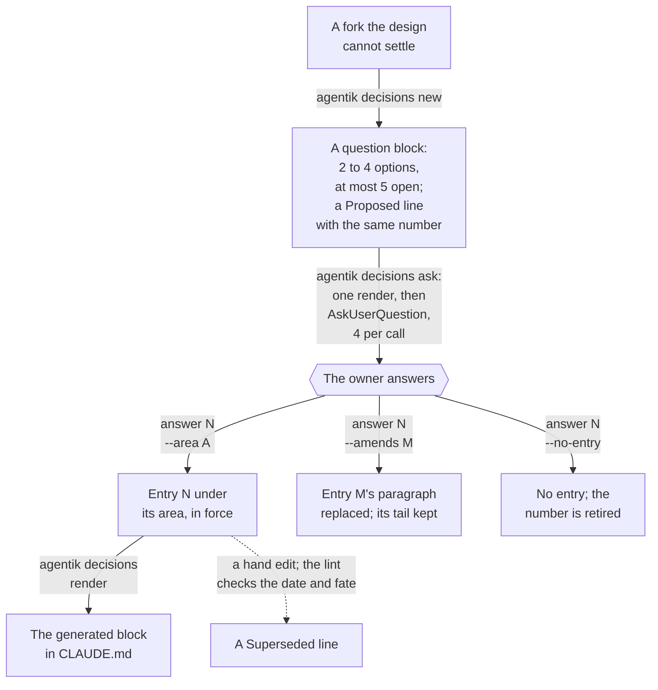

# agentik-decisions

agentik-decisions gives a repository's owner and its Claude Code sessions one short, sectioned decision ledger, `DECISIONS.md`. It caps the ledger at 25 entries in force, with at most 7 loaded on every session. It renders a small block of the ledger into CLAUDE.md and batches the owner's open questions into one ask per session. The evidence is our use, by one owner, and the benefit is unmeasured. Everything on this page is the repo's record at commit 569a120, its head on 2026-10-14, unless marked otherwise.

## The problem

You keep a record of what you and your agents decided, so that later sessions can follow it. The record grows with every session. Soon no session can read it whole, a hand-kept index falls behind, and the designs that cite the record drift from it. The journal entry [The ledger that ran away](../journal/posts/2026-10-10-the-ledger-that-ran-away.md) tells the story behind the cap.

agentik-decisions exists because its first consumer's decision log had reached that state. The repo records three parts of the failure:

- **A log too long to read, kept in sync by hand.** The log held 214 rulings in 242,404 bytes, and the longest ruling ran 13,654 bytes. The consumer's own session rules already forbade reading it whole. Its hand-kept index was 41,576 bytes long and four rulings behind, and a hand-written mirror failed its completeness test three times in four days. A conversion study counted 91 rulings in force at 103,047 bytes, about 42.5 percent of the log by our arithmetic. Those rulings carried 75 free-text scope labels, 64 of them used once.[^historydesign]
- **Decisions that drift from the design that cites them.** One day after the first design, a review found 17 decisions made since the design of record. Five of them lived only in a change log, and two only in a handover charter.[^historydesign]
- **Context cost.** The first design's model says always-loaded text costs its size times the turns, while a lookup costs an extra turn. With assumed values, inline wins below about 667 tokens.[^historydesign]

## A human example: four chunks at once

Block a person's ways to group or rehearse items, and they hold about four in mind at once. That is the argument of Nelson Cowan's 2001 review, which calls Miller's 1956 "seven, plus or minus two" a rough estimate. From nine studies of spoken-word recall with rehearsal blocked, the review derives 17 independent capacity estimates. All but one fall between three and five items; the outlier is 2.4 items. Group means run from about three to five chunks; individual people range from two to six. Miller's range appears when a person can group items through long-term memory, a limit the paper calls compound. The four-chunk figure is contested, and the paper itself names seven opposing views.[^cowan]

A second example measures an outcome. From October 2007 to September 2008, eight hospitals in eight cities introduced a 19-item surgical safety checklist. It is read at three pauses: before anaesthesia, before incision, and before the patient leaves. Among 3,733 patients before and 3,955 after, deaths fell from 1.5 to 0.8 percent and inpatient complications from 11.0 to 7.0 percent. The study compared consecutive cohorts at the same sites, without randomisation, and the list came with a programme and teamwork measures. The paper claims association, not cause.[^haynes]

conjecture Neither source measures a decision ledger. Cowan counts the items a person holds at once, not how well a person or a model uses a list it rereads. Neither paper supports a particular length, and Cowan's four is not the ledger's 7 or 25. A test would run the same task under ledgers of different lengths and count the rulings each session breaks. In agentik-decisions, the list read every time is Every session, capped at 7 entries, inside a ledger capped at 25 entries in force.

## What the research teaches

The research supports the mechanics. No source gives the caps of 25 and 7.

documented As of October 2026, the documentation supports the mechanics, as the [Memory](../field/memory.md) chapter shows. `@` imports expand at launch, and a parent CLAUDE.md loads in every repository beneath it. A skill loads its description at start and its body on use. AskUserQuestion takes 1 to 4 questions with 2 to 4 options.

On length, the measured results are narrow. The cost of a context file against none is measured, but that study did not vary length.[^gloaguen] One factorial study found no detectable effect of file size from 25 to 500 lines on one trivial rule.[^mcmillan] The decline with many instructions was measured only for keyword lists.[^ifscale] The first design's inline-versus-retrieve model left out prompt caching. On 2026-10-14, commit `f7222c3` added §8.3a, which restates the model at cache-read prices. Cache reads discount both sides alike, so the threshold holds to first order. The section adds a term for cache misses: with five-minute cache writes on Opus 5.5, two misses a sitting move the threshold from about 667 to about 575 tokens. It is still a model with assumed values.[^historydesign][^rf1] See [Memory](../field/memory.md).

The [Review that ends](../field/review.md) chapter covers the ledger's form and the questions. Compact entries, unique numbers and supersession match ADR practice. None of the ADR sources caps active records, and none compares a ledger with ADR files. Asking the owner once per session was never compared with asking as questions arise. The nearest measured result, from studies of people at work, is that an interruption at a subtask boundary costs less than one at a random moment.[^iqbal]

## The approach

Commands are written as `agentik decisions <verb>`, the form of the suite's front door, which runs the installed `agentik-<tool>`.[^commonsrecord] At commit 569a120 the package installs `agentik-decisions` and keeps the bare old name as an alias until 2026-12-31. `make install` puts the vendored `agentik` front door beside it.[^pyproject][^makefile]

### The design

- **The ledger.** Its sections are `## In force` (with `### Every session` first, then one subsection per area), `## Proposed` and `## Superseded`. An entry in force is one line: a number, a bold title, a paragraph, and a dated tail naming its source. Numbers are unique and never reused. Agents draft; only the owner's answer moves a question into force.[^readme][^d18]
- **The caps.** A ledger may hold at most 25 entries in force and 7 under Every session. `render --lint` enforces both caps and exits 1 at a 26th or an 8th; tests pin both edges.[^d17][^tests] The caps count entries, not bytes. On 2026-10-14, commit `ba78699` recorded both in d17 and in a comment in `ledger.py` as rulings, not measurements: the owner set them on 2026-09-25 in the owner's home-infrastructure ledger. d17 says no outside source gives either number. As the nearest evidence it names the instruction-count study above, in this site's reading, and Anthropic's advice to keep a CLAUDE.md under 200 lines.[^d17][^src][^rf1]
- **The generated block.** `agentik decisions render` writes the Every session entries in full and one title line for each other entry in force. The block sits between two markers in the CLAUDE.md beside the ledger. `render --check` fails a repo's check when the block is stale.[^src][^tests][^makefile]
- **Owner questions.** `new` writes a four-part question with two to four options, the first recommended, and refuses a sixth open question. The skill's rule is to ask once per session; the code does not enforce it. `ask` renders the open questions through respeak when respeak is installed. It prints AskUserQuestion calls of at most four questions each. `answer N` records the answer as a new entry, as an amendment of an existing one, or with no entry. It works under a lock and writes both files or neither, then rewrites the block where the markers exist.[^d18][^plugin][^src]
- **`backlog` and `doctor`.** `backlog` places each repo's `NICE_TO_HAVE.md` items against its `HANDOFF.md` build order. S1 (harm) and S2 (blocks the goal) items come first, ahead of step 1; then each open step with the items on its path. It writes nothing and runs no model. `doctor` prints one line per check.[^d23][^src]

The diagram follows the one-flow design and the code. The repo has no diagram of its own.[^d18][^src]

### Why one capped ledger

The repo moved from one file per ruling to one ledger, and it ruled out six other routes. The table gives its reason where it states one.

| Alternative | What the repo says |
|---|---|
| One file per ruling with front matter, a tag list and a generated index (the first design) | Replaced in 0.3.0 by one sectioned ledger; the packet lists what was dropped and gives no prose reason. The first design's reviews had found that "only the owner leaves proposed" held only if an agent used the verb, since a direct edit could forge a record[^d17][^reviewadv6] |
| Converting the old log by hand, or by tool | Hand conversion refused; a tool-drafted conversion was folded after its refuter round and dropped with the per-file design in 0.3.0[^historydesign][^d17] |
| `@`-importing an index | Out of scope because Claude Code expands imports at launch[^historydesign] |
| MADR's optional sections, Y-statements, log4brains, agent-authored rulings | Out of scope by name. The owner's ruling of 2026-09-22 set a direction for the first design's index generator: model it on existing ADR tooling, adr-tools' `generate toc` and a CI-checked index pattern from an earlier research note. The row records that direction, not a built feature, and 0.3.0 dropped the index with the per-file design[^historydesign][^historychangelog][^d17] |
| Per-component directories | Six of the last eight rulings bound two to five components each[^historydesign] |
| Decision content in a parent CLAUDE.md above many repos | Rejected because a parent file taxes every repo beneath it. d17 later renders a cross-repo block into a user-level CLAUDE.md. On 2026-10-14, commit `98117fc` added §9a: d17 overrides the ban for that one block only, and the cap of 7 Every session entries bounds its cost. The block also lists every other entry in force by title, so the cap of 25 bounds it too[^historydesign][^d17][^historysessions][^rf1] |
| Respeak as a dependency | It stays optional; a static include file ships instead[^d23] |

## Does it work?

our use One owner, and one public ledger of 12 entries. A check enforces the caps; nothing measures what the ledger saves a session.

The benefit is unmeasured. No token count compares a session with and without the block. The first design disclaimed such a count, and nothing in the current design states a saving.[^historydesign][^d18][^d17][^readme] The burn report that would measure the ledger's real share was specified but not built.[^historydesign]

The record holds sizes, not outcomes. On the repo's sample ledger of 1,155 bytes, the block is 563 bytes. On the relay's real ledger of 8,023 bytes, it is 984 bytes in 18 lines.[^src][^tests][^runonrelay] The tool's own repo keeps no ledger, so its own check prints that there is no block to check.[^makefile] Tests pin the cap's edge: 25 entries in force lint clean and 26 fail.[^tests] The only public ledger it has run on has 12 entries.[^readme][^runonrelay] On 2026-10-14 the repo recorded one private consumer's block with 4 Every session entries and 21 title lines, so 25 entries in force, in 7,693 bytes. From those entries it puts a block at both caps, 7 entries in full and 18 title lines, at about 12 KB at the mean entry and 19 KB at the longest, loaded in every session.[^d17] Nothing measures how sessions fare with a ledger at the cap.

## What has not worked, and what is open

Two failures came from the tool itself, and both led to changes in the code. On 2026-10-14 the repo merged fixes for findings this site raised in its first review (merge `569a120`).[^rf1]

**A cap that blocked the way back under it.** On 2026-10-11 two sittings (two Claude Code sessions) each put four questions, within the cap of five. After their branches merged, the file held eight. An answer removes one question, so the tool's answer verb would have left seven, and it refused with the line "OPEN-QUESTIONS.md:100: 7 questions open; the cap is 5". The sitting set four questions aside by hand, answered, and restored them byte for byte.[^historysessions] Through commit fabb212 the answer's post-write lint still refused on the open-question cap, and no test or backlog item named the case.[^rf1][^nth] On 2026-10-14, commit `8f9847b` dropped the cap problem from that lint and added the test `test_an_answer_over_the_cap_lowers_the_count`. Commit `b967e59` records the change in d18 §1.2. `render --lint` still reports the count.[^src][^answertests][^d18][^rf1] our use On a synthetic ledger with eight open questions, this site's run of `agentik decisions answer` exits 2 and writes nothing with the code at fabb212. With the code at 569a120 it exits 0 and leaves seven open. The new test fails against the fabb212 code and passes at the head.[^rf1] No consumer's repeat of the case is on record.

**Verbs that damaged entries.** Answering with `--amends` once dropped an earlier amendment clause. Another time, it cut an entry from 2,267 bytes to 801 while printing only "entry 29 amended". A ledger-shaped `--text` doubled the title and the tail, and the lint passed it. Each failure became a guard. An amending answer keeps the whole tail and prints the old paragraph as replaced. It refuses a paragraph under half the old length unless given a flag. The lint names a doubled title.[^packets]

Still open:

- The owner's authority is a convention, not a guard. The plugin ships no hook, and the lint checks shape, not authorship. The earlier design's reviews showed that a direct edit bypasses a verb-level rule.[^plugin][^reviewadv6]
- No verb retires an entry in force. At the cap, the only pressure is the failing lint.[^src]
- A kill between two renames leaves the ledger and the question file disagreeing.[^nth]
- `ask` may be slow: one unconfirmed sighting put it at about three minutes for two questions. It also rewords a carried question on every run.[^nth]

## From the journal

- [The ledger that ran away](../journal/posts/2026-10-10-the-ledger-that-ran-away.md): a decision ledger past 400 entries, and the cap, sign-off bar and levels that followed.

## Sources

[^historydesign]: agentik-dev/agentik-decisions, "history/design/decisions-r1.md", "history/design/review-r6.md" and "history/design/ledger-conversion-r1.md", commit 569a120, <https://github.com/agentik-dev/agentik-decisions/tree/569a120/history/design>.
[^cowan]: Nelson Cowan, "The magical number 4 in short-term memory: A reconsideration of mental storage capacity", Behavioral and Brain Sciences, February 2001, <https://www.cambridge.org/core/journals/behavioral-and-brain-sciences/article/magical-number-4-in-shortterm-memory-a-reconsideration-of-mental-storage-capacity/44023F1147D4A1D44BDC0AD226838496>.
[^haynes]: Alex B. Haynes et al., "A surgical safety checklist to reduce morbidity and mortality in a global population", New England Journal of Medicine, January 2009, <https://www.ebi.ac.uk/europepmc/webservices/rest/search?query=DOI:10.1056/NEJMsa0810119&resultType=core&format=json>.
[^gloaguen]: Gloaguen et al., "Evaluating AGENTS.md: Are Repository-Level Context Files Helpful for Coding Agents?", February 2026, <https://arxiv.org/abs/2602.11988>.
[^mcmillan]: Damon McMillan, "Instruction Adherence in Coding Agent Configuration Files: A Factorial Study of Four File-Structure Variables", May 2026, <https://arxiv.org/abs/2605.10039>.
[^ifscale]: Jaroslawicz et al., "How Many Instructions Can LLMs Follow at Once?", July 2025, <https://arxiv.org/abs/2507.11538>.
[^iqbal]: Shamsi T. Iqbal and Brian P. Bailey, "Leveraging Characteristics of Task Structure to Predict the Cost of Interruption", CHI 2006, <https://www.interruptions.net/literature/Iqbal-CHI06-p741-iqbal.pdf>.
[^pyproject]: agentik-dev/agentik-decisions, "pyproject.toml", the script entries, commit 569a120, <https://github.com/agentik-dev/agentik-decisions/blob/569a120/pyproject.toml>.
[^commonsrecord]: agentik-dev/agentik-commons, "design/agentik-r1.md", the suite record, commit e456f4b, <https://github.com/agentik-dev/agentik-commons/blob/e456f4b/design/agentik-r1.md>.
[^readme]: agentik-dev/agentik-decisions, "README.md", commit 569a120, <https://github.com/agentik-dev/agentik-decisions/blob/569a120/README.md>.
[^d18]: agentik-dev/agentik-decisions, "design/d18-one-flow.md", commit 569a120, <https://github.com/agentik-dev/agentik-decisions/blob/569a120/design/d18-one-flow.md>.
[^d17]: agentik-dev/agentik-decisions, "design/d17-four-verbs.md", commit 569a120, <https://github.com/agentik-dev/agentik-decisions/blob/569a120/design/d17-four-verbs.md>.
[^tests]: agentik-dev/agentik-decisions, "tests/test_ledger.py", commit 569a120, <https://github.com/agentik-dev/agentik-decisions/blob/569a120/tests/test_ledger.py>.
[^src]: agentik-dev/agentik-decisions, "src/decisions/", commit 569a120, <https://github.com/agentik-dev/agentik-decisions/tree/569a120/src/decisions>.
[^makefile]: agentik-dev/agentik-decisions, "Makefile", commit 569a120, <https://github.com/agentik-dev/agentik-decisions/blob/569a120/Makefile>.
[^plugin]: agentik-dev/agentik-decisions, "plugin/skills/decisions/SKILL.md" and "plugin/skills/ask/SKILL.md", commit 569a120, <https://github.com/agentik-dev/agentik-decisions/tree/569a120/plugin/skills>.
[^d23]: agentik-dev/agentik-decisions, "design/d23-backlog-view.md", commit 569a120, <https://github.com/agentik-dev/agentik-decisions/blob/569a120/design/d23-backlog-view.md>.
[^reviewadv6]: agentik-dev/agentik-decisions, "history/design/review-adv6.md", finding ADV6-1, commit 569a120, <https://github.com/agentik-dev/agentik-decisions/blob/569a120/history/design/review-adv6.md>.
[^historychangelog]: agentik-dev/agentik-decisions, "history/design/decisions-r1-changelog.md", row "ruled", commit 569a120, <https://github.com/agentik-dev/agentik-decisions/blob/569a120/history/design/decisions-r1-changelog.md>.
[^historysessions]: agentik-dev/agentik-decisions, "history/sessions/", the 2026-09-29 and 2026-10-11 intakes, commit 569a120, <https://github.com/agentik-dev/agentik-decisions/tree/569a120/history/sessions>.
[^runonrelay]: This site's run of agentik-decisions at commit 569a120 on a scratch copy of agentik-dev/agentik-relay's "DECISIONS.md" at commit 405d1e0, 2026-10-14, <https://github.com/agentik-dev/agentik-relay/blob/405d1e0/DECISIONS.md>.
[^answertests]: agentik-dev/agentik-decisions, "tests/test_answer.py", commit 569a120, <https://github.com/agentik-dev/agentik-decisions/blob/569a120/tests/test_answer.py>.
[^nth]: agentik-dev/agentik-decisions, "NICE_TO_HAVE.md", commit 569a120, <https://github.com/agentik-dev/agentik-decisions/blob/569a120/NICE_TO_HAVE.md>.
[^packets]: agentik-dev/agentik-decisions, "design/packets/", packets d19, d21 and d22, commit 569a120, <https://github.com/agentik-dev/agentik-decisions/tree/569a120/design/packets>.
[^rf1]: agentik-dev/agentik-decisions, the merge "rf1-research-fixes" and its commits 8f9847b to b967e59, commit 569a120, <https://github.com/agentik-dev/agentik-decisions/compare/fabb212...569a120>.
