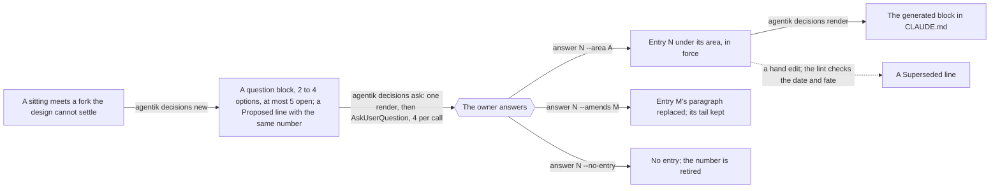

# agentik-decisions

agentik-decisions keeps one sectioned `DECISIONS.md` per repository, caps it at 25 entries in force with at most 7 loaded on every session, renders a small block of it into CLAUDE.md, and batches the owner's open questions into one ask per session. It exists because the first consumer's decision log had grown to 242,404 bytes holding 214 rulings, with a hand-kept index 41,576 bytes long and four rulings behind, and a hand-written mirror that failed its completeness test three times in four days.[^historydesign] The benefit is unmeasured: no token count compares a session with and without the block; the first design disclaimed one, and nothing in the current design states a saving.[^historydesign] Everything on this page is the repo's record at commit 80d59eb unless marked otherwise.

## The problem, as the repo records it

- A decision log too long to read, kept in sync by hand. 242,404 bytes, 214 rulings, the longest 13,654 bytes; the consumer's own session rules already forbade reading it whole. A conversion study counted 91 rulings in force at 103,047 bytes, about 42.5 percent of the log by our arithmetic, with 75 free-text scope labels among them, 64 used once.[^historydesign]
- Decisions that drift between the record and the design that cites them. One day after the first design, a review found 17 decisions made since the design of record, five of them living only in a change log and two only in a handover charter.[^historydesign]
- Owner questions blocked by the tool's own cap. On 2026-10-11 two sittings each put four questions the same day, within the cap of five; after their branches merged the file held eight, and the tool's answer verb refused with the line "OPEN-QUESTIONS.md:100: 7 questions open; the cap is 5". The sitting set four questions aside by hand, answered, and restored them byte for byte. By reading the code, the refusal still stands at this commit.[^historysessions][^src]
- The tool's own verbs damaged entries. Answering with `--amends` once dropped an earlier amendment clause, and once cut an entry from 2,267 bytes to 801 while printing only "entry 29 amended"; a ledger-shaped `--text` doubled the title and the tail, and the lint passed it. Each became a guard: the whole tail is kept, the old paragraph is printed as replaced, a paragraph under half the old length is refused without a flag, and the lint names a doubled title.[^packets]
- Context cost, unmeasured. The first design's model says always-loaded text costs its size times the turns while a lookup costs an extra turn, and with assumed values inline wins below about 667 tokens. The burn report that would measure the real share was specified and not built.[^historydesign]

## The design

- **The ledger.** `## In force` (with `### Every session` first, then one subsection per area), `## Proposed`, `## Superseded`. An entry in force is one line: a number, a bold title, a paragraph, and a dated tail naming its source. Numbers are unique and never reused. Only the owner's answer moves a question into force; agents draft.[^readme][^d18]
- **The caps.** At most 25 entries in force and 7 under Every session, enforced by `render --lint`, which exits 1 at a 26th or an 8th. The caps count entries, not bytes, and the repo gives no reason for 25 or 7.[^d17][^tests]
- **The generated block.** `agentik decisions render` writes, between two markers in the CLAUDE.md beside the ledger, the Every session entries in full and one title line for each other entry in force. On the repo's sample ledger of 1,155 bytes the block is 563 bytes; on the relay's real ledger of 7,995 bytes it is 984 bytes in 18 lines. `render --check` fails the repo's check when the block is stale.[^src][^tests][^runonrelay][^makefile]
- **Owner questions.** `new` writes a four-part question with two to four options, the first recommended, and refuses a sixth open question. `ask` runs once per session, renders the open questions through respeak when it is installed, and prints AskUserQuestion calls of at most four questions each. `answer N` records the answer as a new entry, as an amendment of an existing one, or with no entry, under a lock with both files written or neither, and then rewrites the block where the markers exist.[^d18][^plugin][^src]
- **`backlog` and `doctor`.** `backlog` reads each repo's open items and places the blocking ones first; it writes nothing and runs no model. `doctor` prints one line per check.[^d23][^src]

The diagram follows the one-flow design and the code; the repo has no diagram of its own.[^d18][^src]

## Alternatives the repo rejected

| Alternative | What the repo says |
|---|---|
| One file per ruling with front matter, a tag list and a generated index (the first design) | Replaced in 0.3.0 by one sectioned ledger; the packet lists what was dropped and gives no prose reason. The first design's reviews had found that "only the owner moves a status" held only if an agent used the verb, since a direct edit could forge a record[^d17][^reviewadv6] |
| Converting the old log by hand, or by tool | Hand conversion refused; a tool-drafted conversion was folded after its refuter round and dropped with the per-file design in 0.3.0[^historydesign][^d17] |
| `@`-importing an index | Out of scope because Claude Code expands imports at launch[^historydesign] |
| MADR's optional sections, Y-statements, log4brains, agent-authored rulings | Out of scope by name; the generated-and-checked index pattern was borrowed from adr-tools[^historydesign][^historychangelog] |
| Per-component directories | Six of the last eight rulings bound two to five components each[^historydesign] |
| Decision content in a parent CLAUDE.md above many repos | Rejected because a parent file taxes every repo beneath it; the later cross-repo block in a user-level CLAUDE.md sits in tension with this[^historydesign][^historysessions] |
| Respeak as a dependency | It stays optional; a static include file ships instead[^d23] |

## What part 1 says

- The documentation supports the mechanics: `@` imports expand at launch, a parent CLAUDE.md loads in every repository beneath it, a skill loads its description at start and its body on use, AskUserQuestion takes 1 to 4 questions with 2 to 4 options. See [Memory](../field/memory.md).
- The cost of a growing always-loaded file is measured; the adherence loss is not. One factorial study found no effect of file size from 25 to 500 lines on one rule, and the measured decline with many instructions is for keyword lists. The caps of 25 and 7 are in no source.
- The inline-versus-retrieve model ignores prompt-cache pricing; cache reads discount both sides alike, so the threshold likely holds to first order, which is conjecture.
- Compact entries, unique numbers and supersession match ADR practice; none of the ADR sources caps active records, and none compares a ledger with ADR files. See [Review that ends](../field/review.md).
- Asking the owner once per session was never compared with asking as questions arise; the one measured result is that an interruption at a task boundary is cheaper than a random one.

## What is open

- The benefit is unmeasured, and the tool's own repo keeps no ledger; the only public ledger it has run on has 12 entries, so the cap has not been shown to hold at 25.[^readme][^runonrelay]
- The over-cap `answer` refusal has no fix in the code, no test name, and no backlog item.[^src][^tests]
- Authority is a manner, not a guard: the plugin ships no hook, the lint checks shape not authorship, and the earlier design's reviews showed a direct edit bypasses a verb-level rule.[^plugin][^reviewadv6]
- No verb retires an entry in force; the only pressure at the cap is the lint failing.[^src]
- A kill between two renames leaves the ledger and the question file disagreeing.[^nth]
- `ask` is slow, about three minutes for two questions by one unconfirmed sighting, and rewords a carried question on every run.[^nth]

## Sources

[^historydesign]: agentik-dev/agentik-decisions, "history/design/decisions-r1.md", "history/design/review-r6.md" and "history/design/ledger-conversion-r1.md", commit 80d59eb, <https://github.com/agentik-dev/agentik-decisions/tree/80d59eb/history/design>.
[^historysessions]: agentik-dev/agentik-decisions, "history/sessions/", the 2026-09-29 and 2026-10-11 intakes, commit 80d59eb, <https://github.com/agentik-dev/agentik-decisions/tree/80d59eb/history/sessions>.
[^src]: agentik-dev/agentik-decisions, "src/decisions/", commit 80d59eb, <https://github.com/agentik-dev/agentik-decisions/tree/80d59eb/src/decisions>.
[^packets]: agentik-dev/agentik-decisions, "design/packets/", packets d19, d21 and d22, commit 80d59eb, <https://github.com/agentik-dev/agentik-decisions/tree/80d59eb/design/packets>.
[^readme]: agentik-dev/agentik-decisions, "README.md", commit 80d59eb, <https://github.com/agentik-dev/agentik-decisions/blob/80d59eb/README.md>.
[^d18]: agentik-dev/agentik-decisions, "design/d18-one-flow.md", commit 80d59eb, <https://github.com/agentik-dev/agentik-decisions/blob/80d59eb/design/d18-one-flow.md>.
[^d17]: agentik-dev/agentik-decisions, "design/d17-four-verbs.md", commit 80d59eb, <https://github.com/agentik-dev/agentik-decisions/blob/80d59eb/design/d17-four-verbs.md>.
[^tests]: agentik-dev/agentik-decisions, "tests/test_ledger.py", commit 80d59eb, <https://github.com/agentik-dev/agentik-decisions/blob/80d59eb/tests/test_ledger.py>.
[^runonrelay]: This site's run of the tool on a scratch copy of agentik-dev/agentik-relay's "DECISIONS.md" at commit a326550, 2026-10-14, <https://github.com/agentik-dev/agentik-relay/blob/a326550/DECISIONS.md>.
[^makefile]: agentik-dev/agentik-decisions, "Makefile", commit 80d59eb, <https://github.com/agentik-dev/agentik-decisions/blob/80d59eb/Makefile>.
[^plugin]: agentik-dev/agentik-decisions, "plugin/skills/decisions/SKILL.md" and "plugin/skills/ask/SKILL.md", commit 80d59eb, <https://github.com/agentik-dev/agentik-decisions/tree/80d59eb/plugin/skills>.
[^d23]: agentik-dev/agentik-decisions, "design/d23-backlog-view.md", commit 80d59eb, <https://github.com/agentik-dev/agentik-decisions/blob/80d59eb/design/d23-backlog-view.md>.
[^nth]: agentik-dev/agentik-decisions, "NICE_TO_HAVE.md", commit 80d59eb, <https://github.com/agentik-dev/agentik-decisions/blob/80d59eb/NICE_TO_HAVE.md>.
[^reviewadv6]: agentik-dev/agentik-decisions, "history/design/review-adv6.md", finding ADV6-1, commit 80d59eb, <https://github.com/agentik-dev/agentik-decisions/blob/80d59eb/history/design/review-adv6.md>.
[^historychangelog]: agentik-dev/agentik-decisions, "history/design/decisions-r1-changelog.md", row "ruled", commit 80d59eb, <https://github.com/agentik-dev/agentik-decisions/blob/80d59eb/history/design/decisions-r1-changelog.md>.
