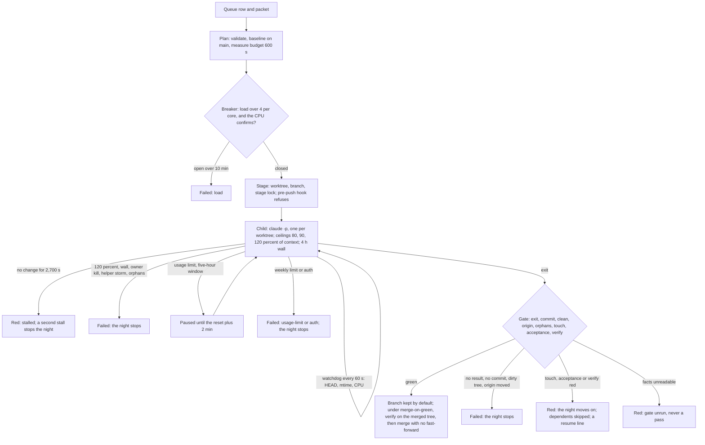

# agentik-relay

agentik-relay runs a night of queued packets while nobody watches. Each queue row gets one git worktree, one branch and one `claude -p` child, and a deterministic gate decides whether the branch merges. It is for one owner who wants planned work built overnight and read in the morning. Its evidence is our use: one owner's nights on one Mac, from 2026-09-22 to 2026-10-13. Everything on this page is that record unless marked otherwise.[^sittings][^nth]

## The problem

You queue work, start a night and walk away. Whatever goes wrong next has no person to catch it. A child can start more children, a crash can leave a lock held, a test can fail only under load, a child can stall without knowing it, a child can reach past its branch, and every row costs money. The night has to decide alone whether to stop or move on.

The relay's reviews record the cycles by which a night could fork past its means, and its ledger records what writing packets inside a night cost.[^reviews][^decisions] The repo's record, failure by failure:

- **Runaway recursion.** On 2026-09-23 a night was bounded against a fork storm. A design review counted nine cycles by which the relay could re-invoke itself. Eight were bounded; one was not: a child running `agentik relay run` would spawn grandchildren under its own worktree with the same environment. An adversarial review reproduced it, and a killed relay left two spawned processes alive. The response was a TLA+ model of the night. It keeps fork storms as violations the checker must find, four of them at the commit read.[^reviews][^packetsdir][^tla]
- **Lock contention.** The stage lock never checked its holder's pid, so a crashed relay left its row refused until a person removed the lock. The live-process probe had no timeout and took minutes under load. A shell shim held a rehash lock for 60 seconds. The one-relay-per-account guard went from a pid file to a loopback TCP port. Reviews found a child could get past the earlier forms by changing its environment, detaching, or unlinking the pid file.[^reviews][^designr1]
- **Flaky tests under load.** A test of the orphan probe failed 20 of 20 runs with its timeout cut to 3 milliseconds. The test's clock raced a fake process's start-up. The full check went red under a load of 20 on 16 cores when a hand gate started four minutes in. One package alone took 316 seconds, over half of Go's default test timeout. The load signal itself misled on a Mac with efficiency cores. A plan baseline read a load of 40.23 with 59 to 73 percent idle, and marked 8 of 9 checks unrun as loaded. The breaker proper never opened in 166 plans across five ledgers.[^sittings][^nth][^breaker]
- **A child that cannot tell it has stalled.** The design watches from outside, because the child cannot. This site's survey found no real stall recorded in the repo, so the stall rule has no tuning data. Agents also cannot count their own turns. On 2026-10-11 the adversary agent ended at its cap with no report, three times. A prompt line asking for a report by turn 70 did not help.[^designr1][^nth]
- **Cost.** One run of 183 sittings cost 653 dollars, of which 58 packet-writer sittings cost 261. Builders ran the verify line about 2.7 times a row, which took 46 percent of a night's time. A row whose gate read unrun after a bytecode file moved cost 6.79 dollars, with five acts unjudged. Two nights lost stacks of 9 and 7 dependent rows when a parent row hit its soft context ceiling one act short.[^decisions][^packetsdir][^nth][^pycache]
- **What a child can reach.** Reviewers reproduced a child moving `main` with `update-ref` and hiding touched paths behind a tag. They also reproduced a child passing a helper `claude` line that disabled hooks or set an unbounded turn count. These are reproductions on the relay's own code, not misbehaviour seen in a night.[^reviews][^designr1]

## A human example: a checklist before an irreversible step

In 2007 and 2008, a study in the World Health Organization's Safe Surgery Saves Lives program brought a 19-item checklist to eight hospitals in eight cities, from Toronto to Ifakara. The operating team reads it aloud at three points: before anaesthesia, before the skin incision, and before the patient leaves the operating room. Its items include confirming the patient's identity and the site, the antibiotic timing, and the instrument and sponge counts.[^haynes]

The study compared 3,733 patients before the checklist with 3,955 after, in the same operating rooms. Deaths in hospital fell from 1.5 to 0.8 percent, and inpatient complications from 11.0 to 7.0 percent. The study was not randomised: it compared a period before with a period after, and the authors name a secular trend and the Hawthorne effect as dangers to that design. They could not measure how closely teams kept to the briefings and debriefings. At the high-income sites the fall in deaths, from 0.9 to 0.6 percent, was not significant.[^haynes]

A checklist read by people is an analogy for a deterministic gate, not evidence for one. The relay's gate is a checklist with nobody in the room: it checks each night's row before its branch may merge.

## What the research teaches

Part 1 backs the relay's two outside checks, the watchdog and the gate. It also marks where the relay leans on engine behaviour that has holes or has changed.

**What it supports.**

- No main-session progress watchdog is documented, so the relay's outside watchdog fills a real gap.[^network] The `subagents/` transcript directory is documented.[^subagents]
- A sign-off that is a check outside the reviewer follows the measured finding that external checks beat self-judgement. See [Review that ends](../field/review.md).
- The documentation and two reported isolation leaks support one worktree per writer. The step from shared refs to lock contention is conjecture. See [Many agents](../field/many-agents.md).
- The relay times a builder's verify line against the Bash tool's 600-second cap, at 540 seconds, a tenth under it.[^designr1] That cap is the documented ceiling, and the default is 120 seconds.[^bash]

**Where it cuts against the relay.**

- The budget overshoot is documented: `--max-budget-usd` is checked after each response and is a client-side estimate. See [Unattended runs and guardrails](../field/unattended-and-guardrails.md).
- The rule that a completed `-p` run stops background work held from Claude Code 2.1.163 to 2.1.291, and not after. The relay's record names versions 2.1.263 to 2.1.296.[^changelog][^usagelimit]
- Claude Code does not strip `CLAUDE*` variables from a child; it sets `CLAUDECODE` and `CLAUDE_CODE_CHILD_SESSION` in the child. The relay strips them itself, which is a choice, not a correction of the engine.[^envvars][^designr1]
- Deny rules that match command text have documented bypasses (an absolute path, `bash -c`, `git -C`).[^permissions] A PreToolUse hook fails open on a timeout by default.[^hooks] The sandbox covers shell commands and their children only, and the relay runs without one.[^sandbox][^designr1] The relay's four recorded guard evasions (a command substitution, backticks, a variable holding the command name, `pkill -f`) are of the same kind.[^nth]

## The approach

The README states the aim: a night that fails early, never pushes, amends or rebases, and leaves a door back into every stopped sitting.[^readme] Commands on this page use the suite's planned form, `agentik relay <verb>`; at commit a326550 the Makefile still builds the binary under the bare tool name.[^makefile][^commonsrecord]

### A night, row by row

A night is one `agentik relay run`: a plan, then a loop over the queue. A row names a packet and a budget. The relay stages a worktree and a branch, starts one child in it, and runs the gate when the child exits. A green gate may merge. The night ends with a stop reason.

- **The packet.** A markdown file under 9,216 bytes with a six-row header (from, pin, wall, may touch, acceptance, budget) and six sections. Acceptance lines come from an allowlist of commands. Whole-suite lines are refused as acceptance, because the repo's verify line is the gate.[^designr1]
- **The child.** `caffeinate -i claude -p --permission-mode auto --allowedTools "Bash Edit Write MultiEdit NotebookEdit" --model <m> --max-turns <n> --max-budget-usd <x> --output-format stream-json --verbose --session-id <uuid>`, run from the worktree, with the resume line known before the first byte. Its stdin is the repo's every-session block, a rules block, one context line and the packet verbatim. Its git is fenced by a pre-push hook that refuses, a deny push URL on every remote, and PreToolUse guards. The guards read Bash through a real shell parser, adopted after three review rounds each found a shape the hand-written reader missed.[^designr1][^guardparser][^decisions]
- **The gate.** Deterministic, zero tokens, in the driver: the same function by hand and at night. It checks, in order, for a result event with no error, HEAD moved, a clean tree, origin unmoved and no orphans. Every changed path must then fall within the may-touch list. Each acceptance line then re-runs in a fresh clone at the bound sha, under a pinned environment, with a 900-second limit. Next the verify line runs. Last comes the merge, only under the `merge-on-green` policy; it first runs the verify line on the merged tree. The queue's default policy is `branch-only`, which keeps the branch for the owner.[^queue] A gate whose facts cannot be read is unrun, and an unrun gate is never a pass.[^designr1]
- **Stop reasons.** The code names thirty. A packet failure (a red gate, a stall, an unrun gate) is the builder's, and the night moves on to the next independent row. A sitting failure means the prompt or the driver is broken, and the night stops. A usage limit or an expired login kills every running row.[^code][^designr1]
- **Money.** Two layers cap it. Per row, the budget becomes the child's own `--max-budget-usd`, with defaults of 15 dollars and 100 turns. Per night, the relay compares `--max-usd` with the ledger tally before each pick. When no result event read a sitting's cost, the tally holds that sitting at its own budget, never at zero. No code kills a running sitting for the night cap, so a night can overshoot by the running rows' budgets. That is our reading of the code, not a measured overshoot.[^code][^queue]
- **The watchdog.** Every 60 seconds it samples the worktree's HEAD, the newest file time outside `.git`, and the CPU seconds of the child's process group. If all three stay unchanged for 2,700 seconds, it kills the group. The row goes red with reason stalled, and a second stall stops the night. After exit, an orphan sweep kills survivors by start time, so it never kills a reused pid.[^designr1][^code]
- **Usage limits.** The relay classifies a rate-limit event as a window, a weekly limit, a model limit or unknown. A window limit pauses the night until the reset plus two minutes. A model limit with a reset pauses only that model's rows. A weekly limit stops the night. Paused rows continue under a fresh session id rather than a resume. A row stopped by a limit had sat at 206k context, which a resume would reload with a cold cache.[^usagelimit][^decisions]
- **The morning read.** `agentik relay report` prints merged SHAs, stops verbatim, burn per sitting, branches waiting and the resume line for every red or failed row.[^readme]

### Alternatives the repo rejected

The repo records eight choices against a named alternative, each with its reason.

| Decision | Rejected alternative | The reason given |
|---|---|---|
| Packets are written before their rows | A packet-writer sitting per row | 58 of one run's 183 sittings and 261 of 653 dollars went to writing packets[^decisions] |
| The lock is a loopback TCP port | A pid file, then an ancestor rule, then `flock` | Reviews found a child could change its environment, detach, or unlink the pid file; the kernel frees a port when its holder dies, so no sitting can unlink it[^designr1] |
| The guard reads Bash through a real parser | Keep patching the hand-written reader | Three review rounds each found a shape that hid a push[^guardparser] |
| The verify limit is per repo | One fixed 900-second limit | A verify line cut at 900 seconds twice read as a failure with no failing test[^nth][^decisions] |
| A model's own limit pauses only its rows | Pause the whole night on any limit | Other models' rows can run on[^decisions] |
| Soft request at 90 percent, kill at 120 | A hard kill at 100 percent | The kill is for runaways; the share moves only on a night's recorded tune lines, never on a guess[^designr1] |
| The ledger stays out of the repo | Copy it into history at close | Decision D18: the report is the only repo write[^designr1] |
| A stalled row is red, a second stall stops the night | Every stall stops the night | A stall can be the driver's as much as the packet's[^reviews] |

## Does it work?

our use One owner's nights on one Mac, from 2026-09-22 to 2026-10-13: 132 sitting charters and 87 packets. Treat it as a record of use, not a test; nothing on this page compares the relay with another way to run a night.

The repo's record is the longest in the suite. At commit a326550 it holds the 132 sitting charters and 87 packets, and a count of the test files finds 706 test functions, against the README's 699.[^sittings][^packetsdir][^readme][^nth] Beside the tests, the record holds adversarial reviews that reproduce attacks on the relay's own code, and a TLA+ model of the night.[^reviews][^tla]

What it does not measure:

- Every incident and measurement is one owner's, on one Mac. The ledger is outside the repo, so you cannot check any aggregate of nights or dollars.[^nth]
- The night cap's overshoot is our reading of the code, not a measured overshoot (see Money, above).
- The stall rule has no tuning data, because no real stall is recorded (see below).

## What has not worked, and what is open

The failures the record holds are listed under the problem, above. The journal tells of one more night that stopped: [The probe that stopped a night](../journal/posts/2026-09-30-the-probe-that-stopped-a-night.md). What stays open:

- The relay has no sandbox. The design says a line can do anything the owner's account can until it runs in one, and the hooks stay advisory.[^designr1]
- The zsh test table for the guard parser is owed and recorded as an open risk.[^decisions]
- The 120 percent kill waits on recorded nights to tune it.[^designr1] The 25 percent idle floor is a judgment until a load sweep confirms it, and the breaker page disagrees with itself on whether that sweep has run.[^breaker]
- Usage-limit handling rests on stream fields the repo calls unpublished, and all 46 model-limit messages it measured named no reset.[^usagelimit]
- This site's survey found no real stall recorded, so the 2,700-second default has no tuning data.[^designr1]
- The README and the Makefile say the check wall is 840 seconds; the design record says 900.[^readme][^designr1]
- The child runs under `caffeinate`, a macOS command, and the load floor was tuned on a Mac with efficiency cores. The load and idle readers also have Linux paths, untested in the record.[^designr1][^breaker]

## From the journal

- [The probe that stopped a night](../journal/posts/2026-09-30-the-probe-that-stopped-a-night.md): a review agent's hand-built binary stopped a running night.
- [Living inside a usage window](../journal/posts/2026-10-14-living-inside-a-usage-window.md): pacing helpers to a five-hour window, and pausing a night at the limit.

## Sources

[^readme]: agentik-dev/agentik-relay, "README.md", commit a326550, <https://github.com/agentik-dev/agentik-relay/blob/a326550/README.md>.
[^reviews]: agentik-dev/agentik-relay, "design/review-r6.md", "design/review-adv6.md" and "design/review-adv10.md", commit a326550, <https://github.com/agentik-dev/agentik-relay/tree/a326550/design>.
[^sittings]: agentik-dev/agentik-relay, "history/sittings/", commit a326550, <https://github.com/agentik-dev/agentik-relay/tree/a326550/history/sittings>.
[^packetsdir]: agentik-dev/agentik-relay, "design/packets/", commit a326550, <https://github.com/agentik-dev/agentik-relay/tree/a326550/design/packets>.
[^tla]: agentik-dev/agentik-relay, "design/relay-r1.md", section 16, the TLA+ model, commit a326550, <https://github.com/agentik-dev/agentik-relay/blob/a326550/design/relay-r1.md>.
[^designr1]: agentik-dev/agentik-relay, "design/relay-r1.md", commit a326550, <https://github.com/agentik-dev/agentik-relay/blob/a326550/design/relay-r1.md>.
[^nth]: agentik-dev/agentik-relay, "NICE_TO_HAVE.md", commit a326550, <https://github.com/agentik-dev/agentik-relay/blob/a326550/NICE_TO_HAVE.md>.
[^breaker]: agentik-dev/agentik-relay, "design/breaker-signal-r1.md", commit a326550, <https://github.com/agentik-dev/agentik-relay/blob/a326550/design/breaker-signal-r1.md>.
[^decisions]: agentik-dev/agentik-relay, "DECISIONS.md", commit a326550, <https://github.com/agentik-dev/agentik-relay/blob/a326550/DECISIONS.md>.
[^pycache]: agentik-dev/agentik-relay, "design/pin-pycache-r1.md", commit a326550, <https://github.com/agentik-dev/agentik-relay/blob/a326550/design/pin-pycache-r1.md>.
[^guardparser]: agentik-dev/agentik-relay, "design/guard-parser-r1.md", commit a326550, <https://github.com/agentik-dev/agentik-relay/blob/a326550/design/guard-parser-r1.md>.
[^code]: agentik-dev/agentik-relay, "internal/relay/types.go", "internal/night/night.go" and "internal/night/bound.go", commit a326550, <https://github.com/agentik-dev/agentik-relay/tree/a326550/internal>.
[^queue]: agentik-dev/agentik-relay, "relay/queue.yaml", commit a326550, <https://github.com/agentik-dev/agentik-relay/blob/a326550/relay/queue.yaml>.
[^usagelimit]: agentik-dev/agentik-relay, "design/usage-limit-resume-r1.md", commit a326550, <https://github.com/agentik-dev/agentik-relay/blob/a326550/design/usage-limit-resume-r1.md>.
[^makefile]: agentik-dev/agentik-relay, "Makefile", commit a326550, <https://github.com/agentik-dev/agentik-relay/blob/a326550/Makefile>.
[^commonsrecord]: agentik-dev/agentik-commons, "design/agentik-r1.md", the suite record, commit e456f4b, <https://github.com/agentik-dev/agentik-commons/blob/e456f4b/design/agentik-r1.md>.
[^changelog]: Anthropic, "Claude Code changelog", documentation page read 2026-10-14, entries to 9 October 2026, <https://code.claude.com/docs/en/changelog>.
[^envvars]: Anthropic, "Environment variables", Claude Code documentation read 2026-10-14, <https://code.claude.com/docs/en/env-vars>.
[^bash]: Anthropic, "Tools reference", Claude Code documentation read 2026-10-14, <https://code.claude.com/docs/en/tools-reference>.
[^subagents]: Anthropic, "Create custom subagents", Claude Code documentation read 2026-10-14, <https://code.claude.com/docs/en/sub-agents>.
[^network]: Anthropic, "Enterprise network configuration", Claude Code documentation read 2026-10-14, <https://code.claude.com/docs/en/network-config>.
[^permissions]: Anthropic, "Configure permissions", Claude Code documentation read 2026-10-14, <https://code.claude.com/docs/en/permissions>.
[^hooks]: Anthropic, "Hooks reference", Claude Code documentation read 2026-10-14, <https://code.claude.com/docs/en/hooks>.
[^sandbox]: Anthropic, "Configure the sandboxed Bash tool", Claude Code documentation read 2026-10-14, <https://code.claude.com/docs/en/sandboxing>.
[^haynes]: Alex B. Haynes, Thomas G. Weiser, William R. Berry, Stuart R. Lipsitz, Atul A. Gawande and colleagues, for the Safe Surgery Saves Lives Study Group, "A Surgical Safety Checklist to Reduce Morbidity and Mortality in a Global Population", N Engl J Med 360(5):491-499, 29 January 2009, <https://dash.harvard.edu/server/api/core/bitstreams/c5287a52-75bc-4131-9262-4c598fcde8cc/content>.
