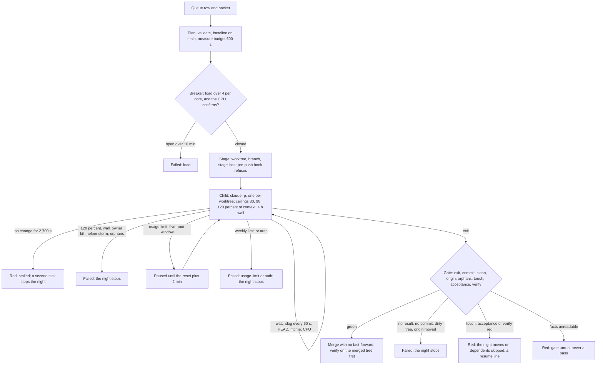

# agentik-relay

agentik-relay runs a night of queued packets while nobody watches: one git worktree, one branch and one `claude -p` child per queue row, a deterministic gate that decides whether the branch merges, thirty named stop reasons, and two layers of money cap. Its README states the aim: a night that fails early, never pushes, amends or rebases, and leaves a door back into every stopped sitting.[^readme] Its reviews record the earlier runs that forked past their means, and its ledger the packets that bought nothing.[^reviews][^decisions] The repo's record is the longest in the suite: 132 sitting charters and 87 packets at commit a326550, and 706 test functions by a count of the test files against the README's 699, all from one owner's nights on one Mac between 2026-09-22 and 2026-10-13.[^sittings][^packetsdir][^readme][^nth] Everything on this page is that record, labelled our use, unless marked otherwise.

## The problem, as the repo records it

- **Runaway recursion.** On 2026-09-23 a night was bounded against a fork storm, and a design review counted nine cycles by which the relay could re-invoke itself. Eight were bounded; one was not: a child running `agentik relay run` would spawn grandchildren under its own worktree with the same environment. An adversarial review reproduced it, and a killed relay left two spawned processes alive. The response was a TLA+ model of the night with fork storms kept as violations the checker must find, four of them at the commit read.[^reviews][^packetsdir][^tla]
- **Lock contention.** The stage lock never checked its holder's pid, so a crashed relay left its row refused until a person removed the lock; the live-process probe had no timeout and took minutes under load; a shell shim held a rehash lock for 60 seconds. The one-relay-per-account guard went from a pid file to a loopback TCP port, because a child could change its environment or detach to evade the earlier forms.[^reviews][^designr1]
- **Flaky tests under load.** A test of the orphan probe failed 20 of 20 runs with its timeout cut to 3 milliseconds, the test's clock racing a fake process's start-up. The full check went red under a load of 20 on 16 cores when a hand gate started four minutes in; one package took 316 seconds alone, over half of Go's default test timeout. The load signal itself misled on a Mac with efficiency cores: a plan baseline read a load of 40.23 with 59 to 73 percent idle and marked 8 of 9 checks unrun as loaded; the breaker proper never opened in 166 plans across five ledgers.[^sittings][^nth][^breaker]
- **A child that cannot tell it has stalled.** The design watches from outside, because the child cannot. This site's survey found no real stall recorded in the repo, so the stall rule has no tuning data. Agents also cannot count their own turns: the adversary agent ended at its cap with no report three times on 2026-10-11, and a prompt line asking for a report by turn 70 did not help.[^designr1][^nth]
- **Cost.** One run of 183 sittings cost 653 dollars, of which 58 packet-writer sittings cost 261; builders ran the verify line about 2.7 times a row, 46 percent of a night's time; a row whose gate read unrun after a bytecode file moved cost 6.79 dollars with five acts unjudged; two nights lost stacks of 9 and 7 dependent rows when a parent row hit its soft context ceiling one act short.[^decisions][^packetsdir][^nth][^pycache]
- **What a child can reach.** Reviewers reproduced a child moving `main` with `update-ref`, hiding touched paths behind a tag, and passing a helper `claude` line that disabled hooks or set an unbounded turn count. These are reproductions on the relay's own code, not misbehaviour seen in a night.[^reviews][^designr1]

## The design

A night is one `agentik relay run`: a plan, then a loop over the queue. A row names a packet and a budget. The relay stages a worktree and a branch, starts one child in it, and when the child exits runs the gate. A green gate may merge. The night ends with a stop reason.

- **The packet.** A markdown file under 9,216 bytes with a six-row header (from, pin, wall, may touch, acceptance, budget) and six sections. Acceptance lines come from an allowlist of commands; whole-suite lines are refused as acceptance, because the repo's verify line is the gate.[^designr1]
- **The child.** `claude -p --permission-mode auto --allowedTools "Bash Edit Write MultiEdit NotebookEdit" --model <m> --max-turns <n> --max-budget-usd <x> --output-format stream-json --session-id <uuid>`, from the worktree, with the resume line known before the first byte. Its stdin is the repo's every-session block, a rules block, one context line and the packet verbatim. Its git is fenced by a pre-push hook that refuses, a deny push URL on every remote, and PreToolUse guards that read Bash through a real shell parser after three review rounds each found a shape the hand-written reader missed.[^designr1][^guardparser][^decisions]
- **The gate.** Deterministic, zero tokens, in the driver, the same function by hand and at night. In order: a result event with no error; HEAD moved; a clean tree; origin unmoved; no orphans; every changed path within the may-touch list; each acceptance line re-run in a fresh clone at the bound sha under a pinned environment, with a 900-second limit; the verify line; then the merge, with the verify line on the merged tree first. A gate whose facts cannot be read is unrun, and an unrun gate is never a pass.[^designr1]
- **Stop reasons.** Thirty in the code. A packet failure (a red gate, a stall, an unrun gate) is the builder's, and the night moves on to the next independent row. A sitting failure means the prompt or the driver is broken, and the night stops. A usage limit or an expired login kills every running row.[^code][^designr1]
- **Money.** Per row, the budget becomes the child's own `--max-budget-usd`, with defaults of 15 dollars and 100 turns. Per night, `--max-usd` is compared with the ledger tally before each pick, where a sitting whose cost no result event read is held at its own budget, never at zero. No code kills a running sitting for the night cap, so a night can overshoot by the running rows' budgets; that is our reading of the code, not a measured overshoot.[^code][^queue]
- **The watchdog.** Every 60 seconds it samples the worktree's HEAD, the newest file time outside `.git`, and the CPU seconds of the child's process group. All three unchanged for 2,700 seconds kills the group; the row is red with reason stalled, and a second stall stops the night. An orphan sweep after exit kills survivors by start time, so a reused pid is never killed.[^designr1][^code]
- **Usage limits.** A rate-limit event is classified as a window, a weekly limit, a model limit or unknown. A window limit pauses the night until the reset plus two minutes; a model limit with a reset pauses only that model's rows; a weekly limit stops the night. Paused rows continue under a fresh session id, because a row stopped by a limit had sat at 206k context, which a resume would reload with a cold cache.[^usagelimit][^decisions]
- **The morning read.** `agentik relay report` prints merged SHAs, stops verbatim, burn per sitting, branches waiting and the resume line for every red or failed row.[^readme]

## Alternatives the repo rejected

| Decision | Rejected alternative | The reason given |
|---|---|---|
| Packets are written before their rows | A packet-writer sitting per row | 58 of one run's 183 sittings and 261 of 653 dollars went to writing packets[^decisions] |
| The lock is a loopback TCP port | A pid file, then an ancestor rule, then `flock` | A child changing its environment or detaching evaded each[^designr1] |
| The guard reads Bash through a real parser | Keep patching the hand-written reader | Three review rounds each found a shape that hid a push[^guardparser] |
| The verify limit is per repo | One fixed 900-second limit | A verify line cut at 900 seconds read as a failure with no failing test[^decisions] |
| A model's own limit pauses only its rows | Pause the whole night on any limit | Other models' rows can run on[^decisions] |
| Soft request at 90 percent, kill at 120 | A hard kill at 100 percent | The kill is for runaways; the share is tuned from recorded nights, not guessed[^designr1] |
| The ledger stays out of the repo | Copy it into history at close | Decision D18: the report is the only repo write[^designr1] |
| A stalled row is red, a second stall stops the night | Every stall stops the night | A stall can be the driver's as much as the packet's[^reviews] |

## What part 1 says

- The budget overshoot is documented: `--max-budget-usd` is checked after each response and is a client-side estimate. See [Unattended runs and guardrails](../field/unattended-and-guardrails.md).
- The rule that a completed `-p` run stops background work held from Claude Code 2.1.163 to 2.1.291 and not after; the relay's record names versions 2.1.263 to 2.1.296.[^usagelimit]
- Claude Code does not strip `CLAUDE*` variables from a child; it sets `CLAUDECODE` and `CLAUDE_CODE_CHILD_SESSION` there. The relay strips them itself, which is a choice, not a correction of the engine.
- The 600-second cap on the Bash tool that the relay plans around is the documented ceiling; the default is 120 seconds. The `subagents/` transcript directory is documented. No main-session progress watchdog is documented, so the relay's outside watchdog fills a real gap.
- Deny rules that match command text have documented bypasses (an absolute path, `sh -c`, `git -C`); hooks fail open on a timeout by default; the sandbox covers shell commands only, and the relay has none. The relay's four recorded guard evasions (a command substitution, backticks, a variable holding the command name, `pkill -f`) are of the same kind.[^nth]
- One worktree per writer is supported by the documentation and by two reported isolation leaks; the step from shared refs to lock contention is conjecture. See [Many agents](../field/many-agents.md).
- A sign-off that is a check outside the reviewer follows the measured finding that external checks beat self-judgement. See [Review that ends](../field/review.md).

## What is open

- Every incident and measurement is one owner's, on one Mac; the ledger is outside the repo, so no aggregate of nights or dollars can be checked.[^nth]
- There is no sandbox. The design says a line can do anything the owner's account can until it runs in one, and the hooks stay advisory.[^designr1]
- The zsh test table for the guard parser is owed and recorded as an open risk.[^decisions]
- The 120 percent kill and the 25 percent idle floor are judgments; the breaker page disagrees with itself on whether a second sweep has run.[^breaker]
- Usage-limit handling rests on stream fields the repo calls unpublished, and all 46 model-limit messages it measured named no reset.[^usagelimit]
- This site's survey found no real stall recorded, so the 2,700-second default has no tuning data.[^designr1]
- The README and the Makefile say the check wall is 840 seconds; the design record says 900.[^readme][^designr1]
- Several mechanisms are macOS-specific: `caffeinate`, the load reader, the pinned paths.[^breaker]

## Sources

[^readme]: agentik-dev/agentik-relay, "README.md", commit a326550, <https://github.com/agentik-dev/agentik-relay/blob/a326550/README.md>.
[^reviews]: agentik-dev/agentik-relay, "design/review-r6.md", "design/review-adv6.md" and "design/review-adv10.md", commit a326550, <https://github.com/agentik-dev/agentik-relay/tree/a326550/design>.
[^sittings]: agentik-dev/agentik-relay, "history/sittings/", commit a326550, <https://github.com/agentik-dev/agentik-relay/tree/a326550/history/sittings>.
[^packetsdir]: agentik-dev/agentik-relay, "design/packets/", commit a326550, <https://github.com/agentik-dev/agentik-relay/tree/a326550/design/packets>.
[^tla]: agentik-dev/agentik-relay, "design/relay-r1.md", section 16, the TLA+ model, commit a326550, <https://github.com/agentik-dev/agentik-relay/blob/a326550/design/relay-r1.md>.
[^designr1]: agentik-dev/agentik-relay, "design/relay-r1.md", commit a326550, <https://github.com/agentik-dev/agentik-relay/blob/a326550/design/relay-r1.md>.
[^nth]: agentik-dev/agentik-relay, "NICE_TO_HAVE.md", commit a326550, <https://github.com/agentik-dev/agentik-relay/blob/a326550/NICE_TO_HAVE.md>.
[^breaker]: agentik-dev/agentik-relay, "design/breaker-signal-r1.md", commit a326550, <https://github.com/agentik-dev/agentik-relay/blob/a326550/design/breaker-signal-r1.md>.
[^decisions]: agentik-dev/agentik-relay, "DECISIONS.md", commit a326550, <https://github.com/agentik-dev/agentik-relay/blob/a326550/DECISIONS.md>.
[^pycache]: agentik-dev/agentik-relay, "design/pin-pycache-r1.md", commit a326550, <https://github.com/agentik-dev/agentik-relay/blob/a326550/design/pin-pycache-r1.md>.
[^guardparser]: agentik-dev/agentik-relay, "design/guard-parser-r1.md", commit a326550, <https://github.com/agentik-dev/agentik-relay/blob/a326550/design/guard-parser-r1.md>.
[^code]: agentik-dev/agentik-relay, "internal/relay/types.go", "internal/night/night.go" and "internal/night/bound.go", commit a326550, <https://github.com/agentik-dev/agentik-relay/tree/a326550/internal>.
[^queue]: agentik-dev/agentik-relay, "relay/queue.yaml", commit a326550, <https://github.com/agentik-dev/agentik-relay/blob/a326550/relay/queue.yaml>.
[^usagelimit]: agentik-dev/agentik-relay, "design/usage-limit-resume-r1.md", commit a326550, <https://github.com/agentik-dev/agentik-relay/blob/a326550/design/usage-limit-resume-r1.md>.
