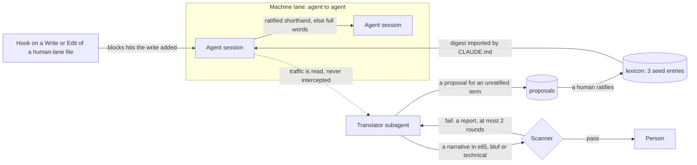

# agentik-respeak

agentik-respeak is a Claude Code plugin that splits communication into two lanes. Agents may write shorthand to each other, but only for terms a lexicon ratifies. A person reads a narrative that a translator subagent writes in one of three modes; a style gate checks that narrative, and a verifier checks that an editorial pass kept the structure.[^readme] It is for the person who supervises agents that hand work to each other. Its evidence is our use on one owner's repos and sites, and it covers the human lane's tooling, not the problem or the machine lane. Repo facts on this page are the record at commit c83e9b8, the repo's head on 2026-10-14, unless marked otherwise.

## The problem

You run agents that hand work to each other, and you read their notes afterwards. Every token in those notes spends context. respeak's premise is that agents left alone drift into shorthand, and you become the outsider in your own run.[^readme][^architecture]

The README's case is a set of Claude Code plugins run unattended, with one session handing its work to the next.[^readme] It calls the pressure to compress structural and names two bad responses. Forcing prose on agents pays the attention cost on every message. Letting the dialect drift gives up auditing your own automation.[^readme][^architecture] The repo records no instance of the failure: a search of its charters and tests found no incident of a person misreading agent shorthand.[^sittings][^tests]

A second, smaller problem is that model-written prose carries recognisable tells. The corpus meets it with 234 phrases: 96 never to emit and 138 to flag for rewrite. Six are labelled as the owner's preference rather than research.[^corpus]

## A human example: the reference game

In a 1986 study, eight pairs of students sat on either side of an opaque screen, each side holding the same 12 abstract figures. A director described the figures in order, and a matcher arranged identical cards to match. Each pair did this six times, with the same figures in new orders. Directors used an average of 41 words per figure on trial 1 and 8 on trial 6, and their speaking turns per figure fell from 3.7 to about one.[^clark] One figure began as a person ice skating with two arms stuck out in front; by trial 6 the whole reference was "The ice skater."[^clark] respeak's README gives the fall as "about forty words" to "two";[^readme] the paper's mean on trial 6 is 8 words.

A 1989 study ran the same game with ten pairs, then had forty other students hear the recordings and do the matcher's task. Matchers placed 99 percent of the figures correctly. Overhearers who heard every word from trial 1 placed 88 percent, and those who joined at trial 3 placed 68 percent. In the authors' words, "addressees were more accurate at arranging the figures than overhearers even when the overhearers heard every word."[^schober]

Neither study tested agents, and [part 1](../field/telling-people.md) found that the step to agents rests on an analogy. A pair's shorthand works inside the pair and leaves an overhearer behind: agents writing to each other are the pair, and the person supervising the run is the overhearer.

## What the research teaches

The design draws on a literature the repo surveyed in August 2026. Pairs of people shorten their descriptions fast, and outsiders have trouble interpreting the signs a pair evolves. In a 2017 case the survey records, negotiation agents rewarded only for deal outcomes drifted off understandable language; a researcher said "There was no reward to sticking to English language." Word length tracks information content across 10 languages, and the survey infers from this that identifiers, numbers and error specifics should never be shortened.[^researchsurvey] Part 1 re-opened what it could; see [Telling people what happened](../field/telling-people.md). It finds measured support for parts of the human lane, one precedent for the split, and no record of the failure the machine lane guards against.

- measured One benchmark found that 75.8 percent of failed runs with an explicit status claim claimed success.[^advani] That argues for checking a "done" claim against a tool result before a person reads it. Machine-prose tells exist and expert readers see them; the sources found include no study of a banned-phrase list or of tone causing dislike.[^kobak][^russell]
- documented The split by reader has one precedent among the standards found: an Army regulation lets memorandums use authorized brevity codes and bans military brevity codes in letters to persons outside the Department of Defense.[^army] A medication-safety list advises that its abbreviations "should NEVER be used" in any medication communication, with no split by reader; only the entries it marks as the Joint Commission's are mandatory, for accredited organizations.[^ismp] Claude Code's output style, as documented in October 2026, has one lane.[^outputstyles] Bottom line up front is a standard, not a measured effect on a manager.
- conjecture The lock-out risk rests on an analogy from human pairs; no source records an agent dialect locking out a person.
- measured Readability formulas track readers weakly on specialist text. Flesch-Kincaid, SMOG and Gunning-Fog correlated at r = 0.10 to 0.41 with rated difficulty on 242 clinical notes and 140 articles.[^zheng] Of four Afrikaans formulas, only one correlated significantly with cloze scores from 149 readers, and a second almost reached significance.[^jansen] Neither study tests agent prose. The repo declares a grade per mode and computes none.[^config] The gate's effect on readers is unmeasured.

## The approach

respeak keeps the lanes apart and enforces only the human lane with code. The machine lane runs on instruction alone.

| | Machine lane | Human lane |
|---|---|---|
| Who writes, who reads | Agents to agents | A translator subagent or an editorial pass, to a person |
| The rule | Shorthand only for ratified terms; error messages, security findings, user quotes and numbers with units never shortened | One of three modes; a style gate over banned phrases, sentence length and dash density |
| How it reaches the writer | A digest of the lexicon imported into CLAUDE.md; nothing intercepts traffic | The translator agent, the skill, the hook gate, the CI check |
| What enforces it | Instruction only | A scanner, a hook, a CI check and a verifier |
| Evidence it works | None recorded | Tooling evidence, under "Does it work?"; no reader study |

- **Modes and profiles.** `eli5` is for a newcomer: one idea per sentence, at most one analogy. `bluf` is for a manager: the result, decision or ask first, forwardable unedited. `technical` is for a peer engineer: the conclusion, then the evidence as a file and line, then open questions. A profile (`exec`, `peer-engineer`, `author`) sets depth and lexicon access and is orthogonal to the mode.[^config][^readme][^architecture]
- **The corpus.** It holds 234 banned and flagged phrases in 22 categories (96 error, 138 warn), 60 replacement rules and 3 lexicon entries. It also holds a tone map that replaces bare scalars with observable behaviours.[^corpus]
- **The gate.** A PostToolUse hook on Write and Edit scans the written Markdown file. It blocks with exit 2 on an error-severity hit the write introduced, and fails open on any setup problem. It is opt-in per project. A CI check gates every Markdown file git knows about, using committed configuration only.[^gate]
- **The verifier.** `respeak-verify-edit.py` holds headings, block structure counts, link targets, fenced code and front matter unchanged across an editorial pass, and inline code and numbers as the same multiset. Its invariants are structural.[^verify]
- **The include file.** `/respeak:include write` renders a static file of at most 1,500 bytes from the configuration, with no model call. The file is for CLAUDE.md to import, so a reader without the plugin still gets the rules.[^include]

The diagram follows the README, the architecture document, the gate script and the skill. The skill allows the scan loop at most two rounds, then relays the narrative with the report attached.[^readme][^architecture][^gate][^skill]

### Why this design over the alternatives

The repo rejects both ends, forced prose and free drift, and builds a proposal path where a fixed vocabulary would ossify.

| Alternative | What the repo says |
|---|---|
| Force agents to write full prose | Pays the attention cost on every message[^readme] |
| Let the dialect drift | Gives up auditing your own automation[^readme] |
| Intercept or rewrite traffic after the fact | Conventions are adopted at emission through the digest; a display-time hook is designed and not built[^architecture][^readme] |
| Statistical compression of prompts | Output is degraded English with no durable convention[^researchsurvey] |
| Standard agent vocabularies | FIPA-ACL ossified for want of a light amendment process, so a proposal path is built in[^researchsurvey] |
| Prompt-only enforcement | A scanner shipped in the first release, 0.2; 0.3.0 added a gate hook and a skill that scans before relaying[^changelog] |
| An external linter such as Vale | Not rejected: compiling the corpus to a Vale package is the designed CI path, not yet built[^readme][^architecture] |
| A hand-kept README | Replaced by a rendered, verified, stamped one after it reached 40,089 bytes[^changelog] |

## Does it work?

our use One field test (n=1), one field run over about 2,000 files, and the repo's own charters, all on one owner's repos and sites. They test the human lane's tooling, not the problem, the machine lane or a reader.

The firmest evidence is for the human lane's tooling. A field run over about 2,000 files on 2026-09-21 drove a round of fixes. Three charters record the verifier refusing a model's render of the README.[^changelog][^sittings] The journal entry [Two lanes](../journal/posts/2026-08-31-two-lanes.md) covers the 2026-08-31 field test.

| Measurement | Result | Caveat |
|---|---|---|
| One editorial pass over a 4,000-word design document, 2026-08-31 | Error-severity banned phrases 3 to 0; em-dashes per 1,000 words 19.9 to 3.1; average sentence 32.1 to 24.5 words; headings, links, code and numbers unchanged | The README calls it sizing evidence; the source document was removed; the sentence figures predate a splitter fix[^readme][^changelog] |
| A ten-agent pass over nine sites, about 2,000 files, 2026-09-21 | A heading hit locked a file against every later edit; one site's average sentence measured 68.9 words because the splitter read bullet lists as sentences; a scan without its config reported 36 errors against 13 real ones; a hard-wrapped line published as a heading while the verifier passed | The sites are private; the counts cannot be re-run[^changelog] |
| The hand-edited README | 40,089 bytes; the rendered one 19,223 at c83e9b8 by this site's byte count | One file[^changelog][^readme] |
| README renders through the translator | One took 6 minutes; one was killed at the 600-second wall; in two charters the verifier refused a render that changed code spans, and the README was left untouched | A model call varies run to run[^sittings] |
| Tests | 279 unit tests and 10 shell suites, counted at c83e9b8 | A count, not an outcome[^tests] |

The weakest evidence is for the problem itself, which has no recorded incident, and for the machine lane. The lexicon holds three seed entries and no token count. Its use counter is declared, not built: no script writes it, so every entry reads 0.[^corpus] Nothing measures token savings, a readability grade or the translator's accuracy.[^tests][^readme] No reader study shows that people understand the three modes better than raw output.[^readme]

## What has not worked, and what is open

- The verifier passes false content. A review reproduced an appended false paragraph and a flipped "never", and both pass.[^reviews] The fix was deferred to its own packet.[^deferral] For facts, the only guard is the translator's rule never to add, delete or correct a claim.[^agent] Until 2026-10-14 the README said the verifier proves a style edit "meaning-preserving", which is stronger than its invariants.[^reviews][^fixverifier] On 2026-10-14, commit `7931dd4` rewrote that line: the verifier "checks that a style edit kept the structure", and the README now cites review ADV6-4 for the false content that passes.[^fixverifier][^readme]
- The 2026-09-21 field run found the faults in the table above: a locked file, a splitter that misread lists, a scan that over-reported without its config, and a hard-wrapped line that published as a heading while the verifier passed.[^changelog]
- The translator is a model call: the renderer re-words the README on every run, so a render followed by `git status` cannot come back clean.[^sittings]
- Shorthand governance rests on the translator's prompt. Until 2026-10-14 the configuration declared governance keys that nothing read, among them a cap of 150 terms, a 180-day expiry and 30-day audits. On 2026-10-14, commit `ea6c754` removed ten such keys from the shipped configuration.[^fixkeys] The README now lists the cap, the expiry and the audits as not built, and says `NICE_TO_HAVE.md` holds their plan.[^readme] Five keys stay. `lexicon` and `proposal_dir` are tagged fixed path: the scripts and the agent use a fixed path, and the key is not read. Human ratification, a legibility floor of 0.5 and the never-compress classes are tagged instruction-only: the translator's prompt names each and no script checks it, though the verifier holds numbers across an editorial pass.[^config][^agent] A test pins that the shipped file holds none of the removed keys and exactly the five kept.[^tests]
- The repo has one owner, and every recorded use is on the owner's own repos and sites.[^readme][^changelog]

## From the journal

- [Two lanes](../journal/posts/2026-08-31-two-lanes.md): governed shorthand for agents, gated prose for people, and one field test.

## Sources

[^changelog]: agentik-dev/agentik-respeak, "CHANGELOG.md", commit c83e9b8, <https://github.com/agentik-dev/agentik-respeak/blob/c83e9b8/CHANGELOG.md>.
[^sittings]: agentik-dev/agentik-respeak, "history/sittings/", the 41 charters of 2026-09-22 to 2026-10-13, commit c83e9b8, <https://github.com/agentik-dev/agentik-respeak/tree/c83e9b8/history/sittings>.
[^corpus]: agentik-dev/agentik-respeak, "plugin/corpus/", commit c83e9b8, <https://github.com/agentik-dev/agentik-respeak/tree/c83e9b8/plugin/corpus>.
[^readme]: agentik-dev/agentik-respeak, "README.md", commit c83e9b8, <https://github.com/agentik-dev/agentik-respeak/blob/c83e9b8/README.md>.
[^architecture]: agentik-dev/agentik-respeak, "docs/architecture.md", commit c83e9b8, <https://github.com/agentik-dev/agentik-respeak/blob/c83e9b8/docs/architecture.md>.
[^clark]: Herbert H. Clark and Deanna Wilkes-Gibbs, "Referring as a collaborative process", Cognition 22(1):1-39, 1986, <https://web.stanford.edu/~clark/1980s/Clark,%20H.H.%20_%20Wilkes-Gibbs,%20D.%20_Referring%20as%20a%20collaborative%20process_%201986.pdf>.
[^schober]: Michael F. Schober and Herbert H. Clark, "Understanding by Addressees and Overhearers", Cognitive Psychology 21:211-232, 1989, <https://web.stanford.edu/~clark/1980s/Schober,%20M.F.%20_%20Clark,%20H.H.%20_Understanding%20by%20addressees%20and%20overhearers_%201989.pdf>.
[^researchsurvey]: agentik-dev/agentik-respeak, "research/sources/" and "research/synthesis/", the August 2026 survey, commit c83e9b8, <https://github.com/agentik-dev/agentik-respeak/tree/c83e9b8/research>.
[^tests]: agentik-dev/agentik-respeak, "tests/", commit c83e9b8, <https://github.com/agentik-dev/agentik-respeak/tree/c83e9b8/tests>.
[^config]: agentik-dev/agentik-respeak, "plugin/config/respeak.config.yaml", commit c83e9b8, <https://github.com/agentik-dev/agentik-respeak/blob/c83e9b8/plugin/config/respeak.config.yaml>.
[^gate]: agentik-dev/agentik-respeak, "plugin/scripts/respeak-gate.sh" and "plugin/scripts/respeak-check.sh", commit c83e9b8, <https://github.com/agentik-dev/agentik-respeak/tree/c83e9b8/plugin/scripts>.
[^verify]: agentik-dev/agentik-respeak, "plugin/scripts/respeak-verify-edit.py", commit c83e9b8, <https://github.com/agentik-dev/agentik-respeak/blob/c83e9b8/plugin/scripts/respeak-verify-edit.py>.
[^reviews]: agentik-dev/agentik-respeak, "design/review-adv6.md", finding ADV6-4, commit c83e9b8, <https://github.com/agentik-dev/agentik-respeak/blob/c83e9b8/design/review-adv6.md>.
[^include]: agentik-dev/agentik-respeak, "design/include-r1.md", commit c83e9b8, <https://github.com/agentik-dev/agentik-respeak/blob/c83e9b8/design/include-r1.md>.
[^skill]: agentik-dev/agentik-respeak, "plugin/skills/respeak/SKILL.md", commit c83e9b8, <https://github.com/agentik-dev/agentik-respeak/blob/c83e9b8/plugin/skills/respeak/SKILL.md>.
[^agent]: agentik-dev/agentik-respeak, "plugin/agents/respeak.md", the translator's rules, commit c83e9b8, <https://github.com/agentik-dev/agentik-respeak/blob/c83e9b8/plugin/agents/respeak.md>.
[^deferral]: agentik-dev/agentik-respeak, "history/sittings/2026-09-23-6.md", commit c83e9b8, <https://github.com/agentik-dev/agentik-respeak/blob/c83e9b8/history/sittings/2026-09-23-6.md>.
[^fixverifier]: agentik-dev/agentik-respeak, "README: say what the verifier holds, and that facts rest on the translator (research item 8)", commit 7931dd4, 14 October 2026, <https://github.com/agentik-dev/agentik-respeak/commit/7931dd4>.
[^fixkeys]: agentik-dev/agentik-respeak, "config: remove the shorthand keys tagged not built (a field with no behaviour is deleted)", commit ea6c754, 14 October 2026, <https://github.com/agentik-dev/agentik-respeak/commit/ea6c754>.
[^army]: Department of the Army, "Army Regulation 25-50, Preparing and Managing Correspondence", 10 October 2020, <https://www.maine.gov/dvem/policies/documents/AR%2025-50%20(10%20October%202020).pdf>.
[^ismp]: Institute for Safe Medication Practices, "List of Error-Prone Abbreviations", 2024, <https://home.ecri.org/blogs/ismp-resources/list-of-error-prone-abbreviations>.
[^outputstyles]: Anthropic, "Output styles", Claude Code documentation read 2026-10-14, <https://code.claude.com/docs/en/output-styles>.
[^zheng]: Jiaping Zheng and Hong Yu, "Readability Formulas and User Perceptions of Electronic Health Records Difficulty: A Corpus Study", March 2017, <https://pmc.ncbi.nlm.nih.gov/articles/PMC5355629/>.
[^jansen]: Jansen et al., "Evaluating Four Readability Formulas For Afrikaans", December 2017, <https://spilplus.journals.ac.za/pub/article/view/739>.
[^kobak]: Dmitry Kobak et al., "Delving into LLM-assisted writing in biomedical publications through excess vocabulary", July 2025, <https://arxiv.org/abs/2406.07016>.
[^russell]: Jenna Russell et al., "People who frequently use ChatGPT for writing tasks are accurate and robust detectors of AI-generated text", January 2025, <https://arxiv.org/abs/2501.15654>.
[^advani]: Advani, "From Confident Closing to Silent Failure: Characterizing False Success in LLM Agents", June 2026, <https://arxiv.org/abs/2606.09863>.
