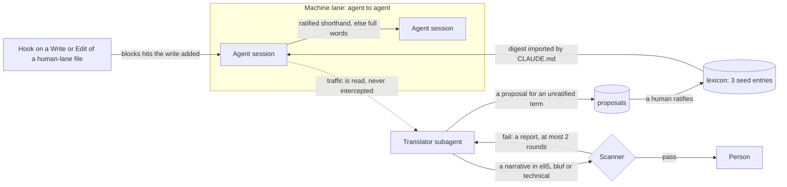

# agentik-respeak

agentik-respeak splits communication into two lanes. Agents may write shorthand to each other only for terms a lexicon ratifies; a person reads a narrative that a translator subagent writes in one of three modes, held to a style gate and to a verifier that proves an editorial pass changed prose only. The firmest evidence in the repo is for the human lane's tooling: a field run over about 2,000 files on 2026-09-21 drove a round of fixes, and three charters record the verifier refusing a model's render of the README.[^changelog][^sittings] The weakest evidence is for the problem itself and for the machine lane: the repo records no incident of a person misreading agent shorthand, its lexicon holds three seed entries with zero recorded uses, and nothing measures token savings, a readability grade or the translator's accuracy.[^corpus][^readme] Everything on this page is the repo's record at commit 319f060 unless marked otherwise.

## The problem, as the repo states it

Agents that write to each other spend context on every token, so the pressure to compress is structural. They drift into shorthand, and the person supervising becomes the outsider. The README names two bad responses: force prose on agents, which pays the attention cost on every message, or let the dialect drift, which gives up auditing your own automation.[^readme][^architecture] The first user was the owner's own set of plugins, run unattended with one session handing its work to the next. A second, smaller problem is that model-written prose carries recognisable tells; the corpus bans 234 phrases to meet it, six of them labelled as the owner's preference rather than research.[^corpus]

The design leans on a literature the repo surveyed in August 2026: pairs of people shorten their descriptions fast and outsiders cannot read the signs they evolve; agents drift off English when nothing rewards English; word length tracks information content, so identifiers, numbers and errors are where short codes fail.[^researchsurvey] Part 1 re-opened what it could; see [Telling people what happened](../field/telling-people.md).

### What the repo measured

| Measurement | Result | Caveat |
|---|---|---|
| One editorial pass over a 4,000-word design document, 2026-08-31 | Error-severity banned phrases 3 to 0; em-dashes per 1,000 words 19.9 to 3.1; average sentence 32.1 to 24.5 words; headings, links, code and numbers unchanged | The README calls it sizing evidence; the source document was removed; the sentence figures predate a splitter fix[^readme][^changelog] |
| A ten-agent pass over nine sites, about 2,000 files, 2026-09-21 | A heading hit locked a file against every later edit; a bullet list read as a 68.9-word sentence; a scan without its config reported 36 errors against 13 real ones; a hard-wrapped line published as a heading while the verifier passed | The sites are private; the counts cannot be re-run[^changelog] |
| The hand-edited README | 40,089 bytes; the rendered one 21,453 | One file[^changelog] |
| README renders through the translator | One took 6 minutes; one was killed at the 600-second wall; in three charters the verifier refused a render that changed code spans, and the README was left untouched | A model call varies run to run[^sittings] |
| Tests | 272 unit tests and 10 shell suites, counted at the commit | A count, not an outcome[^tests] |

## The design

| | Machine lane | Human lane |
|---|---|---|
| Who writes, who reads | Agents to agents | A translator subagent or an editorial pass, to a person |
| The rule | Shorthand only for ratified terms; error messages, security findings, user quotes and numbers with units never shortened | One of three modes; a style gate over banned phrases, sentence length and dash density |
| How it reaches the writer | A digest of the lexicon imported into CLAUDE.md; nothing intercepts traffic | The translator agent, the skill, the hook gate, the CI check |
| What enforces it | Instruction only | A scanner, a hook, a CI check and a verifier |
| Evidence it works | None recorded | Tooling evidence above; no reader study |

- **Modes and profiles.** `eli5` for a newcomer (one idea per sentence, at most one analogy), `bluf` for a manager (the result, decision or ask first, forwardable unedited) and `technical` for a peer engineer (the conclusion, then the evidence as a file and line, then open questions). A profile (`exec`, `peer-engineer`, `author`) sets depth and lexicon access and is orthogonal to the mode.[^config][^readme]
- **The corpus.** 234 banned phrases in 22 categories (96 error, 138 warn), 60 replacement rules, 3 lexicon entries, and a tone map that replaces bare scalars with observable behaviours.[^corpus]
- **The gate.** A PostToolUse hook on Write and Edit scans the written Markdown file, blocks with exit 2 on an error-severity hit the write introduced, and fails open on any setup problem. It is opt-in per project. A CI check gates every Markdown file git knows about from committed configuration only.[^gate]
- **The verifier.** `respeak-verify-edit.py` holds headings, block structure counts, link targets, fenced code, inline code, numbers and front matter byte-identical across an editorial pass. Its invariants are structural: a review reproduced an appended false paragraph and a flipped "never" that pass, and the fix was deferred. For facts, the only guard is the translator's rule never to add, delete or correct a claim.[^verify][^reviews]
- **The include file.** `/respeak:include write` renders a static file of at most 1,500 bytes from the configuration, with no model call, for CLAUDE.md to import; a reader without the plugin gets the rules.[^include]

The diagram follows the README, the architecture document and the gate script.[^readme][^architecture][^gate]

## Alternatives the repo rejected

| Alternative | What the repo says |
|---|---|
| Force agents to write full prose | Pays the attention cost on every message[^readme] |
| Let the dialect drift | Gives up auditing your own automation[^readme] |
| Intercept or rewrite traffic after the fact | Conventions are adopted at emission through the digest; a display-time hook is designed and not built[^architecture] |
| Statistical compression of prompts | Output is degraded English with no durable convention[^researchsurvey] |
| Standard agent vocabularies | FIPA-ACL ossified for want of a light amendment process, so a proposal path is built in[^researchsurvey] |
| Prompt-only enforcement | Replaced from 0.3.0 by a scanner, a hook and a skill that scans before relaying[^changelog] |
| An external linter such as Vale | Deferred: the corpus is written so it can compile to one[^readme] |
| A hand-kept README | Replaced by a rendered, verified, stamped one after it reached 40,089 bytes[^changelog] |

## What part 1 says

- The lock-out risk rests on an analogy from human pairs; no source records an agent dialect locking out a person.
- Machine-prose tells exist and expert readers see them; no study tests a banned-phrase list or shows that tone causes dislike.
- Readability formulas are a weak gate by the studies found; the repo declares a grade per mode and computes none.[^config]
- Bottom line up front is a standard, not a measured effect on a manager.
- The two-lane split matches a military writing regulation, a medication-safety list of error-prone abbreviations, and Claude Code's own Concise output style, so it is supported as a pattern; the gate's effect on readers is unmeasured.
- Among failed coding-agent runs that made a status claim, 75.8 percent claimed success, which argues for checking a "done" claim against a tool result before a person reads it. See [Telling people what happened](../field/telling-people.md).

## What is open

- The machine lane is unmeasured: three seed entries, zero recorded uses, no token count.[^corpus]
- The governance keys (a legibility floor, a cap of 150 terms, expiry, audits) are read by no code; they are instructions to the translator.[^config][^readme]
- The verifier is structural, and the README's "meaning-preserving" is stronger than its invariants.[^reviews]
- No reader study shows that people understand the three modes better than raw output.[^readme]
- The translator is a model call: the renderer re-words the README on every run, so a render followed by `git status` cannot come back clean.[^sittings]
- One owner; every recorded use is the owner's repos and unattended runs.[^readme]

## Sources

[^changelog]: agentik-dev/agentik-respeak, "CHANGELOG.md", commit 319f060, <https://github.com/agentik-dev/agentik-respeak/blob/319f060/CHANGELOG.md>.
[^sittings]: agentik-dev/agentik-respeak, "history/sittings/", the charters of 2026-10-11 to 2026-10-13, commit 319f060, <https://github.com/agentik-dev/agentik-respeak/tree/319f060/history/sittings>.
[^corpus]: agentik-dev/agentik-respeak, "plugin/corpus/", commit 319f060, <https://github.com/agentik-dev/agentik-respeak/tree/319f060/plugin/corpus>.
[^readme]: agentik-dev/agentik-respeak, "README.md", commit 319f060, <https://github.com/agentik-dev/agentik-respeak/blob/319f060/README.md>.
[^architecture]: agentik-dev/agentik-respeak, "docs/architecture.md", commit 319f060, <https://github.com/agentik-dev/agentik-respeak/blob/319f060/docs/architecture.md>.
[^researchsurvey]: agentik-dev/agentik-respeak, "research/sources/" and "research/synthesis/", the August 2026 survey, commit 319f060, <https://github.com/agentik-dev/agentik-respeak/tree/319f060/research>.
[^tests]: agentik-dev/agentik-respeak, "tests/", commit 319f060, <https://github.com/agentik-dev/agentik-respeak/tree/319f060/tests>.
[^config]: agentik-dev/agentik-respeak, "plugin/config/respeak.config.yaml", commit 319f060, <https://github.com/agentik-dev/agentik-respeak/blob/319f060/plugin/config/respeak.config.yaml>.
[^gate]: agentik-dev/agentik-respeak, "plugin/scripts/respeak-gate.sh" and "plugin/scripts/respeak-check.sh", commit 319f060, <https://github.com/agentik-dev/agentik-respeak/tree/319f060/plugin/scripts>.
[^verify]: agentik-dev/agentik-respeak, "plugin/scripts/respeak-verify-edit.py", commit 319f060, <https://github.com/agentik-dev/agentik-respeak/blob/319f060/plugin/scripts/respeak-verify-edit.py>.
[^reviews]: agentik-dev/agentik-respeak, "design/review-adv6.md", finding ADV6-4, commit 319f060, <https://github.com/agentik-dev/agentik-respeak/blob/319f060/design/review-adv6.md>.
[^include]: agentik-dev/agentik-respeak, "design/include-r1.md", commit 319f060, <https://github.com/agentik-dev/agentik-respeak/blob/319f060/design/include-r1.md>.
