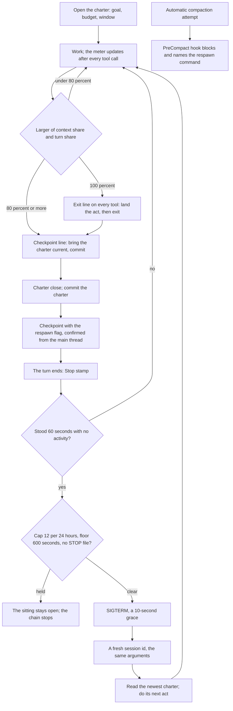

# agentik-session

agentik-session meters a Claude Code session against two ceilings. At 80 percent of either ceiling, its meter prints a checkpoint line, and the session writes its handoff into a charter. Its launcher then starts the next sitting, a fresh session, from that charter instead of compacting.[^readme][^overhaul] It is for runs where nobody watches the terminal.[^readme] Its evidence is our use: one owner's record, and no test of a restart against compaction.

## The problem

You leave Claude Code running for hours, unattended. Its context fills, or its turns run out. A session that runs to 100 percent has no budget left to write down what it was doing, commit, or hand off. The tool's budget module opens with that sentence as its reason. It is design rationale, not an incident.[^budgetpy] The incidents are in the repo's record:

- The first design failed in one night. On 2026-09-12 a coordinator ran in print mode under a scheduler. It emitted its handoff as the run's structured final output while four background builders were still working. That completed the process and killed the builders. The result read `subtype = success`, `is_error = False`, `num_turns = 104`, `stop_reason = tool_use`, `total_cost_usd = 69.34`. Each of four worktree branches held 55 to 138 lines of uncommitted diff. After an idle usage-window roll, the budget read "no usage sample" while the account panel read 32 percent. The coordinator deferred its agents by 40 minutes. The owner disabled the tool that morning. By 2026-09-23 the design that followed had retired the whole fork-and-resume chain.[^bug][^overhaul]
- Restarting by hand left work idle. On 2026-10-05 one orchestrator reached its checkpoint at 00:04, 03:30 and 08:12, and was restarted at 01:57, 06:31 and 09:35. That is 6 hours 17 minutes idle in one night. Each restart read its charter cleanly.[^respawn] The journal tells that night in [Restart, don't compact](../journal/posts/2026-10-05-restart-dont-compact.md).
- Compaction ran against the owner's rule. On Claude Code 2.1.296 the idle compaction setting compacted two sittings overnight. The repo records no case of a compacted session losing its thread.[^nth]
- A cache audit over 649 transcripts found 26 idle wakes that missed the one-hour prompt-cache lifetime and rewrote about 4.8 million tokens. They missed it because a 3,600-second wake lands at 3,636 to 3,648 seconds.[^nth] A burn report of 2026-09-22 found one session using 37.6 percent of a week's burn.[^overhaul]
- A swarm can fork without bound. A design review cites defect D5: 310 concurrent gates came to 620 node starts and 310 test suites, with no timeout, lock or load check.[^reviewr6]

## A human example: structured handoffs between hospital residents

In a hospital, one resident hands patients over to another. Amy Starmer and colleagues built a mnemonic for that handoff, I-PASS, with five parts: Illness severity, Patient summary, Action list, Situation awareness and contingency planning, and Synthesis by receiver. They brainstormed the essential elements of a verbal handoff and drew on best practices in the literature. They focused on three elements that faculty observers in a pilot study noted as most often absent from resident handoffs: the severity assessment, contingency planning, and a read-back by the receiving resident.[^ipass2012]

The I-PASS Study Group then tested a program built on the mnemonic in nine hospitals, before and after it began. Over 10,740 patient admissions, medical errors fell 23 percent, from 24.5 to 18.8 per 100 admissions measured. Preventable adverse events fell 30 percent, from 4.7 to 3.3 per 100 admissions. Oral handoff time did not change significantly: 2.4 minutes per patient before, 2.5 after (P=0.55).[^ipass2014] Besides the mnemonic, the program included handoff and communication training, a faculty development and observation program, and a sustainability campaign. The abstract names no concurrent control group, and the authors write that the program was "associated with" fewer errors.[^ipass2014]

The study measured residents, not model sessions. A sitting's charter is a written, structured handoff to the next session: five fixed parts under 4,096 bytes, ending in the next act that the fresh session carries out.

## What the research teaches

The design rests on one premise: a fresh context per sitting beats a compacted one. The repo records it as the owner's ruling.[^packets] Part 1 of this site supports its direction. It also checks the window table, idle compaction and three numbers against the October 2026 documentation; at the head the repo states the documented values.

- The evidence supports the direction of a fresh context per sitting. A consolidated single message recovered most of a multi-turn loss, and Claude Code's own advice is to start a clean session rather than pile up corrections. The size of the effect is unmeasured, and no study compares a restart with compaction. See [Length and compaction](../field/length-and-compaction.md).
- The profile table is cautious, and says so. It lists opus, sonnet and haiku at 200,000 tokens, and reads 200,000 for a family unless every model the setup runs in it has 1M.[^profiles] The October 2026 documentation gives 1M to Opus 5.5, Sonnet 5.5 and Haiku 5.5.[^ctxdoc][^modelconfig] So a plain `opus` may run on 1M while the table reads 200,000. The role ceilings of 180,000 tokens apply on both windows, so the window matters only for the two orchestrator roles.[^profiles]
- The documentation describes idle compaction as the repo found it. Its documented conditions include an interactive session and the one-hour cache. The `idleCompaction` key needs version 2.1.290 or later. An earlier version ignores the key; on such a version, turning off `autoCompactEnabled` stops idle compaction.[^settings] The repo's backlog now lists these conditions, the version and the older switch.[^nth] The documentation also says that a blocked recovery compaction fails the request.[^precompact] The repo records one observation on 2.1.296: Claude Code reads a passing PreCompact hook's stdout as compaction instructions.[^hooks] The documentation does not say so. See [Length and compaction](../field/length-and-compaction.md).
- Three numbers hold as the October 2026 documentation gives them. By default, the one-hour cache for the main loop holds only on a subscription within plan usage.[^caching] The cache read rate is 0.05 times base on Opus 5.5 and Sonnet 5.5 and 0.025 on Fable 5.1.[^pricing] A command hook's default timeout is 600 seconds.[^hooktimeouts] At the head the backlog and the review state these values.[^nth][^reviewr6] See [Budgets, pacing and cost lanes](../field/budgets-and-lanes.md).
- A blocked Stop hook holds the turn end for up to eight consecutive blocks with no tool call between them. After that, Claude Code overrides it.[^hooksguide] See [Unattended runs and guardrails](../field/unattended-and-guardrails.md).

## The approach

A profile names a role and its two ceilings. A meter reads the session's own transcript after every tool call. At 80 percent the sitting writes its handoff into a charter and commits. When that sitting ends, a launcher starts a fresh session that reads the charter. A hook blocks automatic compaction; a typed `/compact` passes, and otherwise the sitting continues by restart.[^readme] At commit e7f0723 the command line tool still had its old name. This page writes each command under the current name, `agentik session`, as the README does at commit 89c69a8.[^readme][^readmenow]

### The parts

- **Profiles and ceilings.** The tool ships ten profiles. The model decides the window, and the role decides the ceilings. Every role gets 180,000 context tokens and 400 turns, except the two orchestrator roles, which get 400,000 on a 1M window. The repo gives no derivation for 180,000 or 400; both trace to rulings in a private ledger.[^profiles][^overhaul]
- **The meter.** A PostToolUse hook parses only the bytes appended to the transcript since its last run. A turn is one deduplicated assistant message. Context is the last assistant message's input plus cache-creation plus cache-read tokens. The used share is the larger of the context share and the turn share. The meter has five zones: clear under 80 percent, notice at 80, wind-down at 90, reserve at 92, exhausted at 100. Under 80 percent the meter is silent. It adds one line at the first crossing and on every tenth tool call after, and speaks on every tool call at 100. It caps its output at 400 bytes, always exits 0 and never blocks. The budget's stop is a signal, a rule and, under the relay, an outside kill, as the README now says.[^meter][^plugin][^overhaul][^readmehead]
- **Checkpoints and the charter.** A checkpoint commit stages tracked files only, never untracked ones, so an autonomous caller cannot sweep up a secret. The charter is one file per sitting, under 4,096 bytes, in five parts: a title, a table, done-ness, handover and the next act. A next act whose first line opens with RESPAWN marks a respawn close.[^runbook][^charter]
- **Respawn instead of compaction.** A respawn close runs `agentik session charter close`, commits, then runs the checkpoint verb with the respawn flag. That verb runs from the main thread: it refuses a helper. It exits 2 and writes nothing on a charter that git reads as modified, staged or untracked; with `--commit`, a tracked charter passes and an untracked one never does.[^respawncheck] The launcher polls every two seconds and waits for the Stop stamp to stand 60 seconds with no activity. It then sends SIGTERM, and SIGKILL after 30 seconds. It waits a ten-second grace, in which Ctrl-C ends the chain, then starts `claude` with a fresh session id and the same arguments. The guards are at most 12 restarts in any rolling 24 hours, a floor of 600 seconds, a STOP file, and an allowlist of flags. The allowlist exists because a denylist missed four resume or detach flags. The launcher never restarts a crash. A PreCompact hook blocks an automatic compaction with a reason that names the respawn command, and lets a typed `/compact` pass.[^respawn][^chain][^hooks]
- **Hooks.** `plugin/hooks/hooks.json` registers nine command hooks, one per event, that run on every session. It also loads one hooks module, `session.ts`, which holds six more hooks for admission.[^plugin][^admission]
- **Admission.** A young module projects the peak of the five-hour usage window from a least-squares fit. It ships in observe mode and refuses nothing.[^admission] At the head it still only observes and advises: the code reads "enforce is not built yet", and the spawn goes ahead whatever the verdict says. The band it draws above the prompt shows the room left for helpers, and nothing that decides reads it.[^bandhead]

The diagram follows the respawn design and the launcher's code.[^respawn][^chain]

### Why this design

The repo records why it dropped each alternative.

| Alternative | Why it was dropped |
|---|---|
| A fork-and-resume chain with a scheduler | Structural, not a bug: a handoff cannot be both the last message and a wait on children[^overhaul] |
| A sensor that reads the status line | It measures the UI, not the sitting; the meter reads the transcript instead[^overhaul] |
| Compact at most once, then respawn | Replaced on 2026-09-29: a restart reads its brief fresh, and a compaction needs the owner's hand[^packets] |
| Block both compaction triggers, or neither | Only `auto` is blocked; the cost, a request that fails at the hard limit when the recovery compaction is refused, is recorded[^mod] |
| A meter line on every tool | It would spend the context it measures[^overhaul] |
| The engine's own context reading as the budget | Recorded beside the meter and never used by it; `agentik session doctor` warns at a 10 percent drift[^mod] |
| A denylist of launcher flags | It missed four resume or detach flags; an allowlist replaced it[^respawn] |
| A calendar-day restart cap | A calendar day allows twice the cap across midnight; the cap is a rolling 24 hours[^respawn] |

## Does it work?

our use One owner's record: one night of three restarts by hand, each of which read its charter cleanly, and two logged launcher chains, one with five restarts. Nothing compares a restart with compaction.

Unless marked otherwise, everything on this page is the repo's own record, read at commit e7f0723, or at its head on 2026-10-14, e8477a7, where a footnote names that commit.

- **The charter carries a sitting across a restart.** On the night of 2026-10-05, each of three restarts by hand read its charter cleanly.[^respawn]
- **The launcher has run chains.** An observer's check-in of 2026-10-13 logs a chain that stopped at five restarts, after a sitting wrote RESPAWN but never ran the verb that marks it. A note of 2026-10-12 logs another chain, in which the 600-second floor held a sitting. Neither note says whether the restarted sittings read their charters cleanly.[^nth]
- **The hooks' cost.** The review measured the PreToolUse hook at about 58 milliseconds per tool call, and the Stop hook at 58 milliseconds per turn end.[^nth]
- **The tests.** They run against a fake `claude`. Behaviour against the real one rests on the dated proofs in the design records.[^tests][^respawn][^mod]
- **The scale.** One owner and version 2.0.0-alpha.14. At commit e7f0723 the README read rendered 2026-10-13, and the public history held three commits from that day.[^readme][^firstcommits] At commit 89c69a8 it held 38 commits through 2026-10-14, and the README counted 1186 tests in the suite.[^readmenow] At the head, e8477a7, the history holds 63 commits, and the README reads rendered 2026-10-14, with 1239 tests in the suite.[^readmehead]

Nothing measures whether a restart beats compaction, or where the ceilings belong.

## What has not worked, and what is open

The tool has failed silently, and its premise is untested.

- The tool's own failures were silent. With its interpreter gone, the meter and the spawn gate failed open with no signal. One sitting wrote RESPAWN into its charter but never ran the verb that marks it. The chain then stalled at 309,000 of a 400,000-token ceiling until the owner looked. The 600-second floor held another sitting, which idled 47 minutes.[^reviewsadv][^nth][^respawn]
- No outside evidence shows that a restart beats compaction. The repo records the rule as a ruling, not a finding.[^packets] That the effect is real stays conjecture until an A/B test over real sittings. That judgment is this site's.
- The ceilings are rulings, not measurements.[^overhaul]
- The repo owes three respawn proofs. It must show that SIGTERM ends an interactive `claude` cleanly. It must measure whether any file Claude Code writes shows a prompt the owner was still typing; the design takes such a draft as lost at the signal. It must also show that another plugin's blocked Stop is handled.[^respawn]
- Admission is observe-only, and six claims about the engine are unverified.[^admission] At the head, enforcement is still not built.[^bandhead]
- The band mixes accounts. The backlog files it at level S3 on 2026-10-14: the band takes the newest five-hour reading across every session in the ledger, with no account key, so two logins on one machine share one band. That day the ledger held two accounts at once, and the projection and the room for helpers were fitted across both. The item proposes keying readings by the pair of reset times; it carries no fixed mark.[^nth]
- The prompt-cache fix is built, not proven. At commit e7f0723 the backlog's fix, an idle wake capped at 3,300 seconds, was not built. On 2026-10-14 the merge `dac92b5` (packet S30) built it: the pacing rules read the cache lifetime in force, and on the one-hour cache an idle wait wakes at most 3,300 seconds apart. On the five-minute cache an idle wait takes the long fallback and never wakes early to keep the cache. No hook enforces the rules, and the repo records no run since the merge. The cause of nine short-gap misses is unknown.[^s30][^nth]
- This site's first review, of commit e7f0723, found the record out of date in four files. On 2026-10-14 the repo corrected each in the merge `86ac60a`, whose message names "the research site's findings", so this page now gives the head's values. A fix in the record is not a run of the tool: these commits change wording, comments and one design record.[^rf1]
    - The window table listed opus, sonnet and haiku at 200,000 tokens with no caveat. Commit `aad645c` added a comment that calls the table "deliberately cautious", and changed no value.
    - The backlog gave the one-hour cache lifetime with no condition, priced a warm read at 0.1 times base, and did not list idle compaction's documented conditions. Commit `b40baa8` added the subscription condition, the reads of 0.05 and 0.025 times base, and the conditions.
    - The review gave Claude Code's default hook timeout as 60 seconds. Commit `2aa18b3` made it 600.
    - The README promised "a budget with a hard stop". Commit `1c990fe` changed its source to "a budget with a stop", and to a budget "whose stop is a signal, a rule and, under the relay, a kill". The render `5989005` carried both into the README.

## From the journal

- [Restart, don't compact](../journal/posts/2026-10-05-restart-dont-compact.md): a charter under 4 KB and a fresh session, instead of a summary.
- [A wake that cost a turn](../journal/posts/2026-10-10-a-wake-that-cost-a-turn.md): in one count, 581 of 614 self-paced wakeups took a turn of their own, and four pacing rules followed.
- [Living inside a usage window](../journal/posts/2026-10-14-living-inside-a-usage-window.md): a band that advises how many helpers fit a five-hour window, and a pause that waits out the limit.
- [The ledger that ran away](../journal/posts/2026-10-10-the-ledger-that-ran-away.md): a decision ledger grew past 400 entries, and a cap, a sign-off bar and four priority levels followed.

## Sources

[^readme]: agentik-dev/agentik-session, "README.md", commit e7f0723, <https://github.com/agentik-dev/agentik-session/blob/e7f0723/README.md>.
[^overhaul]: agentik-dev/agentik-session, "design/overhaul-r1.md", commit e7f0723, <https://github.com/agentik-dev/agentik-session/blob/e7f0723/design/overhaul-r1.md>.
[^budgetpy]: agentik-dev/agentik-session, "claude_session/budget.py", commit e7f0723, <https://github.com/agentik-dev/agentik-session/blob/e7f0723/claude_session/budget.py>.
[^bug]: agentik-dev/agentik-session, "bugs/2026-09-12-overnight-window.md", commit e7f0723, <https://github.com/agentik-dev/agentik-session/blob/e7f0723/bugs/2026-09-12-overnight-window.md>.
[^respawn]: agentik-dev/agentik-session, "design/respawn-r1.md", commit e7f0723, <https://github.com/agentik-dev/agentik-session/blob/e7f0723/design/respawn-r1.md>.
[^nth]: agentik-dev/agentik-session, "NICE_TO_HAVE.md", commit e8477a7, read 2026-10-14, <https://github.com/agentik-dev/agentik-session/blob/e8477a7/NICE_TO_HAVE.md>.
[^reviewr6]: agentik-dev/agentik-session, "design/review-r6.md", commit e8477a7, read 2026-10-14, <https://github.com/agentik-dev/agentik-session/blob/e8477a7/design/review-r6.md>.
[^ipass2012]: Amy J. Starmer, Nancy D. Spector, Rajendu Srivastava, April D. Allen, Christopher P. Landrigan and Theodore C. Sectish, with the I-PASS Study Group, "I-PASS, a Mnemonic to Standardize Verbal Handoffs", Pediatrics 129(2):201-204, February 2012, <https://pmc.ncbi.nlm.nih.gov/articles/PMC9923540>.
[^ipass2014]: Amy J. Starmer, Nancy D. Spector, Rajendu Srivastava and colleagues, for the I-PASS Study Group, "Changes in medical errors after implementation of a handoff program", New England Journal of Medicine 371(19):1803-1812, 2014, abstract read through Europe PMC, <https://www.ebi.ac.uk/europepmc/webservices/rest/search?query=EXT_ID:25372088%20AND%20SRC:MED&resultType=core&format=json>.
[^packets]: agentik-dev/agentik-session, "design/packets/s17-exit-rule-respawns.md", commit e7f0723, <https://github.com/agentik-dev/agentik-session/blob/e7f0723/design/packets/s17-exit-rule-respawns.md>.
[^profiles]: agentik-dev/agentik-session, "claude_session/profiles.yaml", commit e8477a7, read 2026-10-14, <https://github.com/agentik-dev/agentik-session/blob/e8477a7/claude_session/profiles.yaml>.
[^ctxdoc]: Anthropic, "Context windows", documentation read 2026-10-14, <https://platform.claude.com/docs/en/build-with-claude/context-windows>.
[^modelconfig]: Anthropic, "Model configuration", Claude Code documentation read 2026-10-14, <https://code.claude.com/docs/en/model-config>.
[^settings]: Anthropic, "Settings reference", Claude Code documentation read 2026-10-14, <https://code.claude.com/docs/en/settings-reference>.
[^precompact]: Anthropic, "Hooks reference", Claude Code documentation read 2026-10-14, the PreCompact event, <https://code.claude.com/docs/en/hooks>.
[^hooks]: agentik-dev/agentik-session, "claude_session/hooks.py" and "history/sittings/2026-10-11-3-c1-fix.md", commit e7f0723, <https://github.com/agentik-dev/agentik-session/blob/e7f0723/claude_session/hooks.py>.
[^caching]: Anthropic, "How Claude Code uses prompt caching", Claude Code documentation read 2026-10-14, <https://code.claude.com/docs/en/prompt-caching>.
[^pricing]: Anthropic, "Pricing", documentation read 2026-10-14, <https://platform.claude.com/docs/en/about-claude/pricing>.
[^hooktimeouts]: Anthropic, "Hooks reference", Claude Code documentation read 2026-10-14, the timeout defaults, <https://code.claude.com/docs/en/hooks>.
[^hooksguide]: Anthropic, "Automate actions with hooks", Claude Code documentation read 2026-10-14, <https://code.claude.com/docs/en/hooks-guide>.
[^meter]: agentik-dev/agentik-session, "claude_session/meter.py", commit e7f0723, <https://github.com/agentik-dev/agentik-session/blob/e7f0723/claude_session/meter.py>.
[^plugin]: agentik-dev/agentik-session, "plugin/skills/session/SKILL.md" and "plugin/hooks/hooks.json", commit e7f0723, <https://github.com/agentik-dev/agentik-session/tree/e7f0723/plugin>.
[^runbook]: agentik-dev/agentik-session, "RUNBOOK.md", commit e7f0723, <https://github.com/agentik-dev/agentik-session/blob/e7f0723/RUNBOOK.md>.
[^charter]: agentik-dev/agentik-session, "claude_session/charter.py", commit e7f0723, <https://github.com/agentik-dev/agentik-session/blob/e7f0723/claude_session/charter.py>.
[^chain]: agentik-dev/agentik-session, "claude_session/chain.py", commit e7f0723, <https://github.com/agentik-dev/agentik-session/blob/e7f0723/claude_session/chain.py>.
[^admission]: agentik-dev/agentik-session, "design/admission-r1.md", commit e7f0723, <https://github.com/agentik-dev/agentik-session/blob/e7f0723/design/admission-r1.md>.
[^mod]: agentik-dev/agentik-session, "design/mod-r1.md", commit e7f0723, <https://github.com/agentik-dev/agentik-session/blob/e7f0723/design/mod-r1.md>.
[^tests]: agentik-dev/agentik-session, "tests/", commit e7f0723, <https://github.com/agentik-dev/agentik-session/tree/e7f0723/tests>.
[^firstcommits]: agentik-dev/agentik-session, the first public commit, dated 2026-10-13, read in the checkout at e7f0723, <https://github.com/agentik-dev/agentik-session/commits/e7f0723>.
[^reviewsadv]: agentik-dev/agentik-session, "design/review-adv11.md", commit e7f0723, <https://github.com/agentik-dev/agentik-session/blob/e7f0723/design/review-adv11.md>.
[^readmenow]: agentik-dev/agentik-session, "README.md" and the git history, commit 89c69a8, read 2026-10-14, <https://github.com/agentik-dev/agentik-session/blob/89c69a8/README.md>.
[^readmehead]: agentik-dev/agentik-session, "README.md" and the git history, commit e8477a7, read 2026-10-14, <https://github.com/agentik-dev/agentik-session/blob/e8477a7/README.md>.
[^respawncheck]: agentik-dev/agentik-session, "claude_session/cli.py" (the function `_respawn_check`) and "RUNBOOK.md" (Restarting a sitting), commit e8477a7, read 2026-10-14, <https://github.com/agentik-dev/agentik-session/blob/e8477a7/claude_session/cli.py>.
[^bandhead]: agentik-dev/agentik-session, "claude_session/rules.py" (`ADMISSION` and `ENFORCE`) and "RUNBOOK.md" (the admission and band paragraphs), commit e8477a7, read 2026-10-14, <https://github.com/agentik-dev/agentik-session/blob/e8477a7/RUNBOOK.md>.
[^s30]: agentik-dev/agentik-session, "design/packets/s30-cache-lifetime.md", "claude_session/rules.py" and the merge s30-cache-lifetime (dac92b5), commit e8477a7, read 2026-10-14, <https://github.com/agentik-dev/agentik-session/blob/e8477a7/design/packets/s30-cache-lifetime.md>.
[^rf1]: agentik-dev/agentik-session, the merge rf1-research-fixes (86ac60a) and its commits aad645c, b40baa8, 2aa18b3 and 1c990fe, with the README render 5989005, commit e8477a7, read 2026-10-14, <https://github.com/agentik-dev/agentik-session/commit/86ac60a>.
