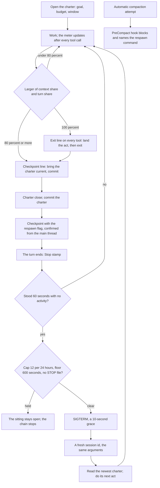

# agentik-session

agentik-session meters a Claude Code session against two ceilings, makes it write its handoff into a charter at 80 percent, and restarts the next sitting from that charter instead of compacting. The problem it meets is recorded in one night: on 2026-09-12 a scheduled print-mode run finished its structured output while four background builders were still working, which ended the process and killed them, after 104 turns and 69.34 dollars.[^bug] The premise behind the design, that a fresh context per sitting beats a compacted one, has support in direction and no measurement of strength; the repo records it as the owner's ruling.[^packets] Everything on this page is the repo's own record, read at commit e7f0723, unless marked otherwise.

## The problem, as the repo records it

- A session that runs to 100 percent has no budget left to write down what it was doing, commit, or hand off. The budget module opens with that sentence as its reason; it is design rationale, not an incident.[^budgetpy]
- The first design failed in one night. On 2026-09-12 a coordinator run under a scheduler ended while four builders were still working, because emitting the handoff as the run's final output completed the process; the result read `subtype = success`, `is_error = False`, `num_turns = 104`, `stop_reason = tool_use`, `total_cost_usd = 69.34`, and each of four worktree branches held 55 to 138 lines of uncommitted diff. After an idle usage-window roll the budget read "no usage sample" while the account panel read 32 percent, and the coordinator deferred its agents by 40 minutes. The owner disabled the tool that morning and retired the whole fork-and-resume chain.[^bug][^overhaul]
- Restarting by hand left work idle. One orchestrator reached its checkpoint at 00:04, 03:30 and 08:12 on 2026-10-05 and was restarted at 01:57, 06:31 and 09:35: 6 hours 17 minutes idle in one night, with each restart reading its charter cleanly.[^respawn]
- Compaction happened against the owner's rule. On Claude Code 2.1.296 the idle compaction setting compacted two sittings overnight. The repo records no case of a compacted session losing its thread.[^nth]
- A cache audit over 649 transcripts found 26 idle wakes that missed the one-hour prompt-cache lifetime, because a 3,600-second wake lands at 3,636 to 3,648 seconds, and rewrote about 4.8 million tokens. One session had used 37.6 percent of a week's burn.[^nth][^overhaul]
- A swarm can fork past its means. A design review quotes an earlier unattended run in which 310 concurrent gates spawned 620 node starts and 310 test suites with no timeout, lock or load check.[^reviewr6]
- The tool's own failures were silent. A gone interpreter made the meter and the spawn gate fail open with no signal; a sitting wrote RESPAWN into its charter but never ran the verb that marks it, and the chain stalled at 309k of a 400k ceiling until the owner looked; another sitting was held by the 600-second floor and idled 47 minutes.[^reviewsadv][^nth]

## The design

A profile names a role and its two ceilings. A meter reads the session's own transcript after every tool call. At 80 percent the sitting writes its handoff into a charter and commits. At the end of that sitting a launcher starts a fresh session that reads the charter, and automatic compaction is blocked so the restart is the only road on.[^readme]

- **Profiles and ceilings.** Ten profiles ship. The model decides the window and the role decides the ceilings: 180,000 context tokens and 400 turns for every role, except the two orchestrator roles, which get 400,000 on a 1M window. The repo gives no derivation for 180,000 or 400; both trace to rulings in a private ledger.[^profiles][^overhaul]
- **The meter.** A PostToolUse hook parses only the bytes appended to the transcript since its last run. A turn is one deduplicated assistant message; context is the last assistant message's input plus cache-creation plus cache-read tokens. The used share is the larger of the context share and the turn share, in four zones: notice at 80 percent, wind-down at 90, reserve at 92, exhausted at 100. The meter is silent under 80 percent, adds one line at the first crossing and every tenth tool after, speaks on every tool at 100, caps its output at 400 bytes, exits 0 always and never blocks. The README's "hard stop" is a signal, a rule, and an outside kill under the relay.[^meter][^plugin][^overhaul]
- **Checkpoints and the charter.** A checkpoint commit stages tracked files only, never untracked ones, so an autonomous caller cannot sweep up a secret. The charter is one file per sitting under 4,096 bytes in five parts: a title, a table, done-ness, handover and the next act. A next act whose first line opens with RESPAWN marks a respawn close.[^runbook][^charter]
- **Respawn instead of compaction.** The close is `charter close`, a commit, then the checkpoint verb with the respawn flag, run from the main thread, which refuses a charter git reads as uncommitted. The launcher polls every two seconds, waits for the Stop stamp to stand 60 seconds with no activity, sends SIGTERM with a ten-second grace, and starts `claude` with a fresh session id and the same arguments. Guards: at most 12 restarts in any rolling 24 hours, a floor of 600 seconds, a STOP file, and an allowlist of flags because a denylist missed four resume or detach flags. A crash is never restarted. A PreCompact hook blocks an automatic compaction with a reason that names the respawn command and lets a typed `/compact` pass.[^respawn][^chain][^hooks]
- **Hooks.** Nine hooks run on every session, at about 58 milliseconds per tool call.[^plugin][^nth]
- **Admission.** A young module projects the five-hour usage window's peak from a least-squares fit and ships in observe mode; it refuses nothing.[^admission]

The diagram follows the respawn design and the launcher's code.[^respawn][^chain]

## Alternatives the repo rejected

| Alternative | Why it was dropped |
|---|---|
| A fork-and-resume chain with a scheduler | Structural, not a bug: a handoff cannot be both the last message and a wait on children[^overhaul] |
| A sensor that reads the status line | It measures the UI, not the sitting; the meter reads the transcript instead[^overhaul] |
| Compact at most once, then respawn | Replaced on 2026-09-29: a restart reads its brief fresh, and a compaction needs the owner's hand[^packets] |
| Block both compaction triggers, or neither | Only `auto` is blocked; the cost, a request that fails at the hard limit when the recovery compaction is refused, is recorded[^mod] |
| A meter line on every tool | It would spend the context it measures[^overhaul] |
| The engine's own context reading as the budget | Recorded beside the meter and never used by it; `doctor` warns at a 10 percent drift[^mod] |
| A denylist of launcher flags | It missed four resume or detach flags; an allowlist replaced it[^respawn] |
| A calendar-day restart cap | A calendar day allows twice the cap across midnight; the cap is a rolling 24 hours[^respawn] |

## What part 1 says

- The direction of a fresh context per sitting is supported: a consolidated single message recovered most of a multi-turn loss, and Claude Code's own advice is a clean session over accumulated corrections. The strength is unmeasured, and no study compares a restart with compaction. See [Length and compaction](../field/length-and-compaction.md).
- The profile table lists opus, sonnet and haiku at 200,000 tokens; the October 2026 documentation gives 1M to Opus 5.5, Sonnet 5.5 and Haiku 5.5. The table is stale or cautious, and the 80 percent checkpoint rests on it.[^profiles]
- Idle compaction is documented as the repo found it, with conditions the repo did not list: interactive sessions, the one-hour cache, version 2.1.290 or later. That a blocked recovery compaction fails the request is documented. That a passing PreCompact hook's stdout is read as compaction instructions is the repo's observation on 2.1.296 and is not in the documentation.[^hooks]
- Four numbers the repo states are wrong as of October 2026. The one-hour cache for the main loop holds only on a subscription within plan usage; the cache read rate is 0.05 times base on Opus 5.5 and Sonnet 5.5 and 0.025 on Fable 5.1, not 0.1; the Bash tool's default timeout is 120 seconds, not 600; a command hook's default timeout is 600 seconds, not 60. The status line's field is `used_percentage`, not `percentUsed`. See [Budgets, pacing and cost lanes](../field/budgets-and-lanes.md).
- The rule that a blocked Stop hook holds every turn end is contradicted: Claude Code overrides it after 8 consecutive blocks. See [Unattended runs and guardrails](../field/unattended-and-guardrails.md).

## What is open

- No outside evidence that restart beats compaction; the effect is conjecture until an A/B over real sittings.[^overhaul]
- The ceilings are rulings, not measurements.[^overhaul]
- Three respawn proofs are owed: that SIGTERM ends an interactive `claude` cleanly, that a drafted prompt is lost at the signal, and that another plugin's blocked Stop is handled.[^respawn]
- Admission is observe-only, and six claims about the engine's usage reading are unverified.[^admission]
- The prompt-cache fix, an idle wake capped at 3,300 seconds, is not built; the cause of nine short-gap misses is unknown.[^nth]
- The tests run against a fake `claude`; behaviour against the real one rests on dated proofs.[^tests]
- One owner, version 2.0.0-alpha.14, public history from 2026-10-13.[^readme]

## Sources

[^bug]: agentik-dev/agentik-session, "bugs/2026-09-12-overnight-window.md", commit e7f0723, <https://github.com/agentik-dev/agentik-session/blob/e7f0723/bugs/2026-09-12-overnight-window.md>.
[^packets]: agentik-dev/agentik-session, "design/packets/s17-exit-rule-respawns.md", commit e7f0723, <https://github.com/agentik-dev/agentik-session/blob/e7f0723/design/packets/s17-exit-rule-respawns.md>.
[^budgetpy]: agentik-dev/agentik-session, "claude_session/budget.py", commit e7f0723, <https://github.com/agentik-dev/agentik-session/blob/e7f0723/claude_session/budget.py>.
[^overhaul]: agentik-dev/agentik-session, "design/overhaul-r1.md", commit e7f0723, <https://github.com/agentik-dev/agentik-session/blob/e7f0723/design/overhaul-r1.md>.
[^respawn]: agentik-dev/agentik-session, "design/respawn-r1.md", commit e7f0723, <https://github.com/agentik-dev/agentik-session/blob/e7f0723/design/respawn-r1.md>.
[^nth]: agentik-dev/agentik-session, "NICE_TO_HAVE.md", commit e7f0723, <https://github.com/agentik-dev/agentik-session/blob/e7f0723/NICE_TO_HAVE.md>.
[^reviewr6]: agentik-dev/agentik-session, "design/review-r6.md", commit e7f0723, <https://github.com/agentik-dev/agentik-session/blob/e7f0723/design/review-r6.md>.
[^reviewsadv]: agentik-dev/agentik-session, "design/review-adv11.md", commit e7f0723, <https://github.com/agentik-dev/agentik-session/blob/e7f0723/design/review-adv11.md>.
[^readme]: agentik-dev/agentik-session, "README.md", commit e7f0723, <https://github.com/agentik-dev/agentik-session/blob/e7f0723/README.md>.
[^profiles]: agentik-dev/agentik-session, "claude_session/profiles.yaml", commit e7f0723, <https://github.com/agentik-dev/agentik-session/blob/e7f0723/claude_session/profiles.yaml>.
[^meter]: agentik-dev/agentik-session, "claude_session/meter.py", commit e7f0723, <https://github.com/agentik-dev/agentik-session/blob/e7f0723/claude_session/meter.py>.
[^plugin]: agentik-dev/agentik-session, "plugin/skills/session/SKILL.md" and "plugin/hooks/hooks.json", commit e7f0723, <https://github.com/agentik-dev/agentik-session/tree/e7f0723/plugin>.
[^runbook]: agentik-dev/agentik-session, "RUNBOOK.md", commit e7f0723, <https://github.com/agentik-dev/agentik-session/blob/e7f0723/RUNBOOK.md>.
[^charter]: agentik-dev/agentik-session, "claude_session/charter.py", commit e7f0723, <https://github.com/agentik-dev/agentik-session/blob/e7f0723/claude_session/charter.py>.
[^chain]: agentik-dev/agentik-session, "claude_session/chain.py", commit e7f0723, <https://github.com/agentik-dev/agentik-session/blob/e7f0723/claude_session/chain.py>.
[^hooks]: agentik-dev/agentik-session, "claude_session/hooks.py" and "history/sittings/2026-10-11-3-c1-fix.md", commit e7f0723, <https://github.com/agentik-dev/agentik-session/blob/e7f0723/claude_session/hooks.py>.
[^admission]: agentik-dev/agentik-session, "design/admission-r1.md", commit e7f0723, <https://github.com/agentik-dev/agentik-session/blob/e7f0723/design/admission-r1.md>.
[^mod]: agentik-dev/agentik-session, "design/mod-r1.md", commit e7f0723, <https://github.com/agentik-dev/agentik-session/blob/e7f0723/design/mod-r1.md>.
[^tests]: agentik-dev/agentik-session, "tests/", commit e7f0723, <https://github.com/agentik-dev/agentik-session/tree/e7f0723/tests>.
