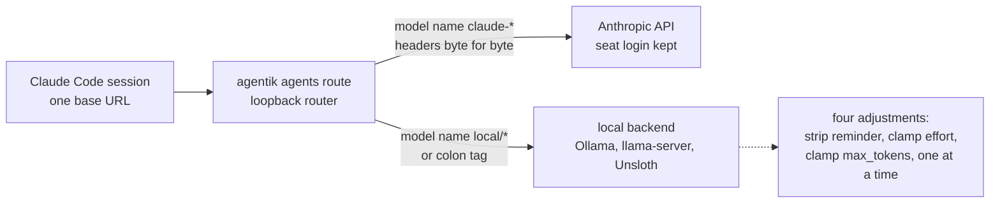
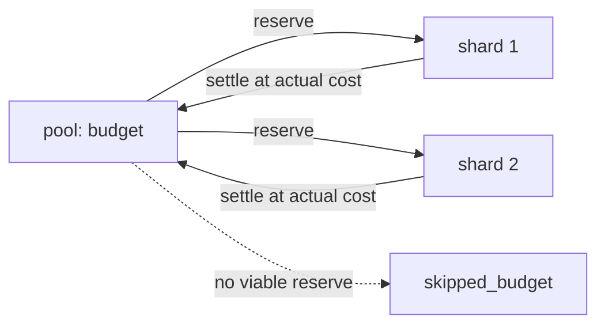

# Phase 1 survey: agentik-agents

Read on 2026-10-14. Source: `agentik-dev/agentik-agents` at commit 78ce312 (the repo's first public commit; its git history holds only that commit, so every date below is a date the files give themselves). Every claim ends with a bracket: the repo and path, the section where one helps, the commit, the source note slug in `research/sources/`, and the evidence level. Every level is "our use" (the agentik repos' own record: an incident, a log line, a test, a stated measurement). Where the bracket says "re-run", this survey recomputed or re-ran something on 2026-10-14. Nothing here shows that lane routing saves money or usage-window headroom in general. It records one owner's design, on one machine, with one model family.

Writing note: the repo still uses the tools' earlier names in many places. This draft uses the current forms: `agentik agents api` (the API-billed wrapper), `agentik agents fanout`, `agentik agents costs`, `agentik agents status`, `agentik agents route` (the router), `agentik agents local` (the launcher) and `agentik agents rig` (the backend manager). The plugin is still under its earlier name at this commit and its rename is pending, so this draft says "the agents plugin". Where the repo sets an environment variable named for an earlier tool name, the draft describes the knob in words.

Bracket key: `[agentik-agents <path> <section> @ 78ce312; <slug>; <level>]`.

## 1. The problem

The tool set meets four problems: delegated work bills in two different currencies and nobody sees the sum; delegated runs fail quietly while billing in full; a session can reach only one API endpoint, so a free local model cannot serve subagents without a proxy; and the proxy and the wrappers were themselves defective until adversarial review.

### 1.1 Three lanes, three currencies, no common ledger

- The repo starts from one split: headless and delegated runs are billed to an Anthropic API key (a Console project), while interactive `claude` keeps using the Team Premium subscription seat. [agentik-agents README.md opening @ 78ce312; agentik-agents-readme; our use]
- The cost tool reports API spend as real dollars from a usage log, seat work as "equivalent dollars" priced at list rates from the per-model usage Claude Code records in its config file, and the local lane as zero dollars with tokens and wall time. It never sums them. Stated measurement: $3.13 of API spend beside $155.78 of seat-absorbed work, about $50 of seat work per $1 of cash. The README gives no date for this pair. [agentik-agents README.md "Three cost lanes" @ 78ce312; agentik-agents-readme; our use]
- A reading of the code, not a claim in the repo: the subscription reader sums a per-project `lastModelUsage` field, and the repo does not say whether that field is cumulative, so the $155.78 figure may undercount. [agentik-agents bin/ cost tool, subscription reader @ 78ce312; agentik-agents-bin; our use]
- Usage windows: the design says the local lane "exists to spare the 5-hour window" of the seat. No usage-window hit, throttle or limit message is recorded anywhere in the files read. The cost tool states that 5-hour and weekly utilisation is written to no local file and sends the reader to `/usage` inside an interactive session. So the repo's window rationale has no measurement behind it. [agentik-agents design/01-local-agent-lane.md section 8 @ 78ce312; agentik-agents-design-01-local-lane; our use] [agentik-agents README.md "Token efficiency" @ 78ce312; agentik-agents-readme; our use]
- The local lane's accounting is not free of traps: a local run reports a nonzero list-style `costUSD` (about five cents for one call in a harness log), so the tool treats local runs as zero by construction. [agentik-agents design/01-local-agent-lane.md section 2.1 @ 78ce312; agentik-agents-design-01-local-lane; our use] [agentik-agents design/01-local-agent-lane/ harness log @ 78ce312; agentik-agents-design-01-evidence; our use]

### 1.2 Delegation fails quietly and still bills

| Incident or measurement | Figure | Date the repo gives | Evidence |
|---|---|---|---|
| Delegated runs that tried a denied tool: 3 of 4 returned a schema-valid placeholder after full cost; one spent $2.15 over 14 turns and 653 s | 3 of 4; $2.15 | undated | [agentik-agents bin/ API wrapper, comment above the tool-limits text @ 78ce312; agentik-agents-bin; our use] |
| An analyze run's prompt promised Grep and Glob, which `claude --bare` drops silently; the delegate worked blind | 1 run | 2026-08-19 | [agentik-agents bin/ API wrapper comment @ 78ce312; agentik-agents-bin; our use] |
| Eight-shard `review` fan-out over an 849-line file: two shards ran 8 to 10 turns, cost $1.02 combined, returned a placeholder, and the envelope said success | 2 of 8; $1.02 | undated | [agentik-agents README.md "Cost and latency notes for fan-out" @ 78ce312; agentik-agents-readme; our use] |
| Same fan-out: 33% of spend bought nothing; cache hit rate 70%; output 46% of cost; $0.52 per usable run; $0.21 per finding; cost dispersion 1.7 times | as listed | undated | [agentik-agents README.md "Token efficiency" @ 78ce312; agentik-agents-readme; our use] |
| Identical prompts varied up to 1.75 times in cost (4 turns against 10); shards cost $0.20 to $0.71, $3.12 for eight | 1.75 times | undated | [agentik-agents README.md "Cost and latency notes for fan-out" @ 78ce312; agentik-agents-readme; our use] |
| A $0.01 cap on a six-file task: 1 of about 6 turns completed, spend $0.0117 (1.2 times the cap), empty result, exit 1 | $0.0117 | undated | [agentik-agents README.md "Spend ceilings" @ 78ce312; agentik-agents-readme; our use] |
| Per-process ceilings do not add up: eight shards at the default $10 expose $80 | $80 | undated | [agentik-agents README.md "Fan-out" @ 78ce312; agentik-agents-readme; our use] |
| An `implement` run on Opus spent 53 turns and $6.44 and emitted only its test file; a continuation with an output-discipline header finished in 17 turns and $1.93 | $6.44 then $1.93 | 2026-08-14 | [agentik-agents README.md "Feedback log" @ 78ce312; agentik-agents-readme; our use] |
| An implement run spread its files over 8 turns; the envelope keeps only the final message, so all but the last file was lost (about $2.70 wasted) | about $2.70 | 2026-08-14 | [agentik-agents README.md "Feedback log" @ 78ce312; agentik-agents-readme; our use] |
| The promotional Sonnet 5 rate ($2/$10 per million tokens through 2026-08-31, as the pricing page listed it) did not apply to the account: the standard $3/$15 predicted the bill within 0.00% and the promotional rate missed by 33% | 33% | 2026-08-31 window | [agentik-agents README.md "Three cost lanes" @ 78ce312; agentik-agents-readme; our use] [agentik-agents bin/ cost tool, comment above `INTRO_PRICING` @ 78ce312; agentik-agents-bin; our use] |

- The first read-only design did not hold. It used `--allowedTools` with `--permission-mode dontAsk` and the README claimed a probe had confirmed Bash and Edit were refused. That was wrong: `--allowedTools` pre-approves a set and restricts nothing. A red team reproduced `echo BASH_RAN_42` running inside a profile run. The fix is `--tools "Read Grep Glob"`. [agentik-agents README.md "Delegated runs" @ 78ce312; agentik-agents-readme; our use]
- The first containment design, a deny-list over the caller's arguments, was defeated four ways: a misordered `--profile` ran uncontained, a flag-shaped prompt parsed as a flag, capability flags passed through, and an unlisted value-taking flag shifted scan parity and dropped the spend ceiling. The replacement builds the child's argv from an allow-list of five caller flags and sends the prompt on stdin. [agentik-agents README.md "How --profile containment works" @ 78ce312; agentik-agents-readme; our use]
- `Read` is not confined to `--add-dir`. A probe with `--add-dir` pointing at a scratch folder read the age private key. The named threat is prompt injection through content the delegate reads. [agentik-agents README.md "Read is NOT confined" @ 78ce312; agentik-agents-readme; our use]
- Credential history: an API key was once committed, encrypted to two identities that could no longer decrypt it; it was removed and revoked in the Console on 2026-09-05, and the README says the API lane had never been run on that machine. A cleartext leak through a name-list encryption rule was reproduced the same day with an `openrouter_key`, so the rule became a suffix pattern. [agentik-agents README.md "There is no API key in this repo", "Where a new provider's key goes" @ 78ce312; agentik-agents-readme; our use]

### 1.3 One endpoint per session, and a local model that needs care

- Claude Code allows one API endpoint per session, so "main thread on the seat, subagents on a local model" cannot be written in agent frontmatter. The design cites an open Claude Code issue on per-agent provider routing (dated 2026-03-25). It therefore puts a proxy on loopback that routes by the request body's model name. [agentik-agents design/01-local-agent-lane.md section 0 @ 78ce312; agentik-agents-design-01-local-lane; our use]
- Measured problems with the local model, all on 2026-09-04 on one Apple an Apple Silicon laptop with 128 GB, Qwen 3.8 27B q8_0, Claude Code 2.1.261:

| Problem | Figure | Evidence |
|---|---|---|
| Effort unpinned: Qwen 3.8 defaults to xhigh reasoning; a three-line file took 4,299 thinking tokens and 4 min 56 s; at low effort 45 s | 4,299 tokens; 4 min 56 s | [agentik-agents design/01-local-agent-lane.md section 14, run T0 and T1 @ 78ce312; agentik-agents-design-01-local-lane; our use] (the T0 figure is stated only; no committed log carries it) |
| The `<total_tokens>` reminder defeats the backend prompt cache: turn-two prefill 35,994.82 ms for 7,004 tokens with it; 381.83 ms for 27 new tokens (7,106 of 7,133 cached) without it | 36.0 s against 0.38 s | [agentik-agents design/01-local-agent-lane/ gates log @ 78ce312; agentik-agents-design-01-evidence; our use] |
| Ollama 0.32.12 returned HTTP 500 on every non-bare Claude Code request (a mid-conversation system message) | 9 of 50 captured rows were 500 | [agentik-agents design/01-local-agent-lane.md section 2.4 @ 78ce312; agentik-agents-design-01-local-lane; our use] [agentik-agents design/01-local-agent-lane/ wire ledger @ 78ce312; agentik-agents-design-01-evidence; our use, re-run 2026-10-14] |
| Tool schemas are the prompt: a 54-tool general-purpose agent sent 31,136 input tokens (172.2 s) and 31,685 on turn two (180.9 s); a 3-tool agent sent 5,289 to 5,790 | 31k tokens; 172 s and 181 s | [agentik-agents design/01-local-agent-lane/ ledger snapshot @ 78ce312; agentik-agents-design-01-evidence; our use, re-run 2026-10-14] |
| `max_tokens` 32000 at about 15 tok/s is a 35-minute worst case | 35 min | [agentik-agents README.md "Lane 3" @ 78ce312; agentik-agents-readme; our use] |
| The subagent-model environment variable does not reach the built-in Explore agent; with the force variant, Explore went local with 50 tools: 26,456 input tokens, 146 s first turn, a poor answer | 146 s | [agentik-agents design/01-local-agent-lane.md section 14, Live C1 and C2 @ 78ce312; agentik-agents-design-01-local-lane; our use] |
| In a plain session with Bash denied, Haiku skipped the preflight and did the task itself with Read | 1 run | [agentik-agents design/01-local-agent-lane.md section 14, E1 to E3 @ 78ce312; agentik-agents-design-01-local-lane; our use] |
| A new agent shape costs a full prefill of about 28 to 37 s on every backend tried (Ollama GGUF, Ollama MLX, tuned llama-server, Unsloth) | about 30 s | [agentik-agents design/02-local-rig.md section 3.6d @ 78ce312; agentik-agents-design-02-local-rig; our use] |

### 1.4 The tools' own defects (the review round and the packets)

- On 2026-09-05 five adversarial reviewer sessions, one surface each, found reproducible defects on all five surfaces (11 findings on the CLI, 13 on the router). Kinds: leaked credentials or misrouted requests; silent failures; hangs and crashes; docs claiming what measurement did not back. [agentik-agents design/03-review-2026-09.md @ 78ce312; agentik-agents-design-03-review; our use]
- The worst: the router's local-header policy was a two-entry deny list, so cookies and any new auth header reached the local backend; a chunked body lost its model name and went upstream on the seat's credential (now HTTP 411); real Bedrock and `:beta` Claude ids were sent to the local model by a colon heuristic. [agentik-agents design/03-review-2026-09.md "Leaked credentials, misrouted requests" @ 78ce312; agentik-agents-design-03-review; our use]
- Both plugin skills granted nothing because `tools:` is not a skill frontmatter key (the key is `allowed-tools`), including the Bash the fail-closed preflight needs. The preflight contract was also unfalsifiable until it required a verbatim line in the reply. [agentik-agents design/03-review-2026-09.md "Silent failures", "Documented as true, not measured that way" @ 78ce312; agentik-agents-design-03-review; our use]
- Four measurements in the design docs failed a check against their own logs (a misattributed log line, an "only difference" claim contradicted by a 3,682 against 3,629 character system prompt, a headline figure measured under flags the launcher does not use, a prefill floor raised from 87 to 120 tok/s with no run). They were corrected and the n=1 caveat restored. [agentik-agents design/03-review-2026-09.md @ 78ce312; agentik-agents-design-03-review; our use] [agentik-agents design/01-local-agent-lane/ reminder-dump summary @ 78ce312; agentik-agents-design-01-evidence; our use]
- Self-inflicted incident: while reproducing the finding that `pkill -f` has a blast-radius hazard, a reviewer's verification command matched its own shell and killed the production router; three orphaned router daemons were cleared as a side effect. The doc concludes that review tooling is production-adjacent and the next round should run against an instance that cannot be the production one. [agentik-agents design/03-review-2026-09.md "The self-inflicted incident" @ 78ce312; agentik-agents-design-03-review; our use]
- A flaky test after the round: the router suite passed 87 of 87 in isolation three times and failed 86 of 87 under `make test`, because an assertion required zero keep-alive pings on a response that could legitimately cross the ping threshold under load. [agentik-agents design/03-review-2026-09.md "Current state" @ 78ce312; agentik-agents-design-03-review; our use]
- 2026-10-13, packet a-s1: a red `make test` (reproduced twice) led to a launcher that dropped the pid of the router it started, so a failure before the exec left an orphan and the next launch refused to start. A 200-run signal repro still left 2 routers running after the fix (filed S4). [agentik-agents design/packets/a-s1-router-leak.md @ 78ce312; agentik-agents-design-packets; our use] [agentik-agents NICE_TO_HAVE.md @ 78ce312; agentik-agents-nice-to-have; our use]
- Tests as evidence: nine suites pin behaviour (section 2.9). On a scratch copy on 2026-10-14 the cost, router, fan-out, status and argument suites passed in full (66, 87, 46, 118 and 58 checks); three suites showed 6 failures, five of which print macOS-specific or sandbox-proxy output and one of which (in the API-run suite) was not investigated (see section 4). [agentik-agents tests/ @ 78ce312; agentik-agents-tests; our use, re-run 2026-10-14]

## 2. The design

### 2.1 The three lanes

| Lane | What it is | Billed to | Entry point | Evidence |
|---|---|---|---|---|
| API-billed | Headless `claude --bare` runs through a wrapper. Auth is the API key only (the README, citing `claude --help`, says `--bare` never reads OAuth or the keychain), and the wrapper unsets the OAuth and auth-token variables in its own process. Read-only profiles `review` (Sonnet 5, medium effort, JSON schema output), `explore` (Sonnet 5, low) and `analyze` (Opus 5, high). Default ceiling $10 per run. | An Anthropic Console project, in dollars | `agentik agents api --profile ...`, and `agentik agents fanout` for many shards | [agentik-agents README.md "How the separation works", "Delegated runs" @ 78ce312; agentik-agents-readme; our use] [agentik-agents bin/ API wrapper profile block @ 78ce312; agentik-agents-bin; our use] |
| Subscription | Plain interactive `claude` on the Team Premium login. Not a tool of this repo; the cost tool prices its usage at list rates as "equivalent dollars". | The seat's capacity, no cash | `claude` | [agentik-agents README.md "Three cost lanes" @ 78ce312; agentik-agents-readme; our use] |
| Local model | A seat session whose subagents run on a local model (default: Qwen 3.8 27B q8_0 in Ollama) behind a loopback router. Five `local-*` agents. | Nothing; tokens and wall time are logged | `agentik agents local` (launcher), `agentik agents route` (router), `agentik agents rig` (backends) | [agentik-agents README.md "Lane 3" @ 78ce312; agentik-agents-readme; our use] |

The status tool shows the same split as row lanes: `seat`, `helper` (a subagent under a seat), `local` (a row the router ledger says the local model answered) and `api` (an API-wrapper run, nested under the seat that launched it). [agentik-agents design/packets/a-s3-status.md ruling 2, a-s5-status-api.md ruling 8 @ 78ce312; agentik-agents-design-packets; our use]

### 2.2 The router: routing by model name

What the router decides: one thing, the model string in the request body. It does not judge a task's cost, privacy or difficulty. The README states it as "Model names decide the route; nothing else does." Fit is decided earlier, by whoever writes `model:` into an agent file or names a model in the Agent call. [agentik-agents README.md "Lane 3" @ 78ce312; agentik-agents-readme; our use]

- A model is local if it starts with `local/`, is in a configured list, or carries an Ollama-style colon tag, unless the id contains "claude" or "anthropic" (Bedrock and `:beta` Claude ids stay upstream). `local/default` resolves to a configured model; `local/<name>` and `local/<name>/<model>` select a declared backend; an undeclared `local/<name>` returns HTTP 404 naming the declared backends, because serving the default made a measurement run report the wrong model. [agentik-agents bin/ router `resolve_local` @ 78ce312; agentik-agents-bin; our use]
- Upstream requests are relayed with every non-hop-by-hop header byte for byte, which is how the OAuth bearer and every `anthropic-beta` value keep the session on the seat. Local requests get an allow-list of headers, the seat's credential stripped, and the backend's own key. [agentik-agents design/01-local-agent-lane.md section 5.1 @ 78ce312; agentik-agents-design-01-local-lane; our use] [agentik-agents design/03-review-2026-09.md @ 78ce312; agentik-agents-design-03-review; our use]
- Four adjustments on local routes only: drop the `<total_tokens>` reminder; inject `output_config.effort: low` when absent and clamp anything above medium; clamp `max_tokens` to 8192; serialise requests (concurrency 1, because the `qwen35` runner is single-slot). Plus SSE `ping` events during silent prefill (first after 20 s, then every 15 s) so Claude Code's 300-second stream watchdog does not fire, a chars/4 `count_tokens` answer, loopback-only bind, and a JSON ledger line per request recording the prompt shape (sizes, tool names, agent ids, usage) and never content or credentials. Router version 0.4.0. [agentik-agents bin/ router header and constants @ 78ce312; agentik-agents-bin; our use] [agentik-agents README.md "Lane 3" @ 78ce312; agentik-agents-readme; our use]
- The launcher starts the router if needed, runs the router's `--check` and refuses to start on a FAIL row, then execs `claude` with the base URL set and no credential variable. It overrides the built-in `Explore` agent with a session-scoped 3-tool local definition, and sets the model for unnamed subagents to `sonnet`, because unnamed agents carry every tool (54 tools, 31k tokens, about three minutes of prefill per turn on the 27B). [agentik-agents design/01-local-agent-lane.md sections 5.2 and 13.1 (D5) @ 78ce312; agentik-agents-design-01-local-lane; our use]
- The fit rule the repo does state is a four-rung ladder: rung 0 local (mechanical and bounded: retrieval, summaries, inventories, first-pass review, run-the-tests, bulk edits with a test as the contract), rung 1 `claude-sonnet-5` (scripted reliability, or when rung 0 returned degenerate), rung 2 `claude-opus-5` (resolution, curation, review that decides), rung 3 `claude-fable-5-1` (main thread and forks only: orchestration, design, anything a wrong answer makes expensive). Escalation is by the acceptance check, not by the model's confidence. Privacy is not a stated routing criterion anywhere in the files read. [agentik-agents design/01-local-agent-lane.md section 5.4 @ 78ce312; agentik-agents-design-01-local-lane; our use]

Would a Mermaid diagram show the mechanism? Yes, one diagram earns its place: the single endpoint with two branches, and what each branch changes. It should show the router deciding on the model name alone, with the ladder beside it as a table, because the router does not read cost, privacy or capability. Draft:

[agentik-agents design/01-local-agent-lane.md section 3 (the repo's own ASCII form) @ 78ce312; agentik-agents-design-01-local-lane; our use]

### 2.3 The fan-out

- Why it exists: `--max-budget-usd` is per process, so N shards at the default $10 expose $N0. The fan-out tool holds one pool. Each shard reserves from the pool before launch and settles at its actual cost when it finishes, so settled plus in-flight reserves never exceed the budget. A shard that cannot get a viable reserve is reported as `skipped_budget`, never silently dropped. [agentik-agents bin/ fan-out orchestrator docstring @ 78ce312; agentik-agents-bin; our use]
- The per-shard ceiling handed to the wrapper is deflated by 1.35 because the ceiling is checked between requests (measured overshoot 1.2 times). The minimum viable shard is $0.05. A measured range for `review` shards ($0.20 to $0.71, median about $0.31 by the source comment) triggers an advisory when a fan-out is funded below it. [agentik-agents bin/ fan-out constants @ 78ce312; agentik-agents-bin; our use]
- Results are checked for substance: eight statuses (`ok`, `degenerate`, `error`, `budget_exhausted`, `skipped_budget`, `timeout`, `interrupted`, `unparseable`); the exit code is non-zero unless every shard is `ok`; `spent_usd_is_upper_bound` flags a shard charged its reservation because it had no cost figure; Ctrl-C kills the delegates (a signal handler, because the exception route never runs while worker threads block). [agentik-agents README.md "Fan-out" @ 78ce312; agentik-agents-readme; our use]
- Would a diagram show it? A small one would: reserve, run, settle, with the invariant written on the pool. It adds less than the routing diagram, so it is optional. Draft:

[agentik-agents bin/ fan-out orchestrator docstring @ 78ce312; agentik-agents-bin; our use]

### 2.4 The cost log

- API lane: the wrapper appends one metadata line per run that emits a JSON envelope to a usage log (timestamp, profile, session id, models, cost, turns, duration, `is_error`, `subtype`, `terminal_reason`, cache read and write tokens, and the names of any denied tools). It records no prompt, result or tool input. The log is unbounded and never rotated. `--tag key=value` (keys `id` and `phase` are conventional) attaches a correlation key so the report can roll up spend per unit of work and the share spent on "deciding" phases. [agentik-agents README.md "Usage log", "Attributing spend with --tag" @ 78ce312; agentik-agents-readme; our use]
- Each run also writes a run dir (`run.json` at launch, `progress.json` from a stream-json fold, names, numbers and times only), pruned after 7 days, which the status tool reads as lane `api`. [agentik-agents README.md "Run dirs" @ 78ce312; agentik-agents-readme; our use]
- Local lane: the router's ledger (section 2.2), summed by the cost tool as requests, sessions, agents, tokens, wall time, errors, reminders stripped and pings, plus a "Sonnet 5 list" figure that sizes what the lane spared. The design calls that figure a size, not a spend. Example at one point on 2026-09-04: 6 requests, 34k tokens, $0, Sonnet-list $0.11. [agentik-agents design/01-local-agent-lane.md section 10, check 6 @ 78ce312; agentik-agents-design-01-local-lane; our use]
- Self-check: the price table is a copy of a published page; every run compares prediction to the billed amount and, past a 2% disagreement, withholds the cache figure and prints `PRICE TABLE DISAGREES`. Advisory rules fire only above measured thresholds and cover waste rate, output share, cache hit rate, cost dispersion, denial attempts and phase overhead. [agentik-agents README.md "Three cost lanes", "Token efficiency" @ 78ce312; agentik-agents-readme; our use]

### 2.5 The local rig

- Question it answers: Ollama's llama runner cannot reuse a prompt prefix across agents and serves this model one request at a time. A backends file (read once at router start) maps `local/<name>` to a backend; the rig tool starts and stops backends, sets the default and restarts the router. [agentik-agents design/02-local-rig.md sections 0 and 2 @ 78ce312; agentik-agents-design-02-local-rig; our use]
- Backends: the default Ollama GGUF runner (`qwen3.8:27b-mtp-q8_0`, 31.5 GB resident); `local/mlx` (Ollama's MLX runner, `qwen3.8:27b-mxfp8`, about 32 GB); `local/llama` (llama-server on the same blob, two slots, a host prompt cache (`--cache-ram 16384`), a checkpoint every 128 tokens, port 8081); `local/unsloth` (Unsloth Studio's API, `UD-Q8_K_XL` GGUF, about 29 GB, port 8888). Non-Ollama backends need a chat template (shipped under `share/`) and folding of non-leading system messages. [agentik-agents design/02-local-rig.md sections 2.1 and 2.2 @ 78ce312; agentik-agents-design-02-local-rig; our use]
- Measured result (2026-09-05, Claude Code 2.1.261, one Mac, a seat main really delegating to two local subagents):

| Backend | New agent | Same agent, new task | Continue | Decode prose / tools (tok/s) | Parallel |
|---|---|---|---|---|---|
| Ollama GGUF runner (default) | 32.6 s | 6.5 s | 0.9 to 1.3 s | 11 / about 25 | no |
| Ollama MLX runner | 28.4 s | about 22 s every time | 0.8 to 6.4 s | 24 / about 28 | no |
| llama-server, tuned | 36.2 s | 9.0 s | 1.3 to 6.3 s | 15.5 / 15.5 | 2 slots |
| Unsloth Studio API | 37.0 s | 26.6 s | 1.2 to 15.5 s | about 14 | 2 slots |

  [agentik-agents design/02-local-rig.md section 3.6d @ 78ce312; agentik-agents-design-02-local-rig; our use] (two cache-hit lines in this table's MLX row were found in the committed logs: agentik-agents design/02-local-rig/ honest-rerun logs @ 78ce312; agentik-agents-design-02-evidence; our use)
- Decision (D1, 2026-09-05): keep the Ollama GGUF runner as `local/default`. An earlier recommendation to make the MLX build the default had come from a late-divergence prompt shape and was withdrawn. The doc's own summary: prefill bandwidth, not caching, governs latency for a new agent shape, so the levers are fewer distinct agent shapes, smaller agent prompts, output discipline, and only then the backend. [agentik-agents design/02-local-rig.md sections 3.4, 3.6d @ 78ce312; agentik-agents-design-02-local-rig; our use]
- Sizing the repo states for the local model (Apple an Apple Silicon laptop with 128 GB of unified memory, Ollama 0.33.2): prefill about 87 to 230 tok/s; a 3-tool agent turn about 5.4k tokens; keep `tools:` under about 8 and turns under about 15k tokens. [agentik-agents README.md "Lane 3" @ 78ce312; agentik-agents-readme; our use]

### 2.6 The delegate agents, commands and skills

| Item | What it does | Evidence |
|---|---|---|
| `local-explore` | Read, Glob, Grep; low effort; 12 turns; narrow retrieval ("where is X") | [agentik-agents plugin/agents/ @ 78ce312; agentik-agents-plugin; our use] |
| `local-summarize` | Read, Glob; low; 8 turns; condense named material to N lines | same |
| `local-review` | Read, Glob, Grep; medium; 15 turns; first-pass review, findings are leads | same |
| `local-implement` | Read, Edit, Write, Bash, Glob, Grep; medium; 20 turns; `isolation: worktree`; reports worktree path and branch | same |
| `local-test` | Bash, Read; low; 6 turns; runs a named command, writes output to a file | same |
| `delegate-review` command | Builds 2 to 5 review shards, budget defaults to dimensions times $1.00, runs the fan-out in the background, reports `ok` shards, verifies before presenting | [agentik-agents plugin/commands/delegate-review.md @ 78ce312; agentik-agents-plugin; our use] |
| `delegate-local` command | Preflights the route (base URL must match the router row of `--check`; stop on FAIL; never do the work itself; print a verbatim preflight line), picks an agent from a table, briefs it, verifies the lead, escalates a degenerate result to sonnet then opus | [agentik-agents plugin/commands/delegate-local.md @ 78ce312; agentik-agents-plugin; our use] |
| `delegate-costs`, `agents-status` | Run the cost tool or the status tool plus the router check and relay them; start nothing | [agentik-agents plugin/commands/ @ 78ce312; agentik-agents-plugin; our use] |
| `delegated-review`, `local-delegation` skills | Model-triggered fallbacks for the same flows; the commands are the deterministic path | [agentik-agents plugin/skills/ @ 78ce312; agentik-agents-plugin; our use] |

The README's reason for slash commands: telling a session in prose to review in the background is unreliable, because the instruction competes with everything else in context, so the fix is a deterministic entry point. The repo records the reasoning and one observed failure (E1 to E3), not a rate. [agentik-agents README.md "Making a session reliably reach for these tools" @ 78ce312; agentik-agents-readme; our use]

Every delegate prompt carries a rule: a finding is a lead, not a fact, and the caller verifies it. The README adds that earlier delegates returned confident, plausible, wrong findings and every consequential one was confirmed by direct test before a fix; it gives no count. [agentik-agents README.md "Driving this from a Claude Code session" @ 78ce312; agentik-agents-readme; our use]

### 2.7 Numbers the repo states

| Item | Value | As-of date the repo gives | Location |
|---|---|---|---|
| API list prices, $ per million tokens (input/output) | fable-5-1 10/50; opus-5-5 4/20; sonnet-5-5 2/10; haiku-5-5 0.10/0.50; fable-5 and mythos-5 10/50; opus-5 and opus 4.5 to 4.8 5/25; sonnet-5 3/15 (the billed rate); haiku-4-5 1/5 | table "cached 2026-10-06" from the claude-api skill | bin/ cost tool `PRICES`; packet a-s3 ruling 9 [agentik-agents-bin; agentik-agents-design-packets] |
| Cache-read rates | 0.20 (opus-5-5, sonnet-5-5), 0.25 (fable-5-1) per million; others 0.10 times input | 2026-10-06 | same |
| Cache multipliers | read 0.10; write 1.25 (5-minute write); 1-hour write 2.0 is not tracked; `[1m]` bills a premium above 200K tokens but is folded into its base model | undated comments | bin/ cost tool [agentik-agents-bin] |
| Haiku 5.5 long-prompt tier | $0.50/$2.50 per million above 100K prompt tokens, not priced | 2026-10-13 | NICE_TO_HAVE.md [agentik-agents-nice-to-have] |
| Sonnet 5 promotional rate | $2/$10 through 2026-08-31 (did not apply to the account) | 2026-08-31 | README "Three cost lanes" [agentik-agents-readme] |
| Output versus input billing | output about 5 times input | undated | README "Token efficiency" [agentik-agents-readme] |
| Profile defaults | per-run ceiling $10; `--max-budget-usd` overshoot 1.2 times; fan-out deflator 1.35; minimum viable shard $0.05 | undated | README; bin/ [agentik-agents-readme; agentik-agents-bin] |
| Claude Code and Ollama versions | Claude Code 2.1.261 measured; Claude Code 2.1 or later for `--bare`; Ollama 0.33.0 or later required, 0.33.2 measured; sops 3.13 or later | 2026-09-04 | design/01 section 14; README "Requirements" [agentik-agents-design-01-local-lane; agentik-agents-readme] |
| Claude Code constants the design relies on | 300-second stream watchdog; `API_TIMEOUT_MS` default 600000 (launcher sets 1800000); 20 concurrent subagents; spawn depth 3 | 2026-09-04 | design/01 section 2.3, 5.2 [agentik-agents-design-01-local-lane] |
| Local model | Qwen 3.8 27B, released 2026-08-14, Apache-2.0; q8_0 31.5 GB resident; model-card figures SWE-bench Pro 61.7% and Terminal Bench 2.1 73.0% (as the doc reports them) | 2026-09-04 | design/01 sections 2.5, 6 [agentik-agents-design-01-local-lane] |
| Machine | Apple an Apple Silicon laptop with 128 GB of unified memory, Metal budget 107.5 GiB | 2026-09-04 | design/01 section 6 [agentik-agents-design-01-local-lane] |
| Router | version 0.4.0; ping after 20 s then every 15 s; timeout 1800 s; `max_tokens` clamp 8192; default effort low, ceiling medium | commit 78ce312 | bin/ router constants [agentik-agents-bin] |
| Plugin | version 1.2.0, MIT, marketplace source `./plugin` | commit 78ce312 | plugin/.claude-plugin/plugin.json [agentik-agents-plugin] |

All brackets in this table carry the repo `agentik-dev/agentik-agents` at commit 78ce312 and the evidence level "our use". The price values are the repo's copy of a vendor price list; section 5 lists them for phase 2 to check.

### 2.8 The status view

`agentik agents status` is a read-only table of every seat, helper, local row and API run: id, lane, model, elapsed time, turns, context, cost, last tool and state (busy, idle, quiet, done). It reads the session tool's per-session folders, Claude Code transcripts (first 4 KB and last 64 KB), the router ledger (last 2 MB) and the API wrapper's run dirs, and never prints prompt, result or tool-input text. Exit codes: 0 when the read works, 1 when the sessions folder cannot be read, 2 on a usage error. `--json` is the contract for a later UI band. [agentik-agents design/packets/a-s3-status.md rulings 1 to 8 @ 78ce312; agentik-agents-design-packets; our use]

### 2.9 What the tests pin

Nine suites, all stub-driven (no real model, key or inference server); only the flag-pinning suite touches the real `claude` binary and it skips when absent. Pinned behaviour includes: a new credential header cannot reach a local backend; an undeclared backend is an error and not the default; Claude ids that contain a colon stay upstream; a chunked body is refused; a backend dying mid-stream ends the response and writes a ledger row; the fan-out aggregate never exceeds its budget even when shards overshoot; a NaN cost cannot poison the pool; a flag-shaped prompt cannot strip the ceiling; an interrupt terminates in-flight delegates; the price-table self-check withholds the cache figure; the status table leaks no content and writes nothing. [agentik-agents tests/ @ 78ce312; agentik-agents-tests; our use]

The gate: `make check` runs the syntax checks, `make test` and the public-hygiene scan under the shared `bounded` script (one run per tree, 840 s wall, held off above load 4 per core). The sitting record gives `make check` and `make test` clean at the exit of the 2026-10-13 cleanup in 115 s and 117 s, and `claude plugin validate` failing only on the reserved plugin name, a known issue until the rename. `share/` holds only Qwen's chat template, which llama-server needs for tool calls. [agentik-agents Makefile, share/ @ 78ce312; agentik-agents-makefile-share-scripts; our use] [agentik-agents history/sittings/2026-10-13-1.md @ 78ce312; agentik-agents-history-sittings; our use]

## 3. Alternatives considered

The repo records options mostly for the local lane and for argument containment. It does not record "one lane only" or "a hosted router" as named alternatives. The nearest records are listed here, and the gaps are named.

| Alternative | Why the repo rejected or deferred it | Evidence |
|---|---|---|
| A gateway app (claude-code-router v3.0.22, 2026-08-24, an Electron app with a local gateway and sqlite config) | Capable and can import the OAuth login, but it is a GUI control plane with a fast release cadence; its core value, Anthropic to OpenAI translation, is unneeded because both candidate backends speak Anthropic format; its subagent routing relies on prompt-tag injection while Claude Code 2.1.251 and later has first-class frontmatter and environment model selection. Documented, not adopted. | [agentik-agents design/01-local-agent-lane.md sections 2.2 and 4 @ 78ce312; agentik-agents-design-01-local-lane; our use] |
| An existing LiteLLM gateway on the home network as the session endpoint | Would lose the seat (it would need the API key for Claude routes), adds a network hop, and risks tool fidelity in OpenAI-to-Anthropic translation; Remote Control is lost. Stays what it is. | same |
| Out-of-process local delegates (the API wrapper pointed at the router with a wall-clock cap in place of dollars) | Kept as a complement, not the primary: it loses the in-session Agent tool, background agents and resume, but keeps Remote Control. The optional slice S5 that adds it appears not built: a search of `bin/` and the README for a `--lane` option found none (2026-10-14). | [agentik-agents design/01-local-agent-lane.md sections 4, 5.5, 12 @ 78ce312; agentik-agents-design-01-local-lane; our use] |
| Aliasing the Haiku model name to the local model (run T2) | Worked, but rejected: the Haiku alias also drives Claude Code's background calls. | [agentik-agents design/01-local-agent-lane.md sections 2.3 and 14 @ 78ce312; agentik-agents-design-01-local-lane; our use] |
| One subagent-model environment variable for all unnamed subagents (original D5: everything local) | Measured wrong: the variable does not reach built-in Explore and Plan; forcing it drags a 50-tool prompt (146 s first turn); the unnamed general-purpose agent carries 54 tools (172 s, then 180 s on turn two). Replaced by a named 3-tool Explore override and a `sonnet` default for unnamed agents. | [agentik-agents design/01-local-agent-lane.md section 13.1 D5 and section 14 @ 78ce312; agentik-agents-design-01-local-lane; our use] |
| Turning the token reminder off session-wide, or capping output tokens session-wide | Both would also blind or cap the seat's main thread; the router strips the reminder and clamps `max_tokens` on local routes only. | [agentik-agents design/01-local-agent-lane.md sections 5.1 and 5.2 @ 78ce312; agentik-agents-design-01-local-lane; our use] |
| Making Ollama's MLX runner the default backend | Recommended in section 3.4 on a late-divergence prompt shape; withdrawn in 3.6d after an honest rerun showed a repeat of the same agent costs about 22 s every time. Kept registered for long prose output and fast reload. | [agentik-agents design/02-local-rig.md sections 3.4, 3.6b, 3.6d @ 78ce312; agentik-agents-design-02-local-rig; our use] |
| Unsloth as the replacement backend | Not now (D3, 2026-09-04): six switching triggers are recorded (parallel local agents, a hard thinking cap, model-availability lag, cache control, MLX speed, quality per GB) with a one-evening reversible trial shape. Later result: its cache behaviour is untuned llama-server and its value is packaging. | [agentik-agents design/01-local-agent-lane.md section 7.1 @ 78ce312; agentik-agents-design-01-local-lane; our use] [agentik-agents design/02-local-rig.md section 3.6d @ 78ce312; agentik-agents-design-02-local-rig; our use] |
| Three small-team MLX servers (Rapid-MLX, MTPLX, oMLX) | On the radar, not adopted: small teams, and Ollama's MLX engine gets the same two properties inside software already in use. | [agentik-agents design/02-local-rig.md section 0 @ 78ce312; agentik-agents-design-02-local-rig; our use] |
| A smaller quant (UD-Q4_K_XL) or bf16 | q8_0 stays (D2): bf16 buys fidelity nobody can see at 10 tok/s; the 4-bit is a fallback if memory gets tight. | [agentik-agents design/01-local-agent-lane.md sections 6, 6.1 @ 78ce312; agentik-agents-design-01-local-lane; our use] |
| A router in Go | D6: a Python stdlib router in the repo, matching the fan-out tool. | [agentik-agents design/01-local-agent-lane.md section 13.1 @ 78ce312; agentik-agents-design-01-local-lane; our use] |
| Read-only by `--allowedTools` and `dontAsk` | Did not restrict; replaced by `--tools`. | [agentik-agents README.md "Delegated runs" @ 78ce312; agentik-agents-readme; our use] |
| A deny-list over the caller's arguments | Defeated four ways; replaced by an allow-list that fails closed. The README gives the reason: a deny-list against a large, versioned flag surface loses on the next release. | [agentik-agents README.md "How --profile containment works" @ 78ce312; agentik-agents-readme; our use] |
| A hand-rolled `xargs -P` fan-out | No shared pool, so no aggregate ceiling. | [agentik-agents README.md "Cost and latency notes for fan-out" @ 78ce312; agentik-agents-readme; our use] |
| A tight per-run cap as the safe choice | "A tight cap is the expensive choice, not the safe one": a run that trips the cap returns nothing and still bills, so profiles default to a generous $10 ceiling that catches runaways. | [agentik-agents README.md "Spend ceilings" @ 78ce312; agentik-agents-readme; our use] |
| A router LaunchAgent | None built: the launcher starts the router on demand and it is not a LAN service. | [agentik-agents design/01-local-agent-lane.md section 12 (S4) @ 78ce312; agentik-agents-design-01-local-lane; our use] |
| Full OS-sandbox containment for every delegate | Recommended only for untrusted input or any delegate that runs a shell; fails closed in the durable-queue service that uses it. Profile delegates run unsandboxed with a deny list ("defence in depth, not a boundary"). | [agentik-agents README.md "Read is NOT confined" @ 78ce312; agentik-agents-readme; our use] |

Gaps in the record: no "one lane only" alternative, no hosted routing service, no rules-per-task router, and no use of the Agent SDK (a search of the README, design docs and plugin for "Agent SDK" found nothing). Headless work goes through `claude --bare -p`, not through the SDK. The repo gives no rationale for the headless-CLI choice over the SDK. [agentik-agents README.md, design/, plugin/ (search 2026-10-14) @ 78ce312; agentik-agents-readme; our use, re-run 2026-10-14]

## 4. What is open or unproven

### 4.1 The repo's open items

- NICE_TO_HAVE.md holds 2 S3 and 11 S4 rows, all dated 2026-10-13, none S1 or S2. S3: no test catches a path left at the old place after the plugin move (a scratch clone with the old Explore path restored still passes `make test`); and a "conventions slice two" backlog (doclint, hygiene in the check, the README rendered from a source, `validate` in the check, `claude plugin test`, a doctor target, an interpreter pin, three commands over 30 lines). S4 rows cover the launcher orphaning a router on a signal within about 1 ms (200 runs left 2 routers) and a 0.25 s window where one launcher can stop a router another is using (not reproduced); Haiku 5.5's long-prompt tier unpriced; per-model cache-read rates reaching only the predicted cost; status-tool edge cases (an in-place rewrite double-counts under `--watch`, a 10 MB line is held whole, a line over 64 KB prints `-`, a recycled pid reads `busy`); a grandchild holding stdout delays the wrapper's exit (4.4 s against 0.3 s); and a fan-out run stamp in local time. [agentik-agents NICE_TO_HAVE.md @ 78ce312; agentik-agents-nice-to-have; our use]
- Design open items: whether Ollama's multi-token-prediction GGUF tag beats plain q8 on Metal has never been A/B'd here (D2); whether Unsloth's API path can serve an MLX build on a Mac is undocumented ("verify"); Ollama's MLX continuous-batching PR is open and would change the backend choice; the rig doc names a cadence for re-running the honest script. [agentik-agents design/02-local-rig.md sections 3.7 and 4 @ 78ce312; agentik-agents-design-02-local-rig; our use] [agentik-agents design/01-local-agent-lane.md section 2.6 @ 78ce312; agentik-agents-design-01-local-lane; our use]
- The review round's own recommendation for the next round: reproduce findings against a router that cannot be the production one (by port, container or host), and look first for a bug that three reviewers hit from three angles. [agentik-agents design/03-review-2026-09.md "For the next round" @ 78ce312; agentik-agents-design-03-review; our use]
- Staggered versus simultaneous shard launch was inconclusive; settling it needs single-turn shards with identical prompts. [agentik-agents README.md "Cost and latency notes for fan-out" @ 78ce312; agentik-agents-readme; our use]
- A deeper fix for lost implement output (a non-profile implement mode with stream-json capturing every turn) is "unimplemented". [agentik-agents README.md "Feedback log" @ 78ce312; agentik-agents-readme; our use]

### 4.2 What the repo admits it did not establish

- Cache best case: the 0.38 s turn-two figure was measured with flags the launcher does not use, and one production run re-prefilled in full on turn two with the strip active. The doc calls it "Best case, not a guarantee." [agentik-agents design/01-local-agent-lane.md section 6, Prompt cache row @ 78ce312; agentik-agents-design-01-local-lane; our use]
- n=1 and uncaused: the 54-tool agent's repeated full prefill on turn two, "cause not isolated". [agentik-agents README.md "Lane 3" @ 78ce312; agentik-agents-readme; our use]
- The cache economics do not extrapolate: the shared prefix measured is only about 4.5k tokens, and context accumulated across turns (cache reads reached 200k tokens on the longest shard) dominates a substantive review. [agentik-agents README.md "Prompt cache economics", "Cost and latency notes for fan-out" @ 78ce312; agentik-agents-readme; our use]
- Signal handling in the API-wrapper packet assumes (not verified) that real `claude` sets its own SIGINT handler, and that `system/init` carries `model`. [agentik-agents design/packets/a-s5-status-api.md section 7 choices @ 78ce312; agentik-agents-design-packets; our use]
- The reviewer sessions in the review round were model sessions; their transcripts are not kept, and "reproduced" is the author's word. [agentik-agents design/03-review-2026-09.md @ 78ce312; agentik-agents-design-03-review; our use]

### 4.3 What is one owner's experience

- Every measurement comes from one owner's machine (an Apple an Apple Silicon laptop with 128 GB), one model family, one Claude Code version per section, and small tasks whose answers were a word or a file name (`gamma`, `beta`, `alpha`). There is no quality comparison between local and hosted output, no count of how often a local agent's answer was wrong, and one recorded poor answer (the forced Explore run). [agentik-agents design/01-local-agent-lane.md section 14 @ 78ce312; agentik-agents-design-01-local-lane; our use]
- The "Sonnet 5 list" figure for the local lane sizes tokens; no run records that the lane kept the seat under a window limit. The repo states no incident of hitting a usage window. [agentik-agents README.md "Lane 3", "Token efficiency" @ 78ce312; agentik-agents-readme; our use]
- The $3.13 against $155.78 ratio and the fan-out efficiency table are single measurements with no date; the 8-shard fan-out is a sample of one over one 849-line file. [agentik-agents README.md @ 78ce312; agentik-agents-readme; our use]
- The interim orchestrator demo (`queue-mvp`) targets a private job-queue service; the files read record `--dry-run` with canned responses at zero spend, and no live run result. [agentik-agents README.md "queue-mvp" @ 78ce312; agentik-agents-readme; our use]
- Whether the slash commands make sessions reach for the tools more reliably than prose is argued and illustrated by one failure, not measured. [agentik-agents plugin/ @ 78ce312; agentik-agents-plugin; our use]

### 4.4 Disputes inside the repo

- Toolset of a profile delegate. The README's opening says a delegate has `Read`, `Grep` and `Glob`. The wrapper's own comments say Grep and Glob do not exist under `--bare` and the delegate's working toolset is Read alone (found by probe, 2026-08-19). The two disagree. [agentik-agents README.md "Driving this from a Claude Code session" @ 78ce312; agentik-agents-readme; our use] [agentik-agents bin/ API wrapper comments @ 78ce312; agentik-agents-bin; our use]
- Explore override. The README says the override is a copy inlined in the launcher that drifts from the agent file; NICE_TO_HAVE.md says that claim is stale and the override is built at launch. [agentik-agents README.md "Lane 3" @ 78ce312; agentik-agents-readme; our use] [agentik-agents NICE_TO_HAVE.md (S3, conventions slice two) @ 78ce312; agentik-agents-nice-to-have; our use]
- Backend recommendation. design/02 sections 3.2 to 3.4 recommended the MLX build; section 3.6d withdraws it. The review doc says a superseded banner was added over 3.2 to 3.4. This survey saw the "SUPERSEDED" mark on the 3.4 recommendation and read 3.2 and 3.3 by heading only. [agentik-agents design/02-local-rig.md @ 78ce312; agentik-agents-design-02-local-rig; our use] [agentik-agents design/03-review-2026-09.md @ 78ce312; agentik-agents-design-03-review; our use]
- Four measurements were corrected after the review round (section 1.4). This commit holds the corrected text; the history that would show the earlier text is not in the repo, which has one public commit. [agentik-agents design/03-review-2026-09.md @ 78ce312; agentik-agents-design-03-review; our use]

### 4.5 Test status of this survey's re-run

On 2026-10-14, in a scratch copy of the commit (Linux, root, a fake `claude` first on PATH, a fake home): cost suite 66 passed and 0 failed; router 87 and 0; fan-out 46 and 0; status 118 and 0; argument handling 58 and 0; API-run suite 80 and 1 (the failing check is "a caller's exported log path is left alone"; cause not investigated); run-path 23 and 3; rig and launcher 51 and 2; flag-pinning skipped. The run-path and rig failures print BSD `stat` usage output (the suites call BSD syntax), a check that the platform's `chmod` rejects a bare `--` (GNU accepts it), and an unexpected proxy warning (the sandbox sets proxy variables). These fit a suite written for macOS; they are not evidence of a regression, and the repo targets macOS. [agentik-agents tests/ @ 78ce312; agentik-agents-tests; our use, re-run 2026-10-14]

## 5. Claims the repo makes about the field (for phase 2 to check against Anthropic's documentation)

Each row is a claim the repo makes about Claude, Claude Code, the API or a local-model stack. The "date" column is the date the repo gives for reading or measuring it. Phase 2 should check each against the vendor's documentation or changelog as of today. Every row's evidence level here is "our use" (the repo's reading), not "documented" until phase 2 confirms it.

### 5.1 Subscription usage limits and the seat

| # | Claim | Location | Date |
|---|---|---|---|
| 1 | The 5-hour and weekly session limits are written to no local file; Claude Code's config file records only a rate-limit tier (a user tier and an organisation tier field); `/usage` inside an interactive session shows window use. | agentik-agents README.md "Token efficiency"; bin/ cost tool closing lines [agentik-agents-readme; agentik-agents-bin] | undated |
| 2 | The local lane "exists to spare the 5-hour window"; delegation turns on the main thread still count against the seat, so small asks should be batched. | agentik-agents design/01-local-agent-lane.md section 8 [agentik-agents-design-01-local-lane] | 2026-09-04 |
| 3 | Interactive work is "covered by the seat"; no money leaves the account; it consumes seat capacity. | README "Three cost lanes" [agentik-agents-readme] | undated |
| 4 | A session with only a custom base URL and no gateway credential stays on the claude.ai login (docs "llm-gateway", as the repo reads them); proved by run T5b with headers passed through verbatim. | design/01 sections 0, 2.3, 14 [agentik-agents-design-01-local-lane] | 2026-09-04 |
| 5 | While the base URL is a non-Anthropic host, Claude Code disables Remote Control and voice dictation. | README "Lane 3"; design/01 section 2.3 [agentik-agents-readme; agentik-agents-design-01-local-lane] | 2026-09-04 |
| 6 | The seat request carries the betas `oauth-2025-04-20` and `extended-cache-ttl-2025-04-11`; the seat's prompt cache survives the relay (about 60k cache-read tokens per turn). | design/01 section 14 (T5b, Live B2, wire facts) [agentik-agents-design-01-local-lane] | 2026-09-04 |
| 7 | `--bare` skips hooks, LSP, plugin sync, auto-memory and CLAUDE.md discovery; its Anthropic auth is strictly an API key or `apiKeyHelper`; Claude Code 2.1 or later is needed. | README "How the separation works", "Requirements" [agentik-agents-readme] | undated |

### 5.2 API pricing and prompt caching

| # | Claim | Location | Date |
|---|---|---|---|
| 8 | The price table (section 2.7): fable-5-1 $10/$50, opus-5-5 $4/$20, sonnet-5-5 $2/$10, haiku-5-5 $0.10/$0.50, sonnet-5 $3/$15, opus-5 $5/$25, haiku-4-5 $1/$5, per million tokens, first-party list rates. | bin/ cost tool `PRICES`; packet a-s3 ruling 9 [agentik-agents-bin; agentik-agents-design-packets] | "cached 2026-10-06" |
| 9 | Cache-read per-million rates: opus-5-5 and sonnet-5-5 $0.20, fable-5-1 $0.25; elsewhere cache reads bill about 0.1 times input and writes about 1.25 times (five-minute TTL); a one-hour write is 2.0 times. | bin/ cost tool comments; README "Prompt cache economics" [agentik-agents-bin; agentik-agents-readme] | 2026-10-06 and undated |
| 10 | The `[1m]` long-context variant bills a premium above 200K tokens. | bin/ cost tool comment (C5) [agentik-agents-bin] | undated |
| 11 | Haiku 5.5 bills $0.50/$2.50 per million above 100K prompt tokens. | NICE_TO_HAVE.md (S4, cost tool) [agentik-agents-nice-to-have] | 2026-10-13 |
| 12 | The pricing page listed a $2/$10 introductory rate for Sonnet 5 through 2026-08-31; on the repo's account the bill matched $3/$15. | README "Three cost lanes"; bin/ comment [agentik-agents-readme; agentik-agents-bin] | 2026-08-31 |
| 13 | Output bills at about 5 times input. | README "Token efficiency" [agentik-agents-readme] | undated |
| 14 | `--exclude-dynamic-system-prompt-sections` keeps cwd, env and git status out of the cached system prefix so repeated calls reuse the cache. | README "Prompt cache economics" [agentik-agents-readme] | undated |
| 15 | Setting `CLAUDE_CODE_ATTRIBUTION_HEADER=0` keeps the attribution block out of a local prompt-cache key; Claude Code appends a mid-conversation `<total_tokens>` system message each turn (its own `CLAUDE_CODE_TOTAL_TOKENS_REMINDER` feature). | design/01 sections 2.3, 2.4 [agentik-agents-design-01-local-lane] | 2026-09-04 |
| 16 | Ollama's Anthropic-compatible endpoint does not support prompt caching (`cache_control`), `tool_choice`, `metadata` or `count_tokens`. | design/01 section 2.4 [agentik-agents-design-01-local-lane] | 2026-09-04 |

### 5.3 Claude Code behaviour the design relies on

| # | Claim | Location | Date |
|---|---|---|---|
| 17 | Claude Code allows one API endpoint per session; per-agent provider routing is an open issue (dated 2026-03-25). | design/01 section 0 and Sources [agentik-agents-design-01-local-lane] | 2026-09-04 |
| 18 | Subagent model precedence from v2.1.251: Agent-tool `model` parameter, frontmatter `model`, the subagent-model environment variable, the session model; the Agent tool's per-call enum is sonnet, opus, haiku, fable; forks always use the main model; a force variant pins everything. | design/01 section 2.3 [agentik-agents-design-01-local-lane] | 2026-09-04 |
| 19 | The subagent-model variable does not change the model the built-in Explore and Plan agents run on (quoted from docs). | design/01 section 14 (Live C1) [agentik-agents-design-01-local-lane] | 2026-09-04 |
| 20 | `effort` frontmatter (v2.1.242 and later) and `--effort` are sent as `output_config.effort` even for unrecognised models; the Haiku alias model variable is also used for background functionality. | design/01 section 2.3 [agentik-agents-design-01-local-lane] | 2026-09-04 |
| 21 | Gateway contract: forward `anthropic-beta` and `anthropic-version` verbatim; stream unbuffered; a stream silent for 300 s is aborted; `API_TIMEOUT_MS` default 600000; model discovery lists only ids containing "claude" or "anthropic". | design/01 section 2.3 [agentik-agents-design-01-local-lane] | 2026-09-04 |
| 22 | Default 20 concurrent subagents and spawn depth 3. | design/01 section 2.3 [agentik-agents-design-01-local-lane] | 2026-09-04 |
| 23 | `--tools` restricts the built-in toolset; `--allowedTools` only pre-approves; `dontAsk` means "proceed without prompting the human"; `--max-budget-usd` is evaluated between requests and a run that trips it returns an empty result. | README "Delegated runs", "Spend ceilings" [agentik-agents-readme] | undated |
| 24 | Deny rules use `~/...` or `//...`; a single leading slash matches nothing and fails silently; deny-rule blocks do not appear in `permission_denials`. | README "Read is NOT confined" [agentik-agents-readme] | undated |
| 25 | Claude Code's OS sandbox (Seatbelt on macOS, bubblewrap on Linux) is configured per run with `sandbox.enabled` and `failIfUnavailable`; without the backend it "silently runs unsandboxed with a warning" unless `failIfUnavailable` is set. | README "Read is NOT confined" [agentik-agents-readme] | undated |
| 26 | `tools:` is not a skill frontmatter key and is silently ignored; the key is `allowed-tools`. | design/03-review-2026-09.md "Silent failures" [agentik-agents-design-03-review] | 2026-09-05 |
| 27 | Plugin commands are namespaced by plugin name; the bare form is not found; an installed plugin is a cached snapshot until updated or the version is bumped; `claude plugin validate` rejects a reserved plugin name. | README "Making a session reliably reach for these tools"; sitting 2026-10-13-1 [agentik-agents-readme; agentik-agents-history-sittings] | 2026-09-04 and 2026-10-13 |
| 28 | `--json-schema` validates the shape of output, not its content, and an envelope can read `success` for a placeholder. | README "Cost and latency notes for fan-out" [agentik-agents-readme] | undated |

### 5.4 Local models and the Agent SDK

| # | Claim | Location | Date |
|---|---|---|---|
| 29 | Ollama speaks the Anthropic Messages API (streaming, tools, thinking; the repo requires 0.33.0 or later), maps `output_config.effort` onto the thinking level, and in 0.32.12 returned HTTP 500 for a non-leading system message (fixed by 0.32.15). | design/01 sections 0, 2.4 [agentik-agents-design-01-local-lane] | 2026-09-04 |
| 30 | Qwen 3.8 27B, released 2026-08-14, Apache-2.0, defaults to xhigh reasoning with `preserve_thinking`; the doc cites SWE-bench Pro 61.7% and Terminal Bench 2.1 73.0% from the model card. | design/01 section 2.5 [agentik-agents-design-01-local-lane] | 2026-09-04 |
| 31 | The `qwen35` runner in Ollama is single-slot (`OLLAMA_NUM_PARALLEL` is inert for it); the MLX runner is serial; llama.cpp's multi-token prediction is a net loss on Metal (an issue dated 2026-05-27); hybrid-model checkpoint behaviour. | design/01 section 2.4; design/02 section 1 [agentik-agents-design-01-local-lane; agentik-agents-design-02-local-rig] | 2026-09-04 and 2026-09-05 |
| 32 | The Agent SDK: the repo makes no claim about it and does not use it. Headless work is `claude --bare -p`. Phase 2 should note this as a gap, not a claim to check. | search of README.md, design/, plugin/ [agentik-agents-readme] | 2026-10-14 |

## 6. Glossary candidates

| Term | One-line meaning the repo gives | Where |
|---|---|---|
| lane | One of three ways work is paid for and run: API-billed, subscription (seat) or local model; also the `lane` column of the status table (`seat`, `helper`, `local`, `api`). | README "Three cost lanes"; design/packets a-s3 |
| seat | The interactive Team Premium subscription login; "seat-absorbed" work consumes its capacity and not cash. | README opening |
| API lane | Headless `claude --bare` runs billed to an Anthropic Console key through the wrapper. | README opening |
| local lane | A seat session whose subagents run on a local model through the router at zero marginal cost. | README "Lane 3" |
| route (noun, verb) | Choosing the destination of a request by the request body's model name; the ledger's `route` field records `upstream`, `local` and error kinds. | README "Lane 3"; bin/ router |
| router | The loopback proxy that is the session's one endpoint and routes by model name. | design/01 section 3 |
| routed session | A session started by the launcher so its base URL points at the router; local agents fail in any other session. | plugin agent descriptions |
| model-name routing | The only routing rule: `claude-*` goes upstream, `local/*` or a colon tag goes local. | README "Lane 3" |
| ladder, rung | The tiering rule: rung 0 local, 1 sonnet, 2 opus, 3 fable. | design/01 section 5.4 |
| fan-out | Running many read-only shards concurrently under one dollar pool. | README "Fan-out" |
| shard | One task in a fan-out; one delegate run with its own prompt. | fan-out docstring |
| pool, reserve, settle | The fan-out's shared budget; a shard reserves before launch and settles at its real cost. | fan-out docstring |
| overshoot factor | 1.35, the margin by which a shard's ceiling is deflated because the cap is checked between requests. | bin/ fan-out constants |
| delegate | A headless or sub-agent run that does side work and returns a report; its output is a lead, not a fact. | README "Driving this" |
| profile | A canned, read-only flag set for a delegate: `review`, `explore` or `analyze`. | README "Delegated runs" |
| envelope | The JSON result a headless run prints (result, cost, turns, `is_error`, `subtype`, denials). | README "Reading a delegated run's output" |
| degenerate shard | A shard whose envelope says success but whose content is a placeholder or empty. | fan-out docstring |
| spend that bought nothing | Cost of errored or substanceless runs (33% in the eight-shard fan-out). | README "Token efficiency" |
| rig | Several local backends behind one router, selected by `local/<name>` and managed by the rig tool. | design/02 |
| backend | One local inference server the router can send to (Ollama GGUF, Ollama MLX, llama-server, Unsloth). | design/02 section 2 |
| `local/default` | The model name that resolves to the configured default backend; what every `local-*` agent uses. | design/02 section 2 |
| preflight | The check an agent or launcher runs before going local (base URL matches the router; router `--check` has no FAIL); the reply must print it verbatim. | plugin commands |
| fail closed | On a failed or unknown check, refuse to start or stop; never silently substitute. | design/01 section 5.2; plugin |
| ledger | The router's one-line-per-request log of prompt shape, tokens and timing, with no content. (The API wrapper's separate log is the usage log.) | design/01 section 5.1 |
| usage log | The API wrapper's metadata line per run (cost, turns, denied tools), with no prompt text. | README "Usage log" |
| run dir | A per-run folder with `run.json` and `progress.json` that the status tool reads. | README "Run dirs" |
| tag | `--tag key=value` attached to a run; `id` and `phase` roll up in the cost report. | README "Attributing spend" |
| equivalent dollars | Seat work priced at API list rates, not a bill. | cost tool docstring |
| price-table drift | Disagreement of more than 2% between predicted and billed cost; withholds the cache figure. | README "Three cost lanes" |
| prefill | The backend's pass over the prompt before the first output token; its cost per turn scales with the tool list. | design/01 section 6 |
| thinking spiral | A local model reasoning for minutes at unpinned xhigh effort (4,299 tokens, 4 min 56 s). | design/01 section 14 |
| packet, sitting, charter | The builder's work order; one bounded work session; its short record of goal, acts and exit. | design/packets; history/sittings |
| builder, adversary, refuter, observer, coordinator | Roles in the packet flow; model sessions, not people. | design/packets |
| seat, helper (status rows) | A session; a subagent transcript under a session. | design/packets a-s3 |

## 7. Private names seen

The repo was rewritten for public release on 2026-10-13 (the sitting record), and a few kinds of private thing remain in its text. This draft describes them only by kind:

- The owner's personal name, in the licence and the plugin manifest's author field.
- A personal machine, referred to by role ("this Mac"), and a monitoring exporter and chat server that run on a home network.
- Private configuration repositories, and notes, decision-log entries and a plugin review inside them that packets cite as their origin.
- A private job-queue service, its internal package path, and mock data with invented lab and bench names in the interim orchestrator.
- A former GitHub organisation, and a private remote for the repo.
- A home-network LiteLLM gateway on network storage, and a documentation-range LAN address in an owner log.
- The owner's public age recipient key, a password manager, and a home-relative path for the age private key.
- Private note titles (wiki-style links) from the owner's memory, cited as rules.
- A hook-context string in a committed JSON dump that embeds a home path.
- One machine class (an Apple an Apple Silicon laptop with 128 GB) is kept as a measurement condition. Strip it if the owner counts the chip as identifying.
