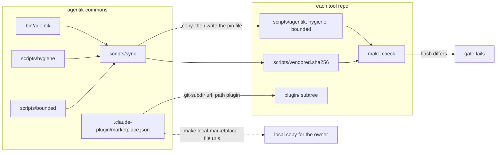
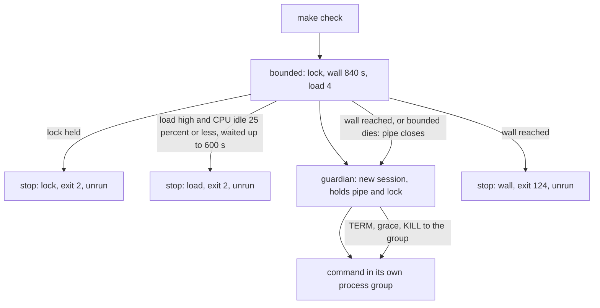

# Phase 1 survey: agentik-commons and the organization profile

Read on 2026-10-14. Sources: `agentik-commons` at commit e456f4b and the organization profile repo (`.github`) at commit 6476f3a, both under `agentik-dev`. Every claim ends with a bracket naming the repo, path and section, the commit, the source note slug in `research/sources/`, and the evidence level. Every level here is "our use" (the agentik repos' own record) unless the bracket says "re-run", which means this survey re-ran something on 2026-10-14. Nothing in these two repos is a measurement of whether the tools help a long session; they record one owner's design and tests.

Writing note: the old tool names are not repeated here. This site's own hygiene scan has a `renamed` group that would flag them, so the old names are described by kind ("the old session launcher name") and the table that lists them is in agentik-commons design/agentik-r1.md §4.1 and GUIDE.md §10.

Key to the brackets: `[commons <path> <section> @ e456f4b; <slug>; <level>]` and `[profile <path> @ 6476f3a; github-org-profile; <level>]`.

## 1. The problem

Commons exists to meet an inconsistency problem, a duplication problem and a leak problem. Its record states the first in two sentences: "Five tools, five naming schemes, three marketplace rules. One tool takes verbs as flags." [commons design/agentik-r1.md §1 @ e456f4b; agentik-commons-r1-record; our use]

**Inconsistent surfaces (the front door and the guide).**
- On 2026-10-13 the five tools had five different executable shapes: relay a Go binary with 12 public verbs and one internal `hook`; session a shell launcher with 12 public verbs, 4 internal ones and frozen code trees in a state folder; decisions a uv tool with 8 verbs; respeak no executable at all; agents eight separate scripts linked into one bin folder, one of which took its verbs as flags. [commons design/agentik-r1.md §2.1 @ e456f4b; agentik-commons-r1-record; our use]
- One name, the session tool's, was at once a marketplace, a state folder and a config folder. Each of the five plugins had its own marketplace. [commons design/agentik-r1.md §1, §2.2 @ e456f4b; agentik-commons-r1-record; our use]
- The names were spread across callers. Counts of files with a hit: 50 for the old session launcher name, 443 for the old bare relay verb form (mostly prose), 140 for the old bare decisions verb form, 26 for the agents tool names and 29 for the old relay subagent prefix. Callers were 27 session briefs in private consumer repos (3 read by running launchers), pasted start lines, subagent types, repo config, generated CLAUDE.md lines, a repo template and the owner's machine settings. The file lists are in private rollout notes, so the counts cannot be re-checked from public repos. [commons design/agentik-r1.md §2.3 @ e456f4b; agentik-commons-r1-record; our use]
- Per-repo spread, as files with the old prefix over files with any old name: relay 6/52, session 20/61, decisions 12/18 plus 4 briefs, respeak 18/20, agents 21/22, the organization profile 1/1. [commons design/agentik-r1.md §6.2 @ e456f4b; agentik-commons-r1-record; our use]

**Names that guardrails depend on (a finding for the guardrails question).**
- Relay's deny guards match by command name, and the record says a new spelling gets past both of the two matching rules. The record cites a guards source file in the relay repo by line; this survey did not open it, so the relay note must confirm it. The rollout therefore requires the guards to match all three spellings, and acceptance line A6 requires a queue row to be denied five spellings of a run or start command. [commons design/agentik-r1.md §2.4, §6.3 (c12), §9 (A6) @ e456f4b; agentik-commons-r1-record; our use]
- Decisions writes its own command name into every generated block, so any new wording makes each `render --check` stale. Session's README test requires the old CLI name. [commons design/agentik-r1.md §2.4 @ e456f4b; agentik-commons-r1-record; our use]
- Plugin names have no aliases, so renaming a plugin renames every slash command and agent. [commons design/agentik-r1.md §2.4 @ e456f4b; agentik-commons-r1-record; our use]

**Duplication (the vendored scripts and the guide).**
- The `bounded` and `hygiene` scripts matched in all five repos and `doclint` in three. A copy that matches today can drift; commons makes one canonical copy and has each repo vendor it with a sha256 pin. [commons design/agentik-r1.md §2.1, §7.3 @ e456f4b; agentik-commons-r1-record; our use]
- The guide takes over the session repo's conventions file (r1, 2026-09-22) so that the other four follow one text. [commons GUIDE.md line 3 @ e456f4b; agentik-commons-guide; our use]
- Hygiene's exit codes were the reverse of the convention (2 on a hit, 1 on usage); the guide sets one meaning per code. [commons design/agentik-r1.md §2.4, §6.1 @ e456f4b; agentik-commons-r1-record; our use]

**Running processes keep old code.**
- A running launcher keeps its interpreter and code tree until the owner restarts it; a RESPAWN restarts only `claude`. Three launchers ran during the survey, one from a pre-move checkout. This is why the rollout needs a cold window and why aliases must stay silent in hooks. [commons design/agentik-r1.md §2.4, §8.4, §8.5 @ e456f4b; agentik-commons-r1-record; our use]

**Leaks into public repos (the hygiene scan).**
- The repos are public while the owner's working context is private. The scan counts hits in six generic groups and prints counts only, never a matched line; owner-specific terms live in a private list outside any repo, and the scan never prints a regex from it. [commons scripts/hygiene docstring @ e456f4b; agentik-commons-hygiene; our use]
- The tests record failures of the scanner itself, found by adversary review rounds whose records are not public. In the relay repo's copy, a tracked file over 4 MiB whose first line held a home path and an email "passed by path only, exit 0" (finding ADV11-15). That led to streaming oversize files (ADV11-3), scanning printable runs in NUL-bearing files (ADV10-17) and decoding UTF-16 (ADV10-8). Another test (ADV6-1) pins that a key, a symlink to a home path and a file named for a private repo are all caught. [commons tests/test_hygiene.py @ e456f4b; agentik-commons-tests; our use]
- This survey re-ran the commons suite on a scratch copy: 49 tests passed, and the scan of commons itself reported 0 hits outside the allowlist, with a warning that no private list was present so only the generic groups ran. [commons tests/, scripts/hygiene @ e456f4b; agentik-commons-tests, agentik-commons-hygiene; our use, re-run 2026-10-14]

**Checks that collide or hang (bounded).**
- Each `make check` runs under `bounded`: one run per tree (a kernel `flock`), a wall of 840 seconds, and no start above a load of 4 per core, confirmed by an idle CPU share at or under 25%. The relay allows 900 seconds. A refusal prints `bounded: stop: lock|load|wall` and the gate reads it as unrun, never red. [commons GUIDE.md §5, scripts/bounded docstring @ e456f4b; agentik-commons-guide, agentik-commons-bounded; our use]
- Commons records the mechanism but no dated incident behind it; its tests are in the session repo (see section 5). The gap is a lead for the unattended-runs page.

## 2. The suite

**Which tools exist and how each is described.** The marketplace lists five plugins with versions as of 2026-10-13 (each repo's main that day):

| tool | what its marketplace entry says | version | form (2026-10-13) |
|---|---|---|---|
| session | profiles for Claude Code sittings: one resolved configuration per session offered to dependent plugins, and a doctor | 2.0.0-alpha.14 | shell launcher plus Python package, frozen trees |
| decisions | verbs over one sectioned `DECISIONS.md` per repo; the plugin carries no data | 0.8.0 | stdlib Python uv tool |
| respeak | machine shorthand for long sessions and a translator for human-facing narratives | 0.8.0 | plugin with its own scripts, no executable |
| relay | queued packet runs, one child per worktree, plus guards (one commit per act, no remote writes) | 0.1.3 | Go binary |
| agents | delegate review to API-billed headless agents under a budget cap, mechanical work to a local model, with cost reports | 1.2.0 | eight scripts |

[commons .claude-plugin/marketplace.json, design/agentik-r1.md §2.1 @ e456f4b; agentik-commons-marketplace-json, agentik-commons-r1-record; our use]

**The profile's one-line purpose.** "Guardrails for long, unattended Claude Code work." Session gives a budget, a hard stop and a charter; relay runs a queue of packets overnight with a gated merge; decisions holds settled decisions; respeak splits shorthand for agents from plain reading for people; agents routes side work to an API key or a local model. [profile profile/README.md @ 6476f3a; github-org-profile; our use]

**How they relate.**
- Each works alone. The guide says it makes them "consistent, not dependent" and the profile says a cross-link turns on only when the other plugin is installed. [commons GUIDE.md line 3 @ e456f4b; profile profile/README.md "How they fit" @ 6476f3a; agentik-commons-guide, github-org-profile; our use]
- Session is an optional provider: it writes a per-session resolved configuration file at SessionStart and on `set`; other plugins read it only when its provider version is in their range, never write it, and run alone without it. [commons GUIDE.md §3 @ e456f4b; agentik-commons-guide; our use]
- Relay starts each packet as a `builder` session and ships `adversary` and `attendant` subagent types; its morning report and decisions' open questions are rendered through respeak; respeak takes its tone from session; agents' status view lists the sessions session tracks. [profile profile/README.md "How they fit" @ 6476f3a; commons design/agentik-r1.md §2.2 @ e456f4b; github-org-profile, agentik-commons-r1-record; our use]
- Two code-level couplings are visible in commons: bounded's idle floor of 25% equals the relay's night idle floor ("the two move together"), and the relay sets the session depth variable to 1 for its children while session refuses depth 2 without `--nested`. [commons scripts/bounded comment, GUIDE.md §3 @ e456f4b; agentik-commons-bounded, agentik-commons-guide; our use]

**Build order: what the record says, and what it does not.** Commons has no history of how the five tools were built or in what order. The partial orderings it does show:
- The session repo's conventions file (r1, 2026-09-22) is the base of the guide, and the canonical hygiene and bounded scripts moved to commons from the session repo. [commons GUIDE.md line 3, design/agentik-r1.md §7.3, design/packets/agentik-r1-commons.md §5 @ e456f4b; agentik-commons-guide, agentik-commons-r1-record, agentik-commons-r1-packet; our use]
- The sibling paragraph every README carries is decisions' wording. [commons design/agentik-r1.md §7.2, docs/sibling.md @ e456f4b; agentik-commons-r1-record, agentik-commons-docs-sibling; our use]
- Respeak was already published on GitHub, and one of the old marketplaces read that public repo. The agents plugin was disabled at survey time. [commons design/agentik-r1.md §2.2, §8.1 @ e456f4b; agentik-commons-r1-record; our use]
- The version numbers are not a build order (session is an alpha of a 2.0.0 line, relay 0.1.3, agents 1.2.0). Dates of each repo's first commit must come from the per-tool surveys.

**What the record says about the suite's history.**
- r1 is the first suite-wide record. The owner's instruction is timed 2026-10-13, 14:15; the record was folded in after a refuter round; the commons packet was built in one sitting the same day (2026-10-13-1: five acts and a five-item fix round); the git log shows the first public commit at 17:10 and a final edit to the rollout order at 17:21 (UTC-7), both on 2026-10-13. The public history starts at that one commit (21 files, 2,939 insertions), so earlier commits the charter names are not visible. [commons design/agentik-r1.md lines 3-5, history/sittings/2026-10-13-1.md, git log @ e456f4b; agentik-commons-r1-record, agentik-commons-sitting; our use]
- Rollout order: step 0 (the owner's private ledger amends four entries), the commons packet (no live effect), tool and profile packets in parallel, the switch, consumer packets, a cold window, then r2 on or after 2026-12-31 which ends the aliases. [commons design/agentik-r1.md §8.1 @ e456f4b; agentik-commons-r1-record; our use]
- At e456f4b only the commons packet is recorded as done; the switch, cold window and r2 are written in the future tense. The organization profile still shows the pre-switch install lines and old CLI names; the record lists it for a profile packet. [commons design/agentik-r1.md §8.2, history/sittings/2026-10-13-1.md @ e456f4b; profile profile/README.md @ 6476f3a; agentik-commons-r1-record, agentik-commons-sitting, github-org-profile; our use]

## 3. The design of commons

**What it holds.** The front door, the guide, one marketplace, the canonical `hygiene` and `bounded`, `sync`, `marketplace-check` and the tests. It "builds no tool": no install target, no plugin (acceptance A9). [commons README.md, Makefile @ e456f4b; agentik-commons-readme, agentik-commons-makefile; our use]

**The front door `agentik <tool>`.**
- 96 lines of POSIX `sh`, version 0.1.0, under a 100-line bound that `make lint` enforces. It validates the name, finds the first executable `agentik-<tool>` on PATH (an empty PATH entry is the current directory), and `exec`s it with the arguments unchanged. It reads and writes nothing and resolves no old name. [commons bin/agentik, Makefile @ e456f4b; agentik-commons-front-door, agentik-commons-makefile; our use]
- Exits: 0 for list, help and version, even with no tool found; 2 for usage; 3 when the tool is not on PATH, with one line naming its repo; otherwise the tool's own code. This survey re-ran it: an unknown tool exited 3 with the repo line, and a malformed name exited 2. [commons bin/agentik, tests/test_agentik.py @ e456f4b; agentik-commons-front-door, agentik-commons-tests; our use, re-run 2026-10-14]
- Plugins and hooks call the dash name, never the front door, so a hook depends only on its own tool. Each tool's install also installs the front door from a vendored copy (D3). [commons design/agentik-r1.md §5.1, §10 @ e456f4b; agentik-commons-r1-record; our use]

**The conventions every tool repo follows** (all from GUIDE.md @ e456f4b; note agentik-commons-guide; our use):

| convention | the rule | section |
|---|---|---|
| layout | a self-contained `plugin/` subtree; `design/` records `<topic>-rN.md`; `packets/`; `history/sittings/` charters `<date>-<n>[-<chain>].md`; no per-repo marketplace file | §1 |
| configuration | layered from shipped defaults up to the invocation; session's resolved file is an optional layer; unknown keys reported, never fatal | §3 |
| tests | Go: state-machine table tests, faked effects, end-to-end against a fake `claude`, race detector, no network. Python: fake `claude` on PATH, every hook tested per event, byte ceilings tested. Every invariant in a design's provability section is one named test | §4 |
| gate | `make check` under `bounded`; README freshness; vendored-script hash check; `doclint` | §5 |
| sittings and charters | a charter per sitting, commit per act, never `--amend` or push, builders in worktrees | §7 |
| packets | closed "may touch" list, a `verify` row, targeted acceptance lines with a measured baseline, six sections under 9,216 bytes; the builder decides inside the design of record, logs each choice in the charter's handover, and names at most one open fork | §9 |
| records | cite a record by section, never a prose range | §8 |
| README and lanes | the facts live in `design/readme/source.md` in the technical lane; `make readme` renders `README.md`; a sidecar of two sha256 lines is the invariant; edit the source, never the README | §6 |
| hygiene | six groups, private list outside the repo, `.hygiene-allow` rows each under a reason line, `.hygiene-live` for running chains | §6 |
| install | the committed tool code is frozen by tree hash and run with `python -P`, so no checkout runs hooks | §7 |
| command surface | `agentik-<tool>`, `<tool>@agentik`, verbs as words, `--help --version doctor` everywhere, `--json` on reads, exit codes 0 done / 1 a check said no / 2 usage or failed precondition / 3 not installed | §10 |

- DECISIONS ledgers: commons does not specify the ledger format. It shows only that the owner's private portfolio ledger is the authority the record defers to (step 0 amends four of its entries before any packet is built), and the profile says decisions keeps settled decisions in one file, copies the few rules every session needs into `CLAUDE.md`, and lets agents draft questions that only the owner settles. The ledger's own rules belong to the decisions note. [commons design/agentik-r1.md §8.0 @ e456f4b; profile profile/README.md @ 6476f3a; agentik-commons-r1-record, github-org-profile; our use]
- Respeak lanes: commons uses the technical lane for READMEs and the profile names three modes (`eli5`, `bluf`, `technical`). The definition of the lanes belongs to the respeak note. [commons GUIDE.md §6 @ e456f4b; profile profile/README.md @ 6476f3a; agentik-commons-guide, github-org-profile; our use]

**The hygiene scan.**
- Six groups: home paths, private networks, sibling tool names, secret shapes, email addresses and `renamed`. Counts only; a symlink is scanned as path plus target; files over 4 MiB are streamed; NUL-bearing files are scanned for home, secret and email over printable runs. Exit 0 no hit outside the allowlist, 1 a hit, 2 usage or failure. [commons scripts/hygiene @ e456f4b; agentik-commons-hygiene; our use]
- `renamed` scans live files only, so records stay unrewritten: `design/`, `bugs/`, `history/`, `NICE_TO_HAVE.md` and `CHANGELOG*` are exempt, but start-line briefs and the newest charter of each declared chain are live. "Newest" is by date and then by n as an integer. [commons scripts/hygiene docstring, design/agentik-r1.md §6.1 @ e456f4b; agentik-commons-hygiene, agentik-commons-r1-record; our use]
- The sibling group's purpose is not stated in the script; commons' allowlist says commons exists to name its sibling tools. [commons .hygiene-allow @ e456f4b; agentik-commons-hygiene-allow; our use]

**The marketplace.**
- One file named `agentik` lists five entries with `source: git-subdir`, the tool repo's public URL and `path: plugin`. Plugin ids become `<tool>@agentik`. Each repo's own marketplace file is deleted, since two install paths would load the hooks twice. [commons .claude-plugin/marketplace.json, design/agentik-r1.md §5.2 @ e456f4b; agentik-commons-marketplace-json, agentik-commons-r1-record; our use]
- `scripts/marketplace-check` reads the file only and checks name, owner, five plugins, URL, path and semver; it fetches nothing. `make local-marketplace` writes the same file with `file://` URLs so the owner's machine uses the same plugin ids. `ref` pins wait for r2 tags. [commons scripts/marketplace-check, Makefile @ e456f4b; agentik-commons-marketplace-check, agentik-commons-makefile; our use]

**Vendoring.** `scripts/sync <repo>` copies the front door, hygiene and bounded into a tool repo's `scripts/` and writes `vendored.sha256`; the repo's `make check` verifies it. The reason given for copies over a library: a Python library could not serve the Go repo. [commons scripts/sync, design/agentik-r1.md §7.3 @ e456f4b; agentik-commons-sync, agentik-commons-r1-record; our use]

**The rename machinery (for completeness).** Old names stay as symlink aliases that print one stderr line on a terminal and stay silent in hooks, pipes and gates; state folders move only in a cold window by `mv` plus a symlink back; every migration is listed (c1 to c19) with its fallback. [commons design/agentik-r1.md §4.3, §6.3, §8.5 @ e456f4b; agentik-commons-r1-record; our use]

**Would a Mermaid diagram show a mechanism?**
- Yes, one for distribution: commons' canonical scripts reach a tool repo through `sync`, which writes a pin file that the tool's `make check` verifies, while the marketplace points at each tool repo's `plugin/` subtree. This is a mechanism a reader cannot get from a table. The sketch:

- Yes, a second one for `bounded`, which belongs on the unattended-runs page: the lock, the guardian that holds the pipe, the command in its own process group, and the three stop reasons. Sketch:

- No for the front door: four rules of dispatch read faster as a table. No for the rename rollout: it is a numbered list in the record.

## 4. Alternatives considered and rejected

Commons has no section headed "alternatives". The record gives each as a constraint with a one-line reason; none is benchmarked and none compares against tools outside the suite.

| option | rejected for | where |
|---|---|---|
| a marketplace file in each tool repo | two install paths would load the hooks twice; one marketplace in commons | GUIDE.md §1; design/agentik-r1.md §5.2 |
| aliasing plugin names | plugin names have no aliases; short ids are taken in the switch and the old ids are disabled, then uninstalled in r2 | design/agentik-r1.md §2.4, §5.1, §8.3 |
| a shared Python library for common code | it could not serve the Go repo; vendored copies pinned by sha256 | design/agentik-r1.md §7.3 |
| the front door resolving old names | it resolves none; aliases are symlinks with no shim, so the hook path is unchanged | design/agentik-r1.md §3, §4.3 |
| plugins calling the front door | plugins call the dash name so each needs only its own tool | design/agentik-r1.md §5.1 |
| merging tool branches before the switch | four old marketplaces read the checkouts and one reads the public respeak repo, so an early merge removes a live manifest (changed in the final commit, 2026-10-13 17:21) | design/agentik-r1.md §8.1, §8.3; git log |
| moving state folders while processes run | moves only in a cold window with no `claude`, launcher or night; the `mv` then `ln -s` race remains and a helper using `lsof +D` is only proposed | design/agentik-r1.md §8.5; NICE_TO_HAVE.md |
| sorting charters lexically | integer order, so the tenth beats the ninth | design/packets/agentik-r1-commons.md ruling 2; acceptance line 9 |
| hashes inside the Makefile | a pin file in `shasum -a 256 -c` form | design/packets/agentik-r1-commons.md ruling 1 |
| a mkdir-style lock directory with a stale-owner check | a kernel `flock`; the docstring calls the old form "mkdir-era" and says the new one has no staleness and no takeover (the reason is read from that wording) | scripts/bounded docstring |
| skipping oversize files in the scan | streaming, after a missed hit (ADV11-15, ADV11-3) | tests/test_hygiene.py |
| keeping hygiene's reversed exit codes | swapped to the guide's meaning | design/agentik-r1.md §6.1 |
| a flag as a verb (the agents CLI) | verbs are words; a dispatcher wraps the eight scripts | design/agentik-r1.md §4.2, §7.2 |
| the owner's machine using the public marketplace | a local `file://` copy (D1), with the public marketplace as the fallback if proof P1 fails | design/agentik-r1.md §5.2, §9, §10 |
| a respeak command in r1 | deferred to a later packet (D4) | design/agentik-r1.md §10 |

[all rows: agentik-commons @ e456f4b; notes agentik-commons-guide, agentik-commons-r1-record, agentik-commons-r1-packet, agentik-commons-bounded, agentik-commons-tests, agentik-commons-nice-to-have; our use]

## 5. What is open or unproven

**Admitted in `NICE_TO_HAVE.md`** (9 items, all from the 2026-10-13 build): [commons NICE_TO_HAVE.md @ e456f4b; agentik-commons-nice-to-have; our use]
- An untested respawn: a launcher's successor may start after a tool packet deletes its repo's marketplace file but before the switch; nobody has tried what it loads. Fix: test in a scratch config folder, or merge no tool packet before the switch.
- The `mv`/`ln -s` race in a folder move; the cold window removes the writers.
- `bounded`'s tests live in the session repo, not in commons.
- Marketplace versions are hand-copied; `marketplace-check` checks only that they are semver.
- `sync` can overwrite a second clone of commons; `make local-marketplace` mishandles a space in its folder, a missing folder, and `make -f` from another folder; the semver check accepts non-ASCII digits; a tool named `help` cannot be dispatched, and `agentik help nosuch` exits 3.

**Unproven in the record.**
- Proofs P1 to P3 are open: a `file://` `git-subdir` entry installs and its hooks run; a disabled plugin's cache survives for a session that loaded it; `uv tool install` after the uninstall yields both command names. Acceptance A2 to A8 (the switch, aliases, cold window) are not shown as run. [commons design/agentik-r1.md §9 @ e456f4b; agentik-commons-r1-record; our use]
- Nothing in commons shows `claude plugin marketplace add` from the public repo succeeding; the packet forbids plugin commands and the check reads the file only. [commons design/packets/agentik-r1-commons.md wall row, scripts/marketplace-check @ e456f4b; agentik-commons-r1-packet, agentik-commons-marketplace-check; our use]
- The switch and r2 (aliases end on or after 2026-12-31, date movable only later) have not happened at this commit. [commons design/agentik-r1.md §4.3, §8.6 @ e456f4b; agentik-commons-r1-record; our use]

**Limits of the checks.**
- The full hygiene scan needs a private list that no public repo holds, so an outsider can run only the generic groups; the scan is regex-based and the allowlist is hand-kept. [commons scripts/hygiene, .hygiene-allow @ e456f4b; agentik-commons-hygiene, agentik-commons-hygiene-allow; our use]
- Commons' own `make check` omits `bounded`, `doclint` and the hash check. The packet file measures 9,913 bytes with `wc -c` (this survey), above the guide's 9,216-byte ceiling for tool-repo packets, and has no `verify` row; the guide binds the five tools, not commons, and says no `doclint` runs until r2. [commons design/packets/agentik-r1-commons.md, GUIDE.md §9, Makefile @ e456f4b; agentik-commons-r1-packet, agentik-commons-guide, agentik-commons-makefile; our use, re-run 2026-10-14]
- The guide notes that packet prompts keep a turns line until the doctor reads the meter hook live, so that check is still pending. [commons GUIDE.md §5 @ e456f4b; agentik-commons-guide; our use]
- Tests use fakes: the front door is tested with stub tools and `sync` with scratch repos; no test runs a real `claude`. [commons tests/ @ e456f4b; agentik-commons-tests; our use]

**Evidence gaps for the site.**
- No measurement shows the conventions improve a long session; all evidence is one owner's use and one day's build. The profile says so itself: "agentik is early and built for the author's own daily use, so expect breaking changes between versions." [profile profile/README.md Status @ 6476f3a; github-org-profile; our use]
- Review-round finding ids (the ADV series), a research-round id and guide labels (D4, D12, E7, T3, T5, a ledger entry) point at private records; a reader cannot follow them. [commons scripts/bounded, GUIDE.md @ e456f4b; agentik-commons-bounded, agentik-commons-guide; our use]
- The profile page lags the record (old install lines). [profile profile/README.md @ 6476f3a; commons design/agentik-r1.md §6.2 @ e456f4b; github-org-profile, agentik-commons-r1-record; our use]
- The sibling group's purpose and the incident behind `bounded` are not written down in commons.

## 6. Glossary candidates

"Defined" means the repo states the meaning; "usage" means this survey inferred it from how the repo uses the word, and the later glossary should confirm it in the tool repo that owns the word.

| term | meaning the repo gives | where | basis |
|---|---|---|---|
| sitting | one working run of an agent on a goal, recorded by a charter; sittings commit per act and never push | GUIDE.md §7; history/sittings/2026-10-13-1.md | usage |
| charter | the short file a session brings up to date before it exits: what it was for, how it ended, what comes next; named `<date>-<n>[-<chain>].md` | profile/README.md; GUIDE.md §1 | defined |
| chain | a named line of sittings (the filename suffix; `-` is the unsuffixed chain) whose newest charter is live | scripts/hygiene docstring | defined |
| act | one unit of a sitting's plan; one commit per act | history/sittings/2026-10-13-1.md; GUIDE.md §7 | usage |
| packet | a short file that says what to build and how to check it | profile/README.md; GUIDE.md §9 | defined |
| may touch / verify row / acceptance line | the closed path list, the gate command and the targeted checks of a packet | GUIDE.md §9 | defined |
| handover | the charter section where the builder logs each choice with its consumer | GUIDE.md §9; the sitting file | usage |
| night | an unattended relay run of queued packets; "no relay night" is a precondition of the switch | profile/README.md; design/agentik-r1.md §8.3 | usage |
| gate | the check a branch must pass to merge; in a packet the `verify` row is the gate line | profile/README.md; GUIDE.md §5 | defined |
| lane | three uses: respeak's "two-lane communication" (machine shorthand versus human narrative; GUIDE.md §6 says "technical lane"), agents' "the lane that fits" the work (API-billed, local model), and a plugin's subagent files "only where the plugin owns a lane" | marketplace.json; GUIDE.md §1, §6 | ambiguous; resolve in the tool notes |
| respawn (RESPAWN) | a restart of `claude` by the launcher; it does not restart the launcher's own interpreter or code | design/agentik-r1.md §2.4 | defined |
| successor | the session a launcher starts after a respawn | NICE_TO_HAVE.md; design/agentik-r1.md §8.4 | usage |
| launcher | the long-lived process that starts and restarts `claude` for a chain; it keeps its interpreter and tree until the owner restarts it | design/agentik-r1.md §2.4, §8.4 | usage |
| frozen tree | the committed tool code copied by tree hash and run with `python -P` | GUIDE.md §7 | defined |
| builder / adversary / attendant | relay's three subagent types; a builder session works a packet | design/agentik-r1.md §2.2; profile/README.md | usage |
| refuter round | the adversarial review that precedes code for an architecture change | design/agentik-r1.md line 3 | defined |
| ledger | `DECISIONS.md`: what a project has already settled in one file; the owner's portfolio ledger holds the cross-repo entries | profile/README.md; design/agentik-r1.md §8.0 | defined |
| record / design of record | a `design/<topic>-rN.md` file cited by section | GUIDE.md §1, §8 | defined |
| front door | the `agentik` command that execs `agentik-<tool>` | design/agentik-r1.md §3 | defined |
| consumer repo | a private repo that uses the tools and needs its own rename packet | design/agentik-r1.md §8.2 | usage |
| vendored copy / pin file | a script copied from commons with its sha256 in `scripts/vendored.sha256` | GUIDE.md §6; docs/sibling.md | defined |
| hygiene group, allowlist, live file | the pattern sets, the exception rows and the files `renamed` scans | scripts/hygiene docstring; design/agentik-r1.md §6.1 | defined |
| alias | an old name pointing at the new code with one terminal note | design/agentik-r1.md §4.3 | defined |
| step 0, switch, cold window, r1, r2 | the rollout stages | design/agentik-r1.md §8 | defined |
| wall | two meanings: a time limit (`bounded --wall 840`) and a packet's list of forbidden acts | GUIDE.md §5; packet and sitting files | ambiguous |
| unrun versus red | a check that did not run to its end (lock, load, wall) versus one that failed | GUIDE.md §5 | defined |
| doctor | the verb that checks the machine; `status` reads once, `report` writes markdown, `run` drives, `hook` is internal | GUIDE.md §10 | defined |
| resolved file / provider | the session's per-session configuration file other plugins may read | GUIDE.md §3 | defined |
| Mod | the one TypeScript hook module per plugin | GUIDE.md §1, §4 | defined |
| owner, coordinator, observer | roles in the record: the person who decides and pushes, the agent that sends a fix round, the party who runs the live proofs | design/agentik-r1.md; the sitting file; the packet | usage |

## 7. Private names seen (kinds only)

- The owner's private portfolio ledger, with numbered entries, and the "step 0" text and paste lines kept in private rollout notes.
- Private consumer repos that use the tools, and the file lists, session briefs and running chains in them.
- The owner's machine: settings, plugin ids installed there, a mirror, a home-folder layout, and owner checkouts named by path in the commons packet's read list.
- The private hygiene list (names, hosts, domains, private repos) that the scan reads from outside any repo.
- A person's name in the licence copyright line and in the git author field.
- A second Go project named in the guide's test standard, which may be a placeholder or a private product.
- Opaque review and ledger labels that point at private records (adversary finding ids, a research round id, decision labels).
- Generic user-level install folders from the public guide (the bin folder, the config and data folders under the user's home) were described, not copied as the owner's paths.
- This site's `renamed` scan flags old tool names in research notes; other phase 1 notes already trip it, which the refuter should check.
