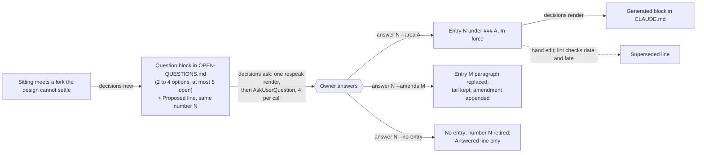
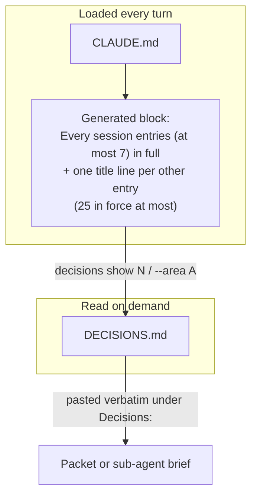

# Tools: agentik-decisions (phase 1 survey)

Scope: the repo `agentik-dev/agentik-decisions` at commit `80d59eb` (all commits in it are dated 2026-10-13, the first public commit; the working history inside it runs 2026-09-22 to 2026-10-13). Read 2026-10-14. Every claim below names its path, the commit `80d59eb` and the source note slug. The evidence level follows in words: "our use" means the repo's own record (an incident, a log line, a test, a design file); "measured by this session" means I ran the tool on a scratch copy; "conjecture" means reasoned and untested. The tool is young, has one owner, and the evidence for it is the owner's own use. Nothing here is a controlled comparison.

Source notes written for this survey: `agentik-decisions-readme`, `agentik-decisions-d17-four-verbs`, `agentik-decisions-d18-one-flow`, `agentik-decisions-d23-backlog-view`, `agentik-decisions-packets`, `agentik-decisions-nice-to-have`, `agentik-decisions-history-design`, `agentik-decisions-history-sessions`, `agentik-decisions-history-sittings`, `agentik-decisions-plugin`, `agentik-decisions-tests`, `agentik-decisions-src`, `agentik-decisions-claude-md`, `agentik-decisions-makefile`, and `agentik-decisions-run-on-relay-ledger` (a run on the relay repo's public ledger).

## 1. The problem

The tool meets one problem: decisions the owner has settled must reach every session of a long, repeated, partly unattended workflow, without every session reading a long file, and without agents moving a decision into force on their own. The README states the purpose in these terms: one owner runs several Claude Code plugins in unattended relay runs where one session hands its work to the next, so the decisions must reach every session and no session should read a long file whole (agentik-decisions README.md:8-15 @ 80d59eb; agentik-decisions-readme). The repo's evidence for the problem is below. Where the repo shows a failure of the tool itself, I say so, because those incidents are also evidence of what a ledger tool must guard.

### 1.1 A decision log too long to read, kept in sync by hand

- The first consumer's ruling log, at the design's pin of 2026-09-22, was one file of 242,404 bytes holding 214 rulings. The longest single ruling was 13,654 bytes. A hand-kept index was 41,576 bytes and lagged four rulings behind (agentik-decisions history/design/decisions-r1.md §7 Decision 1 and §8.1 @ 80d59eb; agentik-decisions-history-design). Our use, the repo's own measurement; the consumer repo is private and described generically.
- A hand-written mirror of the rulings in that consumer failed its completeness test three times in four days, and its main branch stayed red until a fix commit (decisions-r1.md §7 Decision 2 and §8.1; agentik-decisions-history-design). Our use. The first design answered with a generated block "rendered, not remembered" (§8.1).
- The consumer's session rules already forbade reading the log whole (decisions-r1.md §6; agentik-decisions-history-design). The tool exists so that the cited rulings can still be read by number. Our use.
- A conversion study over the same log counted 210 index rows: 91 in force, 88 spent, 18 superseded and 13 mixed. The 91 in-force entries came to 103,047 bytes, about 43 percent of the log's 242,404 bytes (history/design/ledger-conversion-r1.md §2 @ 80d59eb; agentik-decisions-history-design). Our use. It also found 75 different free-text scope labels among the 91, 64 of them used once.

### 1.2 Decisions that drift between the record and the design that cites them

- Review r6 (2026-09-23), one day after the first design, found 17 decisions made since the design of record. Seven lived only in a change-log and three only in a handover charter, so the body of the design still described the first version. It lists five reversals or tensions (history/design/review-r6.md §1 and §2 @ 80d59eb; agentik-decisions-history-design, agentik-decisions-history-sittings). Our use. This is a forgotten-decision failure inside the tool's own repo, and it is the repo's nearest record of "decisions forgotten between sessions".
- The repo's answer to its own drift: a rule that a design record is never edited after its first version and every change is a change-log row (review-r6.md §1, R6-17), then an r2 fold on 2026-09-23 that folded the change-log rows back into the body (decisions-r1-changelog.md row `r2`; agentik-decisions-history-design). I did not find a measure of whether drift fell afterwards. Open.
- The first design cites a private assessment of "decision flapping" for a finding that rulings made before anything uses them are the ones that get re-cut; it makes "no ruling without a consumer" the response (decisions-r1.md §7 Decision 4 and §2; agentik-decisions-history-design). Reported by the repo; the assessment itself is not in this repo, so I could not open it. I found no charter in `history/sittings/` that records a decision re-litigated across sittings (greps over `history/` for flap, re-litigate, re-cut, re-asked and similar; agentik-decisions-history-sittings). The claim of flapping is therefore the owner's report, not an incident I can cite.

### 1.3 Owner questions: scattered, re-rendered, and blocked by a cap

- The standing rule the tool serves is that the owner is asked once per session, in one batch, in plain English, each question with its recommended answer (the packet design/packets/d18-one-flow.md quotes it at line 15, seen by search only; design/d18-one-flow.md §1 step 2 and plugin/skills/ask/SKILL.md state it @ 80d59eb; agentik-decisions-d18-one-flow, agentik-decisions-plugin). Our use. The rule's origin is an entry in the owner's private cross-repo ledger.
- Incident, 2026-10-11: two sittings each put four questions the same day, within the cap of five. After the branches merged, the file held eight. The sitting holding the owner's answers to four of them ran `agentik decisions answer`, which refused with "OPEN-QUESTIONS.md:100: 7 questions open; the cap is 5". The sitting set the other four aside, ran the four answers, and restored them byte for byte: four hand edits of the two files the tool exists to guard (history/sessions/INTAKE-2026-10-11-<consumer>-answer-over-the-cap.md @ 80d59eb; agentik-decisions-history-sessions). Our use. By reading the code, the refusal still stands at `80d59eb`: `answer` lints the result of its write and refuses on any problem (src/decisions/answer.py:196-200), and the open-question cap is among the problems (src/decisions/questions.py:210-212); I did not run this case and no test name covers it (agentik-decisions-src, agentik-decisions-tests).
- Stale text around the tool: a consumer's question file still read "No decision is open" above two new questions; its date was a day old after two answers; a hand-written count read "One decision is open: 56" after 56 was answered (NICE_TO_HAVE.md lines 22, 23, 63 @ 80d59eb; agentik-decisions-nice-to-have). Our use; each is labelled in the file as seen but not confirmed as the tool's doing.
- Cost of asking: one `ask` over two questions took about three minutes, and every `ask` sends all open questions through a model again so a carried question is reworded each time (NICE_TO_HAVE.md lines 21 and 24; agentik-decisions-nice-to-have). Reported by the observer's helper, not confirmed.

### 1.4 The tool's own verbs damaged entries (why the guards exist)

Each of these is a recorded sighting that became a packet and a test (design/packets/ d19, d21, d22 @ 80d59eb; agentik-decisions-packets). Our use.

- 2026-10-02: answering decision 35 with `--amends 9` dropped an earlier amendment clause from entry 9, restored by hand. The fix keeps the whole tail and appends the new clause.
- 2026-10-08: `answer 59 --amends 29` with two new sentences cut entry 29 from 2,267 bytes to 801. The run printed only "entry 29 amended", and the session found the loss an hour later. The fix: `--text` is the whole paragraph in force; the run prints the old paragraph as `replaced:`; a paragraph under half the old length is refused unless `--shorter`.
- 2026-10-10: two real entries passed a ledger-shaped line as `--text` and came out with the bold title and the dated tail twice; `render --lint` passed both. The fix: `--text` is the body only, and the lint names a doubled title or tail. Three shapes still evade the lint (NICE_TO_HAVE.md line 31).
- A trade-off the fix created: `replaced:` prints the whole old paragraph, 3.5 KB for one consumer entry, on every amendment (INTAKE-2026-10-11 "Also seen"; agentik-decisions-history-sessions). Our use.

### 1.5 Context eaten by an unbounded ledger

- The repo's measurements are about bytes per lookup, not tokens. The first design says no token number is claimed: "the 2.8x rise" it mentions is not named further, no measurement isolates the ledger's share, and the burn report that would measure it was specified and not built (decisions-r1.md §8.2; agentik-decisions-history-design). The README states no saving either (agentik-decisions-readme). So the claim that the ledger saves context is unmeasured in this repo. Evidence: conjecture, with the test it names: a burn report over real sittings.
- Its reasoning is an inline-or-retrieve model: always-loaded text costs its size times the turns; a lookup costs one extra turn that re-reads the context. With assumed 300 turns, 100k tokens of context and 2 lookups per sitting, inline wins below about 667 tokens, about 2.7 KB (decisions-r1.md §8.3). Conjecture; the model ignores prompt-cache pricing (see section 5).
- A second context cost showed up after use: the generated block lists every entry in force by title, so a ledger rendered into a user-level CLAUDE.md shows a repo's local entries to a session in any repo (INTAKE-2026-09-29; agentik-decisions-history-sessions). Our use; the proposed fix, an area marked local, is not in the code (grep of `src/decisions/` for "local" finds only path code) and is not in NICE_TO_HAVE.md.

### 1.6 Review loops

- No charter records a review loop that failed to end in this repo. The nearest evidence: three successive adversarial reviews of the first design (2026-09-23) listed 11, 9 and 7 findings by heading, each with one rated high, and each verdict said the tool was not yet the authority for the first consumer's rulings (history/design/review-adv6.md, review-adv10.md, review-adv11.md, Verdict sections @ 80d59eb; agentik-decisions-history-design). Our use. The first design also capped itself at "three passes ever" (decisions-r1.md header).
- The repo's practice for ending reviews: later reviews run two rounds per change, and findings that do not block go to `NICE_TO_HAVE.md`, whose first paragraph says nothing in it blocks a review or a merge (NICE_TO_HAVE.md opening; agentik-decisions-nice-to-have). The relay repo's ledger states the same bar as an owner's rule of 2026-09-25: a review may block only on unmet acceptance criteria, bugs or failing tests, or a conflict with an entry (agentik-relay DECISIONS.md header @ a326550; agentik-decisions-run-on-relay-ledger). Our use. That the bar ended any loop is not shown here.

## 2. The design

### 2.1 The ledger

One `DECISIONS.md` at the repository root, in three sections in order (README.md:17-48; design/d17-four-verbs.md "The ledger format" @ 80d59eb; agentik-decisions-readme, agentik-decisions-d17-four-verbs). Our use.

| part | content |
|---|---|
| `## In force` | `### Every session` first, then one `### <area>` each; every entry sits under a subsection |
| `## Proposed` | one line per open question, `(proposed YYYY-MM-DD; OPEN-QUESTIONS.md)` |
| `## Superseded` | one line with a date and a fate: `replaced by`, `merged into` or `lapsed with` (the code also takes `superseded by`) |

- Entry shape: `N. **Title.** paragraph (YYYY-MM-DD; source[; amended YYYY-MM-DD, source]...)`, one line, the title ending in `.`, `?` or `!` inside the bold (design/d18-one-flow.md §2; src/decisions/ledger.py:1-20 @ 80d59eb; agentik-decisions-d18-one-flow, agentik-decisions-src).
- Numbers are unique across the three sections and never reused; an answered question keeps its number as an entry or as an Answered line (README.md:46, 131).
- Only the owner's answer moves a question into force; agents draft (README.md:15; plugin/skills/decisions/SKILL.md section 4 @ 80d59eb; agentik-decisions-plugin).
- A legacy marker line, `<!-- decisions: legacy below -->`, ends the parsed part so an older ledger can adopt the shape for new entries only; `show` and `find` still read below it (README.md:48). Two older ledgers of 393 and 98 entries failed the shape when the design was written (design/d18-one-flow.md §2).
- Retiring an entry in force into Superseded has no verb. The only code that touches the Superseded heading finds it to place a Proposed line before it (src/decisions/ask.py:175); the lint then checks that a Superseded line has a date and a fate (src/decisions/ledger.py:120-124). By reading the code; not run.

### 2.2 The cap: 25 in force, 7 under Every session

- The numbers are in the design as chosen limits with no stated reason: "Caps: at most 25 in force, at most 7 under `Every session`" (design/d17-four-verbs.md "The ledger format"; src/decisions/ledger.py:40, checks at :249-255). I found no sentence in the repo that explains 25 or 7 (greps for the numbers and for "why" across `design/` and `history/`). The README says only that the ledger "caps its size" (README.md:12). Gap; the rationale may sit in the owner's private cross-repo ledger or research note.
- What the code shows: the cap counts entries, not bytes. No check in `ledger.py` measures an entry's length. Consumer entries recorded in the repo run 2,267 bytes (d21 packet) and about 3.5 KB (the 2026-10-11 intake), against about 1.6 KB for the longest entry line in the relay's ledger (measured by this session, agentik-decisions-run-on-relay-ledger). Conjecture: seven `Every session` entries of that size could put tens of kilobytes in the always-loaded block, well past the 2.7 KB the first design's model allowed. What would test it: render a real ledger at its caps and run `wc -c` on the block.
- The cap is enforced where the owner works: `render --lint` exits 1 at a 26th entry in force and at an 8th `Every session` entry (tests/test_ledger.py `test_26_in_force`, `test_8_in_every_session` @ 80d59eb; agentik-decisions-tests). Our use.
- Open questions have their own cap of five (src/decisions/questions.py:40). The reason is stated only by implication: the AskUserQuestion interface takes four questions per call (design/d18-one-flow.md §1.1), so five makes two calls.

### 2.3 The generated CLAUDE.md block

`agentik decisions render` writes the block between `<!-- BEGIN GENERATED: decisions -->` and `<!-- END GENERATED: decisions -->` in the CLAUDE.md beside the ledger, or in a file passed with `--into`. The block holds one line naming the source and the regenerating command, the full text of the `Every session` entries, a sentence saying `agentik decisions show N` reads one entry, and then `- N Title (area)` for each other entry in force. Proposed and Superseded entries stay out (src/decisions/render.py:50-78; README.md:157-177 @ 80d59eb; agentik-decisions-src, agentik-decisions-readme). Our use.

- Measured by this session on scratch copies: the repo's sample ledger (1,155 bytes) gives a 563-byte block; the relay repo's real ledger at its commit a326550 (7,995 bytes, 12 entries in force, no `Every session` area) gives a 984-byte block of 18 lines, about 12 percent of the ledger (agentik-decisions-tests, agentik-decisions-run-on-relay-ledger). `render --lint` exited 0 on the relay ledger.
- Freshness: `render --check` exits 1 with a diff when the block is stale, and the Makefile's `decisions` step runs it when a ledger exists, so a stale block fails `make check` (Makefile `decisions` target; agentik-decisions-makefile). `answer` also rewrites the block when the file holds the markers (README.md:153).
- The block can be rendered into a user-level CLAUDE.md for a cross-repo ledger; it then names the ledger whole and its commands carry `--ledger` (render.py:50-67). The first design held that no decision content goes into a portfolio CLAUDE.md above the checkouts, "because a parent file taxes every repo beneath it" (decisions-r1.md §9). The d17 design passes `--into` a user-level CLAUDE.md for the cross-repo ledger, which also loads in every repo, and the 2026-09-29 intake records the cost (section 1.5). The repo does not discuss whether the two cases differ. A tension inside the repo.

### 2.4 Batched owner questions: `new`, `ask`, `answer`

Flow (design/d18-one-flow.md §1; plugin/skills/ask/SKILL.md; README.md:110-155; agentik-decisions-d18-one-flow, agentik-decisions-plugin, agentik-decisions-readme):

1. `new` writes a four-part question to `OPEN-QUESTIONS.md` (where things stand, the choice, what each answer sets in motion, the recommendation) with two to four options, the first recommended, and a Proposed line under the same new number. It refuses a sixth open question, a label over five words, or a choice that does not end in `?`. It runs under a lock so parallel runs take distinct numbers; both files are written or neither.
2. `ask` runs once per session, when the sitting blocks on the owner or at close. It sends the open blocks through respeak once (a constant contract keeps headings, numbers, bold labels and option labels), writes the reworded blocks back, and prints AskUserQuestion calls, at most four questions each. With respeak absent or a failed render, the text stays, one warning goes to stderr, and the exit is 0.
3. The skill passes each call to AskUserQuestion unchanged. A result with `afkTimeoutMs` is no answer, and the question is not asked again that session. A headless sitting, such as a relay child, runs `ask` for the render alone, and the owner answers on the `Your answer:` line for the next attended sitting to enter.
4. `answer N` records the answer in one of three ways: a new entry under an area, `--amends M` to replace entry M's paragraph, or `--no-entry`. It removes the question and its Proposed line, adds an Answered line, retires the number, and rewrites the CLAUDE.md block, all under the lock with both files written or neither.

Guards added after incidents: the whole-tail rule (d19), the `replaced:` print and the half-length refusal with `--shorter` (d21), the body-only `--text` (d22), and the shape lint (d-n3) (agentik-decisions-packets). Our use.

The README states the batching as policy and not as a measured benefit. I found no measurement of owner interruptions before or after.

### 2.5 `backlog`, `doctor` and the lint

- `backlog` (0.5.0) reads each repo's `NICE_TO_HAVE.md` and `HANDOFF.md` build order and places S1 and S2 items first, then each open step with the items that share a path, then S3, then S4; an item with no level prints `S4?`. It writes nothing and runs no model. The skill tells an agent to run it before S4 work (design/d23-backlog-view.md §1 to §5 @ 80d59eb; agentik-decisions-d23-backlog-view). Our use. Its motive is stated as the owner's answer to an observer's study (d23 header), not as a recorded failure. One operations repo's backlog of about 600 items is the stated reason it may need a cap (§8).
- `doctor` prints one `ok`, `warn` or `fail` line per check: python, tool version, marketplace and plugin, session provider, ledger lint, and respeak. A warn never changes the exit (src/decisions/doctor.py docstring; agentik-decisions-src).
- The lint (`render --lint`) checks section shape, entry shape, unique numbers, both caps (25 and 7), the dated tail with a named source, the Superseded fate, and for the questions file: the first heading, at most five open, four labels in order, two to four options with only the first recommended, an answer line, and one Proposed line per open question (README.md:157-169). It runs before any write in `render`, and `answer` lints the result of its own write. Our use.
- 356 unittest cases and no allowed skips are stated in the README status line and `tests/skips.allow` (README.md:261, 279; agentik-decisions-tests). I did not run the suite.

### 2.6 Would a Mermaid diagram show a mechanism?

Yes, two, and only these two (the rest of the tool is a list of verbs).

1. The lifecycle of a decision, which shows that the Proposed line, the question block and the number are created together and removed or retired together, and that retiring an in-force entry is a hand edit:

2. Where the ledger sits in the context: a small block that loads on every turn and a large ledger read only by number or area, with the cap bounding the block. It shows what the cap bounds: the number of lines in the block, not its bytes:

Both diagrams are my sketch from the sources cited in 2.1 to 2.4; the repo has no diagram.

## 3. Alternatives considered and rejected

As the repo records them. Where it records no reason, I say so.

- **One file per ruling, with front matter, a closed tag list, a generated index and a verb that only the owner may run** (the design of 2026-09-22, versions 0.1 and 0.2). Replaced in version 0.3.0 by one sectioned ledger; the packet lists what was dropped (record files, front matter on entries, the tag list, `INDEX.md`, the `governs` map, the `rule` verb and its hook, `scope`, `supersede`, `convert`, `stats`, `check`, `index`) and gives no prose reason (design/d17-four-verbs.md "Dropped" @ 80d59eb; agentik-decisions-d17-four-verbs). The cost of the first design is visible in its reviews: the first high-rated finding was that "only the owner moves a status" held only if an agent used the verb, since a direct file edit could forge an in-force record with every gate green (history/design/review-adv6.md ADV6-1; agentik-decisions-history-design). That the reviews drove the redesign is my inference; the repo says only that the redesign carries the owner's direction of 2026-09-28. Conjecture on cause.
- **Converting the old log by hand, or at all.** The first design refused hand conversion of 214 rulings. A tool-drafted conversion was designed, failed its refuter (5 blocking, 4 major, 8 minor, three counts false at the pin), was folded, and was dropped with `convert` in 0.3.0 (history/design/ledger-conversion-r1.md and ledger-conversion-refuter-1.md; agentik-decisions-history-design).
- **Inline everything versus retrieve.** The first design chose by the model in section 1.5: an eight-decision site repo renders inline, a set of about a hundred stays on demand (decisions-r1.md §8.3). The current design splits the difference: `Every session` entries inline, the rest as title lines.
- **`@`-imports of an index.** Out of scope by name because the record says Claude Code expands imports at launch (decisions-r1.md §9; claim to check, section 5). The tool's own CLAUDE.md does import a static include file (agentik-decisions CLAUDE.md; agentik-decisions-claude-md), but that file is style rules, not the decisions.
- **Other ADR forms.** Out of scope by name: optional sections of MADR, Y-statements as prose, static-site tooling of the log4brains kind, MCP servers, and agent-authored rulings in the AgDR style (agents draft `proposed`; only the owner rules). The repo borrowed the generated-and-checked index pattern from adr-tools' table-of-contents generator, on the owner's directive of 2026-09-22 (decisions-r1.md §9; decisions-r1-changelog.md row `ruled`; agentik-decisions-history-design). It gives no reason per form.
- **Per-component directories.** Rejected because six of the last eight rulings bound two to five components each, so a directory per component would split or duplicate them and a worker scoped to one directory would miss a global constraint (decisions-r1.md §7 Decision 3). Our use.
- **Decision content in a parent CLAUDE.md above many repos.** Rejected in the first design; the cross-repo block in a user-level CLAUDE.md sits in tension with it (section 2.3).
- **Choices inside the d18 design, each logged as reversible** (design/d18-one-flow.md §6): one `OPEN-QUESTIONS.md` per repo, not one shared file; no `migrate` verb; `answer --note` dropped; the measure-and-rerun gate, `metadata.source` and `preview` cut; respeak's own `hooks.ask` left unbuilt. The earlier `new --answers` prose string became two to four `--option` flags in 0.4.0 (README.md:300).
- **Respeak as a dependency.** Rejected in d23: respeak stays optional, a static include file ships instead, and users never need it (design/d23-backlog-view.md §6; agentik-decisions-d23-backlog-view).
- **Claude Code memory files and a longer CLAUDE.md.** I found no comparison in the repo. The first sitting's prompt notes its memory directory was empty and the research conclusions were in named files; the design cites a few of the owner's memory files as sources (history/sessions/PROMPT-2026-09-22-first-sitting.md; decisions-r1.md; agentik-decisions-history-sessions). A gap phase 2 should fill from outside sources, with this repo as the "our use" side.

## 4. What is open or unproven

- **Benefit is unmeasured.** No token or turn count compares a session with and without the block; the first design disclaims one (decisions-r1.md §8.2) and the burn report was not built. Level: conjecture.
- **One owner.** The README and design name one owner and a handful of the owner's repos (README.md:10; agentik-decisions-readme). The only public ledger I could run the tool on has 12 entries (agentik-decisions-run-on-relay-ledger). The tool's own repo keeps no ledger (CLAUDE.md; Makefile `decisions` step prints "no DECISIONS.md"; agentik-decisions-claude-md, agentik-decisions-makefile). The cap has therefore not been shown to hold in a public repo at 25 entries.
- **Why 25 and 7** is not recorded (section 2.2), and the count-not-bytes gap is open.
- **The over-cap `answer` refusal** from the 2026-10-11 intake is not fixed by reading the code, has no test name, and is not in NICE_TO_HAVE.md.
- **The area-local marker** from the 2026-09-29 intake has no code and no NICE_TO_HAVE item.
- **Authority is a manner, not a guard.** The skill says only the owner's answer moves an entry in or out of force; the plugin ships no hook, the lint checks shape not authorship, and the earlier design's reviews showed a verb-level version of the same rule was bypassable by direct edits (plugin/skills/decisions/SKILL.md section 4; ADV6-1). Open; conjecture that the same bypass applies today, testable by editing a Proposed line into force by hand and running `render --lint`.
- **Retirement has no verb**, so the only pressure to retire at the cap is the lint failing (section 2.1).
- **`ask` is slow and rewords** (NICE_TO_HAVE.md lines 21, 24); the live respeak gate on question blocks has no test (line 20); whether the copied respeak configuration is read is not shown (line 43).
- **Atomicity.** A kill between `answer`'s two renames leaves the ledger and the question file disagreeing (line 36).
- **Design files lag the code.** `design/d18-one-flow.md` section 3 and line 17 are stale at 0.8.0 (NICE_TO_HAVE.md lines 44 and 58), and the `backlog` design is `status: draft` (agentik-decisions-d23-backlog-view).
- **The README render is expensive.** `make readme` is a model call of 3 to 14 minutes and was refused by its verifier five times across two landings on one- and two-line edits (NICE_TO_HAVE.md lines 25 and 29; agentik-decisions-history-sittings). This is about the repo's docs, not the ledger.
- **Why the per-file design was dropped** is recorded outside this repo (section 3).

## 5. Claims the repo makes about the field, for phase 2 to check

Each is the repo's claim or an unstated assumption; none was checked here.

| claim | where | suggested check |
|---|---|---|
| Claude Code expands `@`-imports at launch, so importing an index loads it every session | history/design/decisions-r1.md §9 (cites a private note) | Claude Code memory documentation on imports |
| A parent CLAUDE.md above several repos loads in every repo beneath it and taxes each | decisions-r1.md §9 | Claude Code memory documentation on the file hierarchy |
| A skill loads only its description at session start and its body on use; keep the body under 500 lines | decisions-r1.md §4.2 | Anthropic skills documentation (progressive disclosure) |
| An always-loaded index costs size times turns; a retrieval costs one extra turn that re-reads the context; inline wins below about 667 tokens | decisions-r1.md §8.3 | prompt-cache documentation: cached reads are priced below fresh input, which the model ignores |
| A growing always-loaded memory file hurts sessions (implied by "caps its size" and the 25 and 7 caps; never stated or cited) | README.md:12; design/d17-four-verbs.md | long-context and instruction-following studies in part 1, questions 1 and 3 |
| AskUserQuestion in Claude Code 2.1.284 takes one to four questions and two to four options per call, advises a header within 12 characters and a label within five words, and adds "Other" itself | design/d18-one-flow.md §1.1 | Claude Code documentation and changelog, dated |
| A result with `afkTimeoutMs` is no answer | design/d18-one-flow.md §1.2; plugin/skills/ask/SKILL.md step 4 | Claude Code documentation or changelog |
| A skill and a command of the same name collide | design/d18-one-flow.md §6 | plugin documentation |
| A hook that times out fails open | history/design/review-r6.md §3 item 3 | Claude Code hooks documentation |
| Decision "flapping": rulings made before anything uses them are re-cut; a named consumer prevents it | decisions-r1.md §7 Decision 4 and §2 (cites a private assessment) | ADR and decision-record literature; practitioner reports on churn |
| The program's "2.8x rise" is due to the corpus and how sessions read it together | decisions-r1.md §8.2 | none available; the source is private |
| The ADR forms named (adr-tools table-of-contents generation, MADR, Y-statements, log4brains, AgDR) behave as the repo assumes | decisions-r1.md §9; decisions-r1-changelog.md row `ruled` | ADR tooling documentation |
| Asking the owner once per session in one batch is better than asking as questions arise | design/d18-one-flow.md §1 step 2; ask skill | studies of interruption cost; practitioner reports; the repo states it as the owner's rule, not a finding |

## 6. Glossary candidates

| term | meaning the repo gives | where |
|---|---|---|
| ledger | the one sectioned `DECISIONS.md` a repo keeps for settled decisions | README.md:5-6 |
| entry | one numbered line in the ledger: title, paragraph, dated tail | README.md:43; src/decisions/ledger.py docstring |
| in force | the section of entries that currently bind; at most 25 | README.md:42, 47 |
| Every session | the `###` subsection whose entries are copied in full into the generated block; at most 7 | README.md:42, 47 |
| area | a `###` subsection of In force; `show --area` reads one whole | README.md:81 |
| Proposed | a one-line draft tied to an open question; only the owner's answer moves it into force | README.md:44 |
| Superseded | retired entries, each with a date and a fate (`replaced by`, `merged into`, `lapsed with`) | README.md:45 |
| tail | the closing parenthetical: a date, then `;` or `,` and a source; an amendment adds `; amended DATE, source` | README.md:43; design/d18-one-flow.md §1.2 |
| number | an entry's id, unique across sections, never reused | README.md:46 |
| legacy marker | the line `<!-- decisions: legacy below -->` that ends the parsed part of an older ledger | README.md:48 |
| generated block | the CLAUDE.md text between the BEGIN and END markers, written by `render` | README.md:170-175 |
| open question | a four-part block in `OPEN-QUESTIONS.md` with 2 to 4 options; at most five open | README.md:110-136 |
| Decided without asking | the section of `OPEN-QUESTIONS.md` where a reversible choice is logged in one sentence | plugin/skills/decisions/SKILL.md section 4 |
| Answered | the section of `OPEN-QUESTIONS.md` with one dated line per answered question | README.md:153, 168 |
| ask | the verb and skill that put the open questions to the owner in one batch | README.md:138-144 |
| answer | the verb that records the owner's answer as an entry, an amendment or nothing | README.md:146-155 |
| amend | replace an entry's paragraph, keep its tail whole, append an amendment clause | README.md:150; design/packets/d19 |
| lint | `render --lint`: shape, numbers, both caps, the questions file | README.md:157-169 |
| cap | the limits of 25 in force, 7 under Every session and 5 open questions | README.md:47; questions.py:40 |
| backlog | the placement of `NICE_TO_HAVE.md` items against a build order | README.md:89; design/d23-backlog-view.md |
| S1 to S4 | priority levels: harm, blocks the goal, the build order, the rest (the session plugin's) | design/d23-backlog-view.md header |
| build order | the numbered open steps in `HANDOFF.md` | design/d23-backlog-view.md §3 |
| doctor | the maintenance verb: one ok, warn or fail line per check | README.md:88 |
| consumer | the named thing that waits on a decision or a change; "no ruling without a consumer" | decisions-r1.md §2; packets' `Consumer:` lines |
| owner | the one person who moves a decision into force | README.md:15 |
| observer | a role that logs sightings and runs the final check before a merge; not defined in this repo | NICE_TO_HAVE.md; packets' `verify` rows |
| cross-repo ledger | the owner's ledger of decisions that bind every repo, rendered into a user-level CLAUDE.md | design/d18-one-flow.md header; INTAKE-2026-09-29 |
| sighting | an observed failure written down before it becomes a packet | design/packets/d19, d21, d22 |
| packet, sitting, charter | defined in the session tool and the commons; here, a builder's instruction file, one working session, and its handover record | design/packets/; history/sittings/ |

## 7. Private names seen

Kinds only. None is written in the source notes or this file.

- A family of private sibling repositories owned by the owner, one of which was the first consumer of the ledger (a private product with a very large decision log and a Go test that read it), one an operations repo that now hosts the cross-repo ledger, one a machine-level configuration repo, one a small configuration repo, and one a private research repo that holds the research notes the first design cites.
- The owner's laptop or workstation, described in the sources as a machine with a registry file, a freeze step and an installed-tools list.
- Home-directory checkouts and user-level tool and plugin install paths, in packets and design files.
- The owner's personal name in the plugin manifest's author field, and the owner's commit-trailer address in the repo's hygiene allowlist.
- The name of a private hygiene pattern list kept outside the repo, and the hash of the private-term scan.
- Commit hashes and file line anchors in private repos, used as pins.
- The relay repo's former name, used in this repo's text, which I replaced with "the relay repo".
- Role names of models and agents (a design model, a builder model) with dated versions; not private, but dated and not used here.
