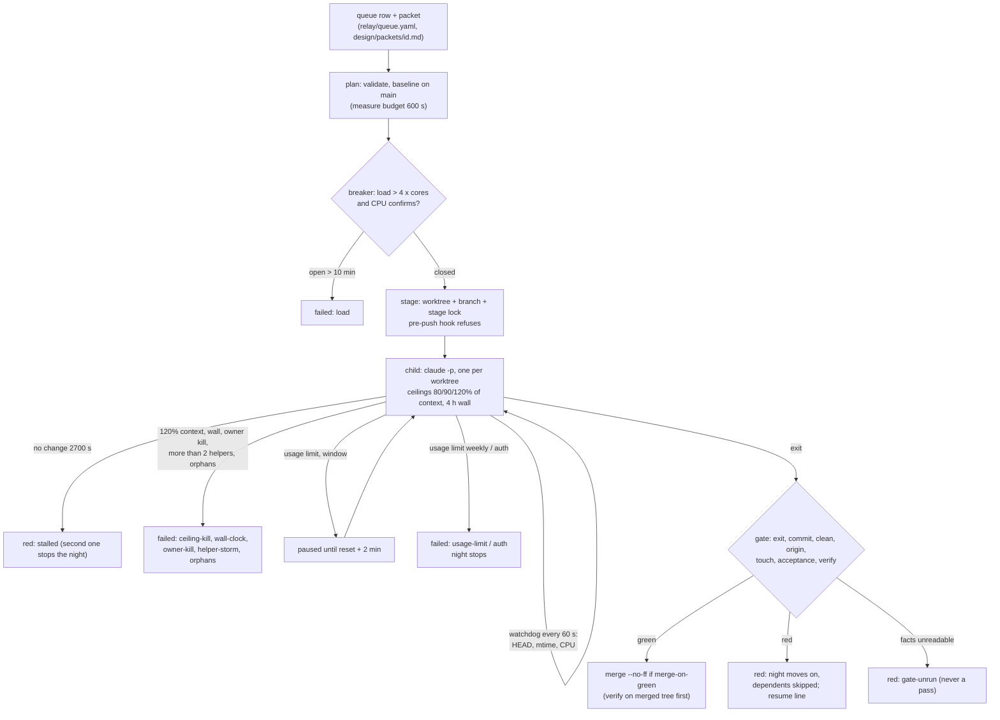

# Tool survey: agentik-relay (phase 1, internal survey)

Source: `agentik-dev/agentik-relay` at commit `a326550`, read 2026-10-14 from `.sources/agentik-relay`. Below, `agentik-relay` means that repo and commit.

Citation form: `(agentik-relay <path>:<line> @ a326550; <source-note slug>)`. Every slug is a note in `research/sources/`. Evidence levels follow the brief: every claim here is **our use** (the repo's own record: an incident, a log line, a test, a design page) unless it says **conjecture**. Nothing here is measured in the brief's sense (a study with a method a stranger can read) and nothing is documented (vendor documentation); section 5 lists the claims that need that check.

What the tool is, in one paragraph: a static Go binary, `relay`, and a Claude Code plugin that run queued "packets" headless overnight. Each queue row gets one git worktree, one branch and one `claude -p` child. A deterministic gate decides whether the row merges. Thirty named stop reasons end a night. Two layers cap money. A person reads one report in the morning (agentik-relay README.md, opening paragraph and "The door"; agentik-relay-readme). Status: version 0.1.3, 699 tests by the README's count, "Nothing is stable before 1.0.0" (agentik-relay README.md "Status" @ a326550; agentik-relay-readme). The "stand-in" below is the earlier Python script `sitting-relay` that the Go relay replaced; its docstring, gate, ledger line and stop conditions were inputs to the design (agentik-relay design/relay-r1.md:3 @ a326550; agentik-relay-design-r1). Its own record is outside this repo.

---

## 1. The problem

The tool meets one problem: a person starts a long run of Claude Code sessions, goes to sleep, and the run must neither damage the machine or the repo, nor spend without bound, nor leave the person unable to get back into a stopped session. The repo states it that way: the night "fails early (a pre-check, a circuit breaker, a wall clock, a spend cap), never pushes, never amends, never rebases, and leaves a door back into every stopped sitting" (agentik-relay README.md "Why it exists" @ a326550; agentik-relay-readme).

The record below is grouped by failure. Dates are the repo's.

### 1.1 Runaway recursion (the "fork storm")

- On 2026-09-23 a night was bounded "against the 2026-09-23 fork storm": the AR10 packet's rows-file entry says so, and the packet quotes an earlier defect brief. That brief said the plan's baseline "runs EVERY acceptance line of a row on main", with no memo, no cap on total time and no load check, and that a plan started by a measurement or a test must never measure (agentik-relay design/packets/rows-2026-09-23-r3.json (`why` field) and design/packets/ar10-bounded-night.md §1 @ a326550; agentik-relay-packets). Our use. The defect brief itself is not in the repo, so the storm's own log (how many processes, how long) cannot be read here. That is a gap.
- The design-decisions review of 2026-09-23 (R6) counted nine cycles by which the relay could re-invoke itself. Eight were bounded by the depth variable, fakes, the memo, an 8-turn cap, a stop-hook block cap, or the earlier stand-in's own guard. One was "Bound: NONE in the binary": a relay child running `agentik relay run`, which would spawn grandchildren under the child's worktree with the same environment. Only prose and each level's turn and dollar caps limited it (agentik-relay design/review-r6.md:55 (C4) @ a326550; agentik-relay-reviews). Our use.
- The same finding was reproduced by the first adversarial review (ADV6-1: `night.Run` with the depth variable set gave `spawns=1`), and a killed relay left both spawned processes alive in a second reproduction (ADV6-2: a stand-in relay sent SIGINT left two `sleep 40` processes running) (agentik-relay design/review-adv6.md:18 @ a326550; agentik-relay-reviews). Our use.
- The owner's reaction is quoted in the AR11 packet: fork storms are "incredibly bad and we need to lock that down" (agentik-relay design/packets/ar11-tla-night.md:15 @ a326550; agentik-relay-packets). The response was a TLA+ model of the night, with two fork storms kept as violations TLC must find: the nested measure (4 states deep) and the nested run (7 states deep) (agentik-relay history/sittings/2026-09-23-18.md:19 @ a326550; agentik-relay-sittings; agentik-relay design/relay-r1.md:657-686 @ a326550; agentik-relay-design-r1; agentik-relay-tla).
- Later reviews kept finding doors: a hand-written shell reader missed shapes that hid `git push` or `agentik relay run` (a quoted heredoc delimiter, a quote nested in a parameter expansion, a reader panic turned into an allow) across three review rounds, which led to DECISIONS entry 8 (agentik-relay design/guard-parser-r1.md §1 @ a326550; agentik-relay-guard-parser; agentik-relay DECISIONS.md:31 @ a326550; agentik-relay-decisions). Our use.

### 1.2 Lock contention and shared-resource contention

- Stage lock: it was created with `O_EXCL` and the holder's pid was never checked, so a crashed relay left its row refused until a person removed the lock and the worktree (agentik-relay design/review-r6.md §4 @ a326550; agentik-relay-reviews). Our use. Fixed by an `flock`, with `agentik relay clean --stale` (agentik-relay design/relay-r1.md:201 and :602 @ a326550; agentik-relay-design-r1).
- Root lock: the lock was a process mutex, so a hand-run plan or gate beside the night could measure the same repo root at once, or read it mid-merge (design/review-r6.md §4).
- The live-claude probe (`lsof`) had no timeout, and "under load it takes minutes" (design/review-r6.md §4). A 30 s limit was added (agentik-relay design/relay-r1.md:201 @ a326550).
- Interpreter shim: the verify line ran `doclint` and `hygiene` through a pyenv shim, where an earlier defect brief "saw 60 s per shell on the rehash lock" (design/review-r6.md §4).
- One relay per account: the first guard was a pid file. Reviews showed a child could change its environment or run a detached relay and evade it, so the lock became a loopback TCP listener on a port derived from the user id, which the kernel frees on death and no sitting can unlink. The page records its own residuals: any local program holding the port refuses the night, and `TIME_WAIT` can refuse the next taker for about a minute (agentik-relay design/relay-r1.md:203-205 @ a326550; agentik-relay-design-r1). Our use.

### 1.3 Flaky tests and gates under load

- 2026-09-23 (sitting 26): a test of the orphan probe failed under the full suite. With the probe timeout cut to 3 ms, 20 of 20 runs failed. The cause was the test's 300 ms timeout racing a fake `lsof` script's start-up, "the test's clock against process start-up", not the product's group kill. The fix waits on a condition, not a longer sleep (agentik-relay history/sittings/2026-09-23-26-ar17c-deflake.md "Handover" @ a326550; agentik-relay-sittings). Our use.
- 2026-09-22 (sitting 16): a shell-reaping test greps `pgrep` machine-wide, so another worktree's concurrent run can trip it (agentik-relay history/sittings/2026-09-22-16.md:27 @ a326550). 2026-09-25 (sitting 1): two tests failed once each at load 7 and passed 3 of 3 alone (agentik-relay history/sittings/2026-09-25-1-ar27a.md:23 @ a326550; agentik-relay-sittings).
- 2026-10-11: the full `make check` went red under a load of 20 on 16 cores when a hand gate started four minutes in. One test took 3.047 s against its limit, and the `internal/night` package hit Go's default 10-minute test timeout. Alone, that package took 316 s, "over half of the default timeout, so twice the load fails it" (agentik-relay NICE_TO_HAVE.md:442 @ a326550; agentik-relay-nice-to-have). Our use. The proposed fix (a `-timeout` in the Makefile or splitting slow tests) is not recorded as done.
- The load breaker itself over-fired. On the owner's laptop (4 efficiency and 12 performance cores) the 1-minute load average counts every runnable thread, so background threads queued on efficiency cores while performance cores idled. One plan baseline read load 40.23 (31 to 72 over the hour) with 59% to 73% idle, and 8 of 9 checks were marked `unrun: loaded` (agentik-relay design/breaker-signal-r1.md §1 @ a326550; agentik-relay-breaker-signal). Our use (a measurement on one machine). In the other direction, across five ledgers the breaker "has never opened": 0 opens in 166 plans, highest load 52.7 (design/breaker-signal-r1.md §6).
- The wrapper that bounds `make check` has the same shape: one run per tree, a wall, and a load ceiling that holds only when the CPU confirms the load (agentik-relay README.md "Tests" @ a326550; agentik-relay-readme).

### 1.4 A session that cannot tell it has stalled, or cannot see its own budget

- The child cannot sense a stall. The relay watches from outside: every 60 s it samples the worktree's HEAD, the newest file mtime outside `.git`, and the CPU seconds summed over the child's process group, and kills the group if all three are unchanged for 2,700 s (agentik-relay design/relay-r1.md:589 @ a326550; agentik-relay-design-r1; agentik-relay internal/night/bound.go (constants `DefaultStallSeconds`, `WatchdogPoll`) @ a326550; agentik-relay-code). A second stalled row in one night stops the night, keeping the earlier stand-in's rule, because "a stall can be the driver's as much as the packet's" (agentik-relay design/review-r6.md §2 and §4 @ a326550; agentik-relay-reviews).
- No real stall incident appears in the repo. The rule is tested (`TestAR10_6_*`, `TestWallClockKill`, `TestAR13_3_SecondStallStopsNight`) but I found no ledger line or charter that records a child actually stalling. Gap.
- Agents cannot count their own turns. The adversary agent ended at its cap with no report three times on 2026-10-11, and a prompt line "report by turn 70" did not help "because the agent cannot see its turn count". The attendant agent stopped at 20 turns with no report (agentik-relay NICE_TO_HAVE.md:483 and :527 @ a326550; agentik-relay-nice-to-have). Our use.
- A kill can look like a failure of the work: a verify line cut by the 900 s limit produced a red row "whose last line is a pass" (agentik-relay NICE_TO_HAVE.md:362-366, 2026-10-06 @ a326550; agentik-relay-nice-to-have). This led to DECISIONS entry 10 (agentik-relay DECISIONS.md:37 @ a326550; agentik-relay-decisions).

### 1.5 Cost

- A cost figure from an earlier run: run 13 (2026-09-24) had 183 sittings and $653, and packet-writer sittings were 58 of them and $261. That drove DECISIONS entry 2, "Packets are written before their rows" (agentik-relay DECISIONS.md:15 and design/packets/ar26-packet-rule.md:17 @ a326550; agentik-relay-decisions; agentik-relay-packets). Our use.
- Waste inside a sitting: builders ran the verify line about 2.7 times a row, 46% of a night's time, since a packet ordered it per act. AR61 adds a RULES sentence, a plan warning, and a CONTEXT clause giving the line and its time on main (agentik-relay design/relay-r1.md:96 and design/packets/ar61-full-suite-once.md §1 @ a326550; agentik-relay-design-r1; agentik-relay-packets). The analysis that gave the figures (and "182 runs were moved to the background") is quoted by the packet, not in the repo.
- Spend that bought nothing: a row whose gate read `unrun` after a bytecode file moved the pinned python cost $6.79 with five acts unjudged (2026-10-01) (agentik-relay NICE_TO_HAVE.md:10 @ a326550; agentik-relay-nice-to-have; agentik-relay design/pin-pycache-r1.md §1 @ a326550; agentik-relay-pin-pycache). An unreachable API cost one child $2.40 after one turn on 2026-10-04 (agentik-relay NICE_TO_HAVE.md:353 @ a326550).
- Stacks lost to one miss: on 2026-10-07 two nights each lost a stack of dependents (9 and 7 skipped `gate-failed-dependency`) because a parent row hit its soft context ceiling (about 329k and 327k tokens) one act short and went red on acceptance lines. The file's diagnosis is packet size: "a packet fits one sitting, about four acts", and one carried six (agentik-relay NICE_TO_HAVE.md:372-379 @ a326550; agentik-relay-nice-to-have). Our use.
- Cost display: `agentik relay status` printed a running row's cost as $0.00 where the final figure was $17.55; since AR28 an unread cost prints as "unread", never $0.00 (agentik-relay NICE_TO_HAVE.md:130 @ a326550; agentik-relay design/relay-r1.md:106 @ a326550; agentik-relay-design-r1).
- Usage limits: before the pause design, a refused `rate_limit_event` killed the child and every other running row and ended the night `usage-limit`. The ledger held five such stops: two weekly limits and three limits on one named model with no reset time (agentik-relay design/usage-limit-resume-r1.md §1 @ a326550; agentik-relay-usage-limit-resume). Our use.

### 1.6 The environment moves under the gate

- A bytecode file written by another process on the machine read as "the pinned python moved" (2026-10-01) (agentik-relay design/pin-pycache-r1.md §1 @ a326550; agentik-relay-pin-pycache). The first `tool-moved` in any ledger.
- A "no space left on device" in a Go cache read as a code failure, because the report's cause quotes the log's last line (agentik-relay NICE_TO_HAVE.md:473 @ a326550).
- An unreachable API produced a red row and a second spawn that should not have happened (agentik-relay NICE_TO_HAVE.md:353-357 @ a326550).
- An acceptance line that greps the harness reads main's copy because the gate lays main's `Makefile` and `scripts` over the branch (agentik-relay NICE_TO_HAVE.md:380-382 @ a326550).

### 1.7 A child that tries what the gate must stop

The adversarial reviews (two read-only reviewers per round, reproductions in temp copies) found, among others: a child can move `main` with `update-ref` and skip the gate (ADV10-1); a tag named after the base hides every touched path (ADV10-2); a helper `claude` line with `--settings` that disables hooks, `--dangerously-skip-permissions`, or `--max-turns 99999999` passed the guard (ADV16-2) (agentik-relay design/review-adv10.md:19,23 @ a326550; agentik-relay-reviews; agentik-relay design/relay-r1.md:278 @ a326550; agentik-relay-design-r1). Our use. These are reviewer reproductions on the relay's own code, not observed misbehaviour in a night; the repo does not record a night in which a child actually pushed or moved `main`.

### 1.8 Scale of the record

- 132 sitting charters from 2026-09-22 to 2026-10-13; 87 packet files and 19 rows files under `design/packets/` (agentik-relay history/sittings/ and design/packets/ @ a326550; agentik-relay-sittings; agentik-relay-packets).
- 33 distinct night ids (pattern `night <date>-<n>`, case folded) are named in the repo, some of them test fixtures; it is a floor on nights run, not a count. The ledger itself "never enters a repo", so the totals (nights, packets merged, dollars) cannot be computed from the checkout (agentik-relay README.md "The night" @ a326550). Gap: no aggregate of nights run or dollars spent is stated anywhere I read.
- 706 `func Test` functions in `*_test.go` against the README's 699 (agentik-relay README.md "Status" @ a326550; agentik-relay-readme). Each invariant is named by a test (agentik-relay design/relay-r1.md:282-284 @ a326550).
- Model checking: 666,949 distinct states in about 70 s at first; 984,043 after a fix to the model (2 min 18 s in the sitting that ran it); 5,434,561 in 14 min 12 s at one later point (agentik-relay design/relay-r1.md:661,713 and history/sittings/2026-09-23-18.md:19 @ a326550; agentik-relay-design-r1; agentik-relay-sittings).
- The relay was built by relay-style runs. The first charter (2026-09-22) is packet A1, "the repo is born", at 60 turns and 80k context (agentik-relay history/sittings/2026-09-22-1.md @ a326550; agentik-relay-sittings).

---

## 2. The design

### 2.1 Vocabulary in one pass

A **night** is one `agentik relay run`: plan, then a loop over the **queue** (`relay/queue.yaml` in the target repo). A queue **row** names a **packet** (a markdown scope file) and a budget. The relay stages one **worktree** and **branch** per row, starts one **child** (`claude -p`) in it, and when the child exits runs a **gate**. A green gate may merge the branch. The night ends with a **stop reason**.

### 2.2 A packet's path through a night

A Mermaid diagram would show this mechanism well, because the order of checks and the split between "red, move on" and "failed, stop the night" are the design. Sketch for the page (one diagram, left to right or top down):

The sitting state machine (eleven states, sixteen events) is a candidate for a second diagram, but it is dense; the packet path above carries the mechanism a reader needs. The ledger events (`night-open`, `plan`, `stage`, `spawn`, `turn`, `ceiling`, `exit`, `gate`, `sitting`, `stop`) could appear as a caption.

### 2.3 The queue and the packet

- Queue defaults at this commit: model `claude-opus-5-5`, 100 turns, 130,000 context, $15 per row, 4 h wall, merge `branch-only`, device `never`, verify `auto` (agentik-relay relay/queue.yaml:7-8 @ a326550; agentik-relay-queue). Validation refuses a row with a zero or negative turns, context, usd or wall (agentik-relay internal/queue/queue.go:526,562 @ a326550; agentik-relay-code).
- A packet is a markdown file under 9,216 bytes with a six-row header (from, pin, wall, may touch, acceptance, budget, optional verify) and six numbered sections. `internal/packet` refuses a missing row, an oversize file, or an acceptance line that is not on an allowlist (`go test`, `grep`, `test`, `wc`, `cut`, `sed -n`, `git log|show|diff|rev-parse`, `cat`, `paste`, `bc`, `tail`, `head`, `echo`). Whole-suite lines (`make check`, `go test ./...`) are refused as acceptance; the verify line is the gate (agentik-relay design/relay-r1.md:31-49 and :583 @ a326550; agentik-relay-design-r1).
- The child's stdin is four parts: the repo's "Every session" block, a RULES block, one CONTEXT line, and the packet verbatim. RULES say "You are headless (`claude -p`)": do every act yourself, in the foreground, commit each act, copy the packet in at act 0, land the act in flight at the soft note, and run the verify line at most once. A template hash and a prompt hash go on the `spawn` ledger line (agentik-relay design/relay-r1.md:86-98 @ a326550; agentik-relay-design-r1).

### 2.4 One child per worktree

- Worktrees live at `<repo>/.claude/worktrees/<id>` on branch `<id>`; only `agentik relay clean --merged` or `--stale` removes them, never the night. A lock file per worktree path (`flock`) holds one sitting per tree. `--parallel` defaults to 1 and may not exceed the core count. Two rows may run together only when they are in different repos, or in different worktrees where neither is the other's base or dependency (agentik-relay design/relay-r1.md:201 @ a326550; agentik-relay-design-r1).
- The spawn line: `caffeinate -i claude -p --permission-mode auto --allowedTools "Bash Edit Write MultiEdit NotebookEdit" --model <m> --max-turns <n> --max-budget-usd <x> --output-format stream-json --verbose --session-id <uuid>`, from the worktree, every `CLAUDE*` variable stripped, `RELAY_ROW` set. The driver picks the session id so the resume line is known before the first byte (agentik-relay design/relay-r1.md:167-175 @ a326550; agentik-relay-design-r1).
- The child's git is fenced: a pre-push hook that refuses, a `pushurl` set to a deny value for every remote, and PreToolUse guards that deny push, amend, rebase, `--no-verify`, branch moves and `git -C` in a row. The README calls the hooks "redundant guards"; the gate, not the hook, decides a merge. The design page says the guards "stay advisory" and that a sandbox is "Not built (the owner's open decision)" (agentik-relay README.md "The plugin" and design/relay-r1.md:191,253 @ a326550; agentik-relay-readme; agentik-relay-design-r1).
- Helpers: a sitting may start at most one foreground `claude -p` helper at a time, only as `CLAUDE_SESSION_DEPTH=<d+1> CLAUDE_SESSION_HELPER=1 claude -p ... --max-turns N --max-budget-usd X`, refused past depth 2. Independently, each watchdog tick counts `claude` processes among the child's descendants; more than 2 kills the row and stops the night `helper-storm` (agentik-relay design/relay-r1.md:191,278,590 @ a326550; agentik-relay-design-r1).
- The doorway back in: `agentik relay resume <row>` runs `claude --resume <session_id>` in the row's worktree. Every red or failed row prints that exact line in the ledger line, `agentik relay status` and `agentik relay report`. The plugin's `/relay:resume` prints it for the owner's terminal and never runs it (agentik-relay README.md "The door" and plugin/commands/resume.md @ a326550; agentik-relay-readme; agentik-relay-plugin).

### 2.5 The gate

Deterministic, zero tokens, in the driver. The same pure function serves `agentik relay gate <row>` by hand and the night's own gate. Checks, in order (agentik-relay design/relay-r1.md:112-122 @ a326550; agentik-relay-design-r1):

1. `exit`: a result event was seen and `is_error` is false; else failed `stream-error`.
2. `commit`: HEAD moved from where it was at stage; else failed `no-commit`.
3. `clean`: `git status` is empty; else failed `dirty-tree`.
4. `origin`: remote refs unchanged from the snapshot at stage; else failed `origin-moved`, and the night stops. Then `orphans`: any survivor is red.
5. `touch`: every changed path matches a `may touch` entry (every touch set also admits the sitting's charter); guarded paths (the Makefile, `scripts/`, `.hygiene-allow`) need to be named exactly.
6. `acceptance`: each line re-run in a fresh clone at the bound sha, main's Makefile and scripts laid over it, `/bin/sh -c`, 900 s timeout. A line that fails but equals its baseline on main is `same-as-main` only if the packet wrote `as main`. The repo's verify line runs after and may not fail on its own: green or same-as-main.
7. `merge` (policy `merge-on-green`, base `main`): the verify line on the merged tree in a fresh worktree first, then `--no-ff --no-commit` in the root under a root lock, then commit. A red main never merges. The relay never rewrites history.

A gate whose facts cannot be gathered is `unrun`, and "an unrun gate is never a pass" (the row reads red, reason `gate-unrun`) (agentik-relay design/relay-r1.md:22,124 @ a326550). The gate binds the branch's sha before any other read and reads git through a hermetic runner (no global or system config, no hooks, a pinned environment, tools pinned by checksum, and a program-key refusal), a long hardening record driven by ADV10 to ADV17 (agentik-relay design/relay-r1.md:124-160 @ a326550). Hygiene note for the page: the length of that record is itself evidence of how much a headless child can reach.

### 2.6 Stop reasons

The code lists thirty (agentik-relay internal/relay/types.go:197-203 @ a326550; agentik-relay-code): `queue-empty`, `count-reached`, `until-reached`, `budget-reached`, `stream-error`, `no-progress`, `dirty-tree`, `no-commit`, `gate-failed-dependency`, `ceiling-kill`, `wall-clock`, `origin-moved`, `tmux-gone`, `owner-stop`, `owner-kill`, `ledger-error`, `measure-timeout`, `load`, `invariant`, `orphans`, `stalled-twice`, `usage-limit`, `auth`, `lock-moved`, `helper-storm`, and for an orchestrated night `done`, `waiting`, `orchestrator-red`, `merge-held`, `queue-invalid`.

The rule that splits them (agentik-relay design/relay-r1.md:27 @ a326550; agentik-relay-design-r1): a **packet failure** (gate red, `stalled`, `gate-unrun`, `main-moved`, `verify-cut`) is the builder's, and the night moves on to the next independent row. A **sitting failure** (`failed`: thirteen reasons in `SittingFailures`) means the prompt or the driver is broken, and the night stops with that reason. A usage limit or an expired login (`usage-limit`, `auth`) is an account stop that kills every running row. Exit codes: 0 ok, 1 red or a failed stop, 2 usage or pre-check, 3 not implemented (agentik-relay README.md "Exit codes" @ a326550).

### 2.7 Money caps

Two layers; the repo states no price table (see section 5).

- Per sitting: the row's `usd` becomes claude's own `--max-budget-usd` flag; turns become `--max-turns` (agentik-relay internal/night/plan.go:1004 @ a326550; agentik-relay-code). The result subtype records how the session ended. Defaults $15 and 100 turns (relay/queue.yaml:7-8). An orchestrator row's example is $150 and 400 turns (agentik-relay design/relay-orchestrator-r1.md §2 @ a326550; agentik-relay-orchestrator).
- Per night: `agentik relay run --max-usd X` compares X with the ledger tally before each pick and at a usage-limit wake. The tally is the read costs plus, for sittings whose cost no result event ever read, the row's own budget as held spend, so an unread cost is never counted as zero. Reached, the loop starts no new sitting and steps `budget-reached` once no row is running (agentik-relay internal/night/night.go:1496,1620-1630 and internal/night/status.go:205-239 @ a326550; agentik-relay-code). I found no code that kills a running sitting for the night cap; that sitting is bounded by its own per-row flag. A night can therefore overshoot `--max-usd` by up to the running rows' budgets (our reading of the code, not a measured overshoot).
- An orchestrated night refuses to start without `--max-usd` or `--until` (agentik-relay cmd/relay/main.go:1173 @ a326550; agentik-relay-code).
- Context ceilings are a third guard on spend: 80% of the row's context writes a `ceiling` line and a notice; 90% sends the soft request once (the PostToolUse hook tells the child to land the act in flight); 120% sends SIGTERM, then SIGKILL after 30 s, for runaways only. Nothing kills at 100% (agentik-relay design/relay-r1.md:175-177 @ a326550; agentik-relay-design-r1). The 120% figure is not yet tuned: "the kill's share moves only on a night's `tune` lines, never on a guess" (design/relay-r1.md:177).
- Usage-limit pauses are capped: at most 12 pauses a night; a wake over 6 h away with no `--until` stops the night (agentik-relay internal/night/pause.go:23 and design/usage-limit-resume-r1.md §2 @ a326550; agentik-relay-code; agentik-relay-usage-limit-resume).

### 2.8 How a stalled child is detected

The watchdog (agentik-relay design/relay-r1.md:589; internal/night/bound.go (constants) @ a326550; agentik-relay-design-r1; agentik-relay-code):

- Every 60 s it samples three signals from outside the child: the worktree's HEAD, the newest mtime outside `.git`, and the CPU seconds summed over the child's process group. Any change resets it.
- All three unchanged for `--stall-seconds` (default 2,700 s, 45 minutes): the group is killed at once with SIGKILL ("a stalled child answers nothing"); the row is red with reason `stalled`, and the sitting line carries the three values. The night moves on. A second `stalled` row in one night stops it `stalled-twice`.
- A row's wall is never zero: the default 4 h applies when none is set; the spawn line records `wall_limit_s`.
- After the child's exit an orphan sweep reads the group and kills survivors up to three rounds; a survivor is a sitting failure `orphans`. A stream still held after exit, and descendants that left the group with `setsid`, are swept by start time so a reused pid is never killed (agentik-relay design/relay-r1.md:179-183 and 592 @ a326550; agentik-relay-design-r1).
- A relay killed without a trap leaves `groups.json`; the next start reaps the recorded groups whose leader still has its recorded start time (agentik-relay design/relay-r1.md:179 @ a326550).
- The loop re-reads a control file after every event, so `agentik relay stop` and `agentik relay kill` land within a poll (agentik-relay README.md "The night" @ a326550).

### 2.9 Other mechanisms worth a sentence

- Usage-limit pause: a `rate_limit_event` that is not allowed, or an `is_error` result naming a usage or rate limit, is classified as `window`, `weekly`, `model` or `unknown`. A window limit pauses the night until the reset plus 2 minutes; a model limit with a reset pauses only that model's rows (DECISIONS entry 12); an unknown limit waits 30 minutes and the wake's sitting is the probe; a weekly limit or a model limit with no reset stops the night. Paused rows keep their worktree and lock and continue under a fresh session id with the budget their parts left, at least 10 turns and $5 (agentik-relay design/usage-limit-resume-r1.md §2 and design/relay-r1.md:27 @ a326550; agentik-relay-usage-limit-resume; agentik-relay-design-r1).
- Load breaker: opens above 4 x cores and confirmed by an idle share at or under 25%; polls every 30 s up to 10 minutes; closes under 2 x cores; a spawn behind a still-open breaker fails `load` (agentik-relay design/relay-r1.md:588; internal/night/bound.go:673-681 @ a326550; agentik-relay-design-r1; agentik-relay-code).
- Measure budget: `plan` measures only ready rows, memoises baselines by (root, HEAD, line), runs one measurement at a time per root, and a whole plan has 600 s (`--measure-seconds`); a plan that runs out stops `measure-timeout` (agentik-relay design/relay-r1.md:586-587 @ a326550).
- Runtime invariants (six, e.g. `commit-moves-head`, `unrun-never-passes`, `one-child-per-tree`); a broken one fails the sitting `invariant` and stops the night (agentik-relay design/relay-r1.md:591 @ a326550).
- Orchestrator row: a standing row restarted fresh after each green, merged sitting; the relay re-reads the queue at main, runs the build rows it added one child at a time, and pushes `main` through the repo's pre-push gate after the night's merges. The relay, never a child, pushes (agentik-relay design/relay-orchestrator-r1.md §1, DECISIONS.md:21 @ a326550; agentik-relay-orchestrator; agentik-relay-decisions).
- The morning read: `agentik relay report` in plain markdown (merged SHAs, stops verbatim, burn per sitting, branches waiting, resume lines, charter handovers) (agentik-relay README.md "The door" @ a326550).

---

## 3. Alternatives considered and rejected

As DECISIONS.md and `design/` record them. "Reason" is the repo's.

| decision | rejected alternative | reason given | where |
|---|---|---|---|
| Packets written before their rows | a packet-writer sitting per row | 58 of one run's 183 sittings and $261 of $653 went to writing packets | agentik-relay DECISIONS.md:15 @ a326550; agentik-relay-decisions |
| One orchestrated night serves one repo | one night over several roots, one child at a time account-wide | a rewrite of `night.Run`; a second relay joining a live night would undo the account lock; a lock per root "would reopen the fork-storm door" | agentik-relay design/relay-orchestrator-r1.md:104; DECISIONS.md:19 @ a326550; agentik-relay-orchestrator |
| The relay pushes `main` after a night, through the repo's pre-push gate | nothing pushes at night; the owner or a later attended sitting pushes | the owner chose the relay; "A relay child still never pushes" | agentik-relay DECISIONS.md:21; design/relay-orchestrator-r1.md:105 @ a326550 |
| Owner answers a night by `agentik relay words`, owner's terminal only | editing `OPEN-QUESTIONS.md` in the root | an edit in the root "would block the next merge" | agentik-relay design/relay-orchestrator-r1.md:106; DECISIONS.md:23 @ a326550 |
| An orchestrator row writes only its own repo | a row that declares sibling repos it may write | the gate sees only its own branch; needs its own record | agentik-relay design/relay-orchestrator-r1.md:107; DECISIONS.md:25 @ a326550 |
| Guard reads Bash through a real parser (`mvdan.cc/sh`) | keep patching the hand-written reader | three review rounds each found a shape that hid a push; the reader was about 750 lines re-deriving shell grammar | agentik-relay design/guard-parser-r1.md §1; DECISIONS.md:31 @ a326550; agentik-relay-guard-parser |
| The owner writes the zsh test table | a helper writes it | Claude Code's safety check stops a helper that composes those lines | agentik-relay DECISIONS.md:33 @ a326550 |
| Verify limit per repo (900 s default, measured by `agentik relay doctor --verify`) | one fixed 900 s limit | a verify line cut at 900 s read as a failure with no failing test | agentik-relay DECISIONS.md:37; NICE_TO_HAVE.md:362-366 @ a326550 |
| A model's own limit pauses only that model's rows | pause the whole night on any limit | other models' rows can run on; the five-hour window still pauses everything | agentik-relay DECISIONS.md:41 @ a326550 |
| Opt-in `limit_fallback_model`, never for the most critical repo | always switch, or never | off when unset; "Only a less critical repo sets it" | agentik-relay DECISIONS.md:43; design/usage-limit-resume-r1.md §8 @ a326550 |
| Pause for a usage limit with a fresh session id | `claude --resume` the same session | the cache is cold and one row sat at 206k context | agentik-relay design/usage-limit-resume-r1.md:96 @ a326550; agentik-relay-usage-limit-resume |
| Soft request at 90% of context, kill at 120% | hard kill at 100% | the owner: signal to pause, tune the kill on recorded data, because the kill "should be for runaway tasks" | agentik-relay design/relay-r1.md:177 @ a326550 |
| Own strict YAML parser | `gopkg.in/yaml.v3` | no dependency, a static binary, matches an earlier rule (D12) | agentik-relay design/relay-r1.md:569 (D17) @ a326550 |
| tmux optional, file windows the tested mode | tmux required | a night should never depend on it | agentik-relay design/relay-r1.md:568 (D16) @ a326550 |
| Ledger stays out of the repo | copy the ledger into `history/` at close | D18; `report --write` is the only repo write | agentik-relay design/relay-r1.md:570 (D18) @ a326550 |
| Lock as a loopback TCP port | pid file; then an ancestor-only rule; then `flock` on the pid file | a child changing env, `env -i`, or a detached relay evaded each; a flag a sitting can type "is no lock" | agentik-relay design/relay-r1.md:203-205 @ a326550; agentik-relay-design-r1 |
| The gate reads a fresh clone fetched by one ref, under a pinned env | the child's worktree and the process environment | a child can write the config, replace refs, hooks and alternates the gate would read | agentik-relay design/relay-r1.md:145-149 @ a326550 |
| A ledger value can only red | a ledger line as a base, a green or a resume target | the child can write the ledger path (ADV12-7) | agentik-relay design/relay-r1.md:104 @ a326550 |
| Give the gate's python its own bytecode dir (`PYTHONPYCACHEPREFIX`) and leave python's own cache files out of the snapshot | ignore the new entry and keep the shared `__pycache__` in play | a planted `.pyc` changes what the stdlib does for every python that reads it | agentik-relay design/pin-pycache-r1.md §1-2 @ a326550; agentik-relay-pin-pycache |
| Breaker reads load and the CPU's idle share | load average alone | background threads inflate load on efficiency cores while the CPU idles | agentik-relay design/breaker-signal-r1.md §1-2 @ a326550; agentik-relay-breaker-signal |
| A plan satisfied edge outranks a red tonight (AR2-13 refused) | treat a dependency's red rerun tonight as un-satisfying its dependents (the filed finding) | a dependency green on record or merged into the base stays satisfied; tonight's rerun going red does not unmerge it | agentik-relay design/review-r6.md:36 (R6-28) and design/review-ar2.md:38-39 @ a326550; agentik-relay-reviews |
| `stalled` is red (night moves on); a second stall stops the night | every stall stops the night | a stall can be the driver's as much as the packet's | agentik-relay design/review-r6.md §2 @ a326550 |

Considered but not adopted, left open: an idle-share-first breaker rule (1.4 s per measured line, needs its own evidence); one continuation sitting for a row that exits cleanly one act short (an architecture change, "the owner's call"); a sandbox (named, not built) (agentik-relay design/breaker-signal-r1.md §6; NICE_TO_HAVE.md:378-379; design/relay-r1.md:253 @ a326550).

---

## 4. What is open or unproven

NICE_TO_HAVE items (as of its last dated section, 2026-10-12), OPEN-QUESTIONS (none open) and what the repo admits:

- **Evidence is one owner's.** Every incident and measurement is from one owner's nights on one macOS laptop, a few downstream repos, 2026-09-22 to 2026-10-13. The ledger is outside the repo, so the totals are not checkable. The binary was "installed on this machine only" as of 2026-09-30 (agentik-relay NICE_TO_HAVE.md:101 @ a326550; agentik-relay-nice-to-have).
- **Reviewers are the builders' model family.** Findings come from read-only Opus agents with reproductions; no outside audit (agentik-relay design/review-adv6.md:1-5 @ a326550; agentik-relay-reviews).
- **No sandbox.** "A line can do anything the owner's account can until it runs in a sandbox"; the hooks "stay advisory". Items deferred "to the sandbox" include a swapped `RELAY_BIN`, a planted resume transcript, and `LockMoved` evasions (agentik-relay design/relay-r1.md:253,605-606,629-640 @ a326550). Fork-storm doors are closed in the model only for the cases it models; items 5-15 of §16 list what is unmodelled (design/relay-r1.md:714-724).
- **The zsh test table is owed.** DECISIONS entry 9 leaves it "an open risk"; packet 3, which deletes the old reader, waits for it (agentik-relay DECISIONS.md:33 @ a326550; agentik-relay-decisions).
- **The 120% kill and the 25% idle floor are judgments.** The kill is to be tuned from `tune` lines. The idle floor is 0.25, though the page header says P2's sweep gives 0.50, "a one-constant change" that waits for the owner's word; the body of section 4 still reads P2 as owed, so the page disagrees with itself. The breaker has never opened in 166 plans (agentik-relay design/relay-r1.md:177; design/breaker-signal-r1.md header, §4, §6 @ a326550; agentik-relay-breaker-signal).
- **Usage-limit handling rests on undocumented fields.** "The stream's fields are the CLI's, unpublished." All 46 measured model-limit messages named no reset. Reset-text parsing reads only forms seen on one machine. A sleeping laptop wakes a pause late. A sibling killed mid-commit may leave `index.lock` ("Observed, not reproduced") (agentik-relay design/usage-limit-resume-r1.md §6 @ a326550; agentik-relay-usage-limit-resume).
- **No real stall incident is recorded**, so the 2,700 s default has no recorded tuning data (see 1.4).
- **Night money cap can overshoot** by the running rows' budgets (our reading, section 2.7). The status and report totals disagreed on turn counts nine times before AR51; one entry notes a token count that "may be the last message's count, not the sitting's. Not confirmed" (agentik-relay NICE_TO_HAVE.md:292-298,474 @ a326550).
- **Open proposals** at the commit: an `api-unreachable` reason and a probe before the next spawn (not built); a plan warning for packets over four acts and an acceptance line that reads the harness; a `-timeout` in the Makefile; a continuation sitting for a clean exit one act short; `agentik relay version` stamped with the commit; a guard tying plugin changes to a version bump; a report line saying a row was replaced by another (agentik-relay NICE_TO_HAVE.md:353-357,372-384,442,522,536 @ a326550; agentik-relay-nice-to-have).
- **Numbers that disagree.** The README and Makefile say the `make check` wall is 840 s; `design/relay-r1.md` §15 says 900 s; the 2026-10-13 charter says `make check` "runs 10 to 20 minutes" (agentik-relay README.md "Tests"; Makefile:15-16; design/relay-r1.md:603; history/sittings/2026-10-13-1-public-r1.md "Handover" 4 @ a326550; agentik-relay-readme; agentik-relay-design-r1; agentik-relay-sittings). The DECISIONS.md front matter says `updated: 2026-09-28` though entries run to 2026-10-12.
- **Portability.** Several mechanisms are macOS-specific (`caffeinate`, `top -l 2`, `sysctl vm.loadavg`, Homebrew paths in the pin). Linux readers exist (`/proc/loadavg`, `/proc/stat`) but the evidence is from macOS (agentik-relay design/breaker-signal-r1.md §2; design/relay-r1.md:155 @ a326550).
- **Model checking is partial**, and `make tla` was skipped in several packets because it took 28 to 34 minutes (agentik-relay design/relay-r1.md:716-717 @ a326550).
- **Cost of the checks.** A pinned `make check` on a cold cache: 157 s and a 601 MB `go-build` (agentik-relay design/relay-r1.md:155 @ a326550).

---

## 5. Claims the repo makes about the field (for phase 2 to check against Anthropic's documentation)

None of these has been checked against vendor documentation. Each is the repo's statement, from its own runs, usually with a CLI version.

| claim in the repo | where | check |
|---|---|---|
| In print mode (`claude -p`) no permission prompt is answered, so `--permission-mode auto` denies every Write and Bash unless `--allowedTools` pre-allows them (CLI 2.1.280); PreToolUse deny hooks still fire in the child | agentik-relay design/relay-r1.md:175 @ a326550; agentik-relay-design-r1 | headless mode and permission modes docs |
| `claude -p` accepts `--max-turns`, `--max-budget-usd`, `--output-format stream-json --verbose`, `--session-id`, `--model`, `--permission-mode auto`; `claude --resume <uuid>` resumes | agentik-relay design/relay-r1.md:167-172; internal/night/plan.go:1004 @ a326550 | CLI reference |
| The stream has `system/init`, `assistant` (usage per message, `tool_use`, `parent_tool_use_id` for subagents) and `result` (`subtype`, `num_turns`, `total_cost_usd`, `is_error`, `permission_denials`, `duration_ms`); `error_max...` result subtypes | agentik-relay design/relay-r1.md:175; design/usage-limit-resume-r1.md §2 @ a326550 | Agent SDK / headless stream format |
| `rate_limit_event` carries `rate_limit_info.status`, `resetsAt`, `rateLimitType` (`five_hour`, `seven_day`); the repo calls the fields "unpublished" | agentik-relay design/usage-limit-resume-r1.md:7-17, 89 @ a326550; agentik-relay-usage-limit-resume | usage limits docs |
| Three limit kinds appear in CLI transcripts: session (resets like "1:30am"), weekly, and a per-model limit ("You've reached your ... limit"), 35, 35 and 46 hits in 96 transcript files, CLI 2.1.263 to 2.1.296 | agentik-relay design/usage-limit-resume-r1.md:9-17 @ a326550 | usage limits docs; changelog |
| The five-hour window, the weekly limit and per-model limits are separate limits; a model limit may name no reset | agentik-relay DECISIONS.md:41; design/usage-limit-resume-r1.md §6 @ a326550 | plan and usage docs (as of date) |
| Context is the last assistant message's input plus cache creation plus cache read; a turn is one deduplicated assistant message | agentik-relay design/relay-r1.md:175 @ a326550 | prompt caching and usage fields |
| Under `claude -p` the SessionStart payload carries no `model`, so a plugin metered every child at a 200k window; the `[1m]` marker names a 1M window | agentik-relay design/relay-r1.md:185 @ a326550 | hooks reference (SessionStart input); model docs |
| The Bash tool has a 600 s cap | agentik-relay design/relay-r1.md:96 (`VerifyOnceSeconds` 540) @ a326550 | tools reference |
| `--bare` would drop CLAUDE.md | agentik-relay design/relay-r1.md:94 @ a326550 | CLI reference |
| A nested `claude` spawn "is its own session with its own hooks", so `CLAUDE*` variables are stripped from the child's environment | agentik-relay design/relay-r1.md:167 @ a326550 | hooks and env docs |
| The hook input carries `agent_id` and `agent_type` for a subagent; Stop has `stop_hook_active`; PostToolUse can hand the child an advisory note | agentik-relay design/relay-r1.md:259; design/review-r6.md:59, relay-r1.md:177 @ a326550 | hooks reference |
| A foreground `Agent` (subagent) call works under `claude -p` in default permission mode (2 turns, $0.74); the Workflow tool runs only in the background there | agentik-relay design/relay-orchestrator-r1.md:43 @ a326550; agentik-relay-orchestrator | subagents docs |
| Agent front matter `maxTurns`; an agent cannot see its turn count | agentik-relay plugin/agents/adversary.md; NICE_TO_HAVE.md:483 @ a326550; agentik-relay-plugin; agentik-relay-nice-to-have | subagents docs |
| `claude plugin update` caches by version, so a changed plugin without a version bump is not picked up; `claude plugin validate` exists | agentik-relay NICE_TO_HAVE.md:522; Makefile:35 @ a326550 | plugin docs |
| "Claude Code's safety check stops a helper that composes" certain zsh lines; a sandbox permission classifier refused a read for "PII handling" | agentik-relay DECISIONS.md:33; history/sittings/2026-09-23-8.md "Done-ness" @ a326550; agentik-relay-sittings | permissions and safety docs; the second is an anecdote |
| The transcript path is `<projects dir>/<cwd slug>/<uuid>.jsonl`, the slug turning every non-alphanumeric character into `-`; subagent transcripts sit in a `subagents/` directory | agentik-relay design/relay-r1.md:175,104 @ a326550 | session storage docs (likely undocumented) |
| Worktrees at `.claude/worktrees/<id>` were "the stand-in's proven layout" | agentik-relay design/relay-r1.md:201 @ a326550 | worktree docs |
| A headless child may be shown a line "asking for a status update"; "if a headless child is shown that line, it is Claude Code's and not the relay's" | agentik-relay NICE_TO_HAVE.md:21 @ a326550 | unconfirmed; check the changelog |
| API errors: "Can't reach the API server ... (ENOTFOUND)" as the result text of an unreachable API | agentik-relay NICE_TO_HAVE.md:353-356 @ a326550 | informational |
| API pricing: the repo states none; it reads `total_cost_usd` and holds an unread cost at the row's own budget | agentik-relay design/relay-r1.md:109-111; internal/night/status.go:213 @ a326550 | n/a; pricing must come from Anthropic's pages |

---

## 6. Glossary candidates

Meaning as the repo gives it; location in `agentik-relay` at `a326550`.

- **night**: one `agentik relay run`, from plan to a `stop` line and `night-close`; named `<date>-<n>`. (README.md "The night"; design/relay-r1.md:27)
- **queue / row**: `relay/queue.yaml` in the target repo; a row has an id (= packet stem = branch = worktree), a packet, a budget, a merge policy and optional dependencies. (design/relay-r1.md:51-70)
- **packet**: a markdown scope file under 9,216 bytes: header table, six sections; "the whole scope" of one sitting. (design/relay-r1.md:31-49; plugin/agents/builder.md)
- **act / act 0**: a unit of work inside a packet, one commit each; act 0 copies the packet into `design/packets/`. (design/relay-r1.md:90; DECISIONS.md:15)
- **sitting**: one headless session on one row; also a hand-run session with a charter. A sitting is a row (`RELAY_ROW` set) or a session at depth 1 or more. (README.md "The plugin"; design/relay-r1.md:7-13)
- **child**: the `claude -p` process the relay spawns for a row. (design/relay-r1.md:167)
- **worktree**: a git worktree at `<repo>/.claude/worktrees/<id>`, one per row, removed only by `agentik relay clean`. (design/relay-r1.md:201)
- **stage**: creating the worktree, branch, lock and refusing pre-push hook, and writing the `stage` ledger line. (design/relay-r1.md:11)
- **gate**: the deterministic, zero-token check after a child exits; green may merge. (design/relay-r1.md:112)
- **acceptance line**: a shell line in the packet with an expectation (`reads N`, `exits N`, `as main`...), re-run by the gate. (design/relay-r1.md:41)
- **verify line**: the repo's own full check (`make check` when it exists), judged green or same-as-main; runs once per gate. (design/relay-r1.md:121,96)
- **baseline / same-as-main**: a line's result on main at plan; a failing line equal to its baseline is not a regression when the packet says `as main`. (design/relay-r1.md:121)
- **merge-on-green / branch-only**: the row's merge policy; the relay merges `--no-ff` after the verify line passes on the merged tree, or leaves the branch for the owner. (design/relay-r1.md:55-70,122)
- **red / failed / skipped / green / unrun**: a gate-red is a packet failure; failed is a sitting failure with a stop reason; skipped is parked; unrun means facts could not be gathered and never passes. (design/relay-r1.md:13,27,114)
- **stop reason**: the named reason a night ends (30 in code). (internal/relay/types.go:197)
- **soft ceiling / hard cap / wall**: 90% of context asks the child to land the act in flight; 120% kills; the wall is a per-row time limit (default 4 h). (design/relay-r1.md:175-177)
- **watchdog / stall**: the 60 s sampler of HEAD, mtime and CPU; 2,700 s unchanged is a stall. (design/relay-r1.md:589)
- **breaker**: the load circuit breaker; a **helper breaker** counts nested `claude` processes. (design/relay-r1.md:588,590)
- **orphan sweep**: killing the child's remaining process group after exit. (design/relay-r1.md:592)
- **invariant**: a named property checked at run time and by a test; a broken one stops the night. (design/relay-r1.md:591)
- **ledger**: the per-day JSONL event log in the state directory; never in the repo. (design/relay-r1.md:102)
- **charter / handover / exit line**: the file a sitting writes (goal, budget, pin, done-ness, handover, exit line), under 4 KB. (history/sittings/*.md; plugin/agents/builder.md)
- **resume door**: `agentik relay resume <row>`, which runs `claude --resume <session_id>` in the row's worktree. (README.md "The door")
- **orchestrator row**: a standing row restarted fresh after each green merged sitting, which adds build rows to the queue. (design/relay-orchestrator-r1.md §1)
- **observer / attendant / builder / adversary**: the observer is the owner's own session watching nights; the attendant, builder and adversary are the plugin's agents. (plugin/agents/*.md; NICE_TO_HAVE.md)
- **harness**: the paths (Makefile, scripts) a branch may not use to judge itself; main's copy is laid over the branch. (design/relay-r1.md:77)
- **pin** (two senses): in a packet, the branch or sha a row is cut from; in the gate, the tools and trees bound by checksum. (design/relay-r1.md:36-42; :145-149)
- **memo**: baselines keyed (root, HEAD, line). (design/relay-r1.md:586)
- **stand-in**: the Python predecessor `sitting-relay` that the Go relay replaced. (design/relay-r1.md:3)
- **fork storm**: a relay or its measurements re-invoking the relay without bound. (design/review-r6.md:50-55)
- **pause / wake / continuation**: a usage-limit hold of the night; the time it ends; a paused row's next part under a fresh session. (design/usage-limit-resume-r1.md §2)
- **standing word**: the owner's standing instruction that settles recommended forks; **quiet hours**: window when notices go only to the log. (design/relay-r1.md:564; DECISIONS.md:27)
- **device verbs**: commands that reach a device, denied in every session. (design/relay-r1.md:270)

---

## 7. Private names seen

Kinds only; none is named in this file or in the source notes.

- A private downstream product repo (a Go infrastructure product) that is the main target of nights, and its row ids and feature names.
- A private umbrella or portfolio repo of the owner that holds the Python stand-in relay, the observer's notes and the portfolio's decision ledger, and sibling private repos for cross-repo operations.
- A household that first used the tool, named in the README's opening reason.
- The owner's timezone and the quiet-hours window.
- The owner's machine: laptop make and core mix, first-person device phrasing, home-directory install paths and a user-level hooks directory path.
- A push-notification service topic and host configuration (the config key names appear; the values do not).
- Public agentik sibling-tool names (session, respeak, decisions) appear in the README; they are published names.
- The plugin manifest's author line is a person's name (allowlisted by the repo's hygiene scan).
- Session identifiers and process ids from ledger excerpts in NICE_TO_HAVE.md.
