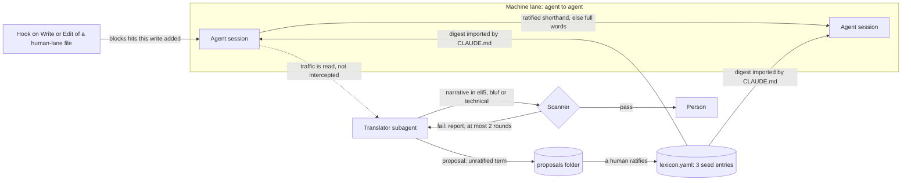

# Tools: agentik-respeak (phase 1 survey)

Scope: the repo `agentik-dev/agentik-respeak` at commit `319f060`. The public git history is three commits, all dated 2026-10-13; the working history inside the repo runs 2026-08-31 to 2026-10-13. Read 2026-10-14. Every claim names its repo, path and commit as `agentik-respeak <path> @ 319f060`, then the source note slug. Source notes written for this survey (24, all `kind: our-use`): `agentik-respeak-readme`, `-design-readme`, `-changelog`, `-nice-to-have`, `-architecture`, `-references`, `-design-include-r1`, `-design-reviews`, `-design-packets`, `-translator-agent`, `-corpus`, `-config-defaults`, `-config-layers`, `-scripts-gate`, `-scripts-verify-edit`, `-scripts-measure`, `-scripts-render`, `-scripts-include`, `-skills`, `-tests`, `-history-sittings`, `-claude-md-dogfood`, `-examples-layered`, `-research-survey` (each prefixed `agentik-respeak`).

Evidence levels, in the brief's words. **Our use** is the repo's own record: a changelog line, a charter, a test, a design file. **Reported** is what respeak's own research notes say about an outside source; those notes are model-written extraction notes from 2026-08-31, and I did not open the outside sources, so phase 2 must re-open before the site cites them. **Documented** I use only where the repo quotes a vendor's documentation. **Measured by this survey** means I counted something in the files at this commit. **Conjecture** is reasoned and untested. I add no measurement of my own beyond counts.

## Bottom line

respeak is a Claude Code plugin that splits communication into two lanes. Agents may write shorthand to each other only if a lexicon ratifies the term. A person reads a narrative that a translator subagent writes in one of three modes, and a style gate holds that human-facing prose to rules. The strongest evidence in the repo is for the human lane's tooling: a local scanner, a hook gate, a CI check and a verifier that proves an editorial pass changed only prose. That evidence comes from one owner's field run on 2026-09-21 and from 40 working charters. The weakest evidence is for the problem and for the machine lane. The repo records no dated incident of a person misreading agent shorthand. Its lexicon holds three seed entries with zero recorded uses, and nothing in it measures token savings, readability grade or translator accuracy.

## 1. The problem

### 1.1 The problem as the repo states it

- Agents that write to each other spend context on every token, so the pressure to compress is structural. They drift into shorthand, and the person supervising becomes the outsider. Two bad responses exist: force prose on agents (pays the attention cost on every message) or let the dialect drift (gives up auditing your own automation) (agentik-respeak README.md:9-26 @ 319f060; agentik-respeak-readme). The architecture document says the same in its Problem section and adds that the human "either fights the optimization ... or loses the loop" (agentik-respeak docs/architecture.md:13-22 @ 319f060; agentik-respeak-architecture). Our use: a design statement by the owner.
- The first user was the owner's own set of Claude Code plugins, run unattended with one session handing its work to the next (README.md:9-26; agentik-respeak-readme). The source names the private product; this survey does not. Our use, one owner.
- A second, smaller problem: model-written prose carries recognisable tells, and a technical reader resents them. The corpus bans 234 phrases to meet it (see 2.4). Six of those entries are labelled owner preference, not research (agentik-respeak plugin/corpus/banned-phrases.yaml @ 319f060; agentik-respeak-corpus). Our use.

### 1.2 The outside evidence the repo leans on (all Reported)

The repo's design rests on research notes written 2026-08-31 (agentik-respeak research/sources/*.md and research/synthesis/design-principles.md @ 319f060; agentik-respeak-research-survey). I list the findings as the notes state them.

- People who repeat a naming task shorten their descriptions fast: the notes give about forty words falling to one or two over six trials in Clark and Wilkes-Gibbs's picture-matching experiments, with the example taken from a Wikipedia summary, and say the pact is partner-specific, so a new partner forces longer forms (research/sources/linguistics-of-expert-shorthand.md §1). Reported, secondhand through Wikipedia.
- Outsiders cannot read signs that a pair evolved. Garrod and colleagues (Cognitive Science, 2007), Experiment 3: those not in the interaction have trouble interpreting the signs; meaning moves from the sign to the users' memory of its use (linguistics note §4). The design reads the human supervisor as that outsider. Reported, from a Europe PMC abstract.
- Agents drift off English when nothing rewards English: the 2017 negotiation-agent work, with a quote from one of its authors that there was "no reward to sticking to English", and a statement that the later experiments rewarded English again (research/sources/token-compression-prior-art.md §6). Reported.
- Word length tracks information content, so high-information content (identifiers, numbers, errors, negations) is where short codes fail. The notes use this to justify the `never_compress` list (linguistics note §3, citing Piantadosi, Tily and Gibson, PNAS 2011). Reported.
- Governed shorthands drift anyway, and the most fluent speakers deviate most: the aviation phraseology case in the notes (linguistics note §5.2, SKYbrary and Wikipedia). Reported.
- The economic case for a machine lane: Anthropic's context-engineering post, as the note extracts it, says context is a finite resource with diminishing returns and that every token is attention-taxed (research/sources/anthropic-effective-context-engineering.md). Reported from a vendor post; phase 2 should open the post.
- Excess vocabulary in LLM-era text: Kobak and colleagues (Science Advances 2025) put "delves" at 28.0 times its expected 2024 frequency in PubMed abstracts and a lower bound of 13.5 percent of 2024 abstracts as LLM-processed (research/sources/deai-language-landscape.md §2.1). Reported. This backs the existence of tells, not the particular 234 phrases.

### 1.3 What the repo measured (Our use)

| # | Measurement | Where | Date | Caveat |
|---|---|---|---|---|
| M1 | One field test, n=1: a technical-mode editorial pass over a 4,000-word internal design document. Error-severity banned phrases 3 to 0; warn 9 to 1 (one documented keep); em-dashes per 1,000 words 19.9 to 3.1; average sentence 32.1 to 24.5 words; headings, links, code and numbers changed: none, with the verifier passing | README.md:55-71 @ 319f060 (agentik-respeak-readme) | 2026-08-31 | The README calls it "sizing evidence, not a benchmark". The source document was removed from the repo (CHANGELOG.md:481). The sentence-length row predates the 0.6.0 splitter, and the CHANGELOG calls such figures stale (CHANGELOG.md:320-322) |
| M2 | A whole-README editorial pass: average sentence length 23 to 15 words, em-dashes out of prose, structure byte-identical by the verifier | CHANGELOG.md 0.5.2 @ 319f060 (agentik-respeak-changelog) | 2026-09-15 | Same stale-splitter caveat |
| M3 | The hand-edited README had grown to 40,089 bytes; the rendered one is 21,453 bytes | CHANGELOG.md 0.6.1 | 2026-09-22 | One file |
| M4 | A ten-agent editorial pass over nine of the owner's sites, about 2,000 edited files, produced the findings in the list below | CHANGELOG.md 0.6.0 (lines 270-415) | 2026-09-21 | The sites are private and not in the repo; the counts cannot be re-run |
| M5 | After the splitter fix, this repo's README went from an 89-word longest sentence to 27 and from 15.1 to 13.0 average, with no prose changed | CHANGELOG.md 0.6.0 | 2026-09-21 | Shows the scanner, not the prose, was off |
| M6 | A README render through the translator took 6 minutes once; another run was killed at the 600 s wall; another exited 1 | history/sittings/2026-10-13-1.md, 2026-10-11-2.md (agentik-respeak-history-sittings) | 2026-10-11 to 2026-10-13 | A model call; run times vary |
| M7 | The include file sizes against its 1,500-byte cap: 1,306 bytes (design example), 1,220 (test fixture), 1,409 (this repo, in memory) | design/include-r1.md §2; sitting 2026-10-11-2 (agentik-respeak-design-include-r1) | 2026-10-11 | Sizes, not outcomes |
| M8 | 272 unittest cases and 10 bash suites; I counted 272 `def test_` lines across eight Python files and 10 `.sh` files | README.md:305; tests/ (agentik-respeak-tests) | 2026-10-13 | Measured by this survey: a count only |
| M9 | Adversarial reviews of the plugin's own scripts: ADV6 12 findings (4 high, 5 medium, 3 low), ADV10 8 findings (2 high, 4 medium, 2 low), ADV11 6 findings (2 high, 3 medium, 1 low) | design/review-adv6.md, -adv10.md, -adv11.md; sittings 2026-09-23-5-adv6 and 2026-09-24-3 (agentik-respeak-design-reviews) | 2026-09-23 to 2026-09-24 | Model reviewers on the owner's repo; not independent |

What the 2026-09-21 field run (M4) found, each fixed in 0.6.0 (CHANGELOG.md:270-415):

- A banned term inside a heading, which the verifier holds byte-identical, locked the file against every later edit. The gate now blocks only on hits a write introduced (`gate.block_on: introduced`).
- One site measured an average sentence of 68.9 words because the splitter read a bullet list as one sentence; the pass reported bullet lists as long sentences on all nine sites. A list item or table row is now its own unit.
- A scan run without `--config` gave 36 reported errors against 13 real ones on one site's baseline.
- Thematic breaks and curly quotes moved to a density tier: 539 of one site's 565 break hits were a catalog card rule, and 296 of another's quote hits sat inside publisher blurbs the pass must not reword. On one real page the density-tier tells ran to 79 hits, mostly dashes.
- Eight corpus entries gained exceptions for literal senses that tripped real pages (a game title printed on 21 pages, a fan-project name, the horticultural sense of one word).
- A hard-wrapped line beginning `#33256` published as a heading while the verifier passed it. The verifier now counts every line MkDocs would render as a heading.
- Bare URLs inflated word counts and joined the lines around them into one long sentence; URLs are now dropped before counting.
- The translator's contract did not forbid several behaviours the run showed; rules 5 to 12 were added to the agent (see 2.6).

### 1.4 Failures of the render and gate path (Our use)

- 2026-09-22 (sitting 2026-09-22-3b): without a render contract, round 1 of the README render summarized the whole document and the verifier failed on everything. The fix passes a keep-the-structure contract (`design/readme/contract.txt`) (agentik-respeak-history-sittings, agentik-respeak-design-readme).
- 2026-10-12 (sitting 2026-10-12-1): the second README render "broke inline code spans in the untouched 'The scanner' paragraph, verify-edit refused", and the README stayed stale. 2026-10-13 (sitting 2026-10-13-1): in act 1 `make readme` "failed twice" ("the translator changed fenced and inline code; verify-edit refused, README untouched"); in act 2 the first render broke an inline code span and the second succeeded after a long source line was rewrapped. The budget line of 2026-10-12-2 allows "one reworded retry on a digit refusal". So at least three charters record the verifier rejecting a model's render, and in the two later ones README.md was left untouched. That is the clearest repo evidence that prose-only verification does work a prompt cannot.
- 2026-10-13: the renderer re-words README prose on every run, so `make readme` followed by `git status` cannot come back clean (sitting 2026-10-13-1 handover). Our use.
- 0.5.0: a follow-up had removed the PostToolUse gate from `hooks.json`, "which made every documented gate knob a no-op for every installer"; a test now pins the manifest's event list (CHANGELOG.md 0.5.0).
- ADV10-3: the renderer ignored `is_error`, so a usage-limit message could be written as the narrative; since fixed, with exit 4 for an account failure (design/review-adv10.md; CHANGELOG.md 0.7.0).
- ADV6, ADV10, ADV11: the CI check could be turned green without fixing anything by an ignored sidecar config, the environment, a nested git repository, or a git failure. The check now reads only committed project config (CHANGELOG.md 0.6.1, 0.7.0; agentik-respeak-scripts-gate).

### 1.5 What the repo does not have

- **No incident of a person misreading agent shorthand.** I searched `history/`, `design/`, `CHANGELOG.md` and `NICE_TO_HAVE.md` for outsider, opaque, alien, decode and supervise; I found nothing that records such a case (agentik-respeak-history-sittings). The problem rests on the literature in 1.2 and on the owner's setup.
- **No machine-lane measurement.** The lexicon has three entries, two ratified (`cfg`, `R1..R7`) and one proposed (`2-lane`), and every entry has `uses: 0`. The file says the counter is "maintained by tooling, not by hand", and no script at this commit writes it (agentik-respeak plugin/corpus/lexicon.yaml @ 319f060; agentik-respeak-corpus). No file records a token count saved by the lexicon. The only token figures in the repo are other projects' numbers in the research notes (LLMLingua up to 20 times, TOON 42.6 percent fewer tokens, a vendor's 33.2 percent), all Reported.
- **No readability grade.** The config declares `readability_metrics: [flesch_kincaid, gunning_fog]` and a reading grade per mode (6, 9, 12), but `respeak-measure.py` computes sentence length and em-dash density and no grade (agentik-respeak-scripts-measure; agentik-respeak-config-defaults). The config marks grade 12 for technical as an "UNVERIFIED number".
- **No reader study and no translator accuracy measure.** The README ranks translator error high ("a confident wrong BLUF is worse than shorthand") and offers three mitigations, `never_compress`, an `UNVERIFIED` fence and the verifier. It reports no rate (README.md:293-302; agentik-respeak-readme).

## 2. The design

### 2.1 Two lanes

A lane is defined by the reader, not the author. The shipped include file says: notes, packets, tool output and messages between agents are the machine lane; what a person reads is the human lane (replies to the user, plus the files the project lists) (agentik-respeak design/include-r1.md §2 @ 319f060; agentik-respeak-design-include-r1).

| | Machine lane | Human lane |
|---|---|---|
| Who writes, who reads | agents to agents | a translator subagent or an editorial pass, to a person |
| Rule | shorthand only for terms the lexicon ratifies; everything else in full; error messages, security findings, user quotes and numbers with units never shortened | one of three modes; a style gate over banned phrases, sentence length and dash density |
| How it reaches the writer | a digest of the lexicon, `lexicon-active.md`, imported into CLAUDE.md with an `@` line; "Nothing intercepts traffic" (README.md:27-54) | the translator agent, the skill, the hook gate, the CI check |
| What enforces it | instruction only: no script checks that traffic stays inside the lexicon | scanner, hook, CI check, verifier (see 2.5, 2.6) |
| Evidence it works | none recorded (1.5) | tooling evidence in 1.3 and 1.4; no reader study |

The lanes meet at one lawful point. The `author` profile at tech_level 5 may show ratified shorthand inline, because a reader who ratifies the lexicon shares its common ground (agentik-respeak plugin/config/respeak.config.yaml @ 319f060; agentik-respeak-config-defaults). Every translation opens with a marker line, a megaphone symbol then `respeak` then the mode, so the reader knows which voice speaks (agentik-respeak docs/architecture.md:95-113 @ 319f060).

### 2.2 The machine lane: lexicon, digest, governance

- Lexicon file: `plugin/corpus/lexicon.yaml`, `version: 0`, fields term, expansion, definition, scope, status (`proposed | ratified | retired`), `ratified_by`, `uses`, `legibility` (0 to 1). Append-mostly: entries are proposed, ratified or retired, never silently edited (agentik-respeak plugin/corpus/lexicon.yaml header @ 319f060; agentik-respeak-corpus).
- Proposals: the translator tallies unratified shorthand it had to decode and writes `.claude/respeak/proposals/<term>.yaml` with `status: proposed`. It never ratifies; a human moves the file into the lexicon and runs `render-lexicon-digest.sh` (agentik-respeak plugin/agents/respeak.md:210-226 @ 319f060; agentik-respeak-translator-agent). Invariant: "the translator proposes, config disposes, the human ratifies" (docs/architecture.md:114-131).
- The one worked example of the legibility floor: the proposed `2-lane` entry carries a comment that it was rewritten from `2L` (legibility 0.4, under the 0.5 floor) to a form closer to plain English (0.6) (lexicon.yaml). Our use, one entry, done by hand.
- Digest: `render-lexicon-digest.sh` writes `.claude/respeak/lexicon-active.md`, ratified terms only; the repo's own CLAUDE.md imports it, and it holds two terms (agentik-respeak-claude-md-dogfood). The architecture records why CLAUDE.md and not a skill: a skill loads only on invocation, but emission-time adoption needs session-start presence; and a plugin cannot ship CLAUDE.md content, so `/respeak:init` offers the import with consent (docs/architecture.md:132-195, question 2).
- Governance in the config (project-only keys): ratification `human`; `legibility_floor` 0.5; `max_entries` 150; `min_token_edit_distance` 2; retire after 180 days unused; re-harmonize every 90 days; fresh-decoder audit every 30 days on a sample of 10; `register_marker: required`; reserved metawords CORRECTION, SAY-AGAIN, UNVERIFIED; readback for irreversible actions, security findings and escalations; eight `never_compress` classes, each with a named failure mode (agentik-respeak-config-defaults). I found no code reading these keys; the README lists the cap, edit-distance check, expiry, auto-ratification gate (5 clean uses) and fresh-decoder audit as "Declared, not yet checked or built" (README.md:320). So the governance is, at this commit, instructions the translator reads plus a human who ratifies.

### 2.3 The human lane: translator, modes, profiles

- The translator is a subagent: `model: sonnet`, tools `Read, Grep, Glob, Write`, in its own context window, so the swarm's context never pays for it. It never modifies swarm files. Procedure: input gate (never carry a banned term from the source into the output), extract the claim structure, lead with the outcome, write to the mode's parameters, apply replacements then the banned-phrase scan, state uncertainty once, keep numbers with units, render homogeneous data as a table at four or more items (agentik-respeak plugin/agents/respeak.md @ 319f060; agentik-respeak-translator-agent).
- The skill wraps it: resolve the configuration, delegate to the agent ("Do not translate inline yourself"), scan the result with `respeak-measure.py --fail-on error`, and if it fails send the report back for a rewrite, at most 2 rounds in all. After 2 failed rounds the skill relays the narrative anyway with the scan report appended under a visible heading (plugin/skills/respeak/SKILL.md; agentik-respeak-skills).

| Mode | Reader | Contract | Numbers in the config |
|---|---|---|---|
| `eli5` | a newcomer | one idea per sentence, no headers or bullets, at most one analogy and the next sentence says the real thing | grade 6, sentences up to 15 words, 150 words, one paragraph, no tables |
| `bluf` | a manager | sentence one is the result, decision or ask, with owner and deadline; forwardable unedited | grade 9, sentences up to 20 words, 200 words, paragraphs up to 6 sentences, zero metaphors |
| `technical` | a peer engineer | conclusion first, then evidence as file:line or a command, then open questions | grade 12 (marked unverified), sentences up to 25 words, 500 words, paragraphs up to 6 sentences and 150 words, zero metaphors |

(agentik-respeak README.md:39, plugin/config/respeak.config.yaml @ 319f060; agentik-respeak-readme, agentik-respeak-config-defaults.) Tone axes: formality 0.4, directness 0.9, confidence 0.8. The warmth scalar was removed in config v1 and replaced by checkable switches (core parts present, specific praise, criticise the work not the person) (plugin/corpus/style/tone-mapping.md; agentik-respeak-corpus).

| Profile | tech_level | Lexicon access | Default mode |
|---|---|---|---|
| `exec` | 1 | `forbidden` | `bluf` |
| `peer-engineer` | 3 | `expand-first-use` | `technical` |
| `author` | 5 | `inline` | `technical` |

A profile (who reads) is orthogonal to a mode (what form) and to a context (`incident | routine | celebration`, the reader's state) (plugin/config/respeak.config.yaml; docs/architecture.md:196-218). The design cites Diataxis, plain-language guidance, ASD-STE100 caps, BLUF and Minto for the contracts (agentik-respeak-research-survey). Several numbers come from those standards (STE 20-word procedures and 25-word descriptions; plain-language 150-word paragraphs), and two are admitted judgement calls (grade 12; the 150-entry cap) (research/synthesis/config-critique.md; agentik-respeak-research-survey).

### 2.4 The corpus: the numbers

Counted in this survey from `plugin/corpus/` at `319f060` (agentik-respeak-corpus); the counts equal the README's.

| File | Shape | Size |
|---|---|---|
| `banned-phrases.yaml` | 22 categories, 234 entries: 96 `error`, 138 `warn`; 11 in a `density` tier; 6 `provenance: owner-preference` | 587 lines |
| `replacements.yaml` | 60 from-to rules, applied before the ban scan | 106 lines |
| `lexicon.yaml` | 3 entries (2 ratified, 1 proposed), every `uses: 0` | 52 lines |
| `style/tone-mapping.md` | tone axes mapped to observable behaviour; tech_level 1 to 5 table | 68 lines |

Largest categories: `ai_cliches` 76 entries, `self_grading` 18, `claude_reflexes` 14, `narrative_slop` 14, `pleasantries` 12, `significance_inflation` 12. Matching is case-insensitive by default; each entry may carry a `fix`, `exceptions` (regexes; a hit is exempt when the surrounding sentence matches), `case_sensitive`, `provenance` and `tier`. Patterns are RE2-safe so the corpus can later compile to Vale. The corpus condenses Wikipedia's "Signs of AI writing" (CC BY-SA 4.0) and cites the antislop-sampler project (Apache-2.0) for ideas only (banned-phrases.yaml header; README.md:367+).

### 2.5 The gate: hook, scanner, CI check

- **Hook.** A PostToolUse hook on `Write|Edit` (timeout 20 s) runs `respeak-gate.sh` on the written Markdown file. It blocks with exit 2 and puts the scan report on stderr, which Claude Code returns to the model as an error to fix. It fails open on any setup problem. It is opt-in: only the project layer can set `gate.enabled: true`, and the plugin default is off. SessionStart (lexicon status) and Stop (narrative nudge) hooks default to off (agentik-respeak plugin/hooks/hooks.json, plugin/scripts/respeak-gate.sh @ 319f060; agentik-respeak-scripts-gate).
- **What a write is judged on.** `gate.block_on: introduced` (default) hands the scanner a baseline: the committed file, else the pre-edit text rebuilt from the Edit's strings, else an empty file. Only hits the write added block; older hits are listed in `additionalContext`. `any` gates the whole file.
- **Bounds.** A file over 2,097,152 bytes blocks as "too large to gate"; the scan has a 15 s deadline (agentik-respeak-scripts-gate).
- **Scanner.** `respeak-measure.py` counts banned-phrase hits by tier, sentence-length statistics, em-dash density and word count, locally, with zero API tokens. It skips code, blockquotes, HTML comments and URLs. Budgets in the config: em-dashes 5 per 1,000 words, warn phrases 5 per 1,000 words, average sentence 20 words, longest sentence 35 words (agentik-respeak-scripts-measure).
- **CI check.** `respeak-check.sh` gates every Markdown file git knows about from committed configuration only (it unsets the session and environment overrides), and with `--verify <ref>` also runs the verifier on each changed file. Exit 0 all clean; 1 a block or a verification failure; 2 setup or a git failure (agentik-respeak-scripts-gate).
- **Overrides.** `/respeak:off [gate]`, `/respeak:on [gate]`, `RESPEAK_HOOKS=off`, `RESPEAK_GATE=off|on` sit above every layer for one session or launch. The CI check ignores them on purpose (agentik-respeak docs/architecture.md:132-195, question 7).

### 2.6 The editorial pass and prose-only verification

**Method (the translator's rules for editing a document in place).** Run the buried-lede test first: does a reader who stops at the first paragraph know the outcome? If it fails and `restructure: advise` (the default), move nothing and append a structure advisory with a drafted lead. Never add, delete or "correct" a factual claim; report it. Rewrap so no line starts with `#` or `>`. Prose-to-list and list-to-prose count as restructure. Template layout is advisory. A UI label gets the minimal compliant edit, not a rename. A generator edit changes string-literal content only. Third-party text is never reworded. A banned term inside a heading needs `restructure: apply` (plugin/agents/respeak.md:141-196; agentik-respeak-translator-agent). Rules 5 to 12 came from the 2026-09-21 field run.

**What the verifier holds.** `respeak-verify-edit.py <before> <after>` exits 0 safe, 1 violation, 2 usage. For Markdown, invariant: headings (text and order, including setext and hash-without-space), block structure counts (blockquote lines, list items, thematic breaks, table rows, definitions), link and image targets, fenced code (byte), inline code spans (multiset), numeric tokens (multiset), front matter (byte, or only the leaves `--prose-keys` names), admonition types. Code files: comments only; Python: `#` comments only (docstrings are code); HTML: text nodes only; YAML: comments only; JSON: whitespace only. `--allow-restructure` downgrades heading and structure changes to warnings; numbers, code and link targets stay hard. `--dirs` verifies two rendered trees (agentik-respeak plugin/scripts/respeak-verify-edit.py:1-70 @ 319f060; agentik-respeak-scripts-verify-edit).

**What it does not hold.** The invariants are structural, not semantic. Review ADV6-4 (2026-09-23) reproduced two edits that pass: an appended paragraph claiming the plugin "deletes nothing and is safe for production use everywhere", and a flipped "never" to "always". The fix proposed (paragraph count per section; a multiset of polarity words) was deferred to "its own packet" and I found no such invariant in the verifier or its tests at this commit (agentik-respeak design/review-adv6.md, design/packets/r7-fixes-r6.md @ 319f060; agentik-respeak-design-reviews). The README says the verifier "proves a style edit meaning-preserving"; by this record that holds for the listed invariants only. For facts, the guard is the translator's prompt rule 5.

**The README render.** `make readme` runs `scripts/readme-render.sh`: copy `design/readme/source.md` to a temp directory, write the status line, render it through `respeak-render.sh` (`claude -p`; tools limited to Read, Grep, Glob; 8 turns by default; 600 s wall; 1 to 5 rounds, default 2; refuses a render inside a render and refuses above load 4 times the core count), gate it, verify it prose-only against the copy, and only then move the render over `README.md` and stamp both files with SHA-256 in `design/readme/rendered.sha256`. `readme-fresh.sh` re-runs the verifier, so a README edited by hand and re-stamped still reads stale. `make check` refuses a stale README. The source has a 24,576-byte ceiling (agentik-respeak scripts/readme-render.sh, scripts/readme-fresh.sh, plugin/scripts/respeak-render.sh @ 319f060; agentik-respeak-scripts-render).

### 2.7 The include file and CLAUDE.md

- `/respeak:include write` renders a static file of at most 1,500 bytes, from the plugin defaults, the repo's git-tracked `.claude/respeak/config.yaml` and a template, with no model call. The repo commits it and imports it with `@.claude/respeak/include.md` from CLAUDE.md or AGENTS.md. A reader without respeak gets the rules. `check` exits 0 current, 1 drift, 2 usage; `write` over the cap exits 2 and writes nothing. The first line stamps the template version and an input hash, so `check` tells stale from hand-edited (agentik-respeak design/include-r1.md, plugin/scripts/respeak-include.py @ 319f060; agentik-respeak-design-include-r1, agentik-respeak-scripts-include).
- It replaced a mod that a study had weighed, because `@` imports and the AGENTS.md loader already feed a static file to the model and "nothing runs per turn" (design/include-r1.md, status paragraph). Caveat: in Claude Code 2.1.296 the AGENTS.md loader reads AGENTS.md only in a project with no CLAUDE.md, so an `@` line there beside a CLAUDE.md does nothing (design/include-r1.md §3). That is a volatile fact of one version, as of October 2026.
- Other agentik repos use the output: the CLAUDE.md files loaded into this survey session import such an include file, one of them under a path in `plugin/` (seen in the loaded project instructions, not opened as a file). Our use.

### 2.8 Layers and costs

Ten layers, nearest to the target wins: plugin defaults; plugin `userConfig`; the user file; the project file; the project's gitignored local file; `scopes:` with path globs; a folder `.respeak.yaml`; the session tool's tone file (optional provider layer, major version 2); the invocation; session overrides (README.md:211). Governance and enforcement keys (`gate.enabled`, `gate.include`, `gate.exclude`, `shorthand.*`) are project-only and dropped with a warning elsewhere, so no folder or user file can turn enforcement on or change ratification (plugin/docs/config-layers.md "Trust boundaries"; agentik-respeak-config-layers). The author states the resolver costs about 30 ms per call and a gate-hook call about 200 ms on one machine of theirs (config-layers.md "Design notes"); I did not measure these.

### 2.9 Would a Mermaid diagram show a mechanism?

Yes, one diagram, for the two lanes. The mechanism a reader cannot guess from the name is that the machine lane is not intercepted (a digest enters every session by an import) and that the only pressure on it is a ratification loop, while the human lane is gated twice (a scan before relay, a hook on file writes). A second diagram, for the README render pipeline, would show the verifier as the step that rejects a model's output; it is useful for the page on prose-only verification but optional. Sketch for the first:

Nodes and edges map to claims above: the digest import (2.2), the translator and proposals (2.2, 2.3), the scan loop of 2 rounds (2.3), the hook (2.5). The dotted edge is the design's own wording, "nothing intercepts traffic".

## 3. Alternatives considered

How the repo records each one. "Rejected" means the repo says so; "deferred" means it keeps the idea and has not built it; where the repo gives no reason I say so.

| Alternative | What the repo says | Where | Level |
|---|---|---|---|
| Force agents to write full prose everywhere | Rejected: pays the attention cost on every message | README.md:9-26 (agentik-respeak-readme) | Our use (reasoning); the attention-cost premise is Reported from Anthropic's context-engineering post |
| Let the dialect drift unmanaged | Rejected: gives up auditing your own automation | README.md:9-26 | Our use (reasoning) |
| Suppress emergent codewords by rewarding English (the 2017 negotiation-agent fix) | Rejected in favour of capture: codewords become lexicon proposals, the translator is the standing reward channel, and the nudge acts at ratification, not per message | research/synthesis/design-principles.md §1 point 2, Principle 2, Risk 3 (agentik-respeak-research-survey) | Conjecture: no capture is measured in the repo |
| Intercept or rewrite machine-lane traffic after the fact | Rejected: conventions are adopted at emission through the digest; "Nothing intercepts traffic". A display-time translation hook was designed and is listed as not built | README.md:27-54, 320; docs/architecture.md, resolved question 1 (agentik-respeak-architecture) | Conjecture |
| Per-message statistical compression (the LLMLingua family) | Not adopted: output is degraded English with no durable convention. Kept as a method (compression ratio against task fidelity) | research/sources/token-compression-prior-art.md §1; research/synthesis/solutions-and-media.md item 11 | Reported: "up to 20x" with little loss on four benchmarks |
| A glyph language that evolves under selection (SynthLang) | Closest lexicon precedent, but it evolves for efficiency not legibility and has no governance; single-author, marketing-grade benchmarks | token-compression note §3; solutions item 3 | Reported; vendor numbers (70 percent cost, about 150 to 25 tokens per step) not independently verified |
| Sub-linguistic exchange (KV-cache reuse, DroidSpeak) | The foil: maximum efficiency, zero auditability | token-compression note §5; landscape-and-media note §1.3 | Reported: up to 4x throughput, 3.1x faster prefill |
| Token-lean data formats (TOON) | Not a vocabulary; kept as a governance template (versioned spec plus conformance tests) | token-compression note §4 | Reported: 42.6 percent fewer tokens at 72.2 percent against 71.4 percent accuracy, the project's own benchmark |
| Standard agent vocabularies (FIPA-ACL, KQML) and Agora | FIPA ossified for want of a light amendment process, so respeak builds a proposal path in; Agora celebrates minimal human involvement, the opposite aim | token-compression note §5; solutions items 2, 5 | Reported |
| Caveman (a vendor token-efficiency product) | Different lane: a style register, no lexicon. One idea taken: savings must be verified before they count, which the design applies to ratification (a gate that is declared, not built) | caveman-so note; design-principles Q4, Principle 8 | Reported; vendor claims (about 65 percent cost cut, 27 graders, 33.2 percent fewer input tokens on a 54-run benchmark) |
| Observability and summary products (LangSmith Insights, PagerDuty Advance, incident.io, Slack AI, Copilot PR summaries) | One lane, after the fact, one register. The researcher scored overlap with respeak between 5 and 30 percent | research/synthesis/solutions-and-media.md; landscape-and-media note §1 | Conjecture: an agent's judgement estimates, labelled so (plus or minus 10 points) |
| Free-form style guides and bare tone scalars | Rejected: "a config field with no observable behavior is deleted"; the warmth scalar was removed because bare scalars are what models read least reliably; tone axes are behaviour tables | README.md:45; plugin/corpus/style/tone-mapping.md; research/synthesis/config-critique.md | Our use (rule); the reliability claim about scalars is Reported from the style-as-code note and untested here |
| Prompt-only enforcement | Not the default: 0.3.0 is titled "Enforcement instead of instruction" (scanner, hook gate, a skill that scans before relaying). The prompt still guards facts, since the verifier is structural | CHANGELOG.md 0.3.0; design/review-adv6.md ADV6-4 (agentik-respeak-changelog, agentik-respeak-design-reviews) | Our use |
| Linters such as Vale | Deferred, not rejected: the corpus is written RE2-safe for a planned `respeak compile` that emits a Vale package; the repo wrote its own scanner. I found no sentence giving the reason for the own scanner beyond that it is local and costs no API tokens | README.md:320; docs/architecture.md, resolved question 3; scanner docstring (agentik-respeak-scripts-measure) | Our use; the Vale facts are Reported |
| Plain-language checkers used blindly (STE checkers) | The notes carry ASD's warning that blind reliance on a checker produces poor writing, and conclude that lint gates but a judge or human owns meaning | research/sources/communication-best-practices.md §2 | Reported |
| Detection-evasion "humanizers" and AI-detector scores | Out of scope: they optimise against classifiers, not readers; detector scores are not ground truth | research/sources/deai-language-landscape.md §5 | Reported |
| A skill, a cron job, or a shipped mod as the carrier | A skill loads only on invocation; hooks beat cron for milestone narratives; a static include file beats a mod | docs/architecture.md, questions 1, 2; design/include-r1.md | Our use (reasoning) |
| Other config designs: `.claude/rules` frontmatter as the carrier, YAML `extends:`, a user-level `.local` file, a managed layer that projects cannot override | Rejected, each with a reason (rules are prose for the model; `extends` would break "nearest wins"; the user file is already personal; nothing needs a managed layer yet) | plugin/docs/config-layers.md, "Design notes" (agentik-respeak-config-layers) | Our use (reasoning) |
| Auto-ratification of shorthand by default | Human ratification is the default; an auto gate (5 clean uses, 0 fidelity failures) is declared, not built | plugin/config/respeak.config.yaml; README.md:320 | Our use |
| Restructure documents in an editorial pass | Default is to advise only and keep headings, so anchors and inbound links survive | respeak.config.yaml `editorial_pass.restructure: advise`; plugin/agents/respeak.md:141-196 | Our use |
| A hand-kept README | Replaced by a rendered, verified, stamped README after the hand-edited one reached 40,089 bytes | CHANGELOG.md 0.6.1 | Our use |

## 4. What is open or unproven

### 4.1 Items the repo itself lists

From `NICE_TO_HAVE.md` (`updated: 2026-10-12`; the file says none of it blocks a merge; agentik-respeak-nice-to-have):

- Unchecked: whether Claude Code hides the include file's HTML-comment stamp line from the model.
- The user-level CLAUDE.md import of the include file stays a by-hand step (N5). The owner's ruling sits in no ledger because the repo keeps none (N8).
- `check` says "hand-edited" where a file is only stale after a script-only change; over the cap `check` exits 2; a backtick in a `gate.include` pattern breaks its code span; a separate git directory under another name is not refused; `CLAUDE_CONFIG_DIR` is not guarded as `~/.claude` is; a hard-linked tracked config reaches the render; with a parent directory at mode 000 the tracked config is skipped silently and `check` exits 0.
- `/respeak:init` copies the plugin's lexicon into every repo; whether it should seed one at all is open.
- A bare `yes` or `on` is a YAML 1.1 boolean that the validator and hook accept for `hooks.session_start` while `--set` refuses it; a comment at `plugin/scripts/respeak-config.py:788` says the opposite. Unchecked: whether init's `git add` allowance also matches a command that stages the whole tree.
- `propose` treats a symlinked `README.md` and a symlinked `docs/*.md` differently, and `propose --root ""` silently means the current directory.

From the README status section, "Declared, not yet checked or built" (README.md:320; agentik-respeak-readme): the 150-term lexicon cap; the edit-distance check between near-neighbour terms (minimum 2); expiry after 180 unused days; the auto-ratification gate (5 clean uses); fresh-decoder audits every 30 days; `respeak compile` (the corpus as a Vale package); a display-only translation hook.

### 4.2 Gaps this survey found

- **Governance keys with no code.** I found no script reading `legibility_floor`, `max_entries`, `min_token_edit_distance`, `retire_after_days_unused`, `review_cadence_days`, `legibility_audit`, `register_marker` or `reserved_metawords` (agentik-respeak-config-defaults). They are instructions to the translator. The `uses` counter on lexicon entries has no writer.
- **The machine lane is unmeasured.** Three seed entries, zero recorded uses, no token count, no measure of whether agents stay inside the lexicon (1.5).
- **The verifier is structural.** ADV6-4, deferred (2.6). The README's "meaning-preserving" is stronger than the invariants. The prompt rule "never add, delete or correct a fact" is the only guard for facts.
- **One n=1 field test, with its source removed.** The 2026-08-31 numbers cannot be re-run from the repo; the sentence-length row predates the 0.6.0 splitter. The 2026-09-21 field run counts are the owner's private sites.
- **Readability is declared, not computed.** No Flesch-Kincaid or Gunning Fog code exists; grade 12 for technical mode is marked unverified in the config.
- **No reader study.** Nothing shows that people understand the three modes better than the agent's raw output.
- **The CI check was last reviewed on 2026-09-24.** ADV11 ruled it "not ready" for another repo's docs until two wrong-green findings were fixed; 0.7.0 records those fixes, and no later review is in the repo (agentik-respeak-scripts-gate).
- **Fluency risk untested.** The design predicts the most capable agents drift most (an aviation finding, Reported). No test or measurement checks it.
- **The translator is a model call.** Its prose varies run to run: the renderer re-words the README each time, and a render may need retries (1.4).
- **One owner's experience.** Every use recorded is the owner's repos and unattended runs; the problem statement describes that setup. Treat it as one user's report.

### 4.3 Inconsistencies in the repo's own documents (do not repeat them on the site)

- Proposals have three locations: `plugin/corpus/proposals/` (architecture diagram), `corpus/proposals/` (the config's `proposal_dir`), `.claude/respeak/proposals/` (the agent, `init` and the README). Code paths use the project folder.
- `docs/references.md` links three Wikipedia pages (conceptual pact, interactive alignment, experimental semiotics) that respeak's linguistics note records as 404 (agentik-respeak-references).
- Respeak's own research notes disagree on book dates: Maxwell 2010 against 2009; Sullivan's Simply Said 2017 against 2016; Minto's Pyramid Principle 1985/1996 against "first pub 1978" (communication note §§5, 9 against landscape note §2). Do not use any of these dates without opening a primary source.
- The README install lines still name the plugin marketplace by the tool's earlier name; the repository itself has since been renamed.
- The architecture document opens with a "supported and unique" verdict. It is the design agent's reading of its own notes, and the percentages in the landscape synthesis are labelled judgement estimates.
- The lexicon file says its `uses` counter is maintained by tooling; no tool does.

### 4.4 Volatile facts to date on the site

These come from respeak's notes (fetched 2026-08-31, one rewritten 2026-09-15) or its design files, and none was opened by this survey: the existence and behaviour of a `MessageDisplay` hook; `Stop` hook input carrying the last assistant message; `claude --bare`; skill and subagent frontmatter limits for plugins; the `AGENTS.md` loader default in Claude Code 2.1.296; the README's Claude Code 2.1.196 prerequisite; the renderer's default model name. Phase 2 should state each "as of October 2026" and re-open the Claude Code documentation before citing it.

## 5. The existing research survey

Respeak's `research/` folder holds 11 source studies and 4 synthesis passes, all written 2026-08-31 by model research agents (one primer rewritten 2026-09-15). The notes call themselves extraction notes, not verbatim. I did not copy them. Each line below gives the respeak path, the outside sources it cites (title, author, date, URL as the note gives them; "not given" where the note gives none), the evidence level, and the finding it supports. Slug for all: `agentik-respeak-research-survey`. Paths are under `research/` at `319f060`.

Level key: **Reported** = secondhand through a model-written note; **Vendor claim** = a product's own numbers; **Agent judgement** = a model's estimate.

### 5.1 `sources/anthropic-effective-context-engineering.md`
- Source: "Effective context engineering for AI agents", Anthropic Engineering, date not given in this note (the landscape note's index lists "Sep 2025"), https://www.anthropic.com/engineering/effective-context-engineering-for-ai-agents. Fetched 2026-08-31.
- Level: Reported (vendor post). Supports: context rot is a gradient, not a cliff; attention budget with n squared pairwise relationships; compaction, note-taking files and sub-agents that return about 1,000 to 2,000 tokens; just-in-time context. Reuse in phase 2: questions 1, 2, 3, 5 and the machine-lane argument.

### 5.2 `sources/anthropic-long-running-harnesses.md`
- Source: "Effective harnesses for long-running agents", Anthropic Engineering, published 2025-11-26, https://www.anthropic.com/engineering/effective-harnesses-for-long-running-agents; reference implementation https://github.com/anthropics/claude-quickstarts/tree/main/autonomous-coding.
- Level: Reported. Supports: sessions start with no memory of the last; a feature list kept as JSON resists agent edits better than Markdown; a progress file plus git history carries state; compaction alone is "not sufficient". Reuse: questions 2, 3, 6.

### 5.3 `sources/anthropic-writing-tools-for-agents.md`
- Source: "Writing effective tools for agents", Anthropic Engineering, date not given, https://www.anthropic.com/engineering/writing-tools-for-agents.
- Level: Reported. Supports: a response-format switch (detailed 206 tokens against concise 72 in the post's Slack example) is the precedent for a `mode` parameter; Claude Code caps tool responses at 25,000 tokens by default (as the post stated). Reuse: question 4 (tool output size), question 9 (modes).

### 5.4 `sources/caveman-so.md`
- Source: caveman.so, a vendor page, date not given, https://caveman.so/.
- Level: Vendor claim. Supports: a token-efficiency product's claims (about 65 percent cost reduction; 27 graders; "$0.00" until verified; one example 72 to 21 tokens) and the idea of verified savings. Reuse: use only as a labelled vendor claim.

### 5.5 `sources/claude-code-integration-surfaces.md`
- Sources: 20 pages of the Claude Code documentation, fetched 2026-08-31, note rewritten 2026-09-15: https://code.claude.com/docs/llms.txt and https://code.claude.com/docs/en/ followed by overview, sub-agents, skills, commands, hooks, hooks-guide, plugins, plugins-reference, plugin-marketplaces, output-styles, settings, settings-reference, statusline, memory, headless, agent-sdk/overview, mcp, features-overview, claude-directory (each with a `.md` suffix).
- Level: Reported (documentation, as of 2026-08-31 to 2026-09-15). Supports: subagent isolation and a cheaper model; skills load on invocation; hooks (Stop input carries the final message; a display hook can rewrite what is shown); plugins cannot ship CLAUDE.md; `@path` imports; statusline; headless `-p` and `--bare`; MCP schemas cost context. Reuse: questions 3, 6, 7 after re-opening the live docs.

### 5.6 `sources/communication-best-practices.md` (2026-08-31)
- plainlanguage.gov Federal Plain Language Guidelines (GSA repo), https://www.plainlanguage.gov/guidelines/ and files under https://raw.githubusercontent.com/GSA/plainlanguage.gov/master/_pages/guidelines/ ; digital.gov guide, https://digital.gov/guides/plain-language/writing ; the Plain Writing Act of 2010 as the note describes it.
- GOV.UK style guide, A to Z, https://www.gov.uk/guidance/style-guide/a-to-z-of-gov-uk-style .
- ASD-STE100 Simplified Technical English, Issue 9, January 2025, https://www.asd-ste100.org/ ; Wikipedia, https://en.wikipedia.org/wiki/Simplified_Technical_English .
- BLUF, US Army Regulation 25-50, via https://en.wikipedia.org/wiki/BLUF_(communication) .
- Barbara Minto, The Pyramid Principle (year given as 1985/1996 here, 1978 in the landscape note), via https://en.wikipedia.org/wiki/Barbara_Minto and https://untools.co/minto-pyramid/ .
- Jay Sullivan, Simply Said (Exec-Comm, Wiley, 2017 here, 2016 in the landscape note), https://www.exec-comm.com/product/simply-said/ .
- Kim Scott, Radical Candor, https://www.radicalcandor.com/blog/what-is-radical-candor/ and /glossary .
- Patterson, Grenny, McMillan, Switzler, Crucial Conversations, https://cruciallearning.com/crucial-conversations-book/ ; Wikipedia, https://en.wikipedia.org/wiki/Crucial_Conversations .
- John C. Maxwell, Everyone Communicates, Few Connect (2010 here, 2009 in the landscape note), via a summary at https://sobrief.com/books/everyone-communicates-few-connect .
- Level: Reported; several are Wikipedia or a book summary standing in for the work. Supports the mode contracts: STE caps (20-word procedures, 25-word descriptions, 6-sentence paragraphs; 53 rules, about 900 approved words), plain-language paragraph caps (150 words, hard cap 250), BLUF with an owner and a deadline, Minto's three layers and MECE groups, the "cannot not can't" rule, STE's warning that checkers are not enough. Reuse: question 9 (plain language, bottom line up front).

### 5.7 `sources/deai-language-landscape.md` (2026-08-31)
- Wikipedia, "Signs of AI writing", by Wikipedia contributors (CC BY-SA 4.0), https://en.wikipedia.org/wiki/Wikipedia:Signs_of_AI_writing .
- Kobak, Gonzalez-Marquez, Horvat and Lause, "Delving into LLM-assisted writing" (Science Advances 11(27), 2025), https://arxiv.org/abs/2406.07016 ; data at https://github.com/berenslab/llm-excess-vocab .
- Juzek and Ward, "Why Does ChatGPT 'Delve' So Much?" (ACL 2025 Findings), arXiv:2412.11385 ; a follow-up, arXiv:2508.01930 .
- Reinhart et al., "Do LLMs write like humans? Variation in grammatical and rhetorical styles" (PNAS 122(8), 2025), doi:10.1073/pnas.2422455122 .
- Russell, Karpinska and Iyyer (ACL 2025), arXiv:2501.15654 ; Yakura et al., arXiv:2409.01754 ; Kousha and Thelwall (ISSI 2025), arXiv:2509.09596 ; Ju, Blix and Williams (ACL 2025 Findings), arXiv:2505.07784 ; the RAID benchmark, arXiv:2405.07940 .
- The antislop-sampler and slop-forensics repositories, https://github.com/sam-paech/antislop-sampler and https://github.com/sam-paech/slop-forensics .
- Press items listed on the Wikipedia page, URLs not given in the note: Sam Kriss, New York Times Magazine, 2025-12-03; Washington Post, 2025-11-13; The Economist, 2026-07-30; Chronicle of Higher Education, 2025-09-16. The note says not all were fetched.
- Level: Reported. Supports: "delves" at 28.0 times expected frequency; at least 13.5 percent of 2024 PubMed abstracts LLM-processed; instruction tuning raises participial clauses and nominalizations; expert readers detect AI text about 90 percent of the time and casual readers near chance; do not gate on detector scores; the corpus categories. Reuse: question 9 only lightly (what makes prose read as machine-made).

### 5.8 `sources/landscape-and-media.md` (2026-08-31)
- Product pages: LangSmith https://www.langchain.com/langsmith ; Langfuse https://langfuse.com/ ; incident.io https://incident.io/ ; AgentOps https://www.agentops.ai/ ; Helicone https://www.helicone.ai/ ; Slack AI https://slack.com/features/ai ; PagerDuty Advance https://www.pagerduty.com/platform/generative-ai/ ; GitHub Copilot PR summaries https://docs.github.com/en/copilot/how-tos/copilot-on-github/copilot-for-github-tasks/create-a-pr-summary ; Axios HQ https://www.axioshq.com/ .
- GibberLink README (Pidkuiko and Starkov, February 2025 demo), https://raw.githubusercontent.com/PennyroyalTea/gibberlink/main/README.md ; LLMLingua README, https://raw.githubusercontent.com/microsoft/LLMLingua/main/README.md .
- Marro, La Malfa, Wooldridge, Torr et al., "A Scalable Communication Protocol for Networks of Large Language Models" (Agora), October 2024, https://arxiv.org/abs/2410.11905 ; DroidSpeak, "KV Cache Sharing for Cross-LLM Communication and Multi-LLM Serving", November 2024 (revised July 2025), https://arxiv.org/abs/2411.02820 .
- Books and style guides (years as this note gives them): Zinsser, On Writing Well; Pinker, The Sense of Style (2014); Klinkenborg (2012); VandeHei, Allen and Schwartz, Smart Brevity (2022); McCulloch, Because Internet; plus Google https://developers.google.com/style , Microsoft https://learn.microsoft.com/en-us/style-guide/welcome/ , Mailchimp https://styleguide.mailchimp.com/ , Anthropic engineering index https://www.anthropic.com/engineering , Simon Willison https://simonwillison.net/about/ .
- Level: vendor pages are Vendor claim; the overlap percentages are Agent judgement. Supports: no one product combines a governed shorthand, a multi-register translator and a legibility loop; PagerDuty Advance and Slack AI are existing "summarise for humans" products with audience-specific updates. Reuse: question 9 (summaries for people: PagerDuty's audience-specific updates, Slack recaps), carefully, as vendor claims.

### 5.9 `sources/linguistics-of-expert-shorthand.md` (2026-08-31)
- Clark and Wilkes-Gibbs (1986), "Referring as a collaborative process"; Brennan and Clark (1996); Pickering and Garrod (2004); Clark and Brennan (1991); Zipf (1945, 1949); all via Wikipedia pages (grounding in communication, lexical entrainment, Zipf's law, brevity law, principle of least effort), URLs under https://en.wikipedia.org/wiki/ .
- Piantadosi, Tily and Gibson (2011), "Word lengths are optimized for efficient communication", PNAS 108(9):3526, doi:10.1073/pnas.1012551108 (abstract via Europe PMC).
- Galantucci (2005), "An experimental study of the emergence of human communication systems", Cognitive Science 29:737-767; Galantucci (2009); Galantucci and Garrod (2011); Noelle and Galantucci (2021); Garrod, Fay, Lee, Oberlander and MacLeod (2007), "Foundations of representation: where might graphical symbol systems come from?", Cognitive Science 31:961-987 (abstracts via https://www.ebi.ac.uk/europepmc/webservices/rest/search ).
- Governed shorthands: Wikipedia pages on tactical brevity codes, Q codes, aviation English, the International Code of Signals, medical prescription abbreviations, stenotype, Gregg shorthand, open outcry, the Joint Commission; the Joint Commission "Do Not Use" list (2004; Internet Archive copy, https://web.archive.org/web/20130310233725/http://www.jointcommission.org/assets/1/18/Do_Not_Use_List.pdf ); SKYbrary, https://skybrary.aero/articles/standard-phraseology .
- Level: Reported (abstracts and Wikipedia summaries, not full papers). Supports: referring expressions shorten over repeated trials and are partner-specific; people outside the interaction cannot read the evolved signs; short codes belong on low-surprisal content; every durable shorthand has one owner, a size cap, a ban list and a revision cycle; compression was banned in medicine after harm. Reuse: question 9 (separating agent shorthand from human prose) and the glossary rationale.

### 5.10 `sources/style-as-code-tooling.md` (2026-08-31)
- Vale (docs https://docs.vale.sh/llms.txt , repo https://raw.githubusercontent.com/errata-ai/vale/v3/README.md ); proselint, write-good, textlint, alex (their READMEs on raw.githubusercontent.com); Hemingway Editor, https://hemingwayapp.com/ (Boondoggle Studio); Mailchimp content style guide, https://styleguide.mailchimp.com/voice-and-tone/ ; Microsoft and Google style guides; Diataxis, https://diataxis.fr/ ; Claude Code output styles, https://code.claude.com/docs/en/output-styles.md ; CrewAI README, https://raw.githubusercontent.com/crewAIInc/crewAI/main/README.md . Grammarly's tone axes are marked not fetched.
- Level: Reported. Supports: Vale as a compile target; Hemingway's default grade 9 ("the average for adults in the United States", per the note) with Accessible, Default and Technical presets; budgets, not bans; voice constant while tone varies; Diataxis varies form by reader need; Claude Code's Concise style keeps error reports and security warnings complete, a precedent for `never_compress`. Reuse: question 9 (Diataxis, readability measures).

### 5.11 `sources/token-compression-prior-art.md` (2026-08-31)
- LLMLingua, arXiv:2310.05736 (EMNLP 2023); LongLLMLingua (ACL 2024); LLMLingua-2, arXiv:2403.12968 (ACL 2024 Findings); SecurityLingua (CoLM 2025); all Microsoft, authors not named in the note.
- Mu, Li and Goodman, "Learning to Compress Prompts with Gist Tokens", arXiv:2304.08467 (NeurIPS 2023); a prompt-compression survey, arXiv:2410.12388 .
- SynthLang, ruvnet, https://raw.githubusercontent.com/ruvnet/SynthLang/main/README.md ; TOON, toon-format, https://raw.githubusercontent.com/toon-format/toon/main/packages/toon/README.md ; GibberLink; DroidSpeak; Google A2A (marked not fetched); FIPA-ACL and KQML via https://en.wikipedia.org/wiki/Agent_Communications_Language .
- Lewis et al., "Deal or No Deal? End-to-End Learning for Negotiation Dialogues" (2017), https://arxiv.org/abs/1706.05125 ; the Snopes fact-check with researcher quotes, https://www.snopes.com/fact-check/facebook-ai-developed-own-language/ ; Mordatch and Abbeel (2017), https://arxiv.org/abs/1703.04908 ; Lazaridou and Baroni (2020 survey), https://arxiv.org/abs/2006.02419 ; Caveman 2, https://raw.githubusercontent.com/JuliusBrussee/caveman/main/README.md .
- Level: Reported; savings figures are the projects' own (Vendor claim) unless a paper reports them. Supports: LLMLingua "up to 20x" and +21.4 percent on a retrieval task with a quarter of the tokens; LLMLingua-2 2x to 5x and 3x to 6x faster; TOON 42.6 percent fewer tokens; Caveman 33.2 percent fewer input tokens on a 54-run benchmark; agents drift off English when nothing rewards English; compression is lossy and illegible without a translator. Reuse: question 4 (cost of context) only as labelled claims.

### 5.12 `synthesis/design-principles.md`
- No outside sources of its own; it cites the notes above by file and line. Contents: verdict "supported" for the two-lane architecture; answers to five open questions (hooks not cron; CLAUDE.md import of a digest; Vale compile path; a three-layer fidelity gate; tech_level 5 as an opt-in feature); 12 principles; 5 risks (lexicon drift, translator hallucination, nudge backfire, ossification, platform rot).
- Level: Agent judgement. Supports: the design's rationale in 2.2 to 2.5. Reuse: the risk list is a ready "what could go wrong" for the tool page, labelled as the owner's own.

### 5.13 `synthesis/solutions-and-media.md`
- Cites the notes; ranks 12 existing solutions by judgement overlap (Caveman 30, Agora 30, SynthLang 25, TOON 20, FIPA-ACL 20, incident.io 20, PagerDuty Advance 20, the 2017 negotiation agents 15, GibberLink 15, antislop 15, LLMLingua 10, LangSmith 10 percent) and a 16-item media shortlist.
- Level: Agent judgement ("my judgment estimates", plus or minus 10). Supports: the "nothing combines these three" claim. Do not quote the percentages as measurements.

### 5.14 `synthesis/config-critique.md`
- Cites the notes; proposes config v1: fields to add, change and remove (the warmth scalar removed), the revised modes, three profiles. Its limits section lists two judgement calls (grade 12; the 150-entry cap interpolated from Gregg stenography's 129 to 181 briefs) and one inconsistency it flagged (the `2L` lexicon entry under the floor, later rewritten).
- Level: Agent judgement. Supports: why each config number exists.

### 5.15 `synthesis/corpus-expansion.md`
- Cites `deai-language-landscape` and `style-as-code-tooling` by section; proposes new banned phrases and replacement pairs, plus re-scoring of seed entries (some upgraded to error, six flagged as owner preference or evidence-light).
- Level: Agent judgement over Reported evidence. Supports: the corpus's provenance and the `owner-preference` label.

### 5.16 `docs/references.md` (outside `research/`)
- A 7-group list of about 40 links, dated 2026-08-31. Three Wikipedia links in it are 404 per the linguistics note (4.3). Supports: the same concepts as the notes above.

### 5.17 What phase 2 can reuse

| Phase 2 question | Reusable here | Caution |
|---|---|---|
| 9, telling people what happened | plain-language rules, GOV.UK, ASD-STE100, BLUF and Minto, Diataxis, Hemingway grade 9, the outsider result in experimental semiotics, aviation and medical shorthand governance, PagerDuty and Slack summaries | Re-open primary sources; the notes lean on Wikipedia; resolve the conflicting book dates (4.3) |
| 1 to 3, length, compaction, memory | the two Anthropic posts and the integration-surfaces note | Re-open the posts and live docs; dates and Claude Code behaviour are volatile |
| 4, budgets and cost | token-compression figures | Vendor claims; label them |
| 5 and 6, many agents and unattended runs | the sub-agent isolation point; the harness post | Re-open |

## 6. Glossary candidates

| Term | One-line meaning the repo gives | Where |
|---|---|---|
| lane | A channel defined by its reader: agent to agent, or agent to person | design/include-r1.md §2 |
| machine lane | Notes, packets, tool output and messages between agents; shorthand only for ratified terms, everything else in full | design/include-r1.md §2; README.md:27-54 |
| human lane | What a person reads: replies to the user and the files the project lists; written in a mode | design/include-r1.md §2; CLAUDE.md |
| translator | The `respeak:respeak` subagent that turns agent output into a narrative and files lexicon proposals; it never edits swarm state | plugin/agents/respeak.md |
| mode | The form of a narrative: `eli5`, `bluf` or `technical`, each with a contract | README.md:39 |
| eli5 / bluf / technical | A newcomer's plain explanation; result-ask-owner-deadline first; conclusion then file:line evidence then open questions | plugin/agents/respeak.md:197-209 |
| profile | A named audience: `exec`, `peer-engineer` or `author`; fills tech level, lexicon access, default mode, reading grade, address | plugin/config/respeak.config.yaml |
| tech_level | An integer 1 to 5 for how much the reader is assumed to know; 5 is the author | plugin/corpus/style/tone-mapping.md |
| lexicon | The canonical file of shorthand the machine lane may use; append-mostly | plugin/corpus/lexicon.yaml |
| ratified / proposed / retired | A lexicon entry's status; only a human moves it to ratified by default | lexicon.yaml header; config `shorthand.ratification` |
| proposal | A file the translator writes for an unratified term it had to decode | plugin/agents/respeak.md:210-226 |
| digest | `lexicon-active.md`, a compact list of ratified terms imported into CLAUDE.md | plugin/scripts/render-lexicon-digest.sh |
| never_compress | Classes of text passed verbatim: error messages, security findings, user quotes, numbers with units, and four more | config `shorthand.never_compress` |
| legibility floor | The minimum guessability score (0.5) for a lexicon entry | config `shorthand.legibility_floor` |
| reserved metawords | CORRECTION, SAY-AGAIN, UNVERIFIED, never compressed or reused | config `shorthand.reserved_metawords` |
| fresh decoder | An agent with no history expanding lexicon samples from the lexicon alone | docs/architecture.md, question 4 |
| marker line | The first line of a translation: a megaphone symbol, `respeak`, the mode | docs/architecture.md:95-113 |
| corpus | The banned phrases, replacements, lexicon and tone map | README.md:45; plugin/corpus/ |
| banned phrase | A phrase with a severity (`error` or `warn`) and an optional density tier | plugin/corpus/banned-phrases.yaml |
| replacement | A preferred substitution applied before the ban scan | plugin/corpus/replacements.yaml |
| scanner | `respeak-measure.py`: a local count of hits, sentence length and dash density | plugin/scripts/respeak-measure.py |
| gate | The style check on human-lane Markdown: a PostToolUse hook plus a CI check | README.md:176-206 |
| fail_on / block_on | The severity that fails; and whether the verdict is about the whole file or only what a write introduced | plugin/config/respeak.config.yaml |
| fail open | A hook that allows the write on any setup error | plugin/docs/config-layers.md |
| editorial pass | Editing an existing document in place, prose only, under a keep-the-structure contract | plugin/agents/respeak.md:141-196 |
| buried-lede test | Does a reader who stops at the first paragraph know the outcome? | plugin/agents/respeak.md:141-196 |
| prose-only edit | An edit that leaves headings, structure counts, links, code and numbers unchanged, proved by the verifier | plugin/scripts/respeak-verify-edit.py |
| include file | A static file of at most 1,500 bytes holding a repo's default writing rules, imported with `@` | design/include-r1.md |
| layer / scope | A configuration source (nearest wins); a path-glob override declared in the project file | plugin/docs/config-layers.md |
| session override | `/respeak:off`, `/respeak:on` or an environment variable that silences or forces hooks for one session | docs/architecture.md, question 7 |
| committed check | The CI form that reads only git-tracked configuration | plugin/scripts/respeak-check.sh |
| stamp | The two SHA-256 lines in `design/readme/rendered.sha256` that mark the README as a verified render | scripts/readme-fresh.sh |

## 7. Private names seen

Kinds only; none is named in the notes or here.

- The private product and set of the owner's plugins that first used the tool, described in the README's "Why it exists" and the changelog.
- Nine of the owner's own sites, and the titles and a brand name on their pages, used as exception examples in the corpus and the changelog.
- Other private repositories and products the owner builds, named in reviews and packets (one called "the device project"), and stand-in names the repo substituted.
- The owner's device, referred to in charters.
- Home-directory paths in earlier row files and an owner's account name, flagged in review ADV6-9.
- The owner's private cross-repo ledger and a private deny-list file the hygiene scan reads.
- A coordinator persona and the owner as a person; the copyright holder in the LICENSE and the plugin manifest's author line.
- Earlier names of the suite's tools: the repo's own earlier name, its marketplace id, its virtualenv, and the session tool's earlier name all appear in charters, the Makefile, the README install lines and the changelog. The commons hygiene scan flags them.
