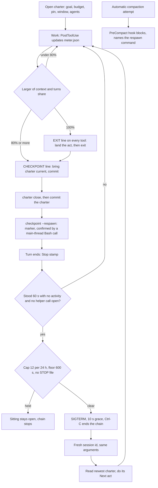

# tools-session: why `agentik-session` exists (phase 1 draft)

Repo read: `agentik-dev/agentik-session` at commit `e7f0723` (2026-10-13), accessed 2026-10-14. The public git history holds three commits (the first public commit and two hygiene merges, all 2026-10-13). The working record is in `history/sittings/` (58 charters, 2026-09-22 to 2026-10-13), `design/`, `bugs/` and `NICE_TO_HAVE.md`.

Citation form: `agentik-session <path>[:lines] @ e7f0723 [source-note slug]`. Source notes are in `research/sources/agentik-session-*.md`. Evidence labels follow the brief: measured, documented, reported, our use, conjecture. Every item below is **our use** (one owner's record) unless it says otherwise. Where the repo quotes Anthropic's documentation, the label is "our use, quoting documentation" and section 5 lists it for phase 2.

## 1. The problem

The tool meets one problem in three parts: a session that runs to its limit has no room left to hand off; an unattended session cannot say it is nearly out; and a human has to be present to start the next one. The repo records the problem as design rationale, a small number of dated incidents, and a few measurements. It does not record a controlled comparison.

**1.1 A session at its limit loses its handoff.** The budget module opens with its reason: "The problem this solves: a session that runs to 100% dies mid-thought. There is no budget left to write down what it was doing, commit the work, or hand off -- so the most valuable turn of the sitting, the handoff, is the one that never happens." (agentik-session claude_session/budget.py:3-6 @ e7f0723 [agentik-session-code-package]). This is design rationale, not an incident. Evidence: our use.

**1.2 The first design failed in one night (2026-09-12).** A coordinator session of a private Go product, running the first design (statusline-sampled budget plus a scheduler that resumed a session when the usage window reset), filed four defects (agentik-session bugs/2026-09-12-overnight-window.md @ e7f0723 [agentik-session-bug-overnight-window]). Evidence: our use, measured from the run's own state files.
- A scheduled `claude -p` run ended while four background builders were still working. The handoff was the run's structured final output, and emitting it completed the process and killed the agents. The run lasted 39 minutes of a 270 minute timeout; its result read `terminal_reason = completed`, `subtype = success`, `is_error = False`, `num_turns = 104`, `stop_reason = tool_use`, `total_cost_usd = 69.34`. Each of four worktree branches held 55 to 138 lines of uncommitted diff (bugs/2026-09-12-overnight-window.md, defect 1).
- After an idle window roll (last sample 95% at 23:29, roll at 00:10, next prompt about 04:27) the budget reported "no usage sample for a current window" while the account panel read 32%. The coordinator treated the budget as unreadable and deferred launching agents by 40 minutes (defect 2).
- `--fork-session` meant the scheduled job never resumed the parent: the parent did not see the work, and the fork queued its own follow-up that would have forked beside a live parent (defect 3).
- A SessionStart notice announced a run from three days earlier as if new (defect 4).
- The owner disabled the tool at about 04:50 the same morning (same file, header). The repo then retired the whole fork-and-resume chain and the statusline sensor (agentik-session design/overhaul-r1.md:18-29 @ e7f0723 [agentik-session-design-overhaul]).

**1.3 Restarts by hand left work idle for hours.** One orchestrator reached its checkpoint at 00:04, 03:30 and 08:12 on 2026-10-05 and was restarted by hand at 01:57, 06:31 and 09:35: gaps of 113, 181 and 83 minutes, 6 h 17 min in all. The record says each restart went cleanly because the successor read its charter: "The handover itself already works without the owner. Only the paste is manual, and the paste is what holds work overnight." (agentik-session design/respawn-r1.md:7-11 @ e7f0723 [agentik-session-design-respawn]). Evidence: our use, from one observer's log of one night.

**1.4 Compaction happened against the owner's rule.** On Claude Code 2.1.296 an `idleCompaction` setting (default on, firing after about 54 idle minutes above 200k tokens) "compacted two sittings overnight", against the owner's rule that a sitting never compacts (agentik-session NICE_TO_HAVE.md:82 @ e7f0723 [agentik-session-nice-to-have]). Evidence: our use, reported by the owner's observer; seen once, no transcript quoted. The repo records no case of a compacted session losing its thread. The rule itself is justified in one sentence: a restart reads its brief fresh, and a compaction needs the owner's hand (agentik-session design/packets/s17-exit-rule-respawns.md:22 @ e7f0723 [agentik-session-design-packets]). **Gap for the site:** no incident of lost context after compaction, and no comparison of restart against compaction, is in this repo.

**1.5 Usage limits and cost.**
- Admission design: a burst of helpers should not fail at the usage limit, and at least 90% of each five-hour window should be used. The record quotes Claude Code documentation for why (helpers count toward the same usage limits; a background helper at the limit "is marked failed"; `claude -p` children are offered no wait) (agentik-session design/admission-r1.md:7-11 @ e7f0723 [agentik-session-design-admission]). Evidence: our use, quoting documentation (unchecked). **Gap:** the repo records no run that overran a window; the nearest incident is 1.2.
- A cache audit by the owner's observer (usage fields only, 649 transcripts, 2026-10-09 to 2026-10-12): 26 idle wakes missed the one-hour prompt-cache lifetime, because a 3600 s wake lands at 3636 to 3648 s, and rewrote about 4.8 million tokens (about 235k to 265k tokens each). Nine more calls after short gaps rewrote 1.17 million tokens, cause unknown. Read shares: 98% for launcher sittings, 97.6% for relay `-p` children, 97% for subagents (agentik-session NICE_TO_HAVE.md:108-111 @ e7f0723 [agentik-session-nice-to-have]). Evidence: our use (a measurement; the audit script is not in the repo). The proposed fix, cap an idle wake at 3300 s, is not built.
- Spend concentration: the design sitting's baseline found one session using 37.6% of a week's burn (11,744 turns, 211k median context), the reason for per-sitting ceilings (agentik-session design/overhaul-r1.md:236-240 @ e7f0723 [agentik-session-design-overhaul]). Evidence: our use; the usage report it comes from is in a private repo and was not opened.

**1.6 A swarm can fork past its means.** The README gives the reason for the budget and the spawn gate: "Without the gate and the budget, a swarm can fork past its means." (agentik-session README.md:9 @ e7f0723 [agentik-session-readme]). Behind it: a design review quotes an earlier unattended run in which 310 concurrent gates spawned 620 node starts and 310 test suites, with no timeout, lock or load check, and a git status took two minutes (agentik-session design/review-r6.md:38-47 @ e7f0723 [agentik-session-design-review-r6]). Evidence: our use, quoting a private defect brief (not opened). Fixes that landed: a nesting depth guard (`CLAUDE_SESSION_DEPTH`, refused above 1 without `--nested`), a per-tree gate lock, a wall-clock limit of 840 s and a load breaker (README.md "Tests" section; Makefile `check`).

**1.7 The tool's own failures are silent.**
- A bad merge could silence the meter in every session, and a builder's half-edited tree could drive the meter that tells the builder when to stop (ADV6-3); a gone interpreter made the meter, CHECKPOINT and the `deny` spawn gate fail open with no signal (ADV11-5) (agentik-session design/review-adv6.md, design/review-adv11.md @ e7f0723 [agentik-session-design-reviews-adv]). Evidence: our use, reproduced by reviewing agents. Answer: install a frozen copy of the package and run it with `python -P` (RUNBOOK.md:11-30 [agentik-session-runbook]).
- The meter read "clear" at 79 of 80 turns for a relay child because the ceiling was 400 turns while the child's `--max-turns` was 80 (review-r6 E5); the first PostToolUse can run before the transcript has the assistant line, so the band showed 0% context where `status --transcript` gave 31.1% (NICE_TO_HAVE.md:122).
- An unattended run cannot answer a permission prompt: the prompt resolves to deny while Claude Code reports `subtype=success` and `is_error=false`; the tool classes such a run PARTIAL by reading `permission_denials` (agentik-session RUNBOOK.md:5-8, 113-139 @ e7f0723 [agentik-session-runbook]). Evidence: our use (measured on one machine, 2026-09-05, one local 27B model, 327 s for five turns).
- A sitting wrote `RESPAWN` into its charter and stopped, but never ran the verb that marks it, so the chain stalled with `claude` idle at 309k of a 400k ceiling until the owner looked; another was held by the 600 s floor and idled 47 minutes (agentik-session NICE_TO_HAVE.md:124-125, 159 @ e7f0723 [agentik-session-nice-to-have]). Evidence: our use, each seen once.

**1.8 What the tests pin.** 36 test files with a fake `claude` binary, so no quota is spent; the README states 1116 tests at v2.0.0-alpha.14 (README.md:171). Pinned behaviours include: silent at 79%, one line at the first crossing, every tenth tool after, every tool at 100%, output under 400 bytes, a subagent never touches the meter (test_hook_meter); automatic compaction blocked, manual passes (test_precompact); a launcher that never compacts or resumes, never restarts after a crash, waits for the turn to end, and fails closed on its cap (test_chain) (agentik-session tests/ @ e7f0723 [agentik-session-tests]). The suite does not exercise a real Claude Code; the respawn design lists its proofs against a real install separately (design/respawn-r1.md:211-225).

## 2. The design

One sentence: a profile names a role and its two ceilings; a meter reads the session's own transcript after every tool call; at 80% the sitting writes its handoff into a charter and commits; at the end of that sitting a launcher starts a fresh session that reads the charter, and automatic compaction is blocked so the restart is the only road on.

**2.1 Profiles.** Ten ship: frontier, balanced, local, local-only, scratch, review, packets, builder, orchestrator, orchestrator-opus (agentik-session claude_session/profiles.yaml:53-end @ e7f0723 [agentik-session-code-profiles]; README.md:63-76 [agentik-session-readme]). A profile is "one named launch posture and everything the sitting is measured against" (design/overhaul-r1.md:39). Defaults: posture signal, `checkpoint_at` 0.8, builders at most 3 concurrent, charter directory `history/sittings`, `respawn: {cap: 12, floor: 600, settle: 60}`. Layers resolve lowest first: shipped profiles, user file, repo file, repo local file, launch profile, session overlay, invocation flag (design/overhaul-r1.md:39). Launch is by flags only; nothing is written to the user's settings (RUNBOOK.md:144). Evidence: our use.

**2.2 Window and ceilings.** The model decides the window (fable and mythos 1M; opus 200k, or 1M as `opus[1m]`; sonnet and haiku 200k); the role decides the ceilings: 180000 context tokens and 400 turns for every role on either window, except the two orchestrator roles, which get 400000 and 400 on a 1M window (README.md:81-82; profiles.yaml:13-19, 21-37). Builders, helpers and relay children stay on 200k by design (design/overhaul-r1.md §2.1 amended 2026-09-28). `--max-turns` caps the turn ceiling (README.md "Profiles"). The repo gives no derivation for 180000 or 400; both trace to rulings in a private ledger (overhaul-r1.md:3, 29, 50). Evidence: our use; model names and windows as of October 2026.

**2.3 The meter.** The PostToolUse hook, on every tool, parses only the transcript bytes appended since its last run and writes `meter.json`. A turn is one deduplicated assistant message. Context is the last assistant message's input plus cache-creation plus cache-read tokens, output excluded. It never reads message content (agentik-session claude_session/meter.py:1-30 @ e7f0723 [agentik-session-code-package]; design/overhaul-r1.md:70-76). The used share is the larger of context share and turn share.

| zone | from | meaning (SKILL.md) |
|---|---|---|
| clear | 0% | work |
| notice | 80% | bring the charter current |
| wind-down | 90% | stop starting what you cannot finish |
| reserve | 92% | finish, commit, hand off |
| exhausted | 100% | exit |

(agentik-session plugin/skills/session/SKILL.md "Budget"; claude_session/budget.py:21-27, 82-95 @ e7f0723 [agentik-session-plugin]). The reserve is 8% by default (floor at 92).

**2.4 What the model is told.** The meter is silent under 80%. At the first crossing it adds one `CHECKPOINT:` line to the tool's output (context and turns as percent and counts, the charter path, "bring the charter current, commit, then exit"), then repeats every tenth tool. At 100% it speaks on every tool and adds the exit rule: "EXIT: land the act in flight at a checkpoint, then exit; respawn, never compact". Output is capped at 400 bytes. UserPromptSubmit adds one budget line per prompt. The meter exits 0 always and never blocks (claude_session/hooks.py:50-53, 350-383; design/overhaul-r1.md:72-76, D13 at :226: a line on every tool would be "the meter eating what it meters"). Evidence: our use. The README says "a budget with a hard stop" (README.md:3); the design says the meter never blocks and the model exits by rule, and that "under the relay the driver kills at the ceiling" (overhaul-r1.md:74). Read "hard stop" as a signal, a rule, and an outside kill in unattended runs. The spawn gate has four postures: off, signal (default, never blocks), ask (from wind-down) and deny (refuses in reserve) (README.md:108; RUNBOOK.md:251-259).

**2.5 Checkpoints.** A checkpoint is "a commit or a durable record" after which the session is handoff-ready (RUNBOOK.md:261). `claude-session checkpoint --commit` stages tracked files only (`git add -u`), never untracked files, because an autonomous caller with `add -A` could sweep up a plaintext `.env` or a tfstate (RUNBOOK.md:261-266). Evidence: our use.

**2.6 The charter.** One file per sitting, `history/sittings/<date>-<n>.md`, under 4,096 bytes, in five parts: a title line, a table (goal, budget, pin, window, agents), Done-ness, Handover, Next act (claude_session/charter.py:1-45 @ e7f0723 [agentik-session-code-package]; SKILL.md "The charter"). `charter close` appends one exit line from the meter: `- exit taken: <text>; about <context> context, <turns> turns`. The Next act is one line; a first line that opens `RESPAWN` marks a respawn close; one that opens `WAITING <n>: <what>; <how to tell>` counts waits and stops the loop at 3 (profiles.yaml:48; README.md:111-115). Two keys set priority (S1 harm, S2 blocks the goal, S3 the build order, S4 the rest) and pacing; the README says "no hook enforces either" (README.md:111-115). Real charters show the pattern: a budget row such as "70 turns, 180k context", "land the act in flight at 80%", and a closing `exit taken` line (agentik-session history/sittings/ @ e7f0723 [agentik-session-history-sittings]).

**2.7 Respawn instead of compaction.**
- The close, in order: `charter close`, commit the charter, then `claude-session checkpoint --respawn --charter <file>` through Bash, then end the turn. The verb reads only the `## Next act` section and refuses (exit 2, nothing written) unless its first non-blank line matches `^RESPAWN(?=[:.\s]|$)`; it also refuses a charter git reads as uncommitted (README.md:105; RUNBOOK.md:295-330; design/respawn-r1.md:48-58).
- Only the main thread confirms the mark: the PostToolUse hook writes `respawn-main.json` with the marker's sha256, because an in-process helper's Bash carries the sitting's own session id (design/respawn-r1.md §3.2 step 5; measured P4 and P5 on 2026-10-10, Claude Code 2.1.296, :220-221).
- The launcher `claude-session run [--chain N] [--cap] [--floor] [--settle] -- <claude args>` starts `claude --session-id <fresh uuid> <args>` with the same arguments each time. The sitting is ready when the Stop stamp is newer than the marker and no activity stamp is newer than the Stop; both must stand for `settle` (60 s). Then SIGTERM (SIGKILL after 30 s), a 10 s grace in which Ctrl-C ends the chain, and a fresh session. Polling is every 2 s (design/respawn-r1.md:60-82; claude_session/chain.py:216-220).
- Guards: cap 12 restarts in any rolling 24 h (derived from one night's sittings of 3 h 34 min, 1 h 33 min and 1 h 41 min, respawn-r1.md:105-112), floor 600 s (a sitting that reaches RESPAWN sooner has done no work and is held, not delayed), a STOP file (global or per chain). The cap fails closed on an unreadable ledger. A crash is never restarted. Flags are an allowlist, not a denylist, because a refuter found four resume or detach flags a denylist missed (respawn-r1.md:44).
- Automatic compaction is blocked by a PreCompact hook: `trigger: "auto"` returns a block whose reason names the respawn command; `manual` passes with no output, because Claude Code 2.1.296 reads a passing hook's stdout as compaction instructions (claude_session/hooks.py:517-531; history/sittings/2026-10-11-3-c1-fix.md [agentik-session-history-sittings]). A shim keeps an older CLI's exit 2 from blocking a typed `/compact` (plugin/hooks/run:1-14 [agentik-session-plugin]).
- Evidence: our use. P1, P2, P4 and P5 were measured; P3 (SIGTERM ends cleanly), P6 (a prompt typed but unsubmitted is lost at the signal) and P7 (a blocked Stop) are listed as owed (respawn-r1.md:211-225).

**2.8 Nine hooks run on every session.** SessionStart (10 s timeout), PreToolUse on every tool, PostToolUse on every tool, PostToolUseFailure, PostToolBatch, UserPromptSubmit, Stop (all 5 s), SessionEnd (15 s), PreCompact (5 s) (plugin/hooks/hooks.json:1-32 [agentik-session-plugin]). The review noted a cost of about 58 ms per tool call and per turn end (median of 20) (NICE_TO_HAVE.md:57). The SessionStart line carries the profile, ceilings, window, checkpoint threshold, and a priority-and-pacing block of at most 320 bytes (hooks.py:287-330).

**2.9 Admission and the band (young).** A Claude Code Mod (an early-access module) draws one band line above the prompt, for example `session: ctx 62% · turns 31% · notice` and a second line `5h 72% → 91% · ceiling 97 ...`, and records the engine's usage reading beside the meter. Admission projects the five-hour window's peak from a least-squares fit over 10-minute intervals (seeds until 20 exist); ceiling 97, margin 3, seven-day ceiling 97; it ships in `observe` mode and refuses nothing (design/admission-r1.md:15-60; RUNBOOK.md:227-233). The mod "draws and cross-checks and never decides" (design/mod-r1.md, one-sentence design); everything that guards stays a classic hook (mod-r1.md §3). Evidence: our use; enforcement is not built.

**2.10 Would a diagram show a mechanism?** Yes, one. The sitting lifecycle is a loop with guarded exits, and a reader cannot see the loop from prose. Draft:

A second diagram (the three hook stamps and the launcher's poll) would add detail the reader does not need on a first read. One diagram is enough.

## 3. Alternatives considered and rejected, as the repo records them

- **Fork-and-resume chain with a scheduler.** Rejected as "structural, not a bug to fix" after the 2026-09-12 night: a handoff cannot be both the last message and a wait on children; chaining sessions is the anti-pattern ("fresh context per sitting is the whole point" is the repo's quotation of its brief) (agentik-session design/overhaul-r1.md:18-29 @ e7f0723 [agentik-session-design-overhaul]). The respawn design shares none of its mechanism (design/respawn-r1.md §2).
- **A sensor that reads the status line or the usage window.** Replaced by a meter that reads the session's own transcript, because "a sensor that depends on rendering measures the UI, not the sitting" (overhaul-r1.md:18-29). The window is kept only for spawn admission, where the engine pushes the reading to a hook (admission-r1.md:13).
- **Compact at most once, then respawn.** The first exit rule said "respawn by default, compact at most once", and two profile descriptions said the first checkpoint compacts in place and the second respawns. Replaced on 2026-09-29: a restart reads its brief fresh and a compaction needs the owner's hand (design/packets/s17-exit-rule-respawns.md:17-22 [agentik-session-design-packets]).
- **Block both compaction triggers, or neither.** The mod record decided (a), block `auto` and let a typed `/compact` pass; (b) block both and (c) block neither were "not taken", and (c) contradicts the rule. It states the cost: a blocked `auto` keeps a sitting whole to its hard limit, "where the recovery compaction is refused and that request fails" (design/mod-r1.md §8 [agentik-session-design-mod]). Idle compaction cannot be told from an ordinary auto-compaction, since both carry `trigger: "auto"`, so a block covers both (NICE_TO_HAVE.md:82).
- **Summaries, longer windows.** No summary tool is compared. The charter is the summary, written by the sitting itself and capped at 4,096 bytes. Longer windows are used but capped: orchestrator profiles run on a 1M window with a 400k ceiling, builders stay on 200k with 180k. The repo gives no reason for 400k. **Gap.**
- **A meter line on every tool.** Rejected as "the meter eating what it meters" (overhaul-r1.md:226, D13).
- **The engine's own context reading as the budget.** Recorded beside the meter, never used by it; `doctor` warns at a drift of 10% or more and never fails. The record notes the engine's figure is an estimate and the meter's a usage sum (design/mod-r1.md §8; RUNBOOK.md:233). No drift data is in the repo.
- **Closing stale helper calls by reading the transcript, or at SubagentStop.** PostToolBatch was chosen, because the launcher must never open a transcript and a blocked call in a live helper would otherwise wait for the helper's end (history/sittings/2026-10-11-1-s-stale-calls.md [agentik-session-history-sittings]).
- **Manual paste of the start line.** The state before the launcher; cost in 1.3.
- **A denylist of launcher flags.** Missed four resume or detach flags; replaced by an allowlist (respawn-r1.md:44).
- **A calendar-day cap.** A calendar day would allow twice the cap across midnight; the cap is a rolling 24 h (respawn-r1.md §9, C3).
- **Local-only profile as a default.** The runbook says not a daily driver: about 65 s per turn measured, and local subagents run one at a time (RUNBOOK.md:67-70, 101-103, 113-139 [agentik-session-runbook]).
- **Admission policy choices.** Three options for the weekly allowance (hold back, always aim for 90%, ignore); the owner chose the five-hour target first and moves to a second account when the week runs out. When a night and a sitting want the same room, neither waits (agentik-session OPEN-QUESTIONS.md:5-12 @ e7f0723 [agentik-session-open-questions]).
- **Hard dependencies on sibling plugins.** Dropped on the owner's word that a user is never forced to install several plugins (mod-r1.md §9).

## 4. What is open or unproven

- **No outside evidence that restart beats compaction.** The repo's case is a rule (entry 17 of a private ledger), one reported overnight compaction, and one measured idle gap. There is no A/B, no quality measure of a restarted sitting against a compacted one. Evidence level for the whole approach: our use; the effect is conjecture until tested.
- **Ceilings are rulings, not measurements.** 180000/400 and 400000/400 on 1M have no derivation in the repo.
- **Blocking automatic compaction has a cost** (mod-r1.md §8) and cannot separate idle from ordinary compaction (NICE_TO_HAVE.md:82). A `doctor` warning for the idle setting is proposed, not built.
- **Respawn proofs owed:** P3 (SIGTERM ends an interactive `claude` cleanly), P6 (a drafted prompt is lost at the signal; no hook sees typing), P7 (another plugin's blocked Stop) (respawn-r1.md:211-225). The launcher cannot see background work that outlives the main turn, or a `/clear` (§3.9).
- **Silent respawn failures seen once:** the verb never run; a floor-held sitting idle 47 minutes; a `/loop` of 60 minutes or more waits on a cloud-or-session question at every restart (NICE_TO_HAVE.md:124-125, 159; RUNBOOK.md:339-343). Guards are proposed.
- **Stuck helper calls** can hold a respawn: 13 sessions held call files older than 30 minutes on 2026-10-11; the fix is unverified with a real `claude` (NICE_TO_HAVE.md:10, 90-93).
- **Admission is observe-only.** Enforcement (S27a) and a brake are not built; six claims about the engine are unverified (admission-r1.md §4: whether a helper's responses move the reading, whether the Fable limit is visible, and others); the rate model needs a day of observation (P3).
- **Prompt-cache fix not built:** the 3300 s idle cap; the cause of nine short-gap misses unknown (NICE_TO_HAVE.md:109-111).
- **Priority and pacing are not enforced by a hook** (README.md:111-115); a wakeup nudge is not built (NICE_TO_HAVE.md:61).
- **Window detection gaps:** no `model` in the SessionStart payload under `-p`, `--resume`, `--continue` or `/clear`; a `/model` switch is invisible until the next SessionStart; a relay child may take the default ceilings (NICE_TO_HAVE.md:24-36).
- **Ledger duplicates:** five of 174 sessions have more than one row (NICE_TO_HAVE.md:16).
- **One owner, young.** Version v2.0.0-alpha.14; the public history starts 2026-10-13; all incidents come from one owner's machines and a few unattended runs. The README does not claim otherwise but also gives no adoption data.
- **OPEN-QUESTIONS.md holds no open question;** four are answered (agentik-session OPEN-QUESTIONS.md @ e7f0723).
- **Tests use a fake `claude`.** Behaviour against real Claude Code is proven only by the dated proofs P1, P2, P4, P5 and the mod's P1 (2026-10-12).

## 5. Claims the repo makes about the field (for phase 2 to confirm or refute)

Each is the repo's claim, with location. Dates are Claude Code versions the repo names.

1. Claude Code strips `[1m]` from the API model id, so a transcript's `message.model` cannot show a 1M window; the SessionStart payload's `model` keeps it (design/overhaul-r1.md §2.1; history/sittings/2026-09-28-1-model-ceilings.md; read from the 2.1.284 binary, not a live run).
2. The SessionStart payload has no `model` under `claude -p`, `--continue`, `--resume` or `/clear` (NICE_TO_HAVE.md:24).
3. Hook stdin carries session_id, transcript_path, cwd and similar, but no token or context field, so a hook must read the transcript (design/research.md §3, docs as of 2.1.278).
4. `idleCompaction`: a setting, default on, fires after about 54 idle minutes above 200k tokens; `autoCompactEnabled` also exists; both pass `trigger: "auto"` to PreCompact (NICE_TO_HAVE.md:82, 2.1.296).
5. A PreCompact hook that exits with output on a pass has its stdout read as compaction instructions (history/sittings/2026-10-11-3-c1-fix.md; hooks.py:553-556, 2.1.296). A blocked `auto` compaction near the hard limit makes the recovery compaction fail and the request fail (mod-r1.md §8).
6. Prompt cache: the main loop uses a one-hour lifetime and subagents five minutes; a one-hour write costs 2x and a read 0.1x; a 3600 s scheduled wake lands at 3636 to 3648 s; the status line carries `prompt_cache.last_miss_cause` (NICE_TO_HAVE.md:108-111).
7. Usage limits, quoting docs as of 2.1.290: helpers count toward the same usage limits as the main conversation; a background helper at the limit is marked failed and its work re-sent; `claude -p` is offered no wait; `autoContinueAtUsageLimit` defaults true, resumes only an open interactive session, re-arms at most twice; Fable has its own limit and, past it, uses usage credits, which `-p` bills "without asking" (design/admission-r1.md §1).
8. Rate-limit reading: `rate_limits.five_hour` and `seven_day` in the status line and in `session.measure`, `percentUsed` 0 to 100, `resets_at` in Unix epoch seconds, present "after the first API response", empty off a subscription (admission-r1.md §4).
9. Hooks: Stop fires at each main-thread turn end and never for an in-process helper (SubagentStop); helper hook payloads carry `agent_id`; PostToolUse for Bash carries `tool_input.command`; the main thread's Stop can fire while a helper still runs (respawn-r1.md:220-221, measured 2026-10-10, 2.1.296). PostToolBatch fires once every call of a batch has resolved, including a blocked one, but an interrupted call (`aborted_tools`) or a PreToolUse `continue:false` returns before it (NICE_TO_HAVE.md:90). Exit 2 on Stop holds every turn end; exit 2 on PostToolBatch stops the agentic loop (plugin/hooks/run comments). A hook's stderr on exit 0 is not shown (design/review-adv11.md, ADV11-5). The default hook timeout is 60 s (review-r6 C3). Classic hooks fail open on a timeout unless `onFailure: "block"` (2.1.295 and later) (mod-r1.md §8).
10. Headless runs: `claude -p` completes when the model emits its final structured output, killing background agents; `stop_reason = tool_use` on a completed run is the sign (bugs/2026-09-12-overnight-window.md, 2.1.269). An unanswered permission prompt resolves to deny while `subtype=success` and `is_error=false` (RUNBOOK.md:5-8).
11. Interactive: `claude --session-id <uuid>` is honoured; a positional `/loop 30m ...` arms and runs at once; a `/loop` of 60 minutes or more first asks a cloud-or-session question via AskUserQuestion (respawn-r1.md:220; NICE_TO_HAVE.md:55, 2.1.296).
12. Transcripts: the `subagents/` directory is undocumented but present (design/research.md §3); `--max-turns` and `--max-budget-usd` are print-mode flags; `--resume` keeps the session id and `--fork-session` mints a new one.
13. Plugin mechanics: `claude plugin update` compares versions only and caches by version; dependencies auto-install and cannot be disabled; there is no way to find another plugin's data directory; `claude plugin validate` warns on an unquoted `${CLAUDE_PLUGIN_ROOT}` (NICE_TO_HAVE.md:35, 45, 92; research.md §3).
14. Mods: early access; a hook that throws or times out is skipped; "unloaded after three crashes" (the repo found no such count in 170 failures, mod-r1.md §6); absent before workspace trust.
15. A local router that sets `ANTHROPIC_BASE_URL` disables Remote Control and voice dictation for the whole session (RUNBOOK.md:52-56).
16. The cost model "cost is turns times context" (overhaul-r1.md §8, quoting the brief) sits beside the cache audit's read price of 0.1x; phase 2 should say how cache reads change the estimate.
17. Model names and windows (Fable 5.1 and Opus 5.5 on 1M, sonnet and haiku 200k) as of October 2026 (README.md:63-82; profiles.yaml:13-19).
18. "Fresh context per sitting is the whole point" and "a restart reads its brief fresh" are premises; the field survey on context length (question 1) and compaction (question 2) should confirm or refute them.

## 6. Glossary candidates

The repo gives no glossary. Lines below use the repo's own wording where it has one.

| term | one-line meaning in the repo | where |
|---|---|---|
| sitting | no formal definition; the unit that gets one charter file and is measured against two ceilings ("Each sitting gets one file") | README.md:9, 129 |
| profile | "one named launch posture and everything the sitting is measured against"; "a session's profile is its role" | design/overhaul-r1.md:39; README.md:80 |
| role | what decides the ceilings (`ceilings` on 200k, `ceilings_1m` on 1M) | README.md:82 |
| window | the model's context size, picked by the models table | README.md:81 |
| ceiling | one of two limits, context tokens and turns | README.md:101 |
| meter | the PostToolUse hook that reads the transcript's new lines and writes `meter.json` | README.md:101 |
| zone | clear, notice (80), wind-down (90), reserve (92), exhausted (100), by the larger share | README.md:102 |
| checkpoint | "a commit or a durable record"; the session is handoff-ready then | RUNBOOK.md:261 |
| CHECKPOINT / EXIT line | hook context at 80% (then every tenth tool) and at 100% | README.md:103-104 |
| charter | "the sitting's live head": one file per sitting, five parts, under 4,096 bytes | SKILL.md "The charter"; charter.py:1-12 |
| Handover, Next act | the charter parts that carry decisions and the one next step | charter.py:1-12 |
| RESPAWN close | the sitting's last act: `checkpoint --respawn --charter <file>` after a charter whose Next act opens `RESPAWN` | README.md:105 |
| respawn | a fresh session started from the charter, never a compaction or resume | design/respawn-r1.md:5; README.md:107 |
| launcher / chain | `claude-session run`; a named series of sittings under one lock | README.md:107; respawn-r1.md §3.1 |
| marker | `respawn.json`, written by the verb, confirmed by the main thread | respawn-r1.md §3.2 |
| settle, floor, cap, grace | 60 s quiet before the signal; minimum sitting age 600 s; 12 restarts per 24 h; 10 s before restart | README.md:106-107 |
| STOP file | a file that holds a chain; counts only if newer than the chain's start | RUNBOOK.md:334-338 |
| posture | off, signal, ask, deny: how loudly the spawn gate speaks | README.md:108 |
| helper, builder | a helper a sitting spawns resolves as `builder`; the relay spawns builders | overhaul-r1.md §2.5 |
| orchestrator | a profile for a continuous loop on a 1M window that respawns at its checkpoint | profiles.yaml (orchestrator) |
| priority S1 to S4, pacing, WAITING n | the Next act takes the highest ready level; a wake rule; a stop after n unchanged waits | README.md:111-115 |
| stamp | a small file a hook writes so the launcher knows the main thread's state | respawn-r1.md §3.3 |
| admission, band, observe | projecting the five-hour window before a spawn; the status line drawn above the prompt; record without refusing | admission-r1.md; mod-r1.md |
| mod | a Claude Code early-access module that draws and records but never decides | mod-r1.md:9 |
| ledger | `ledger.jsonl`, one row per ended session, plus restart and stop lines for chains | README.md "Budget" |
| idle compaction | Claude Code's automatic compaction after an idle spell | NICE_TO_HAVE.md:82 |
| observer | an agent that watches the work and files notes; used without definition | NICE_TO_HAVE.md |

## 7. Private names seen

Kinds only, none repeated here:
- private repository names and the placeholder-style names the repo uses for a portfolio ledger, a machine-configuration repo and a Go infrastructure product;
- that product's module path, its network-attached-storage device, LAN addresses and domains (counted in `design/research.md`);
- home-directory paths and a state directory on a developer's laptop;
- the developer machines themselves ("this machine", a laptop);
- real session identifiers (hexadecimal) and a chain named after a private project;
- ledger and ruling numbers that point into private ledgers (the budget rulings and portfolio entries);
- a private usage-report script and a private defect brief;
- a private remote and its commit;
- one published third-party author, credited in the README for two starting ideas (public, not private).
